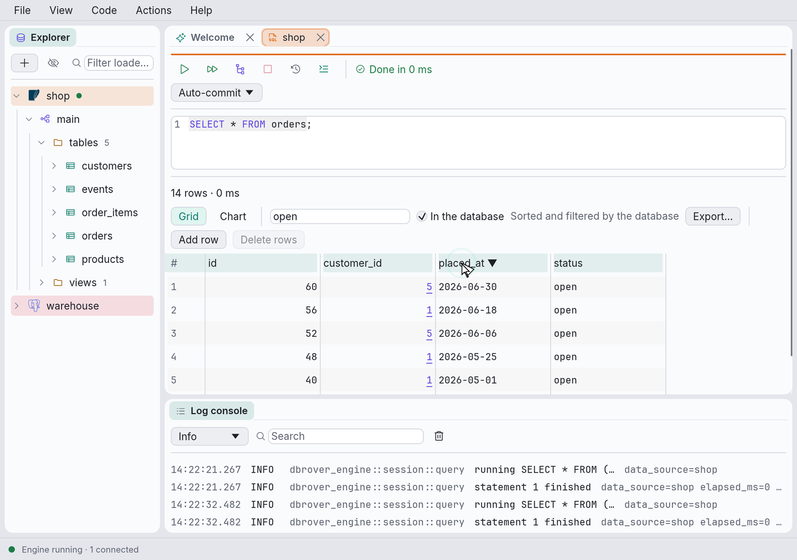

# DbRover

**Eleven databases, one native app.**

DbRover is a desktop database tool written in Rust. It connects to PostgreSQL, SQLite, MySQL,
MariaDB, SQL Server, DuckDB, ClickHouse, Redis (with Valkey and Dragonfly), MongoDB, Elasticsearch
and OpenSearch today, and
support for Oracle is planned. It is a
learning project first and a personal daily driver second: the goal is a tool small enough to
understand end to end and easy to bend to my own workflow.

DbRover was called dbdesk until version 0.12; the manual says what happens to your data when you
update ([Coming from dbdesk](https://dbrover.org/manual/install.html#coming-from-dbdesk)).

<picture>
  <source srcset="site/media/hero-dark-poster.png" media="(prefers-color-scheme: dark)">
  
</picture>

Status: released for macOS, Linux and Windows, with an in-app updater; see
[Releases](https://github.com/navasvarela/dbrover/releases). Query consoles have highlighting,
completion from the catalog, formatting and problems marked as you type; they run the
statement at the cursor or a whole script, explain it, cancel it, and open and save `.sql`
files with `:name` parameters. The grid edits, adds and deletes rows, follows foreign keys,
sorts and filters in the database, exports every row and imports CSV. Dialogs create and change
tables, indexes, views, schemas and PostgreSQL roles, showing their SQL first. Data sources
connect through SSH and TLS, have a safety level each, and group into projects, which an AI
assistant can use through DbRover's MCP server with the permissions you give it. Every
statement goes to a searchable history. Shortcuts are in `keymap.toml`, and the interface
comes in light and dark themes, with the macOS menu bar, font and accent colour on a Mac.

Website: **<https://dbrover.org>**, with the
[user manual](https://dbrover.org/manual/), which explains how to install and
use DbRover. Its sources are in `book/`; `mdbook serve book` shows it locally.

## Problems and questions

Something wrong? In DbRover, **Help › Report a problem…** opens a new issue with the version
and system filled in, or [open one here](https://github.com/navasvarela/dbrover/issues/new/choose).
Questions and ideas go to [Discussions](https://github.com/navasvarela/dbrover/discussions).
The manual's [Troubleshooting](https://dbrover.org/manual/troubleshooting.html) chapter covers
the common problems and where the logs are.

## Building and running

The everyday commands are recipes in the `justfile`, for [just](https://github.com/casey/just)
(`brew install just` or `cargo install just`); `just` lists them.

```bash
just run
```

Before pushing, run the checks CI runs. `just format` fixes what `just lint` reports about
formatting.

```bash
just lint
```

```bash
just test
```

Each recipe is one or two `cargo` commands, which also work without `just`. The `justfile`
shows them.

The tests of server engines need a server and are skipped without one. To run them, start the
bundled containers (PostgreSQL, again with TLS required, MySQL, MariaDB, SQL Server, ClickHouse,
Redis, Valkey, MongoDB, Elasticsearch, OpenSearch, and an SSH server for the tunnel tests) and
load their URLs from `test-servers.env`:

```bash
docker compose up -d --wait
```

```bash
set -a; . ./test-servers.env; set +a; just test
```

Files live in `~/Library/Application Support/dbrover` on macOS: data sources in
`data_sources.toml`, consoles in `consoles/`, the query history in `history.sqlite`, window and
layout state in `app.ron`, your shortcuts in `keymap.toml`, daily log files in `logs/`.
Passwords are in the macOS Keychain under the service `dbrover`.

## Core features (v1)

- **Connection explorer**: a tree of data sources → databases → schemas → objects, loaded lazily.
- **SQL runner**: a query console per data source with syntax highlighting, run statement /
  selection / script, a streaming result grid, and cancellation.
- **Log console**: one place for connection lifecycle events, query timings, server notices and errors.

Engines: **PostgreSQL**, **SQLite**, **MySQL and MariaDB**, **SQL Server**, **DuckDB**,
**ClickHouse**, **Redis, Valkey and Dragonfly**, **MongoDB** and **Elasticsearch and OpenSearch**,
with Oracle and others planned.
UI: **egui** (via `eframe`) with **egui_dock** for dockable panels.

## Documents

| Document | What it covers |
| --- | --- |
| [User manual](book/src/SUMMARY.md) | Installing and using DbRover, for people who have never seen it |
| [Vision](docs/vision.md) | Goals, non-goals, terminology, what "personalised" means |
| [Architecture](docs/architecture.md) | Crates, threading model, data flow, core types |
| [Connection explorer](docs/features/connection-explorer.md) | Data sources, catalog tree, introspection |
| [SQL runner](docs/features/sql-runner.md) | Editor, execution, result grid, cancellation |
| [Log console](docs/features/log-console.md) | Logging pipeline and what gets logged |
| [Keymap](docs/features/keymap.md) | `keymap.toml`: action ids and rebinding keys |
| [Persistence](docs/persistence.md) | Config files, secrets, history, layout state |
| [Testing](docs/testing.md) | Driver conformance suite, UI testing strategy, screenshots, the manual's build |
| [Brand](docs/brand.md) | The logo, its files, and the colour palette |
| [Look and feel](docs/features/look-and-feel.md) | Themes, panels, fonts, icons, data source colours |
| [Roadmap](docs/roadmap.md) | Milestones M0–M5, and the release (R1–R3), database (DB0–DB5), object helpers (E0–E4), MCP (P0, MCP1–MCP3), hackability (H1–H3), well-rounded (W1–W6) and design and documentation (D1–D6) tracks, with exit criteria |
| [Releasing](docs/releasing.md) | Plan for downloadable builds: packaging, signing, the release workflow (proposed) |
| [More databases](docs/databases.md) | Which engines come next (MySQL/MariaDB, SQL Server, DuckDB, ClickHouse, Oracle later) and what each needs (proposed) |
| [Adding a database](docs/adding-a-database.md) | How to contribute support for a new database engine, step by step |
| [Creating and changing database objects](docs/entity-helpers.md) | Dialogs for tables, views and users that show the SQL before running it (proposed) |
| [MCP server](docs/mcp-server.md) | Projects of data sources, and an MCP server with permissions per project and global defaults (proposed) |
| [Hackability](docs/hackability.md) | Custom actions, snippets and themes in files, command actions, then WebAssembly plugins (proposed) |
| [A well-rounded app](docs/well-rounded.md) | Portable configuration, safety levels, SSH and reconnection, history as an audit trail, grid and file features (proposed) |
| [Contributing](CONTRIBUTING.md) | How commits, branches and pull requests are named |
| [ADRs](docs/adr/README.md) | Architecture decision records |

## Licence

DbRover is licensed under either of

- the Apache License, Version 2.0 ([LICENSE-APACHE](LICENSE-APACHE)), or
- the MIT licence ([LICENSE-MIT](LICENSE-MIT)),

at your option.

The bundled fonts keep their own licences: Inter
([`assets/fonts/inter/LICENSE.txt`](assets/fonts/inter/LICENSE.txt)) and JetBrains Mono
([`assets/fonts/jetbrains-mono/OFL.txt`](assets/fonts/jetbrains-mono/OFL.txt)), both under the
SIL Open Font License 1.1.

Unless you explicitly state otherwise, any contribution you intentionally submit for inclusion
in DbRover, as defined in the Apache-2.0 licence, is dual licensed as above, without any
additional terms or conditions.
