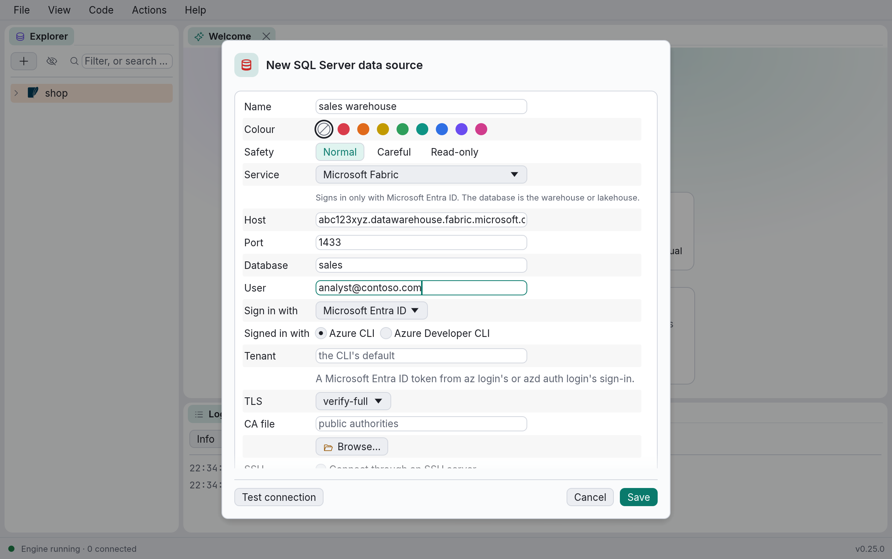

# Managed databases in the cloud

Amazon RDS, Cloud SQL, Azure SQL, Neon and the other managed services run engines DbRover
already speaks, so a data source for one is a PostgreSQL, MySQL, SQL Server or ClickHouse data
source with the service's settings. DbRover fills those in for you and knows where a service's
catalog differs from its engine's.

## Adding one

Under **New data source** (the explorer's **+**, or the Welcome tab), each cloud has a menu of
its services: **Amazon Web Services**, **Google Cloud**, **Microsoft Azure**, and **Other cloud
services** for Neon, Supabase and ClickHouse Cloud. The engines only one cloud runs come first in
its menu: [DynamoDB](dynamodb.md) and [Amazon Athena](athena-trino.md) under Amazon Web Services,
[BigQuery](bigquery.md) under Google Cloud. Choose the service. The dialog opens for the
service's engine with its port, TLS mode and sign-in set, and the **Host** field's hint shows a
host name of the service's form. Fill in the host, database and user from the service's console,
then **Test connection**.

A data source on a service shows a **Service** row, with a line under it saying what DbRover
can't fill in for you, such as a certificate file to download. Choosing another service there
sets that service's settings; **Self-hosted or other** leaves them as they are. A data source
whose host is a service's (`*.rds.amazonaws.com`, `*.database.windows.net`, …) shows its
service whichever way it was added.

Nothing about the service is saved: `data_sources.toml` keeps the engine's settings, as for
any other data source. What DbRover does differently on a service, such as reading Redshift's
or Fabric's catalog, it decides from what the server says about itself when it connects, so a
service reached through an [SSH tunnel](data-sources.md#ssh-tunnels) or a host name of your own
works the same.

## The services

| Service | Engine | Port | TLS | Sign in with | Page |
| --- | --- | --- | --- | --- | --- |
| Amazon RDS or Aurora PostgreSQL | PostgreSQL | 5432 | `require` | Password or AWS IAM | [Amazon Web Services](aws.md) |
| Amazon RDS or Aurora MySQL | MySQL | 3306 | `require` | Password or AWS IAM | [Amazon Web Services](aws.md) |
| Amazon Redshift | PostgreSQL | 5439 | `verify-full` | Password | [Amazon Web Services](aws.md#amazon-redshift) |
| Cloud SQL for PostgreSQL, MySQL | PostgreSQL, MySQL | 5432, 3306 | `require` | Password or Google Cloud | [Google Cloud](google-cloud.md) |
| Cloud SQL for SQL Server | SQL Server | 1433 | `require` | Password | [Google Cloud](google-cloud.md) |
| Azure Database for PostgreSQL, MySQL | PostgreSQL, MySQL | 5432, 3306 | `verify-full` | Password or Entra ID | [Microsoft Azure](azure.md) |
| Azure SQL Database | SQL Server | 1433 | `verify-full` | Password or Entra ID | [Microsoft Azure](azure.md#azure-sql-database) |
| Azure Synapse, dedicated and serverless | SQL Server | 1433 | `verify-full` | Password or Entra ID | [Microsoft Azure](azure.md#synapse-and-fabric) |
| Microsoft Fabric | SQL Server | 1433 | `verify-full` | Entra ID only | [Microsoft Azure](azure.md#synapse-and-fabric) |
| Neon | PostgreSQL | 5432 | `verify-full` | Password | [Neon](neon.md) |
| Supabase | PostgreSQL | 5432 | `require` | Password | [Supabase](supabase.md) |
| ClickHouse Cloud | ClickHouse | 8443 | `verify-full` | Password | [ClickHouse Cloud](clickhouse-cloud.md) |

Signing in with a cloud account is described in
[Cloud sign-in and costs](cloud.md#signing-in-with-a-cloud-account).

`verify-full` checks that the server's certificate is trusted and names its host. Where a
service's certificates come from its own authority rather than a public one, the preset is
`require`, which encrypts without checking; to check, download the service's certificate file,
set **TLS** to `verify-full`, and choose the file as the **CA file**. Each provider's page says
where to find it.

## Behind a pooler

Neon's and Supabase's poolers, like PgBouncer in transaction mode, give a connection a server
of their own only for each transaction. DbRover's own queries (the explorer, describing tables,
checking a console's statements) work behind one. What you set on a session yourself doesn't
last past the transaction: a `SET`, a temporary table or a `LISTEN` may be gone at the next
statement. Use the service's direct or session port for that work, as its page says.

## Not tried against the services yet

DbRover's support for these services was built and tested without cloud accounts, against
local stand-ins: PgBouncer for the poolers, views imitating Redshift's catalog, and SQL Server
playing Synapse and Fabric. Each provider's page lists what is still to be tried against the
service itself. If something there doesn't work, the
[troubleshooting](troubleshooting.md) chapter says how to report it.
