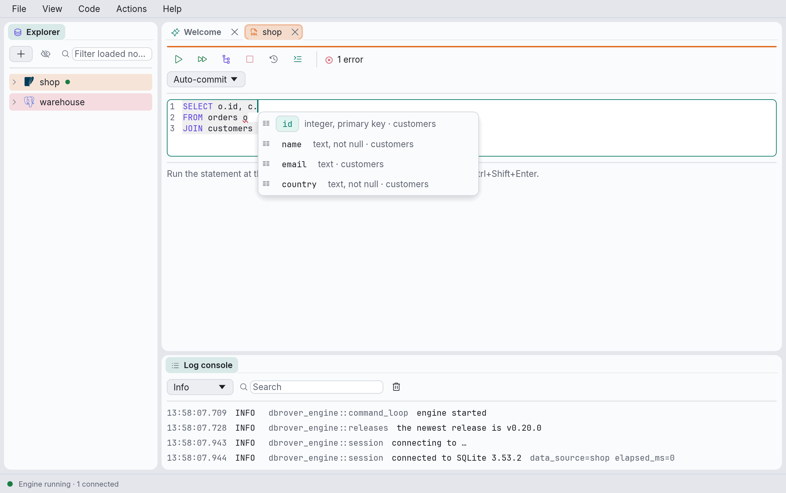
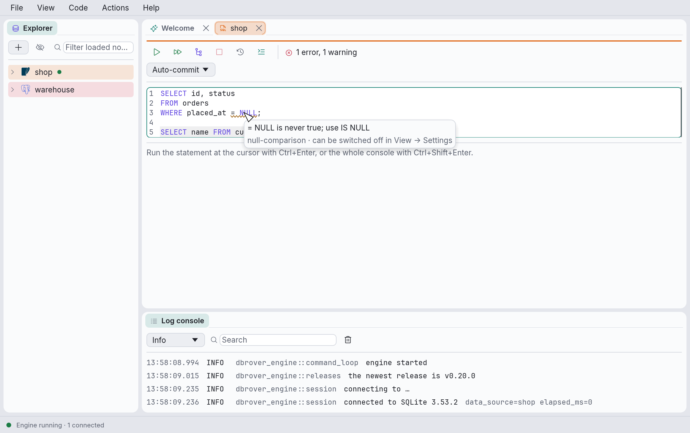
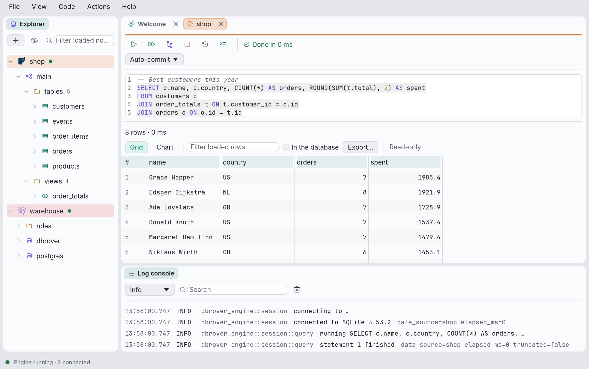
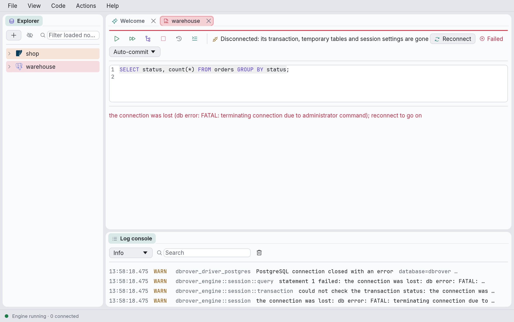
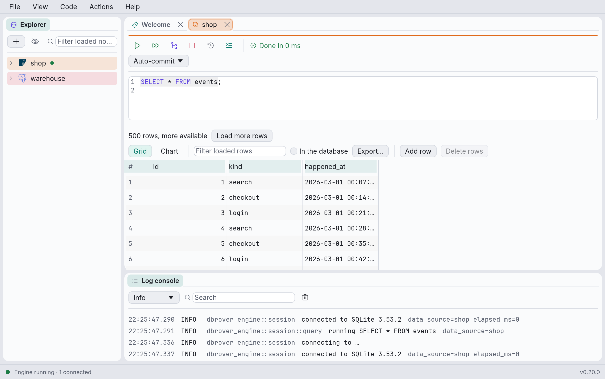
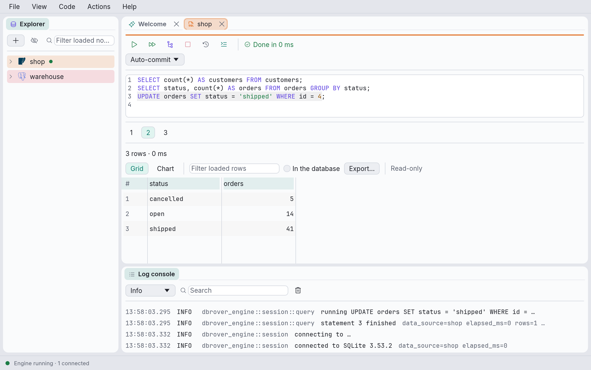
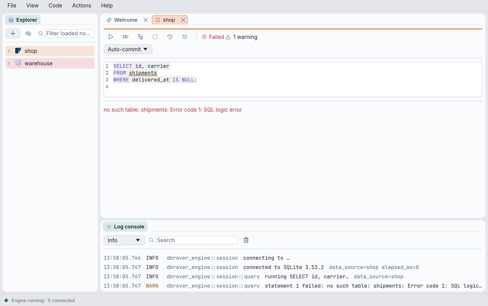
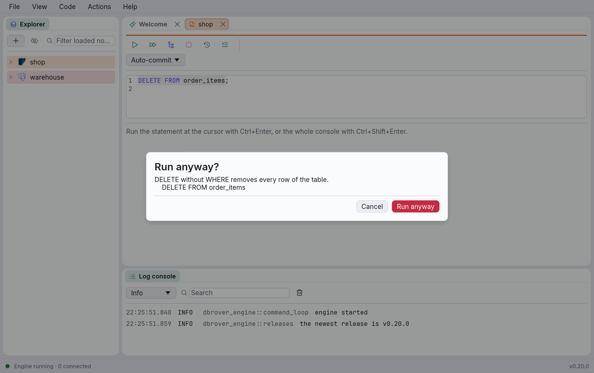
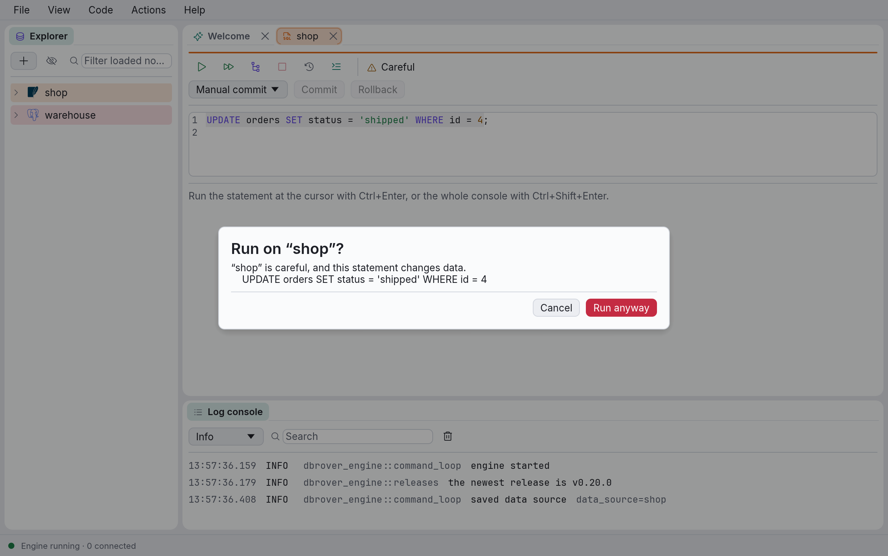
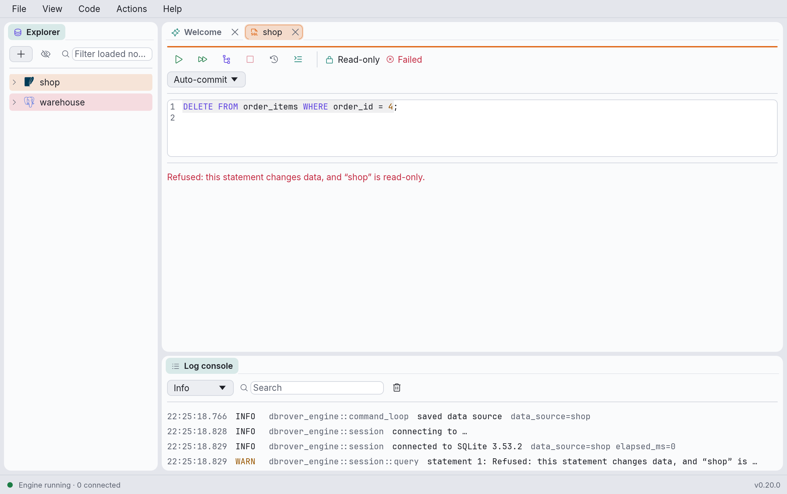

# Query consoles

A query console is a SQL editor tied to one data source, with the results of its latest run
underneath.

## Opening a console

- Right-click a data source in the explorer and choose **New query console**, or use the
  **New query console** card on the Welcome tab.
- Right-click a table, view or materialized view and choose **Open data**: this opens a console
  with `SELECT * FROM` that object and runs it straight away.
- Right-click a data source and choose **Open saved console** to reopen one you closed (see
  below).

Consoles open as tabs next to the Welcome tab, named after their data source. A second console
on the same data source is named `shop (2)`, and so on. If the data source has a colour, the tab
and a band along the top of the console carry it.

Each console has **its own connection**, separate from the explorer's and from other consoles',
so a long query in one tab never blocks another. It connects the first time you run something
("Connecting…" in the toolbar), and closing the console's tab closes the connection.

## Consoles are saved

Every console is a file, `consoles/<data source id>/console.sql` (then `console_2.sql`, and so
on; see [Where DbRover keeps its files](files.md)). DbRover writes your text a second after you
stop typing, and when you quit. Open consoles reopen with their text the next time you start
DbRover.

Closing a console keeps its file if you typed anything in it, and deletes it otherwise (an empty
console, or one opened by **Open data** and left as it was). Kept consoles are listed under
**Open saved console** in their data source's context menu. If a console can't be saved, its
toolbar says **Not saved**, with the reason on hover.

A console can show a `.sql` file of your own instead, saved only when you ask; see
[Files, parameters and find](files-parameters.md).

## The editor

The editor highlights SQL keywords, strings, numbers, comments and quoted names, numbers the
lines, and gives the statement that **Run** would run a faint background.

**Completion.** Typing a name, or a `.`, opens a list of suggestions at the cursor; ⌃Space opens
it anywhere. Use ↑ and ↓ to pick, Enter or Tab to accept, Esc to close.



It suggests what fits where the cursor is:

- after `alias.` or `table.`, that table's columns; after `schema.`, that schema's tables;
- after `FROM`, `JOIN`, `UPDATE` or `INTO`, tables and views;
- after `SELECT`, `WHERE`, `ON`, `GROUP BY`, `ORDER BY` or `SET`, the columns of the tables the
  statement uses, their aliases, and functions;
- inside `INSERT INTO orders (…)`, the columns of `orders`.

The statement's own names count too: aliases, `WITH` queries (CTEs) and subqueries in `FROM`,
with the columns they return. Functions come with their parentheses, the cursor between them.
Each suggestion shows an icon for what it is and, for a column, its type.

You don't have to type the start of a name: `cid` finds `customer_id`, matching the first
letters of its words. Names that start with what you typed come first, and the ones you picked
lately come before the rest.

Names come from what the explorer has loaded for the data source. When a suggestion needs a
part that isn't loaded yet, DbRover loads it in the background (the list says "Loading the
catalog…"), which connects the explorer if it wasn't.

**Formatting.** ⌥⌘L (or **Format** in the toolbar, or **Code → Format**) lays out the selected
text, or the statement at the cursor; ⇧⌥⌘L (**Code → Format all**) formats every statement in
the console:

```sql
SELECT
    id,
    name
FROM users u
JOIN orders o ON o.user_id = u.id
WHERE u.active
    AND o.total > 10
ORDER BY name
```

Each clause starts a line, lists of several items put one per line, and every `AND` or `OR` of
a `WHERE` starts a line. Subqueries are indented inside their parentheses. Statements that
aren't queries, such as `CREATE FUNCTION`, keep their line breaks; a `CREATE TABLE` gets one
column per line.

Formatting only changes spaces, line breaks and the case of keywords. Strings, comments,
quoted names and function bodies between `$$` are never touched, and DbRover checks the result
before using it: if it would read differently to the database, the text stays as it was and the
toolbar says **Not formatted**. The cursor stays where it was in the SQL, and ⌘Z undoes the
whole format at once.



**Problems while typing.** A moment after you stop typing, DbRover underlines mistakes: a red
wave for errors (SQL the database can't read), an amber one for warnings (SQL that runs but
probably doesn't do what you meant). Hover over one to read it. The toolbar counts them; click
the count, or press F8 (⇧F8 for the previous one), to move the cursor to the next.

Warnings point out:

- `= NULL` or `<> NULL`, which are never true: write `IS NULL` or `IS NOT NULL`;
- `UPDATE` or `DELETE` without `WHERE`, which change every row;
- `INSERT … SELECT *`, which depends on the column order of the source;
- a table, or `alias.column`, the explorer has loaded and doesn't have. These only appear for
  parts of the catalog the explorer has already loaded, so expand the data source to get
  them.

Only queries and data changes (`SELECT`, `INSERT`, `UPDATE`, `DELETE`, `WITH`, `VALUES`) are
checked for syntax: DbRover would rather miss an error in a `CREATE FUNCTION` than flag one that
isn't there. Once a console has run something, its own connection also asks the database
whether it would accept each statement, without running it, so the database's own messages
show up too ("The database says: …"). This never happens while results are still loading or a
transaction is open.

**View → Settings… › Editor** switches each kind of warning off, and asking the database too.

**View → Settings… › Editor** chooses how keywords are written (UPPER, lower, or as you typed them) and
how many spaces each level is indented. They're saved in `settings.toml` (see
[Where DbRover keeps its files](files.md)).

## Running SQL



The toolbar's buttons, and their shortcuts while the editor has focus:

| Button | Shortcut | What it does |
| --- | --- | --- |
| **Run** (▷) | ⌘↵ | Runs the selected text if there is a selection, otherwise the statement at the cursor. |
| **Run all** (▷▷) | ⇧⌘↵ | Runs every statement in the console, in order, stopping at the first one that fails. |
| **Explain** | ⌥⌘E | Shows how the database would run the statement at the cursor: `EXPLAIN` on PostgreSQL and MariaDB, `EXPLAIN QUERY PLAN` on SQLite, `EXPLAIN FORMAT=TREE` on MySQL 8 once the console has connected, on SQL Server the estimated plan as XML (`SET SHOWPLAN_XML`), which **View value** shows indented, `EXPLAIN` on DuckDB, whose plan is drawn as a tree in text, and `EXPLAIN` on ClickHouse, one step of the plan per row. |
| **Cancel** (□) | ⌘. | Stops the running statement, or discards rows not yet loaded. |
| **History** | — | Opens the data source's query history. |
| **Format** | ⌥⌘L | Formats the selected text, or the statement at the cursor (see [The editor](#the-editor)). |

On Linux and Windows, use Ctrl instead of ⌘. Hover over a button to see its current shortcut;
all of them can be changed (see [Keyboard shortcuts](shortcuts.md)).

**Which statement is "at the cursor"?** DbRover splits the text into statements at semicolons,
the way the database would: semicolons inside strings, quoted names, comments, PostgreSQL's
dollar-quoted function bodies, and `BEGIN … END` or `CASE … END` blocks don't end a statement.
The statement at the cursor is the one the cursor is in, or the one just before it, so you can
press ⌘↵ with the cursor right after a semicolon.

On MySQL and MariaDB, scripts can change what ends a statement with `DELIMITER`, as the `mysql`
client does, so a procedure's body can hold semicolons:

```sql
DELIMITER //
CREATE PROCEDURE touch(n INT)
BEGIN
  UPDATE items SET price = price + 1 WHERE id = n;
END//
DELIMITER ;
```

The `DELIMITER` lines are DbRover's to read and are never sent. MySQL's own quoting applies too:
`"text"` is a string, as it is without `ANSI_QUOTES`, names are quoted with backticks, and a
backslash inside a string escapes the next character.

On SQL Server, `GO` alone on a line ends a batch, as in SQL Server Management Studio and
`sqlcmd`, and is never sent; a count after it (`GO 3`) is ignored, and the batch runs once.
Semicolons still split statements, except inside `BEGIN … END`, `BEGIN TRY … END CATCH` and
the body of a procedure, function or trigger, which SQL Server reads up to the next `GO`:

```sql
CREATE OR ALTER PROCEDURE dbo.touch @n int AS
SET NOCOUNT ON;
UPDATE dbo.items SET price = price + 1 WHERE id = @n;
GO
EXEC dbo.touch @n = 1;
```

Each statement is sent as a batch of its own, so a variable lives only as long as the statement
that declares it, even when both are selected and run together: `DECLARE @n int = 1; SELECT @n`
is two batches, and the second doesn't know `@n`. Leave out the semicolon
(`DECLARE @n int = 1 SELECT @n`), or put the statements inside `BEGIN … END`, to send them as
one. Names are quoted with brackets (`[order]`), and the values DbRover writes, such as a
grid edit's, are `N'…'` strings so that any character survives. A statement that returns
several result sets shows the first.

On DuckDB, a console can query files without loading them first, by name or through DuckDB's
table functions:

```sql
SELECT customer, sum(total) FROM 'orders/*.parquet' GROUP BY ALL;
SELECT * FROM read_csv('people.csv', header = true) WHERE age > 30;
```

A relative path is resolved from the folder DbRover was started in, which for an app started from
the Dock or the Start menu is not your home folder, so give files their full path. Statements
that only report how they went show no result grid: `CREATE TABLE`, `SET` and `ATTACH` just
finish, and an `INSERT`, `UPDATE`, `DELETE` or `COPY` says how many rows it wrote.

On ClickHouse, a console is a session on the server: `USE`, `SET` and temporary tables last from
one run to the next, until the console disconnects or has been idle for an hour, when the server
ends the session. Names are case-sensitive (`toDate`, not `TODATE`), so **Format** leaves the
case of every word as you typed it and completion keeps ClickHouse's spelling of functions.
`#` starts a comment, as `--` does. Results can't be edited: see [Editing data](#editing-data).

### Redis commands

A Redis, Valkey or Dragonfly console runs Redis's own commands, one per line, written as you
would type them in `redis-cli`:

```text
# A line that starts with # is a comment.
HSET user:42 name "Ada Lovelace" city London
HGETALL user:42
SET greeting 'it\'s me'
SET binary "\xff\x00 bytes"
```

An argument is a word, or text in double quotes, where `\n`, `\"` and `\x41` mean a newline, a
quote and the byte 0x41, or in single quotes, where only `\'` is an escape. ⌘↵ runs the command
on the cursor's line, and completion offers command names, each with its arguments beside it
(`HSET` · `key field value [field value ...]`).

The result shows the reply by its shape:

| Reply | Shown as |
| --- | --- |
| A string, a number, `OK` or nil | One cell, `NULL` for nil. A string that isn't text shows as `redis-cli` quotes it, `"\xff\x00"`. |
| A list of values (`SMEMBERS`, `KEYS`, `MGET`) | One column, `value`, one row per item. |
| `LRANGE` | Two columns, `index` and `value`: each item with its index in the list. |
| A map (`HGETALL`, `CONFIG GET`) | Two columns, `field` and `value`. |
| Pairs (`ZRANGE … WITHSCORES`) | One column for each, `member` and `score`. |
| A stream's entries (`XRANGE`, `XREVRANGE`) | Documents: the entry's id as `_id`, then its fields as columns. |
| Anything nested deeper (`XREAD`, `COMMAND INFO`) | One row per item, a nested value as JSON, which **View value** shows as a tree. |

`SCAN`, `HSCAN`, `SSCAN` and `ZSCAN` are followed to their end, as `redis-cli --scan` does: the
result holds every key or member, read a batch at a time as you scroll, rather than one batch and
the cursor to ask again with. In the same way, `LRANGE`, `ZRANGE … WITHSCORES` by index, and
`XRANGE` and `XREVRANGE` without `COUNT` read their range a page at a time, so a list or a
stream of a million items shows at once. Each batch is one short command, so the server never stalls, but
prefer `SCAN` to `KEYS`, which reads every key at once: DbRover asks before running `KEYS`,
`FLUSHDB` or `FLUSHALL`.

A console is one connection: a `SELECT` stays in force for the commands after it. Redis has no
transactions to roll back (`MULTI` only queues commands for `EXEC`), so its consoles have no
transaction mode.

**Cancel** works as far as Redis allows. Redis runs one command at a time and can't stop most
of them once they start:

- a command that waits, such as `BLPOP` or `XREAD BLOCK`, is ended with `CLIENT UNBLOCK`;
- a script (`EVAL`, `FCALL`) is stopped with `SCRIPT KILL` or `FUNCTION KILL`, unless it has
  already written something;
- anything else, such as a command over a very large key, can't be stopped: DbRover stops
  waiting for it, opens a new connection on the same database, and says so. The server may still
  be finishing the command, and other clients wait until it has.

### MongoDB commands

A MongoDB console runs the shell's commands, as you would type them in `mongosh`:

```text
use shop
db.orders.find({status: "open"}).sort({_id: -1}).limit(50)
db.orders.aggregate([
  {$match: {created: {$gte: ISODate("2026-01-01")}}},
  {$group: {_id: "$customer", total: {$sum: "$amount"}}},
])
db.getCollection("order-lines").countDocuments({qty: {$gt: 4}})
db.orders.updateOne({_id: ObjectId("507f1f77bcf86cd799439011")}, {$set: {"address.city": "Madrid"}})
```

DbRover reads these commands itself rather than running JavaScript, so it knows what each one
does before sending it. What it runs:

- `use <database>`, `show dbs` and `show collections`;
- a collection's methods: `find`, `findOne`, `aggregate`, `countDocuments`,
  `estimatedDocumentCount`, `distinct`, `getIndexes`, `insertOne`, `insertMany`, `updateOne`,
  `updateMany`, `replaceOne`, `deleteOne`, `deleteMany`, `findOneAndUpdate`,
  `findOneAndReplace`, `findOneAndDelete`, `bulkWrite`, `createIndex`, `dropIndex`, `drop` and
  `renameCollection`, with `sort`, `limit`, `skip`, `projection`, `hint`, `collation` and
  `explain()` after `find` and `aggregate`;
- the database's: `runCommand`, `adminCommand`, `aggregate`, `createCollection`, `createView`,
  `getCollectionNames`, `getCollectionInfos`, `stats` and `dropDatabase`;
- `db.getCollection("…")` for a name that isn't a plain word, and `db.getSiblingDB("…")` for
  another database.

Arguments are the shell's relaxed JSON: keys without quotes, single or double quotes, trailing
commas and comments, with `ObjectId()`, `ISODate()`, `new Date()`, `NumberLong()`,
`NumberInt()`, `NumberDecimal()`, `UUID()`, `BinData()`, `Timestamp()`, `MinKey`, `MaxKey` and
`/regular expressions/`. A whole number that fits 32 bits is stored as an `int` and any other
number as a `double`, as in the shell. Variables, functions and loops don't run: the error says
what isn't supported and points at it, and `db.runCommand({…})` sends any command DbRover has no
method for, such as `createUser`.

Commands are separated by `;`, or by a line break once every bracket is closed, so a chain
written over several lines, each starting with `.`, is one command. Completion offers the
methods, each with its arguments, and the operators and pipeline stages, written as MongoDB
writes them (`insertOne`, `$match`).

The result of `find` and `aggregate` is the documents, read 500 at a time as you scroll: the
grid shows their fields as columns, and **Tree** and **JSON** show the selected document whole.
The rest show as the shell shows them: a count as a number, `distinct` as a column of values,
and a write as what it changed (`{acknowledged: true, insertedId: …}`), with the documents it
changed counted in the toolbar. `explain()` after `find` or `aggregate` shows the plan as a
document; **Explain** (⌥⌘E) on a `find` or an `aggregate` runs it that way, with
`executionStats`, so the plan says what each stage read and returned. Pick **Tree** above the
result to browse it.

**Run to file** (⌥⌘↵) on a `find` or an `aggregate` writes every document to a JSON or JSON
Lines file as the server returns them, without loading the grid, and **Export…** of a result of
documents offers **All documents** as well as the loaded ones. Documents read again from the
database are written whole, as canonical Extended JSON, so those two take only the JSON formats;
the loaded documents can also go to CSV, Excel and the others, as the grid's columns.

A console's commands run in its database until `use` chooses another. MongoDB's transactions
need a replica set and a session, which DbRover doesn't open, so each command commits on its own
and there is no transaction mode. **Cancel** finds the command on the server by a comment
DbRover tags it with and stops it with `killOp`, so a slow `find` or aggregation ends at once.

### Elasticsearch and OpenSearch requests

An Elasticsearch or OpenSearch console runs requests as Kibana's Dev Tools and OpenSearch
Dashboards write them: a line with the method and the path, then, when the request has one, its
body.

```text
GET /orders/_search
{
  "query": { "match": { "status": "open" } },
  "sort": [{ "created": "desc" }]
}

POST /orders/_doc?refresh=true
{ "status": "open", "total": 12.50 }

# A line that starts with # or // is a comment.
GET /_cat/indices?s=index
```

A request starts at a line that starts with a method (`GET`, `POST`, `PUT`, `DELETE` or
`HEAD`), so its body may take as many lines as it needs, and the leading `/` of the path may be
left out. The body is JSON, and for `_bulk` and `_msearch` one JSON value a line. DbRover reads
the body to know what the request does, and sends it as you typed it, so numbers keep every
digit. Kibana's triple-quoted strings (`"""…"""`) aren't read: write the string in JSON, with
`\n` for its line breaks. Completion offers the methods, the common endpoints, each with how it
is called, the query's words (`match_all`, `bool`, `date_histogram`), inside the key you are
typing too, and the names of the indices, aliases and data streams the explorer has loaded.

What each answer shows:

- **A search's hits** are documents: `_index`, `_id` and `_score` first, then the fields of the
  hit's `_source`, browsed as columns and with **Tree** and **JSON**. A search without a `size`
  reads every hit, 500 at a time as you scroll, as a `SELECT` without `LIMIT` does; one with a
  `size` reads at most that many. This differs from Kibana, which shows the first ten hits
  unless told otherwise. DbRover pages through a point in time with `search_after`, so the hits
  stay in order and none is repeated or skipped while you scroll.
- **A search for its aggregations**, or one with `from`, `scroll`, `collapse` or `profile`, runs
  as typed, and its answer is one document: pick **Tree** to browse the aggregations.
- **SQL**: `POST /_sql` on Elasticsearch and `POST /_plugins/_sql` (or `_plugins/_ppl`) on
  OpenSearch answer as rows, with their columns' names and types, read past the first page with
  the answer's cursor. Ask for another `format` (`txt`, `csv`) to see the server's own text.
- **`_cat`** answers are documents, a line each: DbRover asks for JSON unless the request names
  a format.
- **Any other answer** is one document; an answer that isn't JSON shows a line a row. `HEAD`
  answers its status alone: `200`, or `404` for what isn't there.

An error shows the server's type and reason (`index_not_found_exception: no such index
[orders]`), and the cursor goes to the place in the body the server names. Neither server has
transactions, so each request takes effect on its own and there is no transaction mode.
**Cancel** cancels the request's tasks on the server, found by an `X-Opaque-Id` DbRover tags
each run's requests with, and drops the request.

The toolbar shows how the last run went: **Done in 12 ms**, **Failed** or **Cancelled**. While a
statement runs, Run, Run all and Explain are disabled.

## Transactions

Below the toolbar, each console has a transaction mode:

- **Auto-commit** (the default): every statement is committed as soon as it succeeds, unless you
  start a transaction yourself with `BEGIN`.
- **Manual commit**: DbRover starts a transaction before your first statement, and changes stay
  pending until you click **Commit** or **Rollback**.

ClickHouse consoles have no transaction mode: ClickHouse's transactions are experimental and
off unless the server is set up for them, so every statement takes effect as it runs. Nor do
Redis consoles: see [Redis commands](#redis-commands).

While a transaction is open, the console says **● Transaction open**, in either mode, and you
can't switch modes. On PostgreSQL, a statement that fails inside a transaction leaves it
**● Transaction failed**: the database then only accepts a rollback.

Closing a console, disconnecting its data source or quitting DbRover with a transaction open
asks whether to roll it back first. Closing the connection is what rolls it back.

## When the connection is lost

When a console's connection is lost (the server restarted, an administrator ended the session,
the network or the SSH tunnel dropped), the console says so in its toolbar: **Disconnected: its
transaction, temporary tables and session settings are gone**, with the reason on hover. The
statement that found out fails with the server's error. DbRover also checks a connection that has
sat unused for a minute before running anything on it, so a statement isn't sent down one that
is gone.

A lost console doesn't reconnect by itself: a script that relies on its open transaction, a
temporary table or a `SET` would otherwise run on a new session without them. Until you click
**Reconnect**, running, committing or applying grid edits says the connection was lost.
**Reconnect** starts a new session on the same data source.



## Results

Under the editor, a summary line describes the result, followed by the rows:

- `8 rows · 3 ms` for a query,
- `12 rows affected · 4 ms` for `INSERT`, `UPDATE`, `DELETE`, `MERGE`, `REPLACE` and `COPY`,
- `Done · 2 ms` for anything else, such as `CREATE TABLE`,
- or the error message, in red.

Drag the line between the editor and the results to give either more room.

In the grid, numbers are right-aligned and `NULL` is shown in grey italics, so it can't be
mistaken for the text "NULL". Drag the edges of a column header to resize it. Hovering over a
column header shows the column's type when the database reports it (SQLite does; PostgreSQL
doesn't, yet).

- **Selecting and copying.** Click a cell to select it; shift-click or drag to select a block.
  ⌘C (while no text field has focus) copies the selection, tab-separated, ready to paste into a
  spreadsheet, and ⇧⌘C copies it with the column names as a first line. Right-click a cell for
  **Copy selection**, **Copy with headers**, **Copy as ›**, **Copy value**, **Copy row** and
  **View value**. **Copy as ›** copies the selected columns of the selected rows as CSV, TSV,
  Markdown (for a pull request or a chat), SQL `INSERT` or `UPDATE` statements, JSON, JSON
  Lines or an HTML table, with the options last chosen in the
  [export dialog](exporting.md#the-export-dialog); HTML is copied as markup, as text. The SQL
  formats need rows the grid can edit, and `UPDATE` the table's whole key among the selected
  columns. Each format has a keymap id, `grid.copy-as.csv` and so on, with no key until you give
  it one. On macOS they are in the Edit menu too. **Copy row** quotes values with tabs or line
  breaks, as **Copy selection** does, so they paste into the right cells.
- **Viewing a long value.** Double-click a cell, or select it and press Space, to see the whole
  value in a window. XML is shown indented; **Copy** copies it as stored.
- **JSON as a tree.** A JSON object or array opens as a tree: a PostgreSQL `json` or `jsonb`,
  MySQL `JSON`, DuckDB or ClickHouse `JSON` column, or JSON text in SQLite. Each field and item
  is on a line with its type; click an object or array to unfold or fold it. Right-click a line
  for **Copy value**, **Copy path** (such as `items[1].qty`) or **Copy all**. Numbers are shown
  as the database wrote them, so `1.10` stays `1.10`. **Text** shows the value indented
  instead.
- **Sorting and filtering.** Click a column header to sort by it (ascending, descending, off),
  and type in **Filter loaded rows** to keep the rows with a cell containing the text. Both
  work on the rows loaded so far, without asking the database again, and the grid says so.
  Tick **In the database** to sort and filter every row instead; see
  [Sorting and filtering in the database](table-data.md#sorting-and-filtering-in-the-database).
- **Exporting.** **Export…** saves the rows as shown, sorted and filtered, or every row the
  query returns, as CSV, Excel, TSV, Markdown, SQL, JSON, JSON Lines, Parquet or HTML; see
  [Exporting and copying rows](exporting.md).

### Large results

Rows arrive 500 at a time. When there are more, the summary says so, and you get the next 500
by clicking **Load more rows** or by scrolling to the bottom of the grid.



A query that is still sending rows keeps its connection busy. **Cancel** discards the rows that
haven't been loaded (the summary then says `rest discarded`), and so does running something
else in the same console.

### Several statements

When a run includes more than one statement, numbered tabs above the summary pick which
statement's result to show. DbRover shows the latest one that returned rows, or the one that
failed; failed statements' tabs are red. Hover over a tab to see its statement.



## Editing data

You can change values in the grid when the result is a `SELECT` from a single table (no joins,
`GROUP BY` or `DISTINCT`), the table has a primary key, and the result includes the key's
columns. Otherwise the grid says **Read-only**; hover over it to see why. ClickHouse results are
always read-only: a ClickHouse table's primary key is its sort order, which several rows may
share, so nothing tells one row from another.

- Double-click a cell, or select it and press F2 or Enter, to edit it. Enter or a click
  elsewhere keeps the new text; Esc drops it. **Set NULL** in the cell's menu sets `NULL`
  (emptying a cell gives an empty string, not `NULL`).
- Changed cells are tinted. **Submit** writes them, one `UPDATE` per changed row, all or none;
  **Revert** forgets them. You can also add and delete rows, and follow foreign keys: see
  [Working with table data](table-data.md).
- If a row changed or disappeared since it was loaded, or a value doesn't fit its column,
  nothing is written, your changes stay, and the error names the row.
- In manual commit mode, submitted changes join the open transaction and stay pending until
  you commit. DuckDB has no savepoints to undo a failed edit with, so on DuckDB, changes can't
  be submitted while a transaction is open: commit or roll back first.
- On a **careful** data source, **Submit** asks first, naming the data source and what will
  change. On a **read-only** one, the grid says **Read-only**.

Values are sent as text and converted by the database, so type them the way the grid shows
them (`t` for a PostgreSQL boolean, `{1,2}` for an array).

## History

Every statement a console runs is recorded with its time, duration, row count and outcome.
**History** in the toolbar lists the data source's statements, newest first; type to search
them, and click **Insert** (or double-click) to put one into the console on a line of its own.
[The query history](history.md) covers the rest: statements from the grid, the explorer and AI
assistants, a grid edit's old values, searching every data source, exporting, and how long
statements are kept.

## Errors

When a statement fails, its error appears in red in the summary line and in the log console.
If the database says where in the statement the error is, the editor underlines that spot in
red until you edit the text. PostgreSQL reports a position for most errors; SQLite only for
syntax errors.



With **Run all**, the statements before the failing one have already run (and, in auto-commit
mode, are committed); the ones after it don't run at all.

## Statements that change every row

Before running an `UPDATE` or a `DELETE` without a `WHERE`, DbRover asks first:



Nothing in the run starts until you answer: **Run anyway** runs everything as asked, **Cancel**
runs nothing. The check looks at how each statement starts, so a `DELETE` inside a `WITH` query
isn't caught.

On MySQL and MariaDB, the same dialog warns before a statement that commits by itself (`CREATE`,
`ALTER`, `DROP`, `RENAME`, `TRUNCATE`, `GRANT`, `REVOKE`) when you might be counting on
**Rollback**: in **Manual commit** mode, or with a transaction open. MySQL commits such a
statement at once, together with whatever the transaction held, so **Rollback** can't undo
either. Temporary tables are the exception, and don't get the warning.

## Careful and read-only data sources

The toolbar shows a data source's [safety level](data-sources.md#safety-levels) unless it is
Normal; hover over it for what it means.

On a **careful** data source, every statement that changes data or the schema asks first, naming
the data source, in the same dialog. Reading, `COMMIT` and `ROLLBACK` don't ask. New consoles on
it start in **Manual commit** mode.



On a **read-only** data source, a statement that would change anything isn't sent at all, and
the result says why. A write the check can't see, inside a function, is refused by the
database, with its own error.


