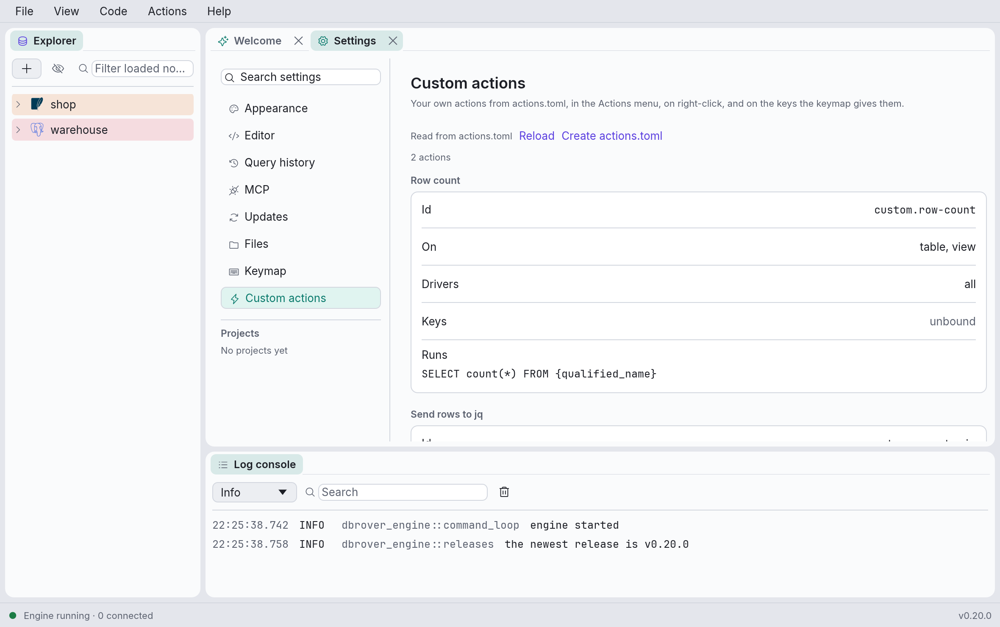

# Actions, snippets and themes

Three files let you add to DbRover without rebuilding it: `actions.toml` adds your own SQL, or
your own programs, to the explorer's and the grid's menus, `snippets.toml` adds snippets to completion, and `theme.toml`
changes the colours. They sit next to `keymap.toml` (see
[Where DbRover keeps its files](files.md)), and none of them exists until you write it.

They are read when DbRover starts. After editing one, click **Reload** on
**Settings › Custom actions** (**View → Custom actions…** opens it), or in the window the status
bar opens for `snippets.toml` or `theme.toml`: that reads all three again, and `exports.toml`,
which adds export formats of your own (see [Your own export formats](export-formats.md)).

A mistake costs only the entry it is in: an action, snippet or colour that can't be used is
skipped, and the status bar shows **actions.toml: N problems** (or **snippets.toml**,
**theme.toml**). Click it to see each problem. A file that isn't valid TOML adds nothing, and
says on which line it went wrong.

## Actions

An action is SQL you attach to what you right-click:

```toml
[[action]]
id = "row-count"
name = "Row count"
applies_to = ["table", "view"]
drivers = ["postgres", "mysql"]
sql = "SELECT count(*) FROM {qualified_name}"

[[action]]
id = "latest"
name = "Last 100 rows"
applies_to = ["table"]
sql = "SELECT * FROM {qualified_name} ORDER BY {column:created_at} DESC LIMIT 100"
run = false
```

- **`id`** names the action for good: lowercase letters, digits, `-` and `_`. It is how
  `keymap.toml` binds it.
- **`name`** is what the menus show.
- **`applies_to`** says where the action appears:
  - explorer nodes by kind: `database`, `schema`, `table`, `view`, `materialized_view`,
    `function`, `procedure`, `sequence`, `event`, `synonym`, `dictionary`, `column`, `index`,
    `constraint`, `trigger`, `role`;
  - `data_source`, a data source's own row;
  - `grid.selection`, the grid's selected cells, acted on once;
  - `grid.row`, the grid's selected rows, acted on once each.
- **`drivers`** limits it to some databases: `postgres`, `sqlite`, `mysql`, `sqlserver`,
  `duckdb`, `clickhouse`, `redis`. Leave it out for every one.
- **`run = false`** opens the SQL in a new console for you to edit and run. Otherwise it runs at
  once.

Choosing an action opens a new console on the same data source with the SQL filled in. Running
it is the same as running SQL you typed: `:name` parameters are asked for, a `DELETE` without
`WHERE` asks first, a careful data source asks before any change, and a read-only one refuses
them. The history marks the statements **Action**, with the action's id.

### Placeholders

| Placeholder | Becomes |
| --- | --- |
| `{qualified_name}` | The object's name, with its schema: `"public"."orders"` |
| `{database}`, `{schema}`, `{table}` | The database, schema or table the object is in, or is |
| `{column}` | The column right-clicked, or the first selected column in the grid |
| `{column:created_at}` | The same, or `created_at` where there is no column |
| `{data_source}` | The data source's name in DbRover, as a string: `'shop'` |
| `{value}` | The first selected cell, as a literal: `'42'`, or `NULL` |
| `{values}` | Every selected cell, as literals separated by commas, for `IN (…)` |
| `{row.email}` | The `email` column of the first selected row (of each row, with `grid.row`) |

A placeholder is never pasted in as text. Names are quoted as the database quotes them
(`"…"`, `` `…` `` or `[…]`), and values become string literals, so a table called
`x; DROP TABLE y` stays one name. Don't put quotes around a placeholder yourself.

A placeholder the action could never fill is a problem with the file: `{value}` on a table, or
`{column}` on a table without a default. One that can't be filled this time, such as `{table}`
on grid cells that don't come from one table, is said in the status bar when you choose the
action. A `{` that doesn't start a placeholder, as in a JSON literal, stays as written; write
`{{` for one that would.

### Keys and the Actions menu

Every action is in the **Actions** menu, and can have a shortcut in `keymap.toml` as
`custom.<id>`:

```toml
[bindings]
"custom.row-count" = "cmd+shift+y"
```

From the menu or a key, an action acts on the focused console's selected cells, or else on the
explorer's selected node: click a node to select it. The item is greyed out when what is
selected isn't something the action applies to. A shortcut that one of DbRover's own actions
already has stays DbRover's, and is listed as a problem on **Settings › Keymap**, which also
lists your actions' ids.

**Settings › Custom actions** shows every action in a card of its own, with its id, what it
applies to, its drivers, its keys and its SQL or command, and the file's problems above them.
**Create actions.toml**, at the top of the page, writes the examples above, commented out, to
start from; it never replaces a file you have. Searching the settings finds an action by its
name, id or what it runs.



## Commands

An action can run a program instead of SQL: write `command` where an SQL action has `sql`.

```toml
[[action]]
id = "rows-to-jq"
name = "Send rows to jq"
applies_to = ["grid.selection"]
command = ["jq", "-r", ".[] | .email"]
stdin = "json"
output = "viewer"

[[action]]
id = "pgcli"
name = "Open in pgcli"
applies_to = ["data_source"]
drivers = ["postgres"]
command = ["gnome-terminal", "--", "pgcli", "postgres://{user}@{host}:{port}/{database}"]
output = "none"

[[action]]
id = "dump-table"
name = "Dump to SQL"
applies_to = ["table"]
drivers = ["postgres"]
command = ["pg_dump", "--table={qualified_name}", "--host={host}", "--port={port}", "--username={user}", "{database}"]
output = "console"
```

- **`command`** is the program, then its arguments, as a list. There is no shell: each item
  reaches the program as one argument, exactly as written, with its placeholders filled in. A
  table name with spaces, quotes and semicolons stays one argument. To use a shell anyway, say
  so: `["sh", "-c", "…"]`. The program itself can't have placeholders, so what runs never
  depends on what you selected.
- **`stdin`** sends the grid's selected cells to the program: the selected columns of the
  selected rows, as `json` (an array of objects, as **Export** writes it), `csv` or `tsv`, each
  with the column names. Only the grid has a selection, so an action with `stdin` applies only
  to `grid.selection`. Leave it out, or write `none`, and stdin is empty.
- **`output`** says where what the program writes goes:
  - `viewer`, the default: a window like the cell viewer's, with JSON and XML laid out for
    reading, and **Copy**;
  - `console`: a new console on the same data source, for a program that writes SQL, to read
    and run yourself;
  - `log`: the log console, a line an entry, with what it wrote to stderr as warnings;
  - `none`: nowhere, for a program that opens a window of its own.
- **`timeout`** is how long it may run before DbRover stops it, as `"500ms"`, `"30s"`, `"5m"` or
  `"1h"`: a minute when left out.
- `run` is for SQL only, and a command can't apply to `grid.row`: it already gets every
  selected row at once.

The terminal in the `pgcli` example is GNOME's, which runs what follows `--`. On a Mac, use a
terminal that takes a command in the same way, such as `["alacritty", "-e", …]` or
`["kitty", …]`: Terminal and iTerm can't be given a command to run this way.

### What a command gets

Its placeholders are the SQL ones, filled in as plain text, with nothing quoted, plus the data
source's own settings:

| Placeholder | Becomes |
| --- | --- |
| `{qualified_name}` | The name as the database's SQL writes it: `"public"."orders"` |
| `{database}`, `{schema}`, `{table}`, `{column}` | As for SQL, unquoted. `{database}` is the one connected to where the object has none |
| `{data_source}` | The data source's name in DbRover: `shop` |
| `{value}`, `{row.email}` | The cell's text; nothing for `NULL` |
| `{host}`, `{port}`, `{user}` | Where a server data source connects, with `${NAME}` variables filled in |
| `{file}` | A SQLite or DuckDB data source's file |

`{values}` is for SQL only: a command gets the selection on stdin. A placeholder nothing fills
this time, such as `{host}` on a SQLite data source, opens a window saying so instead of
running anything.

The program also gets DbRover's own environment, with `DBROVER_DATA_SOURCE`, `DBROVER_DRIVER`
(`postgres`, `sqlite`, …), `DBROVER_DATABASE`, `DBROVER_SCHEMA` and `DBROVER_TABLE` where there is
one, and `DBROVER_FORMAT`, the `stdin` format. It runs in your home folder.

**It never gets a password.** There is no placeholder or variable for one, and none of the
data source's secrets (its password, its SSH password or passphrase) reach a program in any
way. A program that needs one reads it from its own configuration, as `~/.pgpass` or
`~/.my.cnf`, or from the keychain itself.

### The first run

Before a command runs for the first time, DbRover shows it in full and asks **Run a program?**,
with what it gets on stdin, where its output goes and its timeout. **Run** runs it, and from
then on it runs without asking. Change anything in its `command` or `stdin`, even one argument,
and it asks again. **Cancel**, or Esc, runs nothing.

**Settings › Custom actions** says of each command whether it is trusted or asks before it next
runs.
DbRover keeps what you trusted in `trusted_commands.toml`, in its window state folder rather
than beside `actions.toml` (see [Where DbRover keeps its files](files.md)). So an `actions.toml`
you copy from someone, or sync from another machine, still asks before each of its commands
first runs. Delete an entry, or the file, to be asked again.

Actions only ever come from your own `actions.toml`. A data source export never carries any,
even one someone added to the file by hand.

### While it runs

The status bar says **Running Send rows to jq…** with **Stop**. ⌘. (Ctrl+. on Linux and
Windows) stops it too, unless the console you are in is running SQL: then ⌘. stops that instead.
When its timeout passes, it is stopped the same way.

A program that ends with an error opens a window naming it, how it ended (`exit status: 3`)
and what it wrote to stderr, whatever `output` says. So does one that can't start or runs past
its timeout. One that writes more than 4 MB is stopped there, and you get what it wrote first,
with a note.

Stopping a program stops that program only. One that starts programs of its own, as
`sh -c "… &"` does, may leave them running.

### On a Mac and on Windows

- **A Mac app opened from the Finder doesn't see your shell's `PATH`.** It gets
  `/usr/bin:/bin:/usr/sbin:/sbin`, without Homebrew's folders, so `jq` may be "not found" even
  though your terminal finds it. The window says which `PATH` was searched. Write the full path
  instead: `which jq` in a terminal prints it, such as `/opt/homebrew/bin/jq`.
- **On Windows,** a program is found on `PATH` with or without `.exe`, and runs without a
  console window. A `.bat` or `.cmd` file runs through `cmd.exe`, which reads some characters
  in its arguments as its own; DbRover refuses to start it with an argument it can't pass
  safely, rather than let `cmd.exe` read it.

## Snippets

```toml
[[snippet]]
trigger = "sel"
description = "Select with a filter"
body = "SELECT ${1:*}\nFROM ${2:table}\nWHERE ${3:condition};"
drivers = ["postgres"]
```

While you type a word in the editor, completion lists the snippets whose trigger starts with
it, marked with braces, after the names that start with it. **Enter** or **Tab** inserts the
body with its first field selected: type over it, then **Tab** goes to the next field and
**⇧Tab** back. After the last field the cursor goes to `$0`, or to the end, and **Tab** is the
editor's again. **Esc**, or clicking or typing outside the field, leaves the fields.

The syntax is the one other editors use, so snippets can be copied from them: `${1:default}` or
`$1` for a field, `$0` for where the cursor ends, and `\$`, `\}` and `\\` for the characters
themselves. A `$` that starts no field, as in PostgreSQL's `$$`, stays as written; write `\$1`
for a positional parameter. Fields inside fields aren't supported. `trigger` takes letters,
digits and `_`; `description` and `drivers` are optional.

## Themes

```toml
[light]
primary = "#5b3fe0"

[dark]
primary = "#9a8bff"
base = "#14121a"
```

`[light]` and `[dark]` replace colours of the light and dark themes, so **View → Theme** still
offers Match system, Light and Dark, each with your colours. Colours are written `#rrggbb`:

| Name | What it colours |
| --- | --- |
| `primary` | Selection, focus, and the main button on a screen |
| `secondary` | SQL keywords, links |
| `success`, `warning`, `error` | What went right, what to watch, what went wrong |
| `base` | Behind the panels, and the menu and status bars |
| `panel` | The panels, windows and menus |
| `field` | Text fields, the editor and the grid |
| `control`, `control_hover` | Buttons at rest and under the pointer |
| `border` | Lines around panels and windows |
| `text`, `text_weak` | Text, and details, hints and comments |
| `selection` | Behind selected text and rows |
| `on_primary` | Text on a `primary` button |

A colour that leaves text too faint to read on what it is drawn on (below WCAG AA's 4.5:1) still
applies, and is listed as a problem, naming the text and the background.

On a Mac, selection and focus take your accent colour from System Settings, as they do without a
theme, unless `theme.toml` sets that theme's `primary` or `selection`.
