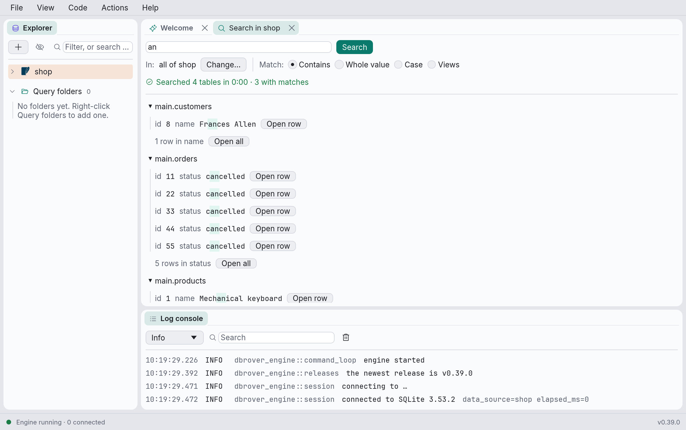
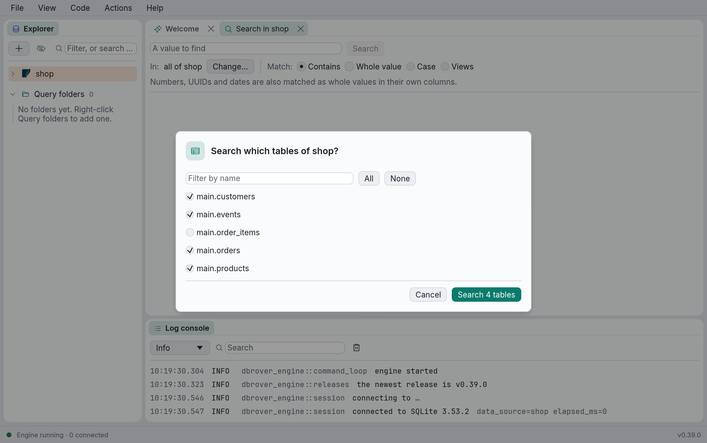

# Searching data

A support ticket quotes an order reference and nothing else. A customer's email address has to
be found everywhere it is kept. A UUID turns up in a log, and no one remembers which table's key
it is. **Search data** finds the rows that hold a value, across a data source's tables and
columns, and opens each one on its row.

It works on PostgreSQL, SQLite, DuckDB, MySQL, MariaDB, SQL Server and ClickHouse, and, a schema
or a table at a time and after asking, on Trino, Athena, BigQuery, Snowflake and Databricks. It
isn't offered on Redshift, Synapse, Fabric or the NoSQL engines yet.

## Opening it

Right-click a data source, a database, a schema, a folder of tables or one table in the explorer
and choose **Search data…**. A tab opens beside the consoles, *Search in* the data source, set to
search what you right-clicked. Each data source has one such tab: choosing **Search data…**
again brings it to the front, pointed at the new place. It has a connection of its own, so a long
search never holds up the explorer or a console, and it isn't reopened when DbRover starts.

From a console, the keymap action `console.search-data` opens the tab on the console's data
source. It has no key until you give it one in `keymap.toml` (see
[Keyboard shortcuts](shortcuts.md)).

## Searching

Type the value as it is, with no quotes or wildcards, and press Enter or **Search**. `%` and `_`
are searched for as themselves.

- **In** says where it searches: *all of* the data source, a schema, or a table. **Change…**
  lists the tables there, with tick boxes and a filter, to search some of them only.
- **Contains** finds the value anywhere in a text column; **Whole value** finds a column holding
  exactly it. **Case** matches case; without it, case is ignored.
- **Views** searches views too. They are left out by default, since a view reads its tables
  again, often with joins.

### Which columns are searched

Each table is searched in one statement, on the columns whose type can hold the value, and
reads only its key and those columns:

| The value | Is looked for in |
| --- | --- |
| Any text | Text columns (`text`, `varchar`, `char`, `nvarchar`, enums), and JSON and XML columns as their text, with **Contains** only |
| A whole number, such as `1042` | Integer and decimal columns too, as `= 1042`, where the number fits the column |
| A decimal, such as `42.50` | Decimal columns that can hold it exactly, and floating-point columns |
| A UUID, in any case, with or without braces | UUID columns too (`uuid`, `uniqueidentifier`) |
| A date written `2026-11-25` | Date columns on that date, and timestamp columns on that day |

So `1042` finds an order by its id and a customer whose phone number contains it, but not
`21042` in a number column. Binary columns, arrays, maps, booleans and geometry are never
searched. A table with no column that can hold the value isn't read at all.

### Ignoring case, engine by engine

Ignoring case uses the engine's own way: `ILIKE` on PostgreSQL, DuckDB, ClickHouse, Snowflake
and Databricks; the column's collation on MySQL, MariaDB and SQL Server, which ignores case by
default, and `LOWER()` on a column whose collation tells case apart; `LOWER()` on Trino and
BigQuery. What matches is what the database itself would say for the same condition:

- MySQL's default collations ignore accents too, so `cafe` finds `café`.
- SQLite ignores the case of `A` to `Z` only: `élan` doesn't find `Élan`.
- MySQL and SQL Server ignore trailing spaces when they compare a whole value.

The statement each table ran is in its menu: right-click a table's name for **Copy statement**
and **Open statement**.

## The results

Tables appear as they finish, smallest first where the database keeps a row count, so most
matches show in the first seconds. Each table that matched shows how many rows (*100+* past the
cap), the columns the value was found in, and its rows as their key and the values that hold the
value, highlighted, a long value cut around it.

- **Open row**, or a double-click, opens a new console with a query for that row by its key,
  and runs it. The grid can edit it, under the data source's safety level, and follow its
  foreign keys. A table without a key opens the rows with the same values.
- **Open all** opens a console with the table's statement without its cap, so every matching
  row pages in, can be exported, or counted.
- A table that ran out of time says so, with **Retry**, which asks, then searches that table
  alone with no time limit.
- The tables with no match, with no column that can hold the value, or not searched (after
  **Cancel**) are folded into one line at the end; click it to see their names.

The line under the options counts the tables searched and names the one being read.
**Cancel** stops the statement running and the search with it; what was found stays.

## Limits

- **One table at a time.** A search never runs more than one statement on the server at once.
- **15 seconds per table**, by default. A table that takes longer is listed as timed out, and
  the search goes on to the next.
- **100 rows per table**, by default. There is no `ORDER BY`, which would make the server find
  and sort every match first, so the rows shown are the first it found.

**Settings › Data search** changes the time limit (or removes it), the rows shown per table, and
whether views are searched by default (see [Settings](settings.md)).

## Safety and cost

A search only reads, and it is made so: each statement runs in the database's read-only mode,
as a [read-only data source's](data-sources.md#safety-levels) statements do, on every data source,
whatever its level. A read-only data source is searched as any other.

- **A careful data source asks** before a search of more than one table, naming it and the
  value: *Search 38 tables of "production" for "o'brien"?*. A search of one table runs at once.
- **A search of a whole data source** reads every table, and a table read in full is a scan of
  it. On a busy production server, search a schema or a few tables.

### Engines that bill each read

On BigQuery and Athena, which bill the bytes a statement scans whatever it finds, on Snowflake
and Databricks, which bill the time their warehouse runs, and on Trino, which reads a lake's
tables whole, **Search data…** is offered on a schema or a table, not on the whole data source,
and every search asks first, whatever the data source's cost guard says:

| Engine | The question says |
| --- | --- |
| BigQuery | *Scan 34.2 GB to search 12 tables of "warehouse"?*: the bytes its statements' dry runs add up to, *at least* when a dry run couldn't tell |
| Athena, Trino | That each table is read whole, and the size can't be told beforehand |
| Snowflake, Databricks | That each table's statement runs on the warehouse, up to the time limit each, and may start a suspended warehouse |

## In the history

A search is recorded once in [the query history](history.md), as **Search**: the statements of
the tables that matched, so **Run again** finds the same rows, and a line saying what was
searched for, how, and what was found. A search that found nothing is kept as that line alone.

## For AI assistants

The MCP server's `search_data` tool runs the same search for an assistant, for any project that
may read: each table in a read-only transaction of its own under the project's time limit, the
project's schemas narrowing it, and its row limit capping the rows over every table. It is
refused on BigQuery, Athena, Snowflake, Databricks and Trino, where there would be no one to ask.
See [AI assistants (MCP)](mcp.md).
