# Data sources

A *data source* is a saved connection: which database to connect to and how. DbRover keeps the
list in a file (see [Where DbRover keeps its files](files.md)) and passwords in your system's
keychain, never in that file.

## Adding one

Click **+** at the top of the explorer (or **New data source** on the Welcome tab) and choose
**PostgreSQL**, **SQLite**, **MySQL / MariaDB**, **SQL Server**, **DuckDB**, **ClickHouse**,
**Redis / Valkey**, **MongoDB** or **Elasticsearch / OpenSearch**.

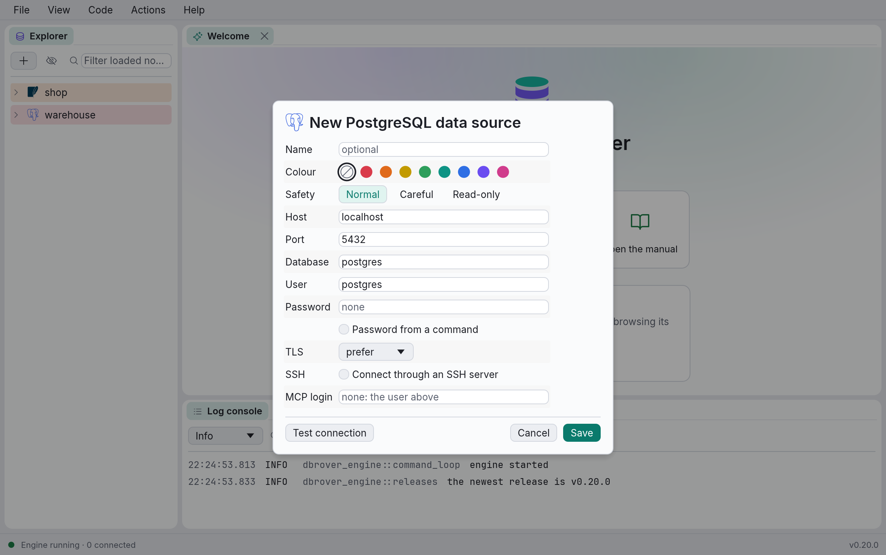

Every kind has:

- **Name** — how it appears in the explorer. Leave it empty and DbRover names it for you:
  `database@host` for a server, the file name for SQLite.
- **Colour** — optional. The colour tints the data source's row in the explorer, the tabs of its
  consoles and a band along the top of each console. Giving production a red and your local copy
  nothing makes it hard to run something in the wrong place.
- **Safety** — how careful DbRover is with the data. See [Safety levels](#safety-levels).

**PostgreSQL** adds:

| Field | Default | Notes |
| --- | --- | --- |
| Host | `localhost` | Name or IP address of the server. |
| Port | `5432` | A number from 1 to 65535. |
| Database | `postgres` | The database to connect to. The explorer lists the server's other databases too. |
| User | `postgres` | |
| TLS | `prefer` | Whether to encrypt the connection; see below. |
| SSH | off | Connect through an SSH server; see [SSH tunnels](#ssh-tunnels). |
| Password | none | Stored in the keychain when you save. See below. |
| Password from a command | off | Run a program for the password instead, for cloud tokens and secret stores; see [Password from a command](#password-from-a-command). |
| MCP login | none | Another user, only for AI assistants; see [The MCP login](mcp.md#the-mcp-login). |
| MCP password | none | Shown once there is an MCP login. Stored in the keychain apart from the password. |

### TLS

**TLS** encrypts the connection, which hosted databases usually require. The modes are the
ones PostgreSQL's own tools call `sslmode`, so a provider's connection guide reads the same:

| Mode | Encrypts | Checks the server's certificate |
| --- | --- | --- |
| `disable` | Never | — |
| `prefer` | If the server offers it, otherwise connects unencrypted | No |
| `require` | Always; fails if the server can't | No |
| `verify-full` | Always | Yes: signed by an authority you trust, and naming the host you typed |

`prefer` and `require` keep anyone on the network from reading what you send, but not from
pretending to be the server. Use `verify-full` for anything that matters.

With `verify-full`, a **CA file** row appears. Leave it empty for servers whose certificate is
signed by a public authority (the same ones web browsers trust). For a private or self-signed
certificate, give the authority's certificate as a PEM file, typed or picked with **Browse…**:
for example the bundle your cloud provider publishes for its managed databases. The **Host**
must be a name (or IP address) the certificate lists.

DbRover encrypts with [rustls](https://github.com/rustls/rustls), so there is no OpenSSL to
install. Client certificates aren't supported yet.

**MySQL / MariaDB** has the same fields as PostgreSQL, with these defaults:

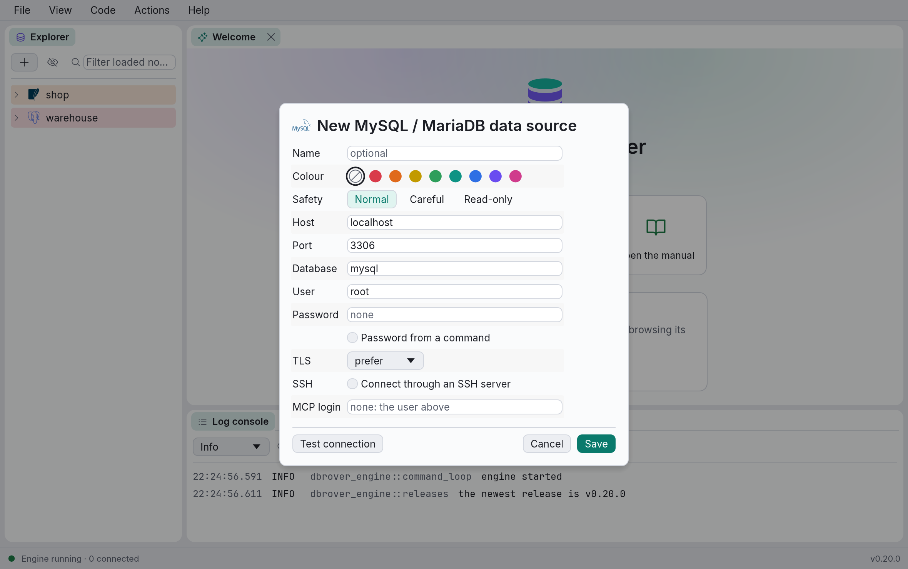

| Field | Default | Notes |
| --- | --- | --- |
| Host | `localhost` | Name or IP address of the server. |
| Port | `3306` | |
| Database | `mysql` | The database unqualified names refer to, as `USE` would set. The explorer lists every database you may see. |
| User | `root` | |
| TLS | `prefer` | As for PostgreSQL. MySQL 8 and MariaDB 11.4 encrypt by default, with a self-signed certificate unless the server is given one, so `verify-full` needs that server's CA file. |
| Password | none | Stored in the keychain when you save. |
| MCP login | none | Another user, only for AI assistants; see [The MCP login](mcp.md#the-mcp-login). |
| MCP password | none | Shown once there is an MCP login. Stored in the keychain apart from the password. |

One data source type serves both: DbRover tells MySQL and MariaDB apart once it connects, and
**Test connection** says which it found ("Connected to MariaDB 11.4.4").

**SQL Server** has the same fields too, for SQL Server and Azure SQL, with these defaults. Its MCP
login is required for [MCP clients](mcp.md) to use it at all, since SQL Server has no read-only
mode: see [How the permissions are enforced](mcp.md#how-the-permissions-are-enforced).

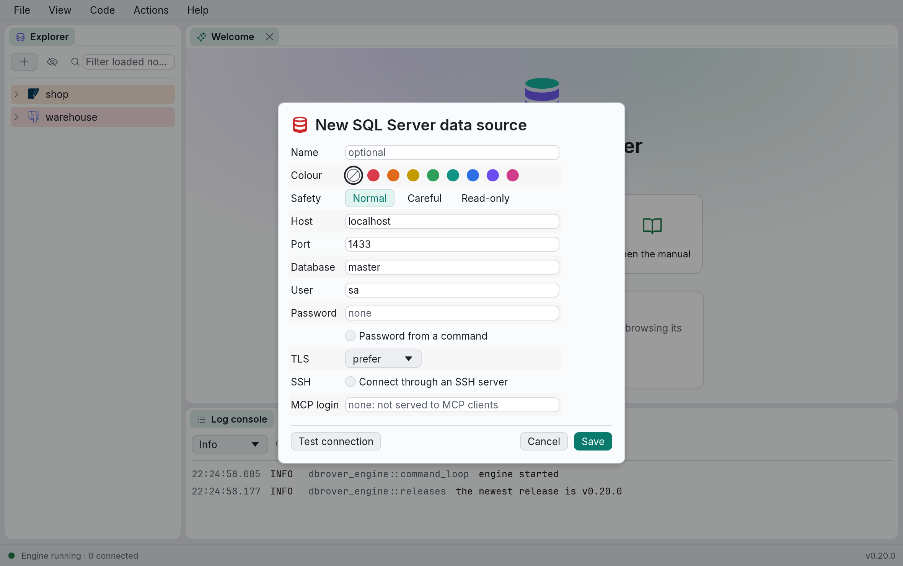

| Field | Default | Notes |
| --- | --- | --- |
| Host | `localhost` | Name or IP address of the server. For Azure SQL, the server's name, such as `myserver.database.windows.net`. |
| Port | `1433` | Named instances aren't looked up: give the instance's port. |
| Database | `master` | The database the console works in. The explorer lists every database the login may open. |
| User | `sa` | A SQL Server login. Windows and Microsoft Entra ID sign-in aren't supported yet. |
| TLS | `prefer` | SQL Server always offers encryption, with a certificate of its own making unless it is given one, so `prefer` and `require` encrypt without checking it, and `verify-full` needs that server's CA file (or, for Azure SQL, nothing: its certificate is publicly signed). |
| Password | none | Stored in the keychain when you save. |

**Test connection** says which server it reached ("Connected to SQL Server 16.0.4305.5"; 16 is
SQL Server 2022).

**ClickHouse** has the same fields, with these defaults:

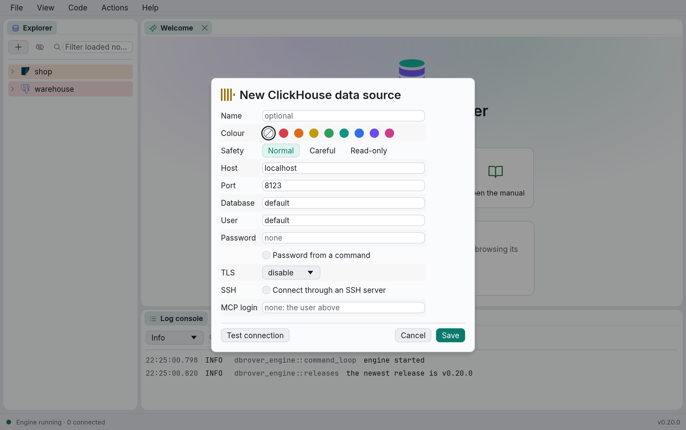

| Field | Default | Notes |
| --- | --- | --- |
| Host | `localhost` | Name or IP address of the server. For ClickHouse Cloud, the service's host name. |
| Port | `8123` | ClickHouse's HTTP port: DbRover speaks HTTP to ClickHouse, not its native protocol on 9000. |
| Database | `default` | The database unqualified names refer to, as `USE` would set. The explorer lists every database you may see. |
| User | `default` | |
| TLS | `disable` | `disable`, `require` or `verify-full`; see below. |
| Password | none | Stored in the keychain when you save. |
| MCP login | none | Another user for AI assistants, optional: they read in ClickHouse's read-only mode either way. See [The MCP login](mcp.md#the-mcp-login). |
| MCP password | none | Shown once there is an MCP login. Stored in the keychain apart from the password. |

ClickHouse serves HTTPS on a port of its own (8443) rather than offering encryption on the HTTP
one, so there is no `prefer`: choosing `require` or `verify-full` moves the port to `8443`, and
`disable` moves it back, unless you typed a port of your own. ClickHouse Cloud only accepts
HTTPS, with a publicly signed certificate, so `verify-full` with no CA file works there.

**Test connection** says which server it reached ("Connected to ClickHouse 25.8.33.6").

**Redis / Valkey** serves Redis, Valkey and Dragonfly, which speak the same protocol. It has the
same fields, with these defaults:

| Field | Default | Notes |
| --- | --- | --- |
| Host | `localhost` | Name or IP address of the server. |
| Port | `6379` | |
| Database number | `0` | The numbered database the console uses, as `SELECT` would choose. The explorer lists every database that holds keys. |
| User | `default` | An ACL user, or `default`, the user every server starts with. Left empty, DbRover signs in as `default`. |
| TLS | `disable` | `disable`, `require` or `verify-full`, as for ClickHouse: Redis serves TLS on a port of its own, set in its configuration, with no usual number, so the port stays as it is. |
| Password | none | The ACL user's password, or the server's `requirepass`. Stored in the keychain when you save. |
| MCP login | none | Required for AI assistants, since Redis has no read-only mode: an ACL user that may only read; see [The MCP login](mcp.md#the-mcp-login). |
| MCP password | none | Shown once there is an MCP login. Stored in the keychain apart from the password. |
| Key separator | `:` | What the explorer groups keys by: `user:42:cart` sits under `user` › `42`. Empty lists keys ungrouped. See [the explorer](explorer.md). |

**Test connection** says which server it reached and its version ("Connected to Valkey 9.1.3").
DbRover connects to one server; Redis Cluster and Sentinel aren't supported yet.

**MongoDB** connects to a server with the same fields, or to a server or cluster through a
connection string. Choose which under **Connect with**:

| Field | Default | Notes |
| --- | --- | --- |
| Host | `localhost` | With **Server**: the name or IP address of one server. DbRover talks to that server alone, even if it belongs to a replica set; use a connection string to reach the whole set. |
| Port | `27017` | |
| Connection string | none | With **Connection string**: `mongodb://…` or `mongodb+srv://…`, as MongoDB Atlas hands it out. Its options, such as `replicaSet`, `tls` or `authMechanism`, apply as written. Paste it whole: its user and password move to their own fields, and the password to the keychain, so the string is kept without them. |
| Database | `test` | The database the console's commands run in until `use` changes it, as the shell starts in `test`. The explorer lists every database the user may see. |
| User | none | Leave it empty for a server without access control. |
| Password | none | Stored in the keychain when you save. |
| Auth database | `admin` | Where the user is defined, the shell's `--authenticationDatabase`. |
| TLS | `disable` | With **Server**: `disable`, `require` or `verify-full`. MongoDB serves TLS or not on a port, so there is no `prefer`. Through an SSH tunnel, `verify-full` isn't offered: the driver would check the certificate against the tunnel's end rather than the server's name. A connection string sets TLS itself (`tls=true`, or `mongodb+srv://`, which turns it on). |
| MCP login | none | Required for AI assistants, since MongoDB has no read-only mode: a user with only the `read` role; see [The MCP login](mcp.md#the-mcp-login). |
| MCP password | none | Shown once there is an MCP login. Stored in the keychain apart from the password. |

**Test connection** says which server it reached and its version ("Connected to MongoDB 8.2.1").
Passwords (SCRAM) work today; X.509 certificates and AWS sign-in are planned.

**Elasticsearch / OpenSearch** connects to one node of a cluster, Elasticsearch's or
OpenSearch's, over its REST API. It has no database: a cluster's indices belong to none. Choose
what it signs in with under **Sign in with**:

| Field | Default | Notes |
| --- | --- | --- |
| Host | `localhost` | The name or IP address of one node. For an Elastic Cloud deployment, its Elasticsearch endpoint's host name, such as `my-deployment.es.us-east-1.aws.elastic.cloud`. |
| Port | `9200` | `443` for Elastic Cloud. |
| User | `elastic` | With **User and password**. Leave it empty for a node without security. |
| Password | none | With **User and password**. Stored in the keychain when you save. |
| API key | none | With **API key**: the encoded key Elasticsearch gives (`POST /_security/api_key` answers it as `encoded`, and Kibana shows it when you create one). Stored in the keychain, in the password's place; it says who it signs in as, so there is no user. |
| TLS | `disable` | `disable`, `require` or `verify-full`. A node serves HTTPS or HTTP on its port, not both, so there is no `prefer`. Elastic Cloud needs `verify-full`, with no CA file. A node whose security was set up when it was installed serves HTTPS with its own authority: point **CA file** at its `http_ca.crt`. |
| MCP login | none | Required for AI assistants, since neither server has a read-only mode: a user or API key with only the `read` and `view_index_metadata` privileges. |
| MCP password | none | Shown once there is an MCP login. Stored in the keychain apart from the password. |

**Test connection** says which server it reached and its version ("Connected to
Elasticsearch 9.5.5", or "Connected to OpenSearch 3.9.0"). Amazon OpenSearch Service's AWS
sign-in is planned.

**SQLite** adds:

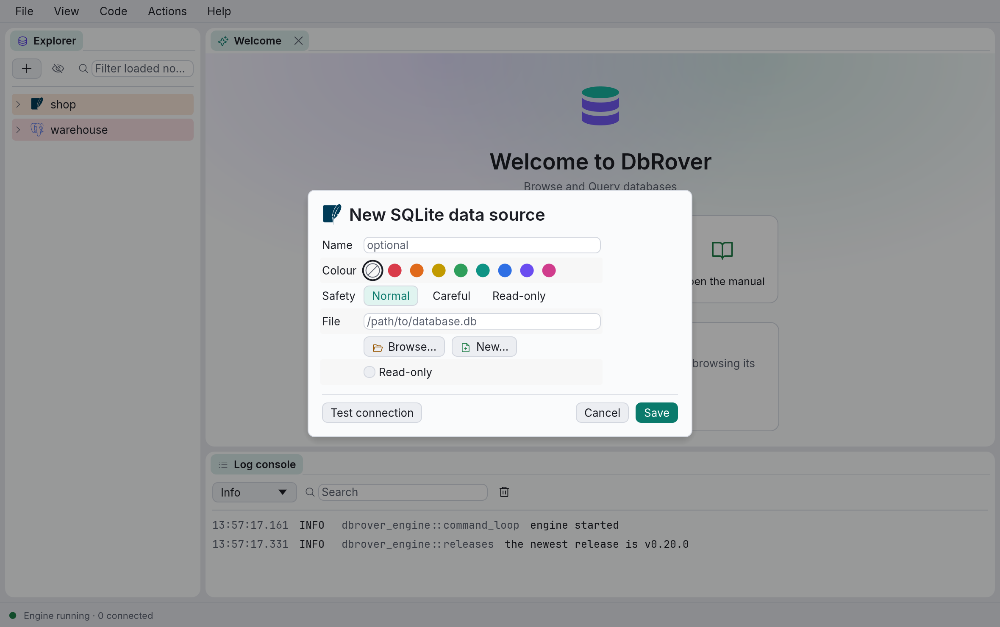

- **File** — the full path to the database file. Type or paste it, or use the buttons under the
  field:
  - **Browse…** opens your system's file dialog to pick an existing database. It shows every
    file, because SQLite databases end in `.db`, `.sqlite`, `.sqlite3` or nothing at all.
  - **New…** opens your system's Save dialog and creates an empty database file where you
    choose, then fills in the path and clears **Read-only**. The message under the form says
    whether it worked; click **Save** to keep the data source. DbRover never overwrites an
    existing file, even if the Save dialog asked whether to replace it and you said yes: pick
    another name instead.

  Connecting never creates a file, so a typo in the path is an error rather than a new, empty
  database. **New…** is the only way DbRover creates one.
- **Read-only** — opens the file read-only. Statements that would change it fail with SQLite's
  error.

**DuckDB** has two kinds of database, chosen under **Database**:

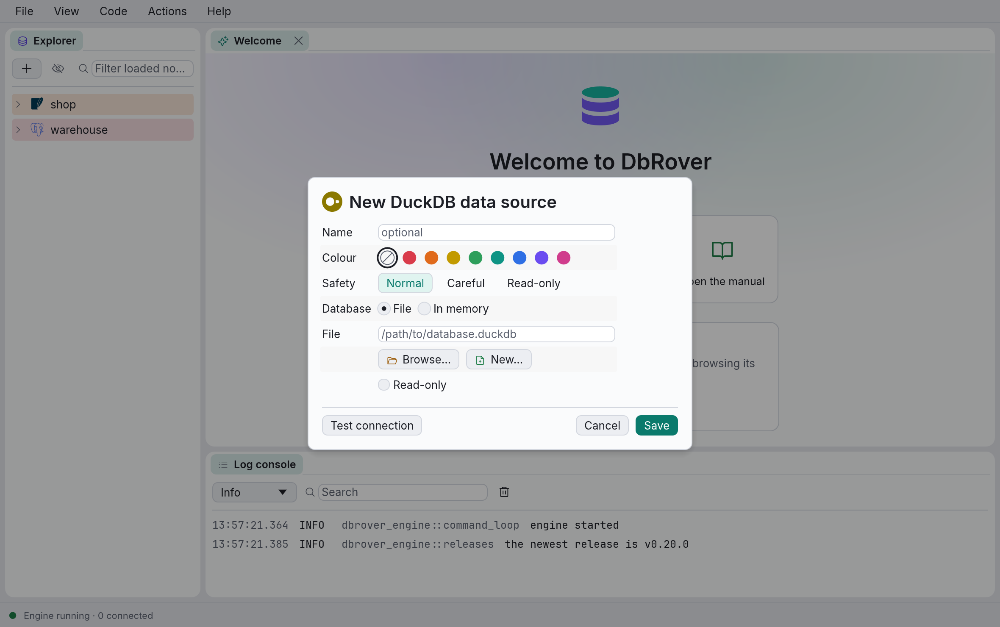

- **File** — a DuckDB database file (`.duckdb`), with **File**, **Browse…**, **New…** and
  **Read-only** as for SQLite. Only one program at a time may have a DuckDB file open for
  writing, and no other may have it open at all meanwhile, so connecting fails while another
  program (the `duckdb` command, say) has it open for writing. Within DbRover, a file is open
  one way at a time too: a data source that opens it read-only (its **Read-only** box, or the
  read-only safety level) can't connect while another has it open for writing, or the other
  way round, and the error says which to disconnect.
- **In memory** — an empty database that lives as long as the connection, for querying files
  rather than storing data: DuckDB reads CSV, Parquet and JSON files directly. Each console has
  its own, and everything created in it is gone when it disconnects.

DuckDB is part of DbRover, so there is nothing to install. **Test connection** says which
version it is ("Connected to DuckDB 1.5.6").

### SSH tunnels

Many databases only accept connections from inside their own network, through a *jump host*
(or *bastion*) you reach with SSH. Tick **Connect through an SSH server** and DbRover opens an
SSH tunnel for you before connecting: no `ssh -L` to run first, and nothing to install. Every
server engine has it: PostgreSQL, MySQL and MariaDB, SQL Server, ClickHouse, Redis,
Elasticsearch and OpenSearch, and MongoDB with the **Server** form (a connection string may name
several servers, or none).

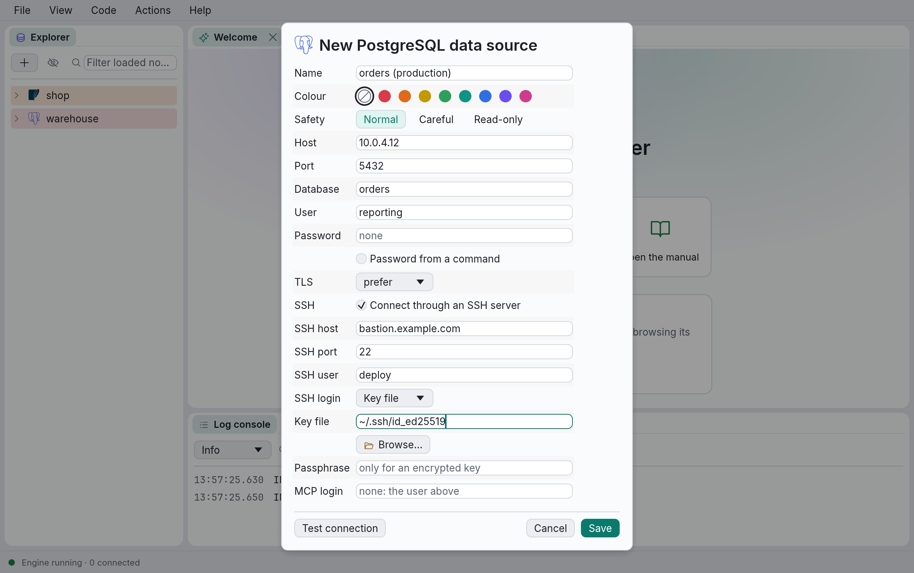

| Field | Default | Notes |
| --- | --- | --- |
| SSH host | none | The SSH server's name or IP address. |
| SSH port | `22` | |
| SSH user | none | Whom to sign in to the SSH server as. |
| SSH login | SSH agent | How to sign in; see below. |
| Key file | none | For **Key file**: your private key, in OpenSSH's format. **Browse…** opens `~/.ssh`. |
| Passphrase | none | For an encrypted key. Stored in the keychain when you save. |
| SSH password | none | For **Password**. Stored in the keychain when you save. |

**Host**, **Port** and **Database** above stay the database's own, as the SSH server sees it:
often a private address such as `10.0.4.12`, or `localhost` when the database runs on the SSH
server itself. TLS still checks the database's certificate against that host, so `verify-full`
works through a tunnel too.

The ways to sign in:

- **SSH agent** uses the keys your running agent holds, as `ssh` does: the agent `SSH_AUTH_SOCK`
  names on macOS and Linux, and Windows' OpenSSH agent or Pageant on Windows. Nothing is stored.
- **Key file** signs in with a private key. An encrypted key's passphrase is asked for the first
  time it is needed, like a password, and kept in the keychain; an unencrypted key never touches
  the keychain.
- **Password** signs in with the SSH user's password, kept in the keychain.

The SSH settings take [placeholders](#placeholders-variable) like the server's, and they travel
in an [export](sharing.md); the passphrase and password stay in each machine's keychain.

**The SSH server's host key** is checked against `~/.ssh/known_hosts`, the file `ssh` itself
keeps, so a server you already reach with `ssh` is trusted by DbRover too. The first time DbRover
meets one it doesn't know, it shows the key's SHA-256 fingerprint and asks. Compare it with the
fingerprint the server's administrator gives you (`ssh-keygen -lf` on the server's host key):
**Trust and connect** adds it to `known_hosts` and connects. A server whose key has changed
since is refused, with the line of `known_hosts` to remove if the change was expected; see
[Troubleshooting](troubleshooting.md#ssh-tunnels).

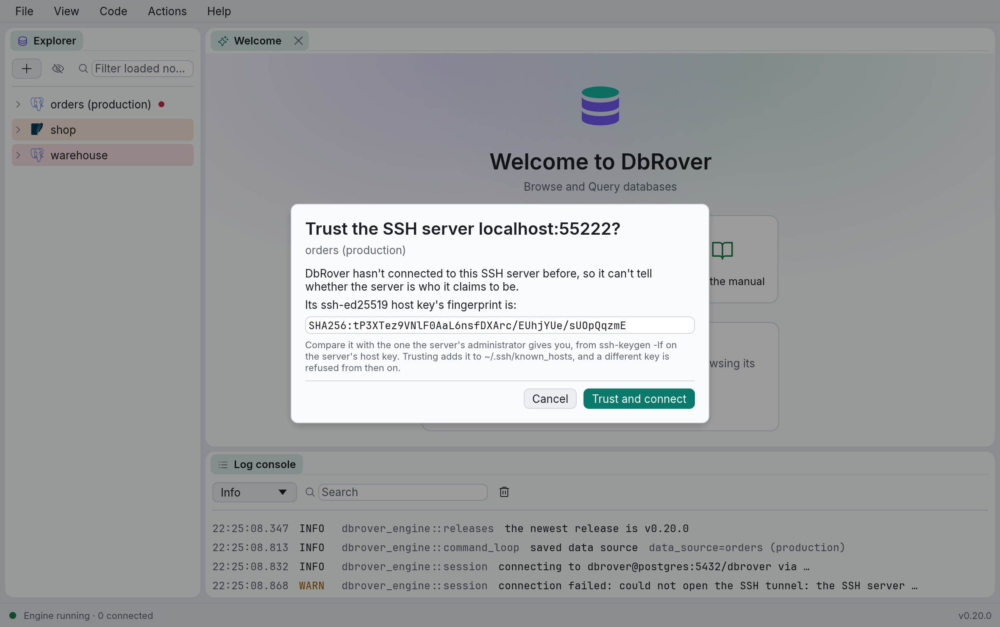

A data source's consoles and its explorer share one tunnel, which closes with the last of them.

## Testing the connection

**Test connection** connects with what is in the form right now, checks the connection works,
and disconnects. The result appears under the form ("Connected to PostgreSQL 17.6", or the
error) and in the log console. Nothing is saved by testing, not even the password.

## Saving

**Save** checks the form and saves the data source. Required fields left empty, or a port that
isn't a number, show a message under the form instead. The dialog stays open until the save has
gone through; if it fails, the reason is shown in the dialog.

**Cancel**, **Esc** or a click outside the dialog closes it without saving.

## Safety levels

A colour only marks a data source. Its **safety level** decides what its consoles may change:

| Level | What happens |
| --- | --- |
| **Normal** | Changes run when asked. Only an `UPDATE` or `DELETE` without `WHERE` asks first (see [Query consoles](consoles.md#statements-that-change-every-row)). |
| **Careful** | Every change asks first, naming the data source: statements that change data or the schema, and edits in the grid. New consoles start in **Manual commit** mode. |
| **Read-only** | Changes are refused. DbRover reads each statement before sending it and refuses anything but reading, then runs it in the database's own read-only mode, which also stops a write hidden in a function. The grid can't be edited. |

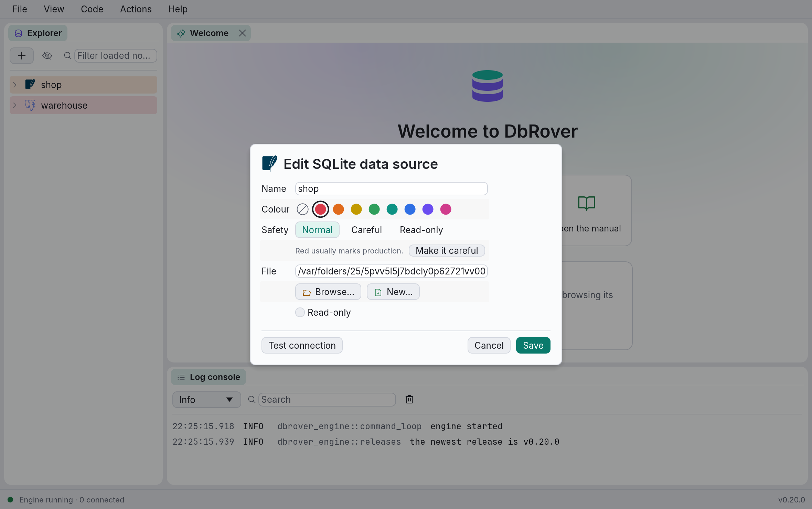

Picking red for a data source whose level is Normal suggests **Careful**, since red usually marks
production; **Make it careful** takes the suggestion. The level is its own setting, so a red data
source can stay Normal, and a careful one can be any colour.

Read-only uses the same checks as an AI assistant's read-only projects (see
[Connecting an AI assistant](mcp.md)):

- **PostgreSQL** runs each statement in `BEGIN READ ONLY`, **MySQL and MariaDB** in
  `START TRANSACTION READ ONLY`, rolled back once its rows are read. **SQLite** and **DuckDB**
  open the file read-only, so `SELECT nextval('orders_id')` fails on DuckDB, since it advances
  the sequence. **ClickHouse** sends `readonly = 2` with every statement: ClickHouse then
  refuses changes, and lifting the setting, while a query's own `SETTINGS` still run.
- **SQL Server**, **Redis**, **MongoDB**, **Elasticsearch** and **OpenSearch** have no
  read-only mode for one connection: statements are still checked, but a write inside a
  procedure, a function or a script isn't stopped. The dialog says so. Sign in as a user who
  may only read to have the database refuse it; [The MCP login](mcp.md#the-mcp-login) shows how
  to make one on each.
- A **DuckDB** database **in memory** can't be opened read-only: statements are checked, and
  what it holds is gone when it disconnects anyway. The dialog says so.
- A read-only mode guards the database it opened. A DuckDB console can still reach other files,
  with `COPY … TO` or `ATTACH`, which the check refuses as administration.
- Anything that isn't a plain read is refused, including `SET`, `BEGIN` and statements DbRover
  can't parse, since what they do can't be told.

## Placeholders: `${VARIABLE}`

Host, port, database, user, a SQLite or DuckDB file and a CA file may hold `${NAME}`
placeholders, which DbRover replaces with the environment variable `NAME` each time it connects.
One shared list of data sources then works on machines whose settings differ: each machine sets
`PGHOST`, say, and the data source's host is `${PGHOST}`. A placeholder can be part of a value
(`db-${ENV}.internal`), and a path starting with `~` is in your home folder.

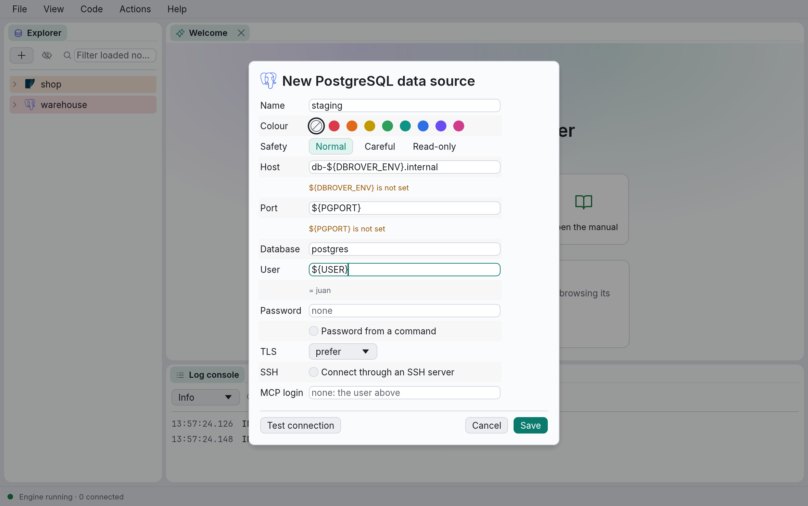

Under each field with a placeholder, the dialog shows what it resolves to now, or which variable
isn't set. Connecting with an unset variable stops with an error that names the setting:
*could not resolve the host: ${PGHOST} is not set*.

Variables come from the environment DbRover was started in. On macOS, an app opened from the
Finder or the Dock doesn't see what your shell profile sets; start it from a terminal
(`open -a dbrover`, after exporting the variables), or set them with `launchctl setenv`.

## Passwords and the keychain

PostgreSQL, MySQL and SQL Server passwords are stored in your operating system's credential
store: the Keychain on
macOS, Credential Manager on Windows, the Secret Service (GNOME Keyring, KWallet) on Linux.
Each entry has the service name `dbrover` and, as its account, the data source's ID, a long
string that never changes even if you rename the data source.

- **When you save**, a typed password is written to the keychain. When you edit a data source
  the password field is empty and says *unchanged*: leave it empty to keep the saved password,
  or type a new one to replace it.
- **When DbRover connects** — the explorer, each console, and Test connection with an empty
  password field — it reads the password from the keychain. On macOS the system may ask whether
  to let DbRover use it; see [Troubleshooting](troubleshooting.md#the-keychain-keeps-asking).
- **When there is none**, or the keychain can't be read (locked, declined, or missing on this
  system), connecting asks for the password. **Save to keychain** is ticked, so you are asked
  once. Whatever you type is also kept in memory until DbRover quits, so the data source still
  connects if the keychain refuses it or you untick the box. A server that needs no password
  (local *trust* login, say) works with the field left empty.
- **When you delete** a data source, its keychain entry is removed too.
- **An MCP login's password** has an entry of its own, with the data source's ID followed by
  `/mcp` as its account. Only `dbrover mcp` reads it.
- **An SSH password or key passphrase** has one too, with `/ssh` after the ID. It is asked for,
  and saved, the same way as the database password.

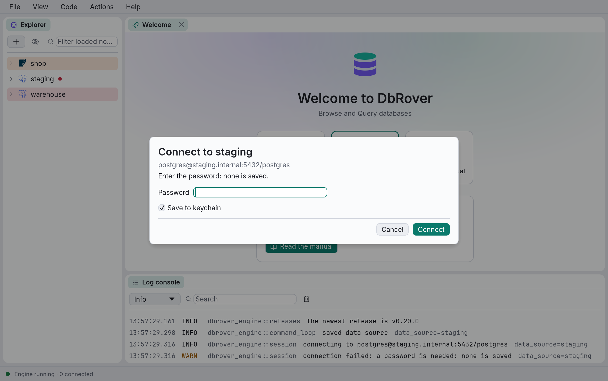

SQLite data sources have no password, so DbRover never asks the keychain for them.

## Password from a command

Some passwords aren't for keeping: an AWS RDS or Google Cloud SQL login token lasts fifteen
minutes or an hour, and a password in 1Password or Vault belongs there, not in a second store.
Tick **Password from a command** and DbRover runs a program on every connection, and its output
is the password. Every server engine has it: PostgreSQL, MySQL and MariaDB, SQL Server and
ClickHouse.

**Password command** takes the program, then each argument, **one per line**. There is no shell,
so nothing is quoted: a line is one argument, spaces and all, and `|`, `>` or `$(…)` mean nothing
special. `{host}`, `{port}`, `{user}` and `{database}` are filled in from the data source, after
its [placeholders](#placeholders-variable) are resolved. Some commands that work:

| For | Command, one line each |
| --- | --- |
| AWS RDS and Aurora (IAM) | `aws` `rds` `generate-db-auth-token` `--hostname` `{host}` `--port` `{port}` `--username` `{user}` `--region` `eu-west-1` |
| Google Cloud SQL (IAM) | `gcloud` `sql` `generate-login-token` |
| Azure Database (Entra ID) | `az` `account` `get-access-token` `--resource-type` `oss-rdbms` `--query` `accessToken` `--output` `tsv` |
| 1Password | `op` `read` `op://Work/{host}/password` |
| HashiCorp Vault | `vault` `kv` `get` `-field=password` `secret/db/{user}` |

What the program writes to standard output, without the spaces and line break around it, is the
password. It is never saved: not in the keychain, the log, the history or any file. Each
connection runs the program again (the explorer, each console, reconnecting after a dropped
connection), so a token that has expired is never reused. Through an [SSH tunnel](#ssh-tunnels)
it runs once the tunnel is open, and `{host}` is still the database's own host.

**The first time** a data source's command runs, DbRover shows it in full, as the list it runs,
and asks **Run this command for a password?** **Run and connect** remembers it and connects;
from then on it runs without asking. Change the command, even one argument, and it asks again.
What you trusted is kept in `trusted_commands.toml` with the commands of
[actions](customising.md#the-first-run), on this machine only: a data source you
[import](sharing.md) brings its command, and asks before it first runs here. **Test connection**
runs the command in the form without asking, since you are looking at it, and remembers nothing.

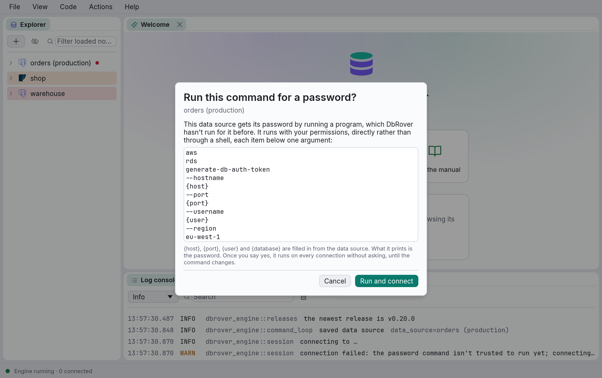

A command that fails stops the connection with how it ended and what it wrote to standard
error: *could not get the password: aws failed (exit status: 255): Unable to locate
credentials*. It may take up to a minute, enough for `op` or a browser sign-in to wait for you;
then it is stopped. One that prints nothing, or more than 4 MB, is an error too.

On a Mac, an app opened from the Finder doesn't see your shell's `PATH`, so `aws`, `gcloud` or
`op` installed with Homebrew are "not found". Write the program's full path on the first line:
`which aws` in a terminal prints it, such as `/opt/homebrew/bin/aws`.

[`dbrover mcp`](mcp.md) runs a data source's password command too, but only once you have
trusted it in DbRover: it has nobody to ask. A data source's [MCP login](mcp.md#the-mcp-login)
signs in with its own saved password, never the command's.

## Editing, connecting and deleting

Right-click a data source in the explorer for:

| Menu item | What it does |
| --- | --- |
| **Connect** / **Disconnect** | Opens or closes the explorer's connection. Expanding a data source also connects it. |
| **Refresh** | Reloads everything under the data source (while connected). |
| **New query console** | Opens a console on this data source. See [Query consoles](consoles.md). |
| **Open saved console** | Reopens a console you closed, by its file name. Shown when there are any. |
| **Diagrams** | Reopens one of the data source's saved ER diagrams; see [ER diagrams](diagrams.md#diagrams-are-saved). Shown when there are any. |
| **New › Schema…** | Creates a database, on MySQL, MariaDB and ClickHouse, whose schemas are databases. See [Views and schemas](views-schemas.md#new-schema). |
| **Edit…** | Opens the dialog with the saved settings. |
| **Move to project ›** | Puts the data source in a project, in **No project**, or in a new project. See [Projects](explorer.md#projects). |
| **Delete…** | Asks for confirmation, then removes the data source and deletes its saved password. |

Hover over a data source to see its driver, where it connects to and its connection state. The
dot after its name shows the state of the explorer's connection: amber while connecting, green
when connected, red when the last attempt failed, and no dot when disconnected. A failed
connection's error is in the tooltip and in the log console.
