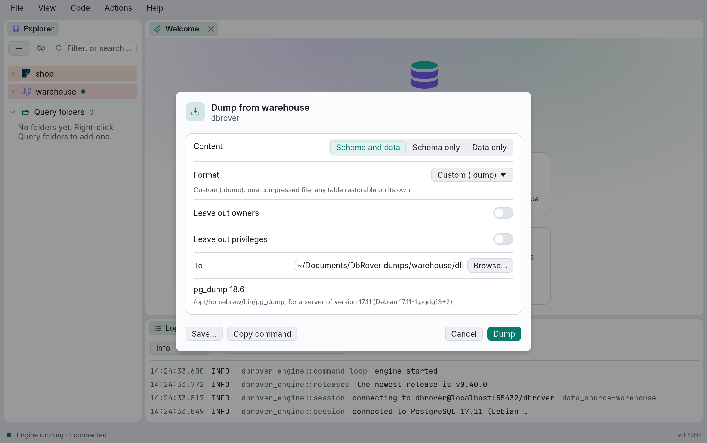
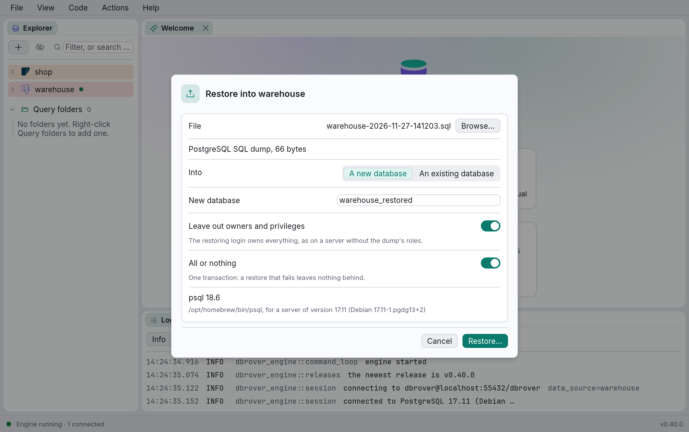
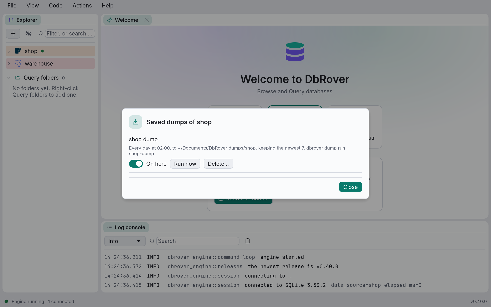

# Dump and restore

Before a migration you want a copy of the database to go back to. A bug only shows on
production's data, and you want that data on your laptop. A colleague sends you a dump. **Dump…**
and **Restore…** do these with each engine's own programs, `pg_dump`, `pg_restore` and `psql` for
PostgreSQL, `mysqldump` and `mysql` for MySQL, `mariadb-dump` and `mariadb` for MariaDB. DbRover
connects them the way the data source connects, with its password, TLS and SSH tunnel, and never
puts the password on a command line. SQLite and DuckDB dump and restore themselves, inside
DbRover.

Dump and restore aren't offered on Redshift, the cloud warehouses (BigQuery, Snowflake,
Databricks, Athena, Trino, Synapse, Fabric), MotherDuck, SQL Server or the NoSQL engines yet.

## Dumping

Connect the data source, then right-click it, or one of its databases, schemas or tables, and
choose **Dump…**. The dialog dumps what you right-clicked:



- **Content**: schema and data, schema only, or data only.
- **Format**: the engine's own, with what each is good for beside it.

  | Engine | Formats |
  | --- | --- |
  | PostgreSQL | **Custom** (`.dump`, the default): one compressed file, any table restorable on its own. **Directory**: a folder, dumped by several jobs at once. **Plain SQL** (`.sql`), or gzipped (`.sql.gz`) |
  | MySQL, MariaDB | **Plain SQL** (`.sql`), or gzipped (`.sql.gz`) |
  | SQLite | **A copy of the file** (`.sqlite`), consistent while others write to it (`VACUUM INTO`) |
  | DuckDB | **Parquet** or **CSV** files in a folder, with DuckDB's `schema.sql` and `load.sql` (`EXPORT DATABASE`) |

- **Leave out owners** and **leave out privileges** (PostgreSQL) leave out `ALTER … OWNER TO`
  and `GRANT`. Most dumps keep them; a restore can leave them out instead.
- **Jobs** (PostgreSQL's directory format): connections dumping at once. One by default, since
  each reads a whole table from a server others may be using.
- **To**: the file, named after the database and the time, `shop-2026-11-27-141203.dump`, first
  in `Documents/DbRover dumps/<data source>`, then wherever you last dumped that data source.
  **Browse…** picks another. DbRover never writes over a file: one that exists stops the dump.
- **The program**: which copy of `pg_dump` (or `mysqldump`, or `mariadb-dump`) DbRover found, its
  version, and the server's. If none fits, the dialog says why and how to install one, and
  **Dump** stays disabled.

**Copy command** copies the command as it will run, for a terminal where `~/.pgpass` or
`~/.my.cnf` holds the password, since the password is never in it. Through an SSH tunnel the
command is only known once the dump runs, so it is in the log console and History then.

**Dump** closes the dialog. The dump runs in the status bar with its tables and bytes so far and
**Cancel**, and says where it went when it ends. While it runs it is written as
`shop-….dump.partial` and renamed once the program has ended well, so a file without `.partial`
is always a whole dump; a cancelled or failed dump leaves nothing. Past two minutes the machine
is kept awake, as for long reports.

## Finding the programs

DbRover doesn't come with the engines' programs. It looks for them:

1. **The path you set in [Settings](settings.md) › Dumps › Programs**, which always wins.
2. **`PATH`.** On macOS an app opened from the Finder gets a short `PATH`, not your shell's, so
   DbRover also looks…
3. **…where installers put them:** Homebrew (`libpq`, `postgresql@17`, `mysql-client`,
   `mariadb`), Postgres.app, the EDB installer, Debian's and Ubuntu's
   `/usr/lib/postgresql/<version>/bin`, the PostgreSQL project's `/usr/pgsql-<version>/bin`, and
   the PostgreSQL, MySQL and MariaDB installers' folders on Windows.

Every copy found is asked its version, and the one that fits the server is chosen:

- **PostgreSQL**: `pg_dump` refuses a server newer than itself, so it must be at least the
  server's major version; one of the server's own version is preferred, then the newest.
  `pg_restore` must be at least as new as the `pg_dump` that made the dump. To dump PostgreSQL 17
  you need PostgreSQL 17's or 18's client tools: `brew install libpq` (or
  `brew install postgresql@17`), `sudo apt install postgresql-client-17` from apt.postgresql.org,
  or the EDB installer with only Command Line Tools ticked.
- **MySQL and MariaDB**: each family's own client, `mysqldump` for MySQL and `mariadb-dump` for
  MariaDB, since across families they only half work. An older client than the server is used,
  with a warning.

A path you type in **Settings › Dumps › Programs** is trusted to run, as DbRover records in
`trusted_commands.toml` in the data folder. A path that came in a copied or synced
`settings.toml` isn't, and the dump says so; set it again in Settings to trust it.

## Passwords, TLS and tunnels

A dump connects as the data source does: its password from the keychain or the session, its
[password command](data-sources.md), or its cloud sign-in token; its TLS mode and CA file; and its
SSH tunnel, through which the program connects on a port of `127.0.0.1`.

The password goes in a file only you can read, in DbRover's data folder, given to the program as
`PGPASSFILE` or MySQL's `--defaults-file`, and removed when the program ends. It is never on the
command line, where any user of the machine can read it, nor in the environment. `PG…` and
`MYSQL…` variables in your profile are left out, and the MySQL clients don't read `~/.my.cnf`,
so what runs is the data source's settings.

- Through a tunnel, PostgreSQL still checks the server's certificate against its own name
  (`verify-full`); the MySQL clients can't, so they check its authority only (`VERIFY_CA`).
- `verify-full` without a CA file uses the system's authorities, which needs `pg_dump` 16 or later.
- A MySQL password whose quotes and `#` its option file can't hold is refused rather than sent
  cut short.
- Behind PgBouncer in transaction mode a dump can fail: use the server's own port. On Neon, use
  the direct host, not the pooled one.

## Restoring

Right-click a connected data source → **Restore…**, or a database → **Restore into this
database…**, and choose the dump. For a PostgreSQL directory dump, choose the `toc.dat` inside it,
and for a DuckDB export its `load.sql`. DbRover reads the file first: what kind it is, which
engine wrote it, and for a PostgreSQL archive its tables and the versions of the server and
`pg_dump` it came from. A dump for another engine is refused.



- **Into a new database**, the default, named after the dumped one with `_restored`. DbRover
  creates it before the program runs, so nothing that was there can be lost.
- **Into an existing database**, written into. Objects that already exist make the restore fail,
  unless **Drop each object first** (PostgreSQL archives) drops them, with their data.
- **Tables**: an archive's tables, all ticked; untick some to restore the rest. Tables restored on
  their own come back with their rows, without their indexes, keys or triggers.
- **Leave out owners and privileges**, on by default: the restoring login owns everything, as you
  want on a server without the dump's roles. On MySQL and MariaDB it takes out the `DEFINER` of
  views, routines, triggers and events, which a login without `SET_USER_ID` couldn't restore.
- **All or nothing** (PostgreSQL), on by default: one transaction, so a restore that fails
  leaves nothing behind. MySQL can't: it commits each `CREATE` as it runs it, so a failed
  restore leaves what it did, and a new database is what makes it safe to try again.

Restores stop at the first error, and the status bar shows the program's last lines. A view or
trigger whose definition names its own database, as `shop.orders`, is restored into that
database, as the dump wrote it.

SQLite and DuckDB restore into a new file, by default beside the dump, never over one.

### It always asks

**Restore…** always asks before anything is written, naming the file, the database and the data
source: *Restore shop.dump into a new database "shop_restored" on "local"?*. Into an existing
database of a [careful](data-sources.md) data source, you also type the database's name. A
read-only data source can't be restored into: **Restore…** is disabled there, with the reason.
A dump only reads, so it never asks.

## Saved and scheduled dumps

**Save…** in the Dump dialog keeps its settings under a name, to run again: by hand, every day
or every week at a time, or every few hours, and how many of its files to keep (the newest 7 by
default; 0 keeps them all). Right-click the data source → **Saved dumps…** lists them:



- **On here** turns the schedule on, on this machine. A schedule runs only while DbRover is open;
  one missed while it was closed runs once, a minute after it opens, never once per missed day.
- **Run now** runs it at once, in the status bar.
- After a run that works, the files past **keep** are removed: only files that saved dump wrote,
  never anything else in its folder.
- **Delete…** removes the saved dump and leaves its files.

The saved dumps are in `dumps.toml` in your [settings folder](settings.md), which you can read,
edit and keep in Git:

```toml
format_version = 1

[[dump]]
id = "nightly-shop"
name = "Nightly shop"
data_source = "6f1c…"
database = "shop"
schemas = ["public"]
format = "custom"
folder = "/Users/ada/Documents/DbRover dumps/production"
keep = 7

[dump.schedule]
every = "day"
at = "02:00"
```

`schedule` can also be `{ every = "week", on = "monday", at = "07:00" }` or
`{ every = "hours", hours = 6 }`. Whether a schedule is on, and the files each one wrote, are kept
in the data folder (`dump_schedules.toml`), so a settings folder synced to a second machine
doesn't dump twice.

### From the command line

To dump on a schedule with DbRover closed, let the system's scheduler run a saved dump:

```text
dbrover dump run <saved dump> [--config-dir <folder>]
```

It takes the saved dump's id or its name, runs it as its schedule would, records it in the
history, removes the files past its `keep`, and exits 0 once the dump is written, 1 otherwise
with the reason. There is nobody to ask for a password, so it must be in the keychain, or come
from a password command or a cloud sign-in.

- **cron** (Linux, macOS): `0 2 * * * /usr/bin/dbrover dump run nightly-shop`
- **launchd** (macOS): a `~/Library/LaunchAgents` agent whose `ProgramArguments` are
  `/Applications/DbRover.app/Contents/MacOS/dbrover`, `dump`, `run`, `nightly-shop`, with a
  `StartCalendarInterval` of hour 2, minute 0.
- **Task Scheduler** (Windows): a daily task running `dbrover.exe` with the arguments
  `dump run nightly-shop`.

## In the history

Each dump and restore is recorded once in [History](history.md), as **Dump** or **Restore**:
when, how long, how it ended, the command that ran (never with the password), and what was
dumped where or restored into what. A scheduled run is recorded the same way.
