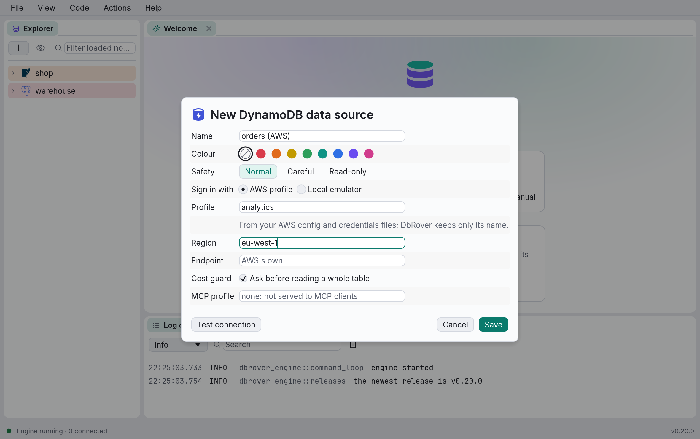

# DynamoDB

DbRover connects to Amazon DynamoDB, on AWS or on an emulator of it (DynamoDB Local,
LocalStack). You browse a region's tables, their keys and indexes, query them in PartiQL, and
edit items in the grid. DynamoDB bills each item a query reads, so a guard asks before a
statement reads a whole table.

## Signing in

A DynamoDB data source keeps no password and no AWS secret. It signs in the way the AWS CLI
does, through AWS's own SDK, with what is already on your machine: the shared `config` and
`credentials` files in `~/.aws`, IAM Identity Center (`aws sso login`), `aws login`,
`credential_process`, the environment, or a role. DbRover saves only the names you type.



| Field | Default | Notes |
| --- | --- | --- |
| Sign in with | AWS profile | **AWS profile**, or **Local emulator** for DynamoDB Local and LocalStack. |
| Profile | AWS's default | A profile of your AWS files, such as `analytics`. A named profile is used alone, as `aws --profile` uses it: keys in the environment don't override it. Empty: AWS's default chain (the environment's keys, then `AWS_PROFILE` or `default`, then a container's or instance's role). |
| Region | the profile's | Such as `eu-west-1`. Empty: the profile's region, or `AWS_REGION`. |
| Endpoint | AWS's own | Another address: a VPC endpoint, DynamoDB Local (`http://localhost:8000`) or LocalStack (`http://localhost:4566`). Required for **Local emulator**. |
| Cost guard | on | **Ask before reading a whole table**; see [The scan guard](#the-scan-guard). |
| MCP profile | none | Required for AI assistants; see [Safety and AI assistants](#safety-and-ai-assistants). |

**Local emulator** signs in with made-up credentials, which DynamoDB Local and LocalStack accept
and AWS never would. Its region defaults to `us-east-1`; DynamoDB Local keeps a separate
database for each region.

**Test connection** lists one table and says where it connected ("Connected to DynamoDB
eu-west-1"). A profile that isn't in your AWS files, or an IAM Identity Center session that
expired, is an error there, naming the profile: run `aws sso login --profile <name>` and test
again. The SDK refreshes credentials before they expire while DbRover runs.

## The explorer

The explorer lists the region's tables by name, 100 at a time with **Load more…**; the filter
box matches any part of a name. Each table shows its approximate item count and size, as
DynamoDB reports them (it updates them about every six hours: nothing is counted). Under a
table are its key attributes, the partition key and the sort key with their types (`S`, `N`,
`B`), and an **indexes** folder with its global and local secondary indexes and their keys.

- **Open data** on a table or an index opens a console with `SELECT * FROM "orders"` (or
  `"orders"."by-status"`) and runs it, a page at a time.
- **Show definition** gives the table as `aws dynamodb create-table --cli-input-json` takes it:
  keys, attribute definitions, billing mode, indexes and their projections, the stream and
  deletion protection.

## The console

A DynamoDB console runs PartiQL, DynamoDB's SQL-like language, a statement at a time; separate
statements with `;`.

```sql
SELECT * FROM "orders" WHERE customer = 'c-42' AND placed > '2026-10';
SELECT * FROM "orders"."by-status" WHERE status = 'open';
INSERT INTO "orders" VALUE {'customer': 'c-42', 'placed': '2026-11-01', 'tags': <<'gift'>>};
UPDATE "orders" SET total = 12.5 WHERE customer = 'c-42' AND placed = '2026-11-01';
DELETE FROM "orders" WHERE customer = 'c-42' AND placed = '2026-11-01';
```

Quote a table's name in double quotes when it has a dash or a dot. Strings take single quotes;
maps are `{…}`, lists `[…]` and sets `<<…>>`. DynamoDB's `UPDATE` and `DELETE` change one item,
named by its whole primary key. Completion offers PartiQL's keywords, DynamoDB's functions
(`begins_with`, `contains`, `attribute_type`, `size`, `exists`) and the tables the explorer
has loaded.

Items come back as documents, one per row, flattened into the grid's columns with the table's
keys first; **Tree** and **JSON** show the selected item whole. Numbers keep their digits, a
binary value shows as `BinData(0, "…")`, and a set as PartiQL writes it, `<<'a', 'b'>>`. A
write answers nothing unless it says `RETURNING`.

Results page 500 items at a time. Each page reads at most 5,000 items: a statement whose
`WHERE` keeps few of them shows a short page, maybe an empty one, with **Load more**, rather
than reading on unseen.

DynamoDB has no explain and can't check a statement without running it, so **Explain** isn't
offered, and a misspelt attribute shows only when the statement runs. There are no
transactions in the console. **Cancel** (⌘.) stops the statement between two of its requests: DynamoDB can't stop
one it has received, so a write cancelled while in flight may have been applied.

## The scan guard

A `SELECT` reads only the partitions it names when its `WHERE` has an `=` or `IN` on the
partition key of the table or index it reads, joined to the rest with `AND`. Any other
`SELECT` is a Scan: DynamoDB reads every item of the table and bills each one, whatever the
`WHERE` keeps.

With **Ask before reading a whole table** on (the default), a console holds such a statement
back and asks, **Read all of orders?**, naming the partition key it lacks. **Scan anyway** runs
it and the statements after it; a later statement that scans too is asked about again. **Open
data** reads a page at a time without asking. **Run to file** and **All documents** refuse a
Scan: turn the guard off in the data source to export a whole table. AI assistants are refused
one, since nobody is there to ask.

Turn the guard off in the data source's dialog. Each page still reads at most 5,000 items.

## Editing items

The items a `SELECT` reads from one table can be edited in the grid, once DbRover has looked up
the table's key, as for a SQL table's rows. Each change becomes a statement of its own, run one
at a time and written to the history:

- a changed attribute is `UPDATE … SET`, by the item's whole key; its value keeps the type the
  old one had, so a number stays a number. Over a set, type a JSON list of its items
  (`["a", "b"]`);
- a deleted row is a `DELETE`; an added row is an `INSERT … VALUE`, which needs the key's
  attributes typed.

The key's attributes can't be changed (DynamoDB can't), an index's items aren't editable since
two may share a key, and binary values can't be written in PartiQL, so those are refused with
the reason.

## Safety and AI assistants

DynamoDB has no read-only mode for a connection. A **read-only** data source refuses `INSERT`,
`UPDATE` and `DELETE` before they are sent; for DynamoDB itself to refuse them, sign in with a
profile whose IAM policy allows only reading, such as:

```json
{
  "Version": "2012-10-17",
  "Statement": [{
    "Effect": "Allow",
    "Action": ["dynamodb:PartiQLSelect", "dynamodb:DescribeTable", "dynamodb:ListTables"],
    "Resource": "*"
  }]
}
```

AI assistants are served a DynamoDB data source only through its **MCP profile**: another AWS
profile, with such a policy, that `dbrover mcp` signs in as instead of the data source's own. It
needs no password in DbRover. Without one, the data source isn't served, and the server's log
says why. Assistants read through the `query` tool, one PartiQL `SELECT` at a time, and are
refused a Scan while the guard is on; `execute` is refused, since DbRover has no transaction to
run changes in. See [Connecting an AI assistant](mcp.md).
