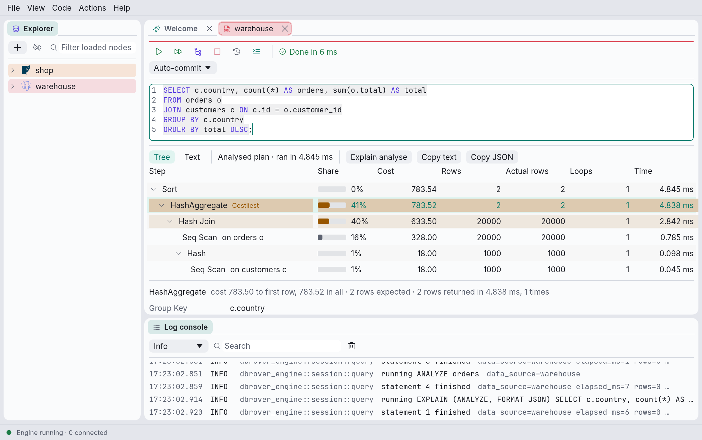

# Reading query plans

When a query is slow, its plan says why: which tables the database reads and how, how it joins
them, and how many rows each step handles. DbRover draws the plan as a tree of steps and points
at the ones that cost the most.

- **Explain** (⌥⌘E) shows the plan of the statement at the cursor, as the database expects to
  run it. Nothing runs.
- **Explain analyse** (⇧⌥⌘E, or the button above a plan) runs the statement and shows, beside
  each estimate, what each step actually did.

On Linux and Windows, use Ctrl instead of ⌘. Both keys can be changed (see
[Keyboard shortcuts](shortcuts.md)).

## The tree

Each row is a step: what it does (**Hash Join**, **Seq Scan on orders o**), indented under the
step it feeds. The database reads the tree from the bottom up: the innermost steps read tables,
and each step above combines what the steps below it return.

| Column | What it says |
| --- | --- |
| **Share** | How much of the whole plan the step accounts for on its own, without the steps under it. |
| **Cost** | The database's estimate for the step and every step under it, in its own units, which only compare within one plan. |
| **Rows** | The rows the step is expected to return each time it runs. |
| **Actual rows** | After Explain analyse: the rows it returned each time it ran, on average. |
| **Loops** | After Explain analyse: how many times it ran. A step on the inside of a nested loop runs once for each row of the outside. |
| **Time** | After Explain analyse: how long it took, every time it ran and the steps under it included. |

- **The costliest step** is tinted and marked **Costliest**, and any other step with at least a
  quarter of the plan is tinted lightly. A step's share is its own cost, which is its cost minus
  its children's, since every database counts a step's cost with everything under it; that
  makes the top step look the most expensive although it rarely is. After Explain analyse,
  shares go by time instead of the estimate.
- **A wrong estimate** is flagged with ⚠ in **Actual rows** when a step returned ten times more
  or fewer rows than expected; hover over it to see the estimate. The database chooses its joins
  and scans by these counts, so a wrong one is the usual reason it picks a slow plan, often
  because a table's statistics are out of date (`ANALYZE` on PostgreSQL, `ANALYZE TABLE` on
  MySQL and MariaDB, `UPDATE STATISTICS` on SQL Server).
- **never ran** means the plan didn't need the step this time, for example the other side of a
  join whose first side returned no rows.
- **What else the database says** about a step (the join condition, the filter, the sort key,
  the index, rows removed by a filter) shows when you hover over it, and under the tree for the
  selected step. The costliest step is selected at first; click another step's name to select
  it.
- **The arrow** before a step folds and unfolds the steps under it.

## Text, and copying

**Text** shows the same plan as text, a line per step with its facts below it, laid out as
PostgreSQL's own `EXPLAIN` is, whichever database it came from. **Tree** goes back.

- **Copy text** copies that text, to paste into a message or a ticket.
- **Copy JSON** (**Copy XML** on SQL Server) copies the plan as the database returned it, for
  tools that read the format, such as a plan visualizer or SQL Server Management Studio, which
  opens it saved as a `.sqlplan` file.

## Each database

| Database | Explain | Explain analyse |
| --- | --- | --- |
| PostgreSQL | `EXPLAIN (FORMAT JSON)` | `EXPLAIN (ANALYZE, FORMAT JSON)` |
| MySQL 8.3 and later | `EXPLAIN FORMAT=JSON`, as a tree of the steps MySQL runs | `EXPLAIN ANALYZE FORMAT=JSON` |
| MySQL before 8.3 | `EXPLAIN FORMAT=JSON` | Not available: MySQL only writes it as text |
| MariaDB | `EXPLAIN FORMAT=JSON` | `ANALYZE FORMAT=JSON` |
| SQL Server | `SET SHOWPLAN_XML ON` | `SET STATISTICS XML ON` |

- **MySQL 8.3 and later** only write their plan as a tree, which `EXPLAIN ANALYZE` needs, when
  the session's `explain_json_format_version` is 2. DbRover sets it just for the explain and puts
  back what the session had.
- **MySQL before 8.3 and MariaDB** write each `SELECT` as a block holding its sorting, grouping
  and the tables it reads one after another. DbRover names those steps as MySQL's tree format
  would: **Table scan on c**, **Index lookup on o using customer_id**. MariaDB times each block
  without counting its rows, so a block's **Actual rows** is empty.
- **SQL Server** sends the actual plan after the statement's own rows, which DbRover reads and
  drops, so Explain analyse on a query that returns many rows still takes as long as fetching
  them. Its steps are named as Management Studio names them, with the logical operation after the
  physical one when it says more: **Hash Match (Aggregate)**.
- **SQLite, DuckDB, ClickHouse and MongoDB** keep their plan as the database writes it, in the
  grid (see [Query consoles](consoles.md#running-sql)). Their plans don't estimate costs to
  compare, and they have no Explain analyse.

If the database answers with something DbRover can't read as a plan, it shows the answer in the
grid as it came, with the reason above it.

## Explain analyse runs the statement

Explain analyse really runs the statement, as **Run** does, so it follows the same rules:

- A statement that changes data changes it. In a console that commits by hand (see
  [Transactions](consoles.md#transactions)), the change stays in the open transaction until you
  commit or roll back, so you can analyse an `UPDATE` and roll it back.
- On a **careful** data source it always asks first, saying that Explain analyse runs the
  statement, even for a `SELECT`, which running alone wouldn't ask about.
- On a **read-only** data source a change is refused before it is sent, and the rest runs inside
  the read-only transaction, so a write hidden in a function is refused by the database.
- An `UPDATE` or `DELETE` without `WHERE` asks first, as it does when you run it.

See [Data sources](data-sources.md#safety-levels) for the safety levels.
