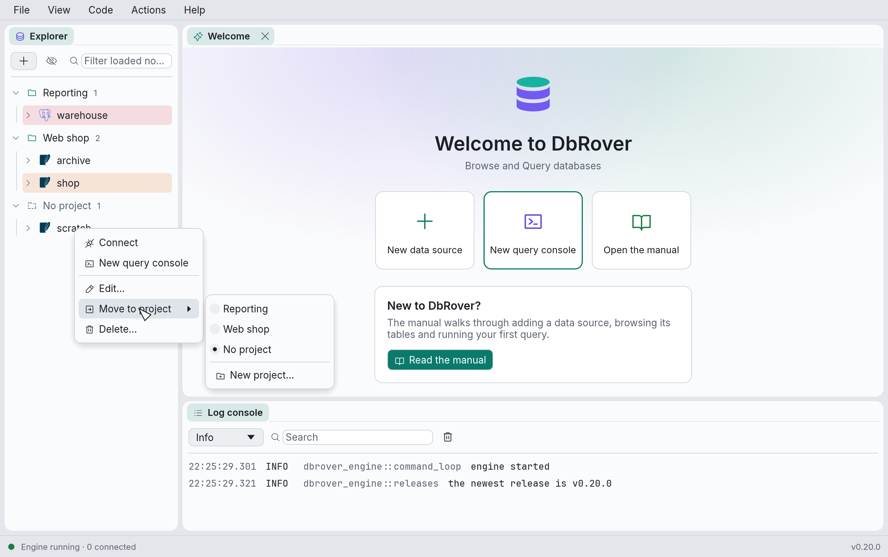
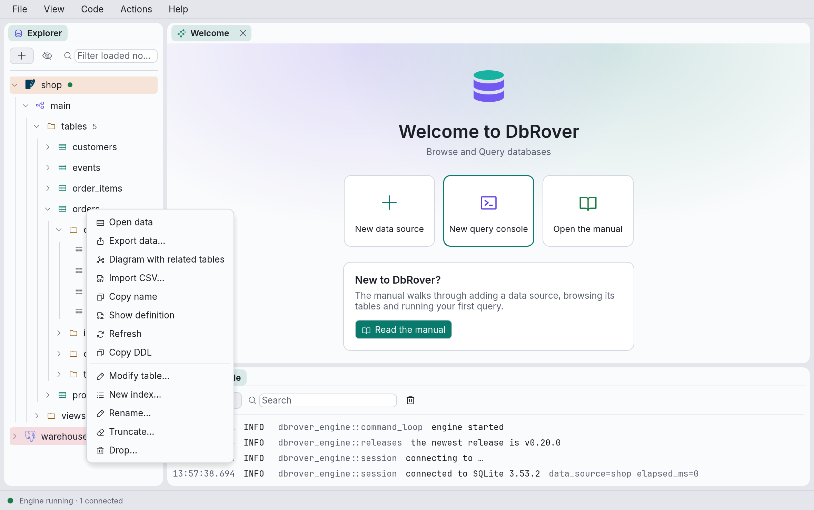
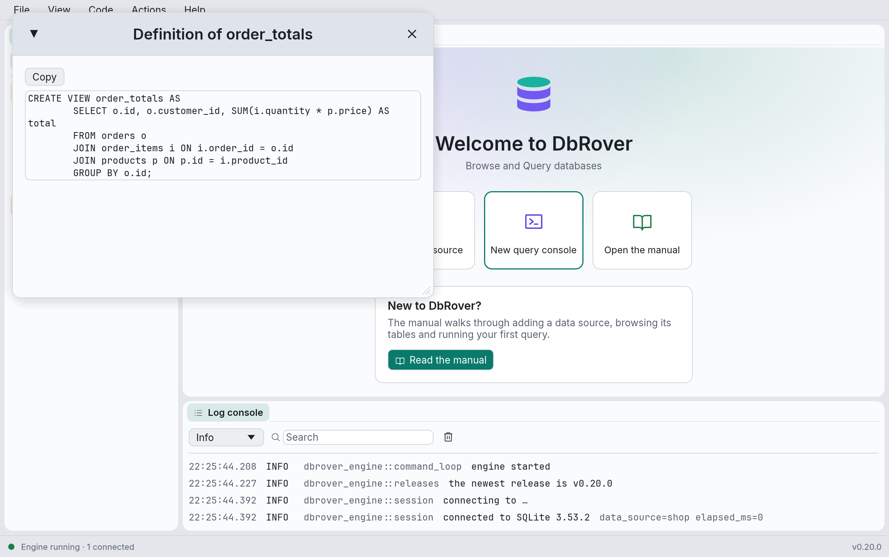
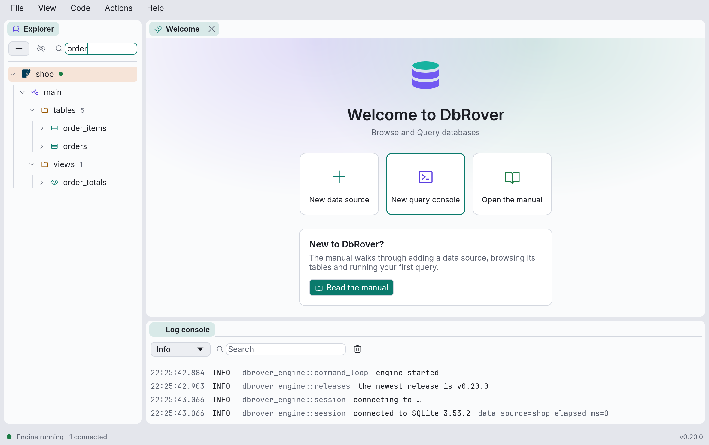

# The explorer

The explorer shows each data source as a tree. Nothing is loaded until you open it: expanding
a node asks the database for that node's children, and a spinner shows while it waits. Expanding
a data source that isn't connected connects it first.

Click the arrow before a node, or double-click its name, to expand or collapse it.

## Projects

Projects group data sources, say one per application you work on. Once there is at least one
project, the explorer shows each project as a header you can fold, with its data sources under
it, and the data sources in no project under **No project**. With no projects, it lists the data
sources on their own, as before.



- **New project…** is in the **+** menu, on every project header's menu, and at the bottom of
  **Move to project**. From **Move to project**, the data source moves into the new project.
- **Move to project ›** on a data source's menu lists the projects and **No project**; the one
  it is in now is marked.
- **Rename…** on a project changes only its name.
- **Delete…** on a project moves its data sources to **No project** first. No data source is
  deleted.
- **Project settings…** on a project sets whether, and how, AI assistants may use its data
  sources; **Copy MCP configuration** copies what an assistant's client needs to connect. See
  [Connecting an AI assistant](mcp.md).

Each project also has a short **slug**, made from its first name: lower case, with hyphens for
spaces (`Web shop` becomes `web-shop`). Hover over a project to see it. Renaming a project keeps
its slug, so whatever refers to it by slug keeps working. A data source belongs to at most one
project, and a project may hold data sources of any colour and engine.

## What the tree contains

**PostgreSQL**

```text
data source
├─ roles                  the server's users and groups (see Users and roles)
└─ database               every database on the server that accepts connections
   └─ schema
      ├─ tables
      │  └─ table
      │     ├─ columns    with their type, "not null" and "primary key"
      │     ├─ indexes
      │     ├─ constraints
      │     └─ triggers
      ├─ views
      ├─ materialized views
      ├─ functions        with their argument types, so overloads are told apart
      └─ sequences
```

**SQLite**

```text
data source
└─ main
   ├─ tables
   │  └─ table
   │     ├─ columns
   │     ├─ indexes
   │     ├─ constraints   primary and foreign keys
   │     └─ triggers
   └─ views
```

**MySQL and MariaDB**, where a database and a schema are the same thing:

```text
data source
└─ database               every database you may see, shown as a schema
   ├─ tables
   │  └─ table
   │     ├─ columns    with their type and "not null"
   │     ├─ indexes    with their columns, and whether they are unique
   │     ├─ constraints
   │     └─ triggers
   ├─ views
   ├─ functions
   ├─ procedures
   └─ events          scheduled with CREATE EVENT
```

**SQL Server**, which keeps schemas inside each database, as PostgreSQL does, and lets one
connection browse them all:

```text
data source
└─ database                 every database the login may open
   └─ schema
      ├─ tables
      │  └─ table
      │     ├─ columns      with their type, length and "not null"
      │     ├─ indexes      with their key columns, clustered or not, and whether unique
      │     ├─ constraints  primary key, unique, foreign key, check and default
      │     └─ triggers
      ├─ views
      ├─ functions
      ├─ procedures
      ├─ sequences
      └─ synonyms           with the object each one names
```

**ClickHouse**, where, as on MySQL, a database holds its tables directly:

```text
data source
└─ database                 every database you may see, shown as a schema
   ├─ tables
   │  └─ table
   │     ├─ columns         with their type
   │     └─ indexes         data-skipping indexes, with their type and expression
   ├─ views
   ├─ materialized views
   │  └─ columns
   └─ dictionaries
      └─ columns
```

A ClickHouse table's primary key is its sort order rather than an index, so it shows in the
table's definition, not under **indexes**. Functions aren't listed: a ClickHouse function belongs
to the whole server, not to one database.

**MongoDB**, where the explorer lists the databases the user may see (`admin`, `config` and
`local` are system ones), and in each its collections:

```text
data source
└─ shop                     a database
   ├─ open_orders           a view
   ├─ orders                a collection, with its estimated number of documents
   │  ├─ _id_               its indexes, each with its keys
   │  └─ status_created     {status: 1, created: -1} · unique
   └─ readings              a time-series collection
```

The number of documents is the server's estimate, from the collection's metadata: DbRover never
counts a collection by reading it. Views and time-series collections show none, since counting
them would read every document. Collections are listed by name, 1,000 at a time, with **Load
more…** after them; in a database with more, the filter box searches every collection's name on
the server. `system.` collections are system ones.

**Open data** on a collection or a view opens a console with
`db.getCollection("orders").find({})` and runs it, in the collection's database. **Show
definition** gives the commands that make it again: `db.createCollection(…)` with its options and
validator, or `db.createView(…)`, then a `createIndex(…)` for each index but `_id`'s.

**Elasticsearch / OpenSearch**, where a cluster has no databases, and the explorer lists what a
search reads from and what makes new indices:

```text
data source
├─ indices
│  └─ orders                an index, with its number of documents (or "closed")
│     ├─ address.city       its fields, from its mapping, by their path, with their type
│     └─ address.city.keyword
├─ aliases
│  └─ orders-live           → the indices it names
├─ data streams
│  └─ logs-web              with its number of backing indices
└─ index templates
   └─ logs                  with its index patterns
```

An object's fields are listed by their path: a field of an object under it (`address.city`),
a `nested` field before its own fields, and a field's other ways of being indexed after it
(`status.keyword`). Indices are listed by name, 1,000 at a time, with **Load more…** after
them; in a cluster with more, the filter box searches every index's name on the server.

**Open data** on an index, an alias or a data stream opens a console with a `match_all` search
of it and runs it, its hits read a page at a time as you scroll.

**Cassandra / ScyllaDB**, where a keyspace holds its tables, as a MySQL database does:

```text
data source
└─ keyspace                 every keyspace you may see
   └─ tables
      └─ table
```

The keyspaces the servers keep for themselves (`system`, `system_schema`, `system_auth`, …) are
system ones, shown only with **System** ticked. **Open data** on a table opens a console with
`SELECT * FROM keyspace.table` and runs it, its rows read a page at a time as you scroll.

**Redis / Valkey**, where the server's numbered databases hold keys, grouped by the data
source's **Key separator** (`:` unless you set another):

```text
data source
└─ db0                      each database that holds keys, with how many
   ├─ user                  the keys that start with user:
   │  └─ 42                 the keys that start with user:42:
   │     ├─ cart            user:42:cart, a hash
   │     └─ name            user:42:name, a string, with its time to live
   └─ plain                 a key with no separator in its name
```

The data source's own database is listed even when it is empty. Each key shows its type's
icon (string, hash, list, set, sorted set, stream, JSON) and, beside its name, its type and
time to live when it has one (`string · TTL 2 h`). **Copy name** copies a key's whole name.

Keys are read with `SCAN`, 1,000 at a time, never with `KEYS`, so listing even a database of
millions of keys never stalls the server. They come in the order the server stores them, not
sorted: **Load more…** at the end of a level reads the next 1,000. A level whose keys fall into
only a few groups may need to read many keys to find its next groups; a page stops after about
100,000 keys and offers **Load more…** rather than keeping you waiting.

In a level with more than 1,000 nodes, typing in the filter box searches every key under it for
that text, ignoring case, on the server, as `SCAN`'s `MATCH`: the level then lists the matching
keys themselves, by their whole names, however deep they are. Clearing the filter brings the
groups back. A smaller level was loaded whole, and is filtered by what is loaded, as the other
engines' levels are.

**DuckDB**, where the database opened (named after its file, or `memory`) is listed with any
attached with `ATTACH`:

```text
data source
└─ database                 the one opened, and attached ones
   └─ schema                main, and any you create
      ├─ tables
      │  └─ table
      │     ├─ columns      with their type and "not null"
      │     ├─ indexes
      │     └─ constraints  primary key, unique, foreign key and check
      ├─ views
      ├─ functions          macros made with CREATE MACRO
      └─ sequences
```

Each kind of object has its own icon and colour, and folders that have been loaded show how many
objects they hold (`tables 5`).

Browsing another PostgreSQL database than the one in the data source's settings opens a
separate connection to that database.

## The context menu

Right-click an object for what you can do with it:



| Menu item | Shown for | What it does |
| --- | --- | --- |
| **Open data** | Tables, views, materialized views; Redis keys; MongoDB collections; Elasticsearch indices, aliases and data streams | Opens a new console that reads the object (`SELECT * FROM` it, in SQL) and runs it. |
| **Export data…** | Tables, views | Writes every row to a file, in any export format; see [A whole table, from the explorer](exporting.md#a-whole-table-from-the-explorer). |
| **Diagram…** | Schemas, on engines with foreign keys | Picks tables of the schema for an ER diagram; see [ER diagrams](diagrams.md). |
| **Diagram with related tables** | Tables, on engines with foreign keys | Opens a diagram of the table and every table its keys join. |
| **Import CSV…** | Tables | Asks for a CSV file and imports it into the table; see [Importing a CSV file](table-data.md#importing-a-csv-file). |
| **Copy name** | Objects inside a schema | Copies the name to use in SQL: schema-qualified for tables, views, sequences, indexes and functions (`main."Order Items"`), bare for columns, constraints and triggers. Quoted where needed. |
| **Show definition** | Objects whose source the database keeps (see below) | Opens the source in a window. |
| **Refresh** | Anything with children | Reloads the node's children and collapses everything below it. |
| **Copy DDL** | Tables, views, materialized views | Copies the statement that creates it; see [Copy DDL](objects.md#copy-ddl). |

Below those come the object helpers, **New › Table…**, **New index…**, **Rename…**,
**Truncate…**, **Drop…** and **Drop index…**, which [Creating and changing tables](objects.md)
describes, and those for views and schemas (**New › View…**, **Edit…**, **Refresh…**,
**New › Schema…**, **Drop schema…**), which [Views and schemas](views-schemas.md) describes.

A data source's own menu (Connect, New query console, Open saved console, Diagrams, Edit,
Delete and so on) is described in [Data sources](data-sources.md#editing-connecting-and-deleting).

## Definitions

**Show definition** opens a window with the object's SQL, which you can select and copy with
the **Copy** button.



Which objects have one depends on the database:

- **PostgreSQL**: views, materialized views, functions, indexes, constraints and triggers.
- **SQLite**: tables, views, triggers, and indexes created with `CREATE INDEX` (not the ones
  SQLite makes for primary keys and unique constraints).
- **MySQL and MariaDB**: tables, views, functions, procedures, events and triggers, as
  `SHOW CREATE …` gives them. A routine whose source you may run but not read shows a message
  instead.
- **SQL Server**: views, functions, procedures and triggers, as SQL Server stores their source
  (what `OBJECT_DEFINITION` returns), and synonyms. One created `WITH ENCRYPTION`, or that your
  login may run but not read, shows a message instead.
- **DuckDB**: tables, views, macros, indexes and sequences, as DuckDB keeps them. A macro's
  definition is rebuilt from its parameters and body, one `CREATE MACRO` per parameter list.
- **ClickHouse**: tables, views, materialized views and dictionaries, as ClickHouse keeps
  their `CREATE` statement.
- **Elasticsearch and OpenSearch**: an index, as the `PUT /<index>` that makes it again with
  its aliases, mappings and the settings that can be set (not those the server sets itself,
  such as its `uuid` or `creation_date`); an alias, as the `POST /_aliases` that adds it to
  each of its indices; an index template, as its `PUT /_index_template/<name>`. Each runs again
  as written, in a console.

## Filtering

Type in the box at the top of the explorer to filter the tree by name, ignoring case. An object
that matches is shown with everything under it, and the nodes leading to it stay open even if
they don't match themselves. Data sources and projects are matched by name too: a project
whose name matches shows all its data sources, and data sources and projects with nothing
matching are hidden while you type.



The filter searches what has already been loaded: expand the parts you want to search first.
The exception is a schema with more objects than the explorer shows at once (below): there,
once you stop typing, the database is asked for the objects whose names contain the text, so
the filter finds them all, loaded or not.

## Large schemas

A schema's tables, views, materialized views and sequences load 1,000 at a time on PostgreSQL
and SQLite, in order of name, so a schema of tens of thousands of tables opens as quickly as a
small one. **Load more…** at the end of the list loads the next 1,000. The other databases, and
the other levels of the tree, load whole.

## System objects

The explorer hides each database's own objects:

- PostgreSQL's `pg_catalog`, `information_schema` and temporary schemas, and its predefined
  `pg_` roles;
- SQLite's internal `sqlite_` tables;
- MySQL's `mysql`, `information_schema`, `performance_schema` and `sys` databases;
- SQL Server's `master`, `model`, `msdb` and `tempdb` databases, and in every database the
  `sys`, `INFORMATION_SCHEMA` and `guest` schemas and those of the fixed database roles;
- DuckDB's `system` and `temp` databases, and its `information_schema` and `pg_catalog`
  schemas;
- ClickHouse's `system` and `information_schema` databases (in either case), and the
  `.inner` tables where a materialized view without a `TO` table keeps its rows;
- Elasticsearch's and OpenSearch's indices, aliases and data streams whose name starts with
  `.`, hidden data streams, and the index templates the server manages itself (`logs`,
  `metrics` and the like on Elasticsearch).

The eye button next to **+** shows or hides them, for every data source at once.

## When the connection closes

Disconnecting forgets everything the explorer had loaded for that data source. It is loaded
again, fresh, the next time you expand it. **Refresh** does the same for a single node while
connected, which is how you see a table you just created.

A connection can also be **lost**: the server restarted, an administrator ended the session, or
the network or SSH tunnel dropped. DbRover notices when a request fails that way, and, before
using a connection that has sat unused for a minute, by checking that it still answers. The
data source's dot turns red and its tooltip says *Disconnected* and why. The tree stays as it
was, and the next thing you expand or refresh connects again by itself.
