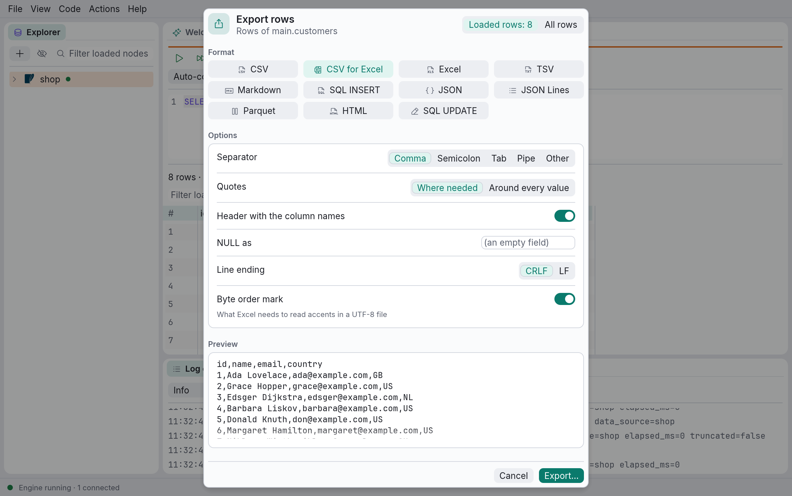

# Exporting and copying rows

Rows leave DbRover in the same formats, with the same options, wherever they start:

- **Export…** in the results grid's toolbar writes a result's loaded rows, or every row it
  returns, to a file.
- **Export data…** on a table or view in the explorer writes every row of it.
- **Run to file…** runs a query straight into a file, without loading the grid.
- **Copy as ›** in a cell's menu, and **Copy with headers**, put the selected cells on the
  clipboard.
- An AI assistant connected over MCP can ask for rows as CSV, Markdown or JSON Lines.

## The export dialog

**Export…** in the grid's toolbar opens the export dialog:

- **Loaded rows** or **All rows**, at the top right: the rows loaded so far, in the order and
  with the filter the grid shows them, or every row the query returns. For all rows the query
  runs again, sorted and filtered if the database is doing that, and its rows are written to
  the file as they arrive, so even a very large result never has to fit in memory.
- **Format**: a tile for each format. A format that can't write these rows is greyed out; hover
  over it to see why.
- **Options**: the format's own (below), a row each, switched on and off or chosen side by side.
- **Preview**: the file's first lines, or for Excel and Parquet what each column becomes.

**Export…**, the highlighted button, then asks where to save the file. The dialog starts from the format and options you
used last, each format remembering its own.

## Formats

| Format | What it writes |
| --- | --- |
| **CSV** | Comma-separated values as RFC 4180 describes them: a header line, fields quoted only where they need it, `NULL` as an empty field, lines ending in CRLF, UTF-8. |
| **CSV for Excel** | The same, starting with a byte order mark: without one, Excel reads a UTF-8 file's accents and other non-English letters wrongly. Excel set to a language whose list separator is a semicolon (much of Europe) puts each line in one column: choose a semicolon separator as well, or export as **Excel**. |
| **Excel** | An Excel workbook (`.xlsx`): a bold header row, frozen and with filter buttons, columns as wide as their first values, and each cell typed (see below). |
| **TSV** | Tab-separated, as ⌘C copies cells: a header line, `NULL` written out, fields with tabs, line breaks or quotes quoted the way spreadsheets read them. |
| **Markdown** | A table for a pull request, an issue or a chat: pipes escaped, line breaks as ` `, `NULL` written out. |
| **SQL INSERT** | An `INSERT` a row into the table the rows came from, of its columns only. Numbers in numeric columns are written as numbers, every other value as a string, which the database turns into the column's type. |
| **JSON** | A list of objects, one a row, keyed by column name. Values are text, and `NULL` is `null`. A repeated column name gets `_2`, `_3`. |
| **JSON Lines** | The same objects, one a line, as data pipelines and `jq -c` read them. |
| **Parquet** | A compressed, typed file for data tools (DuckDB, pandas, Polars, Spark), with each column typed (see below). |
| **HTML** | A web page with the rows as a table, every value escaped, that prints with its header on each page. |
| **SQL UPDATE** | An `UPDATE` a row, setting each of the table's columns but the key, and naming the row by its primary key, as the grid's own edits do. |

Values are written as the database printed them, exactly as the grid shows them: dates and
numbers are never reformatted. To change how they look, format them in the query (`to_char`,
`FORMAT`, `strftime`).

## Options

- **CSV**: the **separator** (comma, semicolon, tab, pipe, or any other character), **quotes**
  where needed or around every value, the **header**, what `NULL` is written as (an empty field,
  `NULL`, `\N` or anything else), the **line ending** (CRLF or LF) and a **byte order mark**.
  **CSV for Excel** is CSV with the byte order mark on; for Excel in a language that separates
  lists with semicolons, choose it and then the semicolon.
- **Excel**: the header, keeping it in view, its filter buttons, and the sheet's name.
- **TSV**, **Markdown** and **HTML**: what `NULL` is written as; TSV's header; HTML as a whole
  page or the table alone, to paste into an email.
- **SQL INSERT**: how many rows each statement inserts, from 1 to 1,000. For rows DbRover doesn't
  know the table of (a join, or a table without a primary key), name the table, and its schema
  if it isn't the default one.
- **Parquet**: zstd or Snappy compression.

## Typed cells in Excel and Parquet

**Excel** cells are numbers, dates or text, so that numbers sum and dates sort, without ever
changing a value:

- A column the database declares as a number, a boolean, a date or a timestamp gets numbers,
  booleans or dates; a text column stays text. PostgreSQL doesn't say what its columns are, so
  each value is looked at: a plain number becomes a number, and an ISO date or timestamp
  (`2024-01-31`, `2024-01-31 08:00:00`) a date, shown the same way.
- These always stay text, as Excel would change them: a number with a leading zero (`007`, a
  code), more than 15 digits (a long id, which Excel would round), a timestamp with a time zone
  or offset (Excel has none), a date before 1900, and a time with a fraction of a second finer
  than milliseconds.
- A sheet holds 1,048,576 rows. More rows go on in a second sheet, *Rows 2*, and so on, each
  with the header, and the export's message says how many sheets there are.
- A cell holds 32,767 characters; a longer value is cut there.

**Parquet** columns are typed too: each takes the narrowest type (whole numbers, decimals,
floating-point numbers, booleans, dates, timestamps) that every one of its values converts to and
back without changing, starting with the type the database declares; otherwise it is text. A zip
code with a leading zero stays text, and a timestamp with an offset isn't moved to UTC. Rows are
gathered in a temporary DuckDB database that spills to disk, so a large export doesn't fill the
memory, and the file is compressed with zstd.

## SQL statements

The SQL formats need to know the table. For rows the grid can edit (selected from one table,
with its whole primary key) it is that table; elsewhere **SQL INSERT** asks for one, and
**SQL UPDATE** is greyed out, saying why. Their statements are in the data source's own SQL, with
its quoting; moving rows to a different kind of database may need them edited.

## Every row, and stopping an export

While every row is being exported, the toolbar counts them (*Exporting… 125000 rows*), and
**Cancel export** stops it. A cancelled or failed export leaves no file behind, and never
replaces a file that was there: the rows go to a file named like the one you chose, plus
`.partial`, which takes its name only when complete.

Running the query again needs the console's connection, so a result that was still loading
more rows stops loading (its summary says `rest discarded`); the rows already in the grid stay.
The export runs in the console's open transaction, if there is one, and sees its temporary
tables.

## A whole table, from the explorer

Right-click a table or view in the explorer and choose **Export data…**. The same dialog opens,
for every row of it; once DbRover has read the table's columns, the preview shows them, and the
SQL formats write to that table (**SQL UPDATE** by its primary key). **Export…** asks where to
save the file, and the dialog stays open to count the rows as they are written, with **Cancel
export**, then says where they went. The rows are read with `SELECT *` on the explorer's
connection, a page at a time, so a table of any size never has to fit in memory. It reads only,
so it works on a read-only data source too, and it is recorded in the history.

## Running a query straight to a file

**Run to file…** (⌥⌘↵, or **Code › Run to file…**) runs the statement at the cursor, or the one
selected, into a file without loading the grid: for a query whose rows you want in a file rather
than on screen, however many there are. It opens the export dialog first, for the format, its
options and the file; then it asks for the statement's `:name` parameters and confirmations as a
run does. Where the grid would be, the console counts the rows as they are written, with
**Cancel export**, then says *Exported 1204331 rows to …*. The file's columns are the
statement's; for **SQL INSERT**, name the table to insert into.

## Copying

Select cells in the grid (click, then shift-click or drag), and:

- ⌘C copies them as tab-separated values, ready to paste into a spreadsheet.
- **Copy with headers** (⇧⌘C, or in a cell's right-click menu) copies them with the column
  names as a first line.
- **Copy as ›** in a cell's right-click menu copies them as CSV, TSV, Markdown, SQL `INSERT` or
  `UPDATE` statements, JSON, JSON Lines or an HTML table, with the options last chosen in the
  export dialog. A Markdown table pastes into a pull request or a chat; `INSERT`s paste into a
  console. HTML goes on the clipboard as its markup, as text. On macOS, **Copy with headers**
  and **Copy as ›** are in the Edit menu too.

Copying takes the selected columns of the selected rows, from the rows loaded; it never runs the
query again. The SQL formats need rows the grid can edit, and `UPDATE` the table's whole primary
key among the selected columns. Each format has a keymap id, `grid.copy-as.csv`,
`grid.copy-as.markdown` and so on, with no key until you give it one in `keymap.toml` (see
[Keyboard shortcuts](shortcuts.md)).

## For an AI assistant

The MCP server's `query` tool answers with JSON by default. With `format` set to `csv`,
`markdown` or `jsonl`, it answers with the rows as that text instead, within the project's row
limit, and says whether rows were left out. The assistant never writes a file through DbRover:
one that wants a file writes the text itself, with its own permissions. See
[Connecting an AI assistant](mcp.md).
