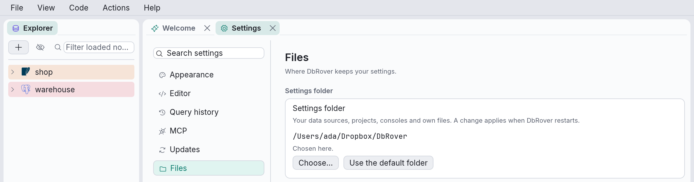

# Where DbRover keeps its files

DbRover keeps your settings in one folder and this machine's own files in another, the same
two on every platform:

| Platform | Settings folder | Data folder |
| --- | --- | --- |
| macOS | `~/.config/dbrover/` | `~/.local/share/dbrover/` |
| Linux | `~/.config/dbrover/` | `~/.local/share/dbrover/` |
| Windows | `%USERPROFILE%\.config\dbrover\` | `%USERPROFILE%\.local\share\dbrover\` |

On Linux, `$XDG_CONFIG_HOME` and `$XDG_DATA_HOME` move them, as for other programs. The
settings folder can also be one you choose; see [Choosing the settings folder](#choosing-the-settings-folder).

| File | What it holds |
| --- | --- |
| `data_sources.toml` (settings folder) | Your data sources. No passwords. |
| `projects.toml` (settings folder) | Your projects. Which project a data source is in is written in `data_sources.toml`. |
| `consoles/<data source id>/*.sql` (settings folder) | Your query consoles, one file each. See [Query consoles](consoles.md#consoles-are-saved). |
| `diagrams/<project>/*.toml` (settings folder) | Your ER diagrams, one file each, in a folder per project (`_none` for data sources in no project). See [ER diagrams](diagrams.md#diagrams-are-saved). |
| `history.sqlite` (settings folder) | Every statement DbRover and MCP clients sent, with its time, duration, outcome and where it came from (see [The query history](history.md)). |
| `keymap.toml` (settings folder) | Your shortcuts, if you changed any. See [Keyboard shortcuts](shortcuts.md#changing-them). |
| `settings.toml` (settings folder) | Your choices in **View → Settings…**, such as how SQL is formatted and whether to check for updates. |
| `actions.toml`, `snippets.toml`, `theme.toml` (settings folder) | Your own actions, snippets and colours, if you wrote any. See [Actions, snippets and themes](customising.md). |
| `trusted_commands.toml` (data folder) | The command actions and password commands you chose **Run** for, each as it was then. See [Commands](customising.md#the-first-run) and [Password from a command](data-sources.md#password-from-a-command). |
| `settings_folder.toml` (data folder) | The settings folder you chose in **Settings › Files**, if you chose one. |
| `app.ron` (data folder) | The window's size and position, the panel layout, the theme you picked, the recent `.sql` files and which file each console tab shows. |
| `logs/dbrover.YYYY-MM-DD.log` (data folder) | One log file per day. The last seven are kept. |
| `logs/dbrover-mcp.YYYY-MM-DD.log` (data folder) | The same for `dbrover mcp`, the server AI assistants use. |

Passwords are not in any of these files: they are in your system's keychain, under the service
name `dbrover`. See [Data sources](data-sources.md#passwords-and-the-keychain).

The settings folder holds what you would want on another machine, and nothing that trusts
anything: a command in `actions.toml` or a password command in `data_sources.toml` still asks
before its first run on each machine, because what you trusted is in the data folder.

Up to version 0.20, DbRover kept its files in the platform's own folders:
`~/Library/Application Support/dbrover/` on macOS, and `%APPDATA%\dbrover\` on Windows. The
first start of a newer version copies them; see
[Settings moved to ~/.config/dbrover](install.md#settings-moved-to-configdbrover). Before
version 0.13 the folders and the keychain entries were named `dbdesk`; see
[Coming from dbdesk](install.md#coming-from-dbdesk).

SSH tunnels share `~/.ssh/known_hosts` with `ssh`: DbRover reads it to check SSH servers' host
keys, and adds a line when you trust a new one. See
[SSH tunnels](data-sources.md#ssh-tunnels).

## data_sources.toml

You can edit this file by hand **while DbRover is closed**. DbRover reads it at start-up and
rewrites it every time you save or delete a data source, so changes made while it runs are
overwritten, and comments are not kept.

```toml
[[data_source]]
id = "6f1c0d9e-3b8a-4c3e-9f57-2d1e8a7b5c40"
name = "local"
color = "teal"
project = "5b0c7d1e-2f3a-4b5c-8d6e-7f8091a2b3c4"
driver = "postgres"
host = "localhost"
port = 5432
database = "app"
user = "juan"

[[data_source]]
id = "b3c9e1f2-7a4d-4b8e-9c2f-1d5e6a7b8c90"
name = "production"
color = "red"
driver = "postgres"
host = "db.example.com"
port = 5432
database = "app"
user = "juan"

[data_source.tls]
mode = "verify-full"
ca_file = "/Users/juan/certs/example-ca.pem"

[[data_source]]
id = "0b6a4f8e-91d2-4e7a-a1c3-5f0e2d9b7c18"
name = "chinook.db"
driver = "sqlite"
path = "/Users/juan/data/chinook.db"
read_only = true
```

- `id` identifies the data source for good, including its keychain entry. Don't change it; for
  a new data source by hand, any unique UUID will do.
- `color` is optional: `red`, `orange`, `yellow`, `green`, `teal`, `blue`, `violet` or `pink`.
- `project` is optional: the `id` of a project in `projects.toml`. Left out, or naming a project
  that doesn't exist, the data source is in **No project**.
- `mcp_login` is optional, for network engines: `mcp_login = { user = "assistant" }` is the
  user AI assistants sign in as (see [The MCP login](mcp.md#the-mcp-login)). Its password is
  in the keychain.
- `tls` is optional for PostgreSQL, and `mode` defaults to `prefer`: `disable`, `prefer`,
  `require` or `verify-full`. `ca_file` is only read with `verify-full`.
- `read_only` is optional and defaults to `false`. It opens a SQLite file read-only; `safety`
  is the setting for every engine.
- `safety` is optional: `normal` (the default, left out), `careful` or `read-only`. See
  [Safety levels](data-sources.md#safety-levels).
- `host`, `port`, `database`, `user`, `path` and `ca_file` may hold `${NAME}` placeholders,
  resolved from the environment when connecting (see
  [Placeholders](data-sources.md#placeholders-variable)). A port with one is a string:
  `port = "${PGPORT}"`.

An export (**File › Export data sources…**) is the same `[[data_source]]` tables, with a
`format_version = 1` line and the projects as `[[project]]` tables, as `projects.toml` writes
them. See [Moving data sources to another machine](sharing.md).

If the file can't be read — say, a typo while editing it — the explorer shows the error and
DbRover refuses to save or delete anything, so it never overwrites your file with an empty list.
Fix the file and restart DbRover.

## projects.toml

Like `data_sources.toml`, edit it only while DbRover is closed; comments are not kept.

```toml
[mcp_defaults]
read = true
write = false
schema = false
admin = false
max_rows = 500
statement_timeout = "30s"
schemas = "all"

[[project]]
id = "5b0c7d1e-2f3a-4b5c-8d6e-7f8091a2b3c4"
name = "Web shop"
slug = "web-shop"
mcp_enabled = true

[project.mcp]
write = true
schemas = ["public"]
```

- `id` is what data sources point at. Don't change it.
- `slug` is lower-case letters, digits and single hyphens, and must be unique. It is kept when
  the project is renamed.
- `mcp_enabled` lets AI assistants use the project's databases through `dbrover mcp`; see
  [Connecting an AI assistant](mcp.md). A new project starts with it `false`.
- `mcp_defaults` sets what MCP clients may do in every project, and a `[project.mcp]` table
  under a project overrides it for that project. `read`, `write`, `schema` and `admin` are the
  [permissions](mcp.md#permissions); `max_rows` and `statement_timeout` (such as `"30s"` or
  `"2m"`) limit each call; `schemas` is `"all"` or a list such as `["public", "reports"]`.
  Project settings and View › Settings › MCP edit all of these.

Unknown keys are refused rather than ignored, so a setting that is misspelt, or one written by a
newer DbRover, never goes unnoticed. If the file can't be read, the explorer lists every data
source ungrouped and DbRover refuses to change projects until the file is fixed, so it never
overwrites it.

## Choosing the settings folder

To keep your settings somewhere else, such as a folder that a service syncs between your
machines or a repository of your dotfiles, open **View → Settings…**, then **Files**, and click
**Choose…**:

- **A folder with DbRover's settings in it**, from another machine or an earlier choice, is
  used as it is. Nothing is copied into it, and the folder you used before stays as it was.
- **An empty folder** gets a copy of your settings, or none if you pick **Start with no
  settings**.
- **Any other folder**, one with other files in it, isn't used: choose an empty folder inside it.

Click **Restart DbRover**. DbRover quits as usual, asking about unsaved consoles and open
transactions first, and starts again on the new folder, copying your settings into it first
if you asked for that. **Use the default folder** goes back the same way.



The choice is kept in the data folder, so it belongs to this machine: on another machine,
choose the same synced folder there too. Passwords stay in that machine's keychain, so each
data source asks for its password once on a new machine. Two folders that share data sources
(one copied from the other) share their passwords too: deleting a data source in one forgets
its password for both.

If the folder isn't there when DbRover starts (a drive that isn't connected, a synced folder
that was moved), DbRover uses the default folder for that session and says so. Your choice is
kept, so the folder is used again once it is back.

**Using one folder on two machines:** quit DbRover on one before using the other. Each file is
written whole, but a sync service can't merge two machines' changes to the same file, and it
may copy `history.sqlite` while DbRover is writing to it.

### For one start only

`--config-dir <folder>` on the command line, or the `DBROVER_CONFIG_DIR` environment variable,
sets the settings folder for that start, over the choice in Settings, for example to keep a
second set of data sources apart:

```bash
dbrover --config-dir ~/work/dbrover
```

The folder must be an absolute path or start with `~`. It is created if it isn't there.
**Settings › Files** shows the folder, and can't change it while the flag or variable is set.
`dbrover mcp` takes the same flag and variable; see
[Connecting an AI assistant](mcp.md#another-settings-folder).

## Starting over

To reset the layout, use **View → Reset layout**. To go back to the default shortcuts, delete
`keymap.toml` and click **Reload** in **View → Keymap…**; for the default settings, delete
`settings.toml` and click **Reload** in **View → Settings…**. To forget everything, quit DbRover and
delete its folders; the passwords stay in the keychain until you delete the `dbrover` entries
there too.
