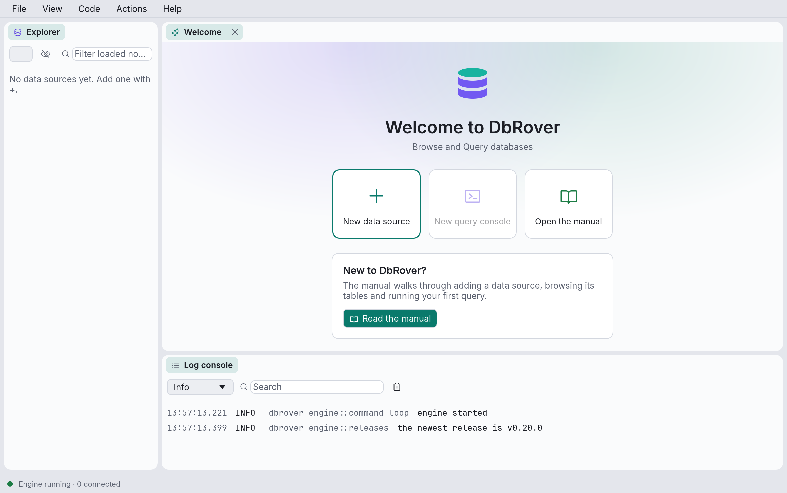

# Install and first launch

Download DbRover from [dbrover.org](https://dbrover.org/#download), or from the
[releases page](https://github.com/navasvarela/dbrover/releases): pick the file for your system
from the latest release's **Assets**.

| System | File |
| --- | --- |
| macOS 11 or later, Apple silicon or Intel | `dbrover-<version>-macos-universal.dmg` |
| Linux x86_64, most distributions | `dbrover-<version>-x86_64.AppImage` |
| Debian, Ubuntu and derivatives | `dbrover_<version>_amd64.deb` |
| Windows 10 or 11, 64-bit Intel or AMD | `dbrover-<version>-windows-x64-setup.exe` |

Or install it with your system's package manager: [Homebrew](#with-homebrew) on macOS, or
[winget](#with-winget) on Windows.

## macOS

1. Open the `.dmg` and drag **DbRover** onto **Applications**.
2. Open DbRover from Applications. These builds aren't signed by Apple yet, so the first launch
   is blocked with "Apple could not verify DbRover".
3. Open **System Settings › Privacy & Security**, scroll down to the message about DbRover, and
   click **Open Anyway**. macOS asks once more; confirm, and it opens normally from then on.

After each update, macOS asks again for access to each password DbRover saved in the Keychain.
Choose **Always Allow**. This happens because the app's signature changes with every unsigned
build; signed builds, planned for a later release, will remove both steps.

### With Homebrew

```bash
brew install --cask navasvarela/tap/dbrover
```

Homebrew installs the same app in Applications, so the first launch needs **Open Anyway** too,
as in step 3 above. From then on DbRover updates itself (see [Updates](#updates)), and
`brew upgrade` leaves it alone.

## Linux

**AppImage**, on any distribution:

```bash
chmod +x dbrover-*-x86_64.AppImage
./dbrover-*-x86_64.AppImage
```

**.deb**, on Debian, Ubuntu and derivatives. This also adds DbRover to the application menu:

```bash
sudo apt install ./dbrover_*_amd64.deb
```

Saved passwords go to the Secret Service (GNOME Keyring, KWallet), which desktop environments
already run. On a bare window manager without one, see [Troubleshooting](troubleshooting.md).

## Windows

1. Run `dbrover-<version>-windows-x64-setup.exe`. Your browser may first say the file isn't
   commonly downloaded; choose to keep it.
2. The first time you run it, Microsoft Defender SmartScreen blocks it: a blue window says
   "Windows protected your PC" and offers only **Don't run**. This is expected. The installer
   isn't signed yet, and SmartScreen holds back programs it hasn't seen downloaded often. To
   go on, click **More info**. The window then shows the file's name and "Unknown publisher".
   Check that the name is the file you downloaded from dbrover.org or the releases page, then
   click **Run anyway**.
3. Follow the installer. It installs DbRover for your user alone, in
   `%LOCALAPPDATA%\DbRover`, without asking for administrator rights, and adds DbRover to the
   Start menu.

SmartScreen asks again for each new installer you download yourself, until DbRover's
installers are signed and known to it. Updates that DbRover installs (below) run without the
warning. On Windows 11 with Smart App Control switched on (in **Windows Security › App & browser
control**), Windows may block the unsigned installer with no **Run anyway** at all, and DbRover
can't get round that until it is signed. To remove DbRover, use **Settings › Apps › Installed apps**.
Saved passwords go to the Windows Credential Manager.

### With winget

In a terminal:

```powershell
winget install DbRover.DbRover
```

winget downloads the same installer and runs it for your user, as above. DbRover then updates
itself (see [Updates](#updates)); `winget upgrade DbRover.DbRover` works too.

## Check the download and the version

Each release has a `SHA256SUMS` file. In the folder with your download:

```bash
shasum -a 256 -c SHA256SUMS --ignore-missing
```

On Windows, in PowerShell, print the installer's checksum and compare it with its line in
`SHA256SUMS`:

```powershell
Get-FileHash dbrover-*-windows-x64-setup.exe -Algorithm SHA256
```

The right end of the status bar shows the version you're running, for example **v0.21.0**;
click it to open **About DbRover**. **Help › About DbRover** shows the version and the commit
it was built from, and **Copy version** copies them for a bug report. From a terminal,
`dbrover --version` prints the same.
**Help › Report a problem…** fills them in for you; see
[Reporting a problem](troubleshooting.md#reporting-a-problem).

## Updates

When DbRover starts, it asks GitHub whether a newer release is out. If one is, the status bar
says so, for example **DbRover 0.5.0 is available**. Click it to open **Updates**; **Help ›
Check for updates…** asks at any time.

- **macOS, and the Linux AppImage:** click **Install and restart**. DbRover downloads the new
  version, checks that it was signed by the DbRover release process, and puts it in place of the
  one you are running. Click **Restart now** to start it, or carry on and it starts next time.
  If a console has a transaction open, quitting asks first, as it always does.
- **Windows, installed with the installer:** click **Install and restart**. DbRover downloads
  the new version's installer and checks its signature in the same way; the dialog then says
  the update is downloaded. Click **Restart now**: DbRover quits (asking first about open
  transactions), the installer shows a progress bar while it replaces DbRover, and the new
  version starts. Windows can't replace a program that is running, so if you carry on instead,
  the update waits until you choose **Restart now**, or is downloaded again next time. The
  installer closes any other DbRover window that is still open.
- **The `.deb`, a Windows copy that wasn't installed with the installer, and builds from
  source:** these can't replace themselves, and the dialog says why. **Open release page**
  leads to the download; install it as above. Copies installed on Windows from version 0.12.0
  or earlier are in this group too: install the next version from the release page once, and
  it updates itself from then on.

An update that isn't signed with DbRover's key is refused before anything is replaced. On macOS,
until DbRover's builds are signed by Apple, the first launch after an update asks again for
access to each saved password; choose **Always Allow**.

The check sends nothing about you or your data: it reads the public list of releases. To stop
the check at start-up, untick **Check for a new release when DbRover starts** in **View →
Settings…**.

## Coming from dbdesk

DbRover was called dbdesk until version 0.12. Another database client called DBDesk was there
first, so this one has a name of its own; nothing else changed.

**Your data comes along.** The first time DbRover starts, it copies dbdesk's folders
(`~/Library/Application Support/dbdesk/` on macOS, `~/.config/dbdesk/` and
`~/.local/share/dbdesk/` on Linux, `%APPDATA%\dbdesk\` on Windows) to
[DbRover's](files.md):
your data sources, projects, consoles, history, settings, shortcuts, actions, snippets and
theme. A window then says where they were copied from. dbdesk's folder is left as it was, with
a note in it; DbRover doesn't read it again, so once DbRover shows everything you had, you can
delete it. If the copy fails, DbRover uses dbdesk's folder for that session, says why, and
tries again the next time it starts.

**Saved passwords** move to DbRover's keychain entries the first time each one is used. On
macOS, choose **Always Allow** when asked.

**Updating from dbdesk:**

- **macOS and the AppImage:** update from the app, as above. On macOS the app keeps the name
  `dbdesk.app` in Finder, because the update replaces what is inside it; the menu bar and the
  window say DbRover. To rename it, quit DbRover, rename `dbdesk.app` to `DbRover.app` in
  Applications, and copy the MCP configuration again (below).
- **The `.deb`:** install `dbrover_<version>_amd64.deb`, then remove dbdesk with
  `sudo apt remove dbdesk`.
- **Windows:** install DbRover with its installer, then uninstall dbdesk in **Settings › Apps**.
  Uninstalling dbdesk leaves its data, which DbRover has copied.

**MCP clients** start the server from the path in their configuration. Copy it again from each
project ([Copy the configuration](mcp.md#2-copy-the-configuration)) and replace the dbdesk
entry. On macOS the old path, `…/Contents/MacOS/dbdesk`, keeps working until DbRover 0.16, and
the server says so in the client's log. Elsewhere the old path runs the old dbdesk, with its own
copy of your data, until you remove it.

## Settings moved to ~/.config/dbrover

From version 0.21, DbRover keeps your settings in `~/.config/dbrover` and this machine's own
files in `~/.local/share/dbrover` on every platform (see
[Where DbRover keeps its files](files.md)). On Linux nothing moves. On macOS and Windows, the
first start of 0.21 copies what DbRover kept in `~/Library/Application Support/dbrover/` or
`%APPDATA%\dbrover\`: your data sources, projects, consoles, diagrams, history, settings,
shortcuts, actions, snippets and theme, the window's layout, and the commands you trusted. A
window then says where they were copied from and to.

The old folder is left as it was, with a note in it; DbRover doesn't read it again, so once
DbRover shows everything you had, you can delete it. Saved passwords stay in the keychain, and
MCP clients need no change. If the copy fails, DbRover uses the old folder for that session,
says why, and tries again the next time it starts.

## Build from source

For contributors, or to run the latest unreleased code. You need:

- **Rust 1.95 or newer**, installed with [rustup](https://rustup.rs). Check with
  `rustc --version`.
- **Git**, to fetch the source.
- On **Linux**, the development headers for the windowing system. On Debian or Ubuntu:

  ```bash
  sudo apt-get install libxcb-render0-dev libxcb-shape0-dev libxcb-xfixes0-dev libxkbcommon-dev libssl-dev
  ```

Then:

```bash
git clone https://github.com/navasvarela/dbrover.git
cd dbrover
cargo run --release -p dbrover-app
```

To install the `dbrover` command so you can start it from anywhere:

```bash
cargo install --path crates/dbrover-app
```

## First launch



On first launch the explorer is empty ("No data sources yet") and the Welcome tab offers three
things to do:

- **New data source** — add a connection to a database. See [Data sources](data-sources.md).
- **New query console** — open a console on a data source. It is greyed out until you have
  one.
- **Open the manual** — opens this manual in your browser.

The log console under the Welcome tab shows `engine started`, and the status bar reads
`Engine running · 0 connected`. If it says the engine is stopped, see
[Troubleshooting](troubleshooting.md).

## Light and dark

DbRover follows your system's light or dark setting. To choose one yourself, open
**View → Theme** and pick **Match system**, **Light** or **Dark**. The choice is remembered.

## The layout

DbRover opens maximized the first time; after that it remembers the window's size and position.

Every panel is a tab you can drag: onto another panel's tab bar to join it, or onto the edge of
a panel to split it. Drag the gaps between panels to resize them. DbRover remembers the layout
and the window size when you quit. **View → Reset layout** puts everything back where it
started.

## On a Mac

On macOS DbRover's menus are in the menu bar at the top of the screen, like any Mac app's, and
the window has no separate title bar. On Linux and Windows the menus are in the window, under
its title bar, and this manual names them that way (**View → Settings…**). On a Mac a few of
them live where Mac apps keep them:

| In the window (Linux, Windows) | On a Mac |
| --- | --- |
| **Help → About DbRover** | **DbRover → About DbRover** |
| **Help → Check for updates…** | **DbRover → Check for updates…** |
| **View → Settings…** | **DbRover → Settings…** (⌘,) |

The rest of the Mac's menu bar:

- **DbRover → Quit DbRover** (⌘Q) quits the way closing the window does: if a console has an open
  transaction or unsaved changes, DbRover asks first. **Hide**, **Hide Others**, **Show All**
  and **Services** are the usual ones.
- **Edit** has **Undo**, **Redo**, **Cut**, **Copy**, **Paste** and **Select All** for whatever
  has focus: the SQL editor, a text field, or the results grid (**Copy** copies the selected
  cells).
- **View → Enter Full Screen** (⌃⌘F), and **Window** with **Minimize** (⌘M), **Zoom** and
  **Bring All to Front**.
- **Help → DbRover manual** opens this manual, and the Help menu's search finds any menu item.

Items that need a console, such as **File → Save** or **Code → Format**, are greyed out until a
console's tab is selected, and every item shows its shortcut, including ones you changed in
`keymap.toml` (see [Keyboard shortcuts](shortcuts.md)).

The strip along the top of the window, beside the close, minimize and zoom buttons, works as a
title bar: drag it to move the window, and double-click it to zoom.

DbRover also takes the Mac's look: text is in the system font, SF Pro (SF Mono for SQL and
results), and selected text, cells and rows are tinted with the accent colour chosen in
**System Settings → Appearance**. Change the accent colour and DbRover follows it when you come
back to its window. The pictures in this manual were taken with DbRover's own fonts and colours,
which it uses on Linux and Windows.
