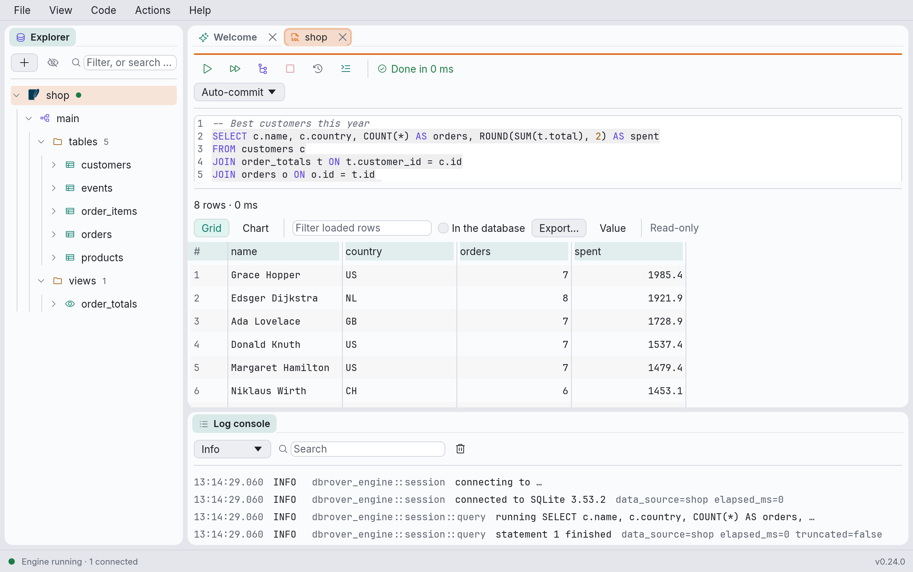

# Introduction

DbRover is a desktop tool to browse and query databases. It connects to **PostgreSQL**,
**MySQL and MariaDB**, **SQLite**, **SQL Server**, **DuckDB**, **ClickHouse**, **Redis, Valkey
and Dragonfly**, **MongoDB**, **Elasticsearch and OpenSearch**, **Cassandra and ScyllaDB**,
**Amazon DynamoDB**, **Amazon Athena**, **Google BigQuery**, and **Trino, Starburst and
Presto**, and to the cloud services that run them. It shows what is inside them as a tree, and
gives you query consoles to write and run queries in each database's own language, page
through, sort, chart and export the results, and edit rows.

Beyond the consoles, it draws ER diagrams and compares schemas, runs reports that combine
several databases into CSV, Excel and Parquet files, and lets an AI assistant query your data
sources over MCP, as far as you allow.

The window has three areas, which you can drag around and resize:

- **Explorer**, a column down the left: your saved connections ("data sources") and, under
  each, its databases, schemas, tables and so on.
- **Consoles**, the main area on the right: the Welcome tab and one tab per query console.
- **Log console**, under the consoles: what DbRover is doing — connections opening and closing,
  queries running and how long they took, errors.

The thin bar at the very bottom shows whether DbRover's background engine is running and how
many data sources the explorer is connected to, and, at its right end, the version you're
running.

This manual describes DbRover as it is today. It is young software: things that are planned but
not built yet are not described here, apart from a few warnings in
[Troubleshooting](troubleshooting.md).
