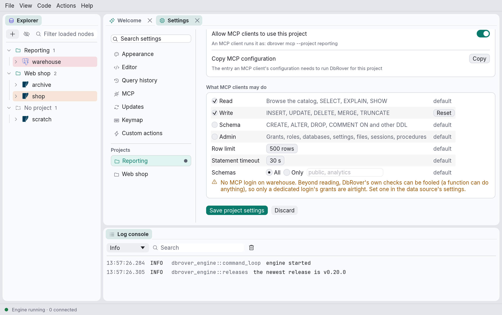
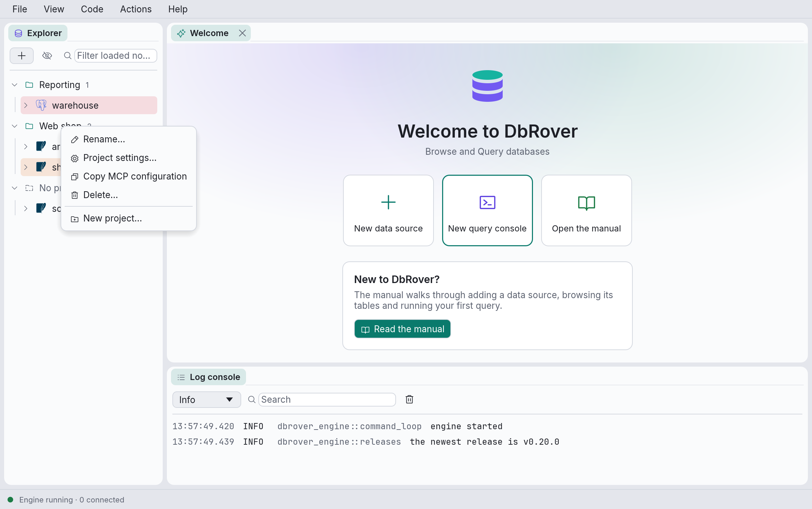
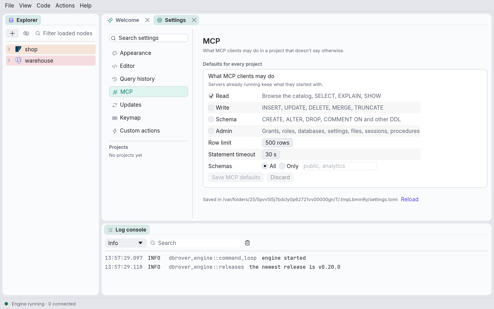

# Connecting an AI assistant

DbRover can serve a [project](explorer.md#projects)'s databases to an AI assistant or coding
agent through the [Model Context Protocol](https://modelcontextprotocol.io) (MCP). The
assistant can then list the project's data sources, browse their tables, describe them and run
queries, using the data sources, drivers and saved passwords DbRover already has. Where you allow
it, it can also change data or the schema.

By default an assistant can **only read**. Every read runs in the database's own read-only mode
and is rolled back, and anything that would change data or the schema is refused before it is
sent. Each project can allow more; see [Permissions](#permissions).

> **Data leaves your machine.** Whatever a query returns goes to the assistant, and from there
> to the company that runs its model. Only allow projects whose data you are happy to share
> that way. Keep sensitive databases in projects of their own, or limit a project to some of
> its schemas.

## Setting up a client

### 1. Allow the project

Right-click the project's header in the explorer and choose **Project settings…**: the
[Settings](settings.md) tab opens on the project's page, which is also under **Projects** in its
sidebar. Switch on **Allow MCP clients to use this project** and click **Save project
settings**. New projects start with this off, so nothing is ever exposed by accident.



The page also shows the project's **slug**, which is what the client names it by, and has
**Copy MCP configuration**, the next step.

### 2. Copy the configuration

Click **Copy** beside **Copy MCP configuration** on the project's page, or right-click the
project's header and choose **Copy MCP configuration**.



DbRover copies the entry an MCP client needs, with this machine's path to DbRover filled in. On
macOS that is the program inside the app bundle, and on Linux it is the AppImage itself:

```json
{
  "mcpServers": {
    "dbrover-analytics": {
      "command": "/Applications/DbRover.app/Contents/MacOS/dbrover",
      "args": ["mcp", "--project", "analytics"]
    }
  }
}
```

A client set up when DbRover was called dbdesk keeps working on macOS until DbRover 0.16;
copy its configuration again anyway. See [Coming from dbdesk](install.md#coming-from-dbdesk).

### 3. Add it to the client

Paste the entry into the client's MCP settings:
- **Claude Desktop:** Settings › Developer › Edit Config opens `claude_desktop_config.json`.
  Add the `dbrover-…` entry inside its `mcpServers`, then restart Claude Desktop.
- **Cursor:** `~/.cursor/mcp.json`, or `.cursor/mcp.json` in a project folder.
- **Claude Code:** a project's `.mcp.json` takes the same JSON. You can also add the server from
  the command line, with the command and arguments from the copied entry:

  ```bash
  claude mcp add dbrover-analytics -- /Applications/DbRover.app/Contents/MacOS/dbrover mcp --project analytics
  ```

One entry serves one project. For several projects, add one entry per project.

The client starts DbRover itself, as `dbrover mcp --project <slug>`, and talks to it over standard
input and output. The DbRover window doesn't need to be open.

On macOS, the first time the server reads a saved password, the system asks whether `dbrover`
may use it, as it does for the app; choose **Always Allow**. Until DbRover's builds are signed,
it asks again after each update.

### 4. Try it

Ask the assistant to list the project's data sources, then to describe a table and query it.
Each statement it runs shows up in the data source's **History**, marked **MCP** (see
[The query history](history.md)).

## What the assistant can do

| Tool | What it does |
| --- | --- |
| `list_data_sources` | The project's data sources: name, engine, colour, and the server version once connected. Also the limits and what the project allows. |
| `list_objects` | One level of a data source's catalog, as the explorer shows it. Each object comes with the `path` that lists its children. A large level, such as a Redis database's keys or a schema of thousands of tables, comes 1,000 objects at a time, with a `next` to ask for the rest; a `filter` keeps the objects whose name contains it, searched by the database. |
| `describe_table` | A table's columns with their types, its primary key, indexes and constraints. |
| `get_definition` | The source of a view, function, trigger or index. |
| `query` | Runs one statement that only reads (on Redis, one command, such as `HGETALL`; on MongoDB, one shell command, such as `db.orders.find({status: "open"})`, whose documents come as canonical Extended JSON; on Elasticsearch and OpenSearch, one request, such as a search, whose hits come as documents, or a `_sql` query), and returns its rows as text: as JSON, or with `format` set to `csv`, `markdown` or `jsonl`, as that text, ready to save or paste. |
| `explain` | Shows how the database would run one read statement, without running it. |
| `execute` | Runs statements that change something, in one transaction. Only offered when the project allows `write`, `schema` or `admin`. |

Every tool but `execute` is marked read-only, and `execute` is marked destructive. Clients that
ask before running tools can therefore let the others run freely and ask before each `execute`.

## Permissions

Each project allows MCP clients some of these. Each one starts at the global default and can be
overridden on the project's page in Settings, and **Reset** goes back to the default. Change the
defaults in **View › Settings… › MCP**; they apply to every project that doesn't override them.



| Permission | Allows | Default |
| --- | --- | --- |
| **Read** | Browsing the catalog, `SELECT`, `EXPLAIN`, `SHOW` | on |
| **Write** | `INSERT`, `UPDATE`, `DELETE`, `MERGE`, `TRUNCATE` | off |
| **Schema** | `CREATE`, `ALTER`, `DROP`, `COMMENT ON` and other DDL | off |
| **Admin** | Grants, roles and users, databases, server settings, `COPY` to or from files, killing sessions, procedures (`CALL`), and anything DbRover can't parse | off |
| **Row limit** | The most rows one call returns; the reply says `"truncated": true` when there were more | 500 |
| **Statement timeout** | How long one statement may run before it is cancelled | 30 s |
| **Schemas** | All, or only the schemas listed: the catalog tools show only those, and statements may only name those | all |

With **Write**, **Schema** or **Admin** on, the assistant gets the `execute` tool. It takes one
or more statements and checks every one before running any. If one needs a permission the
project lacks, the whole call is refused, and the log says which permission was missing.
Otherwise the statements run in one transaction, committed only if they all succeed. The
exception is MySQL and MariaDB, which commit DDL on their own; there the reply says the call
wasn't atomic. `query` still only reads, whatever the project allows.

A running server keeps the settings it started with. After changing them, restart the server:
most clients have a button for it, or restart the client.

### How the permissions are enforced

DbRover checks each statement in up to three ways:

1. **DbRover reads the statement first.** It parses it and works out what it does, looking
   inside `WITH` clauses, `SELECT … INTO`, `EXPLAIN ANALYZE` and the rest. It also notices
   well-known functions that end sessions, change settings or read files, such as
   `pg_terminate_backend` and `set_config`. A statement that needs a permission the project
   lacks is refused before it reaches the database. So is one DbRover can't parse, unless the
   project allows **Admin**, since what it would do is unknown.
2. **When only reading is allowed, the database refuses writes on its own.** Every read runs
   in a read-only transaction that is then rolled back: `BEGIN READ ONLY` on PostgreSQL,
   `START TRANSACTION READ ONLY` on MySQL and MariaDB. SQLite and DuckDB files are opened
   read-only, and ClickHouse is sent `readonly = 2` with every statement. This stops a `SELECT`
   that calls a function which writes, because DbRover can't see inside the function. SQL
   Server, Redis, MongoDB, Elasticsearch and OpenSearch have no such mode; there, the MCP
   login's grants do this (see below).
3. **The database's own grants,** through an [MCP login](#the-mcp-login). This is the only
   layer that is airtight beyond reading.

Beyond reading, the first layer is all DbRover has of its own, and it can be fooled: a function
or a procedure can do anything, whatever the statement that calls it looks like. That is why
a project's page warns when it allows changes and one of its data sources has no MCP
login.

SQL Server has no read-only transaction, and Redis, MongoDB, Elasticsearch and OpenSearch
have no read-only session at all, so their data sources are served to MCP clients only through
an [MCP login](#the-mcp-login) whose grants allow nothing but reading. Without one, a data
source isn't served, and the server's log says why when it starts; the project's page lists it
too.

ClickHouse and DuckDB files are served in their own read-only modes, with or without an MCP
login. A DuckDB file is held only while a call runs: between calls, the app or the `duckdb`
command can open it for writing, and a call made while one of them has it open fails with
DuckDB's lock error. A DuckDB database in memory can't be opened read-only, so it isn't served.

All of these are served for reading only: `execute` is refused on them, whatever the project
allows, since DbRover has no transaction to run changes in there.

## The MCP login

A data source can have a second login, used only by `dbrover mcp`. Create a database user with
exactly the grants an assistant should have, then enter it in the data source's dialog
(**Edit…**) as **MCP login** and **MCP password**. Every MCP call then signs in as that user,
and the database enforces its grants, whatever DbRover's own checks miss.

For example, a PostgreSQL role for a project that allows **Write**, with nothing beyond what
that needs:

```sql
CREATE ROLE assistant LOGIN PASSWORD '…';
GRANT CONNECT ON DATABASE shop TO assistant;
GRANT USAGE ON SCHEMA public TO assistant;
GRANT SELECT, INSERT, UPDATE, DELETE ON ALL TABLES IN SCHEMA public TO assistant;
```

On SQL Server, a login that can only read the database is a login, a user for it, and the
`db_datareader` role:

```sql
CREATE LOGIN assistant WITH PASSWORD = '…';
-- In the data source's database:
CREATE USER assistant FOR LOGIN assistant;
ALTER ROLE db_datareader ADD MEMBER assistant;
```

On ClickHouse, a user with the `readonly` setting can read and nothing else:

```sql
CREATE USER assistant IDENTIFIED BY '…' SETTINGS readonly = 2;
GRANT SELECT ON shop.* TO assistant;
```

Use `readonly = 2`, not `1`: DbRover sends a few settings with every request (how errors and
decimals are written), which `readonly = 1` refuses, so such a user couldn't connect. Both
refuse every change.

On Redis, Valkey and Dragonfly, an ACL user that may only read:

```text
ACL SETUSER assistant on >… ~* +@read
```

Add `+select` when the data source's database isn't 0, so the user may choose it, and `+info`
if you want **Test connection** and `list_objects` to name every database that holds keys;
without it, they show the data source's own. DbRover classifies each command by the flags the
server gives it, so a command that writes is refused before it is sent, and the ACL refuses
it again. Scripts (`EVAL`, `FCALL`) count as writes, so only their read-only forms (`EVAL_RO`,
`FCALL_RO`) run.

On MongoDB, a user with only the `read` role on the data source's database:

```text
db.adminCommand({createUser: "assistant", pwd: "…", roles: [{role: "read", db: "shop"}]})
```

Leave **Auth database** empty when the user is made in `admin`, as here. DbRover classifies each
command by its method, so `insertOne` or `deleteMany` is refused before it is sent, and the
server refuses it again; `$where`, `$function` and `$accumulator`, which run JavaScript, and any
`db.runCommand` outside a short list of reads count as administration, which an MCP project
never allows.

On Elasticsearch, a user whose role has the cluster's read-only `monitor` privilege, and `read`,
`view_index_metadata` and `monitor` on the indices it may search (`monitor` lists the indices
and their counts, and lets **Cancel** find the user's own tasks):

```text
PUT /_security/role/assistant
{ "cluster": ["monitor"], "indices": [{ "names": ["orders*", "logs-*"], "privileges": ["read", "view_index_metadata", "monitor"] }] }

PUT /_security/user/assistant
{ "password": "…", "roles": ["assistant"] }
```

A data source that signs in with an API key takes a second API key, made with the same
privileges, as its **MCP password**: the key says who it is, so the **MCP login** is only its
name. OpenSearch's security plugin grants the same through its own action groups:
`cluster_monitor`, and `read` and `indices_monitor` on the indices, with
`indices:admin/mappings/get` for an index's fields. DbRover classifies each
request by its method and path, so a `_delete_by_query` or a `PUT` of a document is refused
before it is sent, and the server refuses it again; any path DbRover doesn't know, other than a
`GET`, counts as administration, which an MCP project never allows.

The MCP password is kept in the keychain under its own entry, separate from the data source's
password. If it is missing, the server refuses to connect; it never falls back to the data
source's own login. Clear the **MCP login** field to remove it, together with its password.

SQLite files have no logins, so for them DbRover's own checks are all there is.

## What DbRover records

- **The log.** Every call is a line with the project, data source, tool and the kind of
  statement. Refusals are logged with their reason, and with `missing_permission` when the
  project lacked one. The server logs to its own daily files, `dbrover-mcp.YYYY-MM-DD.log`,
  next to the app's (see [Where DbRover keeps its files](files.md)). It also logs to standard
  error, which most clients keep in their own logs.
- **The query history.** Every statement the server sends to a database is in the data
  source's history, marked **MCP** with the assistant's name, beside your own. The History
  window can show just those, and export them (see [The query history](history.md)).

## When it doesn't work

The client's log for the server shows what DbRover said when it stopped:

- **"there is no project with the slug …"**: the `--project` doesn't match any project's
  slug. The message lists the slugs there are. Copy the configuration again.
- **"… is not allowed for MCP clients"**: switch on **Allow MCP clients to use this project** on
  the project's page in Settings, as in step 1.
- **"the MCP login … has no saved password"**: set the **MCP password** in the data source's
  dialog.
- **"the password command isn't trusted to run yet"**: the data source gets its password
  [from a command](data-sources.md#password-from-a-command), which the server only runs once
  you have trusted it in DbRover. Connect to the data source in DbRover once, choose
  **Run and connect**, then restart the server.
- **"unknown argument"**: the client's `args` have a typo; each one is checked.

The server reads `projects.toml`, `data_sources.toml` and `trusted_commands.toml` when it
starts. After changing any of them, restart the server.
