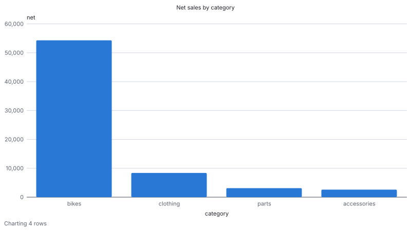

# Reports

A report is a query you run again and again with new values, such as each month's sales by
category, and the files it writes each time, with the columns, names, types and number formats
you chose once. It lives in a file of its own, runs in a process of its own, and stops at
limits you can see, so a report that reads too much never takes DbRover or your machine with
it.

A report reads one data source, or several, combined in DuckDB SQL or in PRQL, and writes CSV
and Excel files, and charts of them as SVG or PNG pictures. A source can read by the keys an earlier one found, and can be on a document database
such as DynamoDB or MongoDB, by declaring the columns it makes.

## Your first report

The examples in the repository's
[`examples/reports`](https://github.com/navasvarela/dbrover/tree/main/examples/reports) folder
run on made-up data:

1. Add a SQLite data source named **shop**, with a new file (see
   [Data sources](data-sources.md)).
2. Open [`shop.sql`](https://github.com/navasvarela/dbrover/blob/main/examples/reports/shop.sql)
   in its console (**File → Open…**) and run it all. It makes a bike shop's products and three
   months of order lines.
3. Right-click **Reports** at the bottom of the explorer and choose **Open the reports folder**.
   Copy `sales-by-category.toml` into it, then come back to DbRover, which lists the folder
   again when its window comes to the front (**Reload** does it too).
4. Click **Sales by category**. Its tab opens.
5. Type `2026-10-01` for **since** and `2026-11-01` for **until**, and click **Run**.

The tab shows the run as it goes, then the three files it wrote in your Downloads folder:
`sales-by-category-2026-10.xlsx` and `sales-by-category-2026-10.csv`, each product's units,
sales, returns and net amount, a subtotal for each category, and a total of 68,435.76; and
`sales-by-category-2026-10.svg`, a bar chart of each category's net sales. Click one to open it.
Under the files, a preview shows the rows the report wrote.

### The examples

Each example shows a kind of report of its own:

| Report | Reads | Shows |
| --- | --- | --- |
| [`sales-by-category.toml`](https://github.com/navasvarela/dbrover/blob/main/examples/reports/sales-by-category.toml) | SQLite | Grouping with a subtotal for each group and a total, with `GROUPING SETS`, and amounts rounded to the cent as they load. A [chart](#charts) of each category's net sales, from a query of its own. |
| [`sales-by-week.toml`](https://github.com/navasvarela/dbrover/blob/main/examples/reports/sales-by-week.toml) | SQLite | A combine step in [PRQL](#prql): each category's net sales, week by week, filtered by the report's parameters in PRQL's own `$since`. |
| [`order-history.toml`](https://github.com/navasvarela/dbrover/blob/main/examples/reports/order-history.toml) | SQLite and MongoDB | Every order line of a period with its customer, read from MongoDB by the ids the lines name, and each customer's running total with a window function. Past an Excel sheet's million rows, it goes on in a new sheet. |
| [`battery-flows.toml`](https://github.com/navasvarela/dbrover/blob/main/examples/reports/battery-flows.toml) | PostgreSQL, DynamoDB and DuckDB | Three sources joined: each battery's charges and discharges priced at the hour's energy price with `ASOF JOIN`, keeping every digit. |
| [`battery-cycles.toml`](https://github.com/navasvarela/dbrover/blob/main/examples/reports/battery-cycles.toml) | PostgreSQL, DynamoDB and DuckDB | State carried across rows: each discharge matched against the charges it drew from, first in, first out, with the price at each end. |

Their data comes from scripts beside them, each run in the console of the data source the
report names:

- **shop** (SQLite): [`shop.sql`](https://github.com/navasvarela/dbrover/blob/main/examples/reports/shop.sql),
  as above.
- **crm** (MongoDB, on a database you can write to):
  [`shop-customers.js`](https://github.com/navasvarela/dbrover/blob/main/examples/reports/shop-customers.js),
  the shop's customers, with their names and addresses.
- **energy-postgres** (PostgreSQL, on a server you can write a schema to):
  [`energy-postgres.sql`](https://github.com/navasvarela/dbrover/blob/main/examples/reports/energy-postgres.sql),
  300 charges and discharges of three batteries in the schema `energy`, each amount in the
  smallest unit the battery's meter records.
- **batteries-dynamodb** (DynamoDB):
  [`energy-batteries.partiql`](https://github.com/navasvarela/dbrover/blob/main/examples/reports/energy-batteries.partiql),
  each battery's name, meter unit, price zone and site. PartiQL can't make a table, so make
  `energy_batteries` first, keyed by `battery_id`, as the script's first lines say.
- **prices-duckdb** (DuckDB, with a new file):
  [`energy-prices.sql`](https://github.com/navasvarela/dbrover/blob/main/examples/reports/energy-prices.sql),
  three months of hourly energy prices. Then edit the data source and tick **Read-only**, so a
  report can read the file while DbRover has it open (see [Several sources](#several-sources)).

Copy the reports into the reports folder, **Reload**, and run each for October 2026: `2026-10-01`
and `2026-11-01` for the two on SQLite, `2026-10-01 00:00` and `2026-11-01 00:00` for the other
two. `battery-flows.toml`'s tab shows **Source flows** loading, **Source batteries** *waiting for
flows*, then reading the three batteries the month's flows name, **Source prices** attached, then
**Combine**. Its CSV file keeps every digit of each value, 26 decimal places, while the Excel
file rounds each to the cent.

## The Reports section

**Reports**, under the data sources in the explorer, lists every report in the `reports` folder
by its name. One with a warning sign can't run: hover over it to see how many problems it has,
and click it to see them. Right-click **Reports** for:

- **New report**: writes a commented report to start from, reading the first data source, and
  opens it.
- **Open the reports folder**: shows the folder in your file manager, to add or edit reports
  with any editor.
- **Reload**: reads every report again, after you have changed one.

Right-click a report for **Rename…** too, which renames its file in the `reports` folder and
keeps its [runs](#runs) with it.

The folder is `reports` in your settings folder (see [Where DbRover keeps its files](files.md)),
one for all your projects, so a report can read data sources from any of them.

## A report's tab

Click a report to open its tab: the report's file, edited in place, beside what a run needs, and
under both, its runs.


- **The toolbar** names the report, with a dot after the name while the file has unsaved
  changes, and says how it stands: *Ready*, *2 problems* or *1 warning* (click it to go to the
  first), *Unsaved*, or what the run is doing. Then **Format**, **Save** and **Run**, and **⋯**
  for **Rename…**, **Show in folder**, **Open in another app**, **Copy path** and **Hide the
  file**.
- **The file**, in the editor consoles use (see [Editing a report](#editing-a-report)).
- **Beside it**, the problems, if there are any, then a field for each parameter, checked as
  you type, and **Output**: the folder its files go in, Downloads until you **Choose…** another,
  and the files the values make. Drag the panel's edge to widen it.
- **Under both**, the run panel: **Last run**, **Preview**, **Profile**, **Compare** and **Past
  runs** (see [Runs](#runs)). Drag the line above it to make it taller.

While a report runs, **Last run** shows a line for each source and, if it has one, for the
combine step: what each has read so far, and for how long, with a check once it is done. Each
second it also says how fast the step reads and what it is mostly doing, as *500 rows/s, 10.0
KB/s · waiting on PostgreSQL (92%)*: waiting on its database (or on DuckDB, for the combine
step), *loading into DuckDB*, or *writing the files*. A source still waiting for its first row
says so too, so a query that keeps its database busy for minutes shows as that, not as
nothing. A
source loaded into DuckDB folds out its columns and the types they were given. Only one report
runs at a time; the other tabs say which one. When it ends, **Last run** shows each file it
wrote with its rows and size, and **Preview** the first rows; or the step that failed and why.
Nothing is written unless every file is: a run that fails or is cancelled leaves the folder as
it was, an older file of the same name included.

The values and the folder are remembered for each report until you quit DbRover. Someone who
runs a report every month and never edits it can choose **⋯ › Hide the file**, which leaves the
inputs and the runs.

### Editing a report

The file is highlighted as TOML, and each step's code in its own language: a source's query in
its data source's (PostgreSQL's SQL, PartiQL, MongoDB's syntax, …), `[combine]`'s query in
DuckDB's SQL, its `prql` in PRQL. Code sits on a faint band, so where it starts and stops shows.
Find and replace (**⌘F**, **⌥⌘F**) work as in a console.


Problems are underlined where they are, once you stop typing, and listed beside the file by
line; click one, or the toolbar's count, to go to it, and **F8** goes to the next:

- mistakes in the TOML, every one of them;
- what the report's file has wrong: a key a table doesn't have, a value of the wrong kind, a
  data source or preset there isn't, a parameter a query uses but `params` doesn't declare,
  PRQL that doesn't compile. These turn **Run** off;
- the SQL steps checked as a console checks a statement, with the lint rules you have switched
  on in [Settings](settings.md). These are warnings, and don't stop a run;
- the newest finished run's [hints](#runs), under the source or `[combine]` they are about,
  dotted. **Quiet** beside one adds it to `quiet_hints`.

**Format** (**⌥⌘L**, or **Code › Format**) lays out the file: one space around each `=`, no
indentation before keys and tables, one blank line before each table and the comments above it.
Lists and inline tables are left as you aligned them. It formats each SQL step as a console
formats SQL, and leaves PRQL as written. If formatting would change anything the report does, it
changes nothing and says so.

**Save** (**⌘S**) writes the file; a file with problems can be saved, to finish later. **Run**
reads **Save and run** while there are unsaved changes: the run reads the saved file, so it
saves first. Closing the tab or quitting with unsaved changes asks first.

When another program changes the file, a clean tab shows the change. One with unsaved changes
says so, with **Reload** to take the file's text or **Keep mine** to save over it. A file
deleted from the folder keeps its tab, and **Save** writes it again. **⋯ › Open in another app**
opens the file in the app your system opens `.toml` files with.

## Runs


Every run of a report is kept, finished, failed or cancelled, with what each of its steps
measured. The run panel's **Past runs** shows the newest five side by side, a column each,
newest first:

- when the run started, with a terminal or a plug beside it when it was started from the
  command line or from MCP rather than the tab (hover over it to see which), how it ended (hover over *failed* for the step and the error), its total time and the
  parameters it ran with;
- the version of the report's file that ran: its Git blob id, shortened as Git shortens it
  (hover over it for the whole id), with a mark where the file changed since the run before.
  The copy button beside it puts `git log --find-object=<id> -- reports/<name>.toml` on the
  clipboard: run in a settings folder kept in Git, it lists the commits that had exactly that
  file, so you can tell which version of the report wrote a given set of files. The id needs no
  Git to work out, so it is there whether or not the folder is in a repository; runs from before
  DbRover 0.31 have none;
- a row for each source, the combine step and each output: its time and its rows, or for an
  output the file's size. Hover over a cell for everything the step measured: the bytes it read,
  how long its first row took, a lookup's batches, the combine step's peak memory and how much
  it spilled to disk, the file's name. A step a run didn't reach shows —. A step that took more
  than 1.5 times its median over at least three finished runs listed is marked ▲, slower than
  usual; its tooltip says how many times.

An output's rows are written as they come, so its time is part of the step its rows come from;
that step's time doesn't count the outputs', and a slow writer shows as its output.

The step that took the longest share of each run is in the accent colour. When it is the same
step in every finished run listed, a line under the table names it, as *Source lines takes the
most time in every run listed: 80% of the newest.* That is the step to look at first. Sources
of one round run at the same time, so their shares can add up to more than the whole run.

Under it, hints from the newest finished run say what to try, each in a sentence that names
the step and the number behind it, such as *Source lines read 1,100,000 rows for 40 written. If
the combine step drops most of them, filter them in the source's query, where its database can
use an index.* Each has an id, and a threshold below which it says nothing:

| Id | When | What to try |
| --- | --- | --- |
| `source-reads-more` | A source read at least 10,000 rows, and ten times what the outputs write. | Filter in the source's query. A report that adds rows up reads more than it writes on purpose, so this is a question to check, not a fault. |
| `combine-spilled` | The combine step held something on disk, past its `memory_limit`. | A larger `memory_limit` in `[combine]`, or fewer rows from the sources. A step that spills still finishes, but disk is slower than memory, and `max_temp_size` stops it once it spills too much. |
| `slow-first-row` | A source of at least 5 seconds spent 80% of them or more before its first row. | Its database is doing the work: explain the query in a console and look for an index. |
| `load-bound` | A source of at least 5 seconds spent half of them or more loading into DuckDB. | Read fewer rows or columns, or aggregate in the source's query. |
| `many-batches` | A lookup sent 50 statements or more. | A larger `batch_size`, or read the table whole and join it in the combine step. |
| `round-wait` | A source waited 30 seconds or more after the source its lookup reads, for the rest of that round. | A round starts when the round before ends, so a slow source there holds every source after it. |
| `writer-bound` | An output's writer took at least 5 seconds and half the run or more. | Excel is the slowest format to write; a CSV of the same rows is faster. |
| `near-limit` | A source's rows, bytes or time, the combine step's memory, spill or time, or the run's time reached 90% of its limit without passing it. | Raise the limit it names before a larger month stops the run. |
| `unused-columns` | The combine step's plan never reads some of a source's columns, and they hold a fifth or more of the bytes it returned. | Drop them from the source's query: they are sent and loaded for nothing. |
| `filter-one-source` | The combine step's plan filters a source's rows as it reads them, by a value or a parameter. | Move the filter into the source's query, where its database returns only the rows kept and can use an index. |
| `aggregate-one-source` | The combine step aggregates one source with nothing joined to it first. | Aggregate in the source's query: it returns its groups instead of its rows, with the same result. |
| `scanned-more` | A source's engine scanned at least 100 MB, and 100 times what it returned. | Check that the query filters on its table's partition or clustering column. An aggregate scans more than it returns on purpose, so this is a question too. |

The plan's three hints need a source of at least 10,000 rows, and read the combine step's plan as
DuckDB ran it: the columns each source's table was read for, the filters applied as it was read,
and the aggregates. **Explain** gives them before a report has run (see [Explaining a
report](#explaining-a-report)).

Hover over a hint to see its id. A report that reads far more than it writes on purpose, such
as one that adds up a year of lines into twelve, can silence a hint in its file, and the tab
then says how many it silences. **Quiet** beside a hint in the file does it for you:

```toml
[report]
name = "Sales by month"
quiet_hints = ["source-reads-more"]
```

**Clear history**, beside the heading, deletes every run of the report, after asking.

### A run's profile


**Profile** draws one of the runs kept, the newest unless you pick another under **Run**: a lane
for each source, the combine step and each output, on one time axis. Each bar is split into
what its time went to:

- a source: *connecting*; *until the first row*, the database working on the query; *receiving
  rows*; *loading into DuckDB*; and *typing columns*, once every row is in;
- the combine step: *until its first row*, DuckDB's own work; its *rows*; and *writing*, the
  files' share of it;
- an output: *waiting for rows* from the step that feeds it, then *writing*.

A source that waited for the sources of the round before it, beyond the source its lookup reads,
has that wait hatched. Hover over a stretch for its time.

Above the lanes, one sentence names the run's bottleneck: *Source lines held the run longest:
1.2 s of 2.0 s, 73% of it waiting on SQLite for its first row.* It is the step on the run's
critical path, the chain of steps the run waited on from start to end, with the most time of
its own, and the phase that held that step. A source that ran beside a slower one of its round
isn't on the path, however long it took, since making it faster wouldn't end the run sooner.
Under the lanes, the most memory the worker's process held. Runs kept before DbRover measured
when each step ran say so, and have no profile.

Under it, the **data funnel**, a line a source: the bytes its engine **scanned**, where the engine
says (ClickHouse, BigQuery, Athena and Trino); the rows and bytes it **returned**; and the rows of
it the combine step's scans **passed on**, after the filters DuckDB applied as it read them, with
their share of what it returned. A source that scanned 1.2 TB, returned 40 GB and passed on 300 MB
should filter in its query. ClickHouse says what it scanned before it sends the rows, so for a
result larger than about a megabyte it says only how it started, and the funnel shows nothing
rather than too little.

Last, **the combine step's plan**: DuckDB's operators as they ran the combine query, drawn as a
console draws a plan, the costliest tinted, with each operator's time and rows. Select a scan to
see the columns it read and its filters. Runs kept before DbRover kept the plan have none.

### Comparing two runs

**Compare** sets two kept runs side by side, the newest and the one before unless you pick
others: for the run and each step, its time, rows, bytes and the combine step's peaks in both,
with the change, and a ▲ on a change of more than half. Under it, the parameters and the limits
that differ, and whether the report's file changed between them (its version).

### Explaining a report

**Explain**, beside **Run**, plans the saved report with the parameters typed, without running
it, and shows what it found under **Explain**:

- **Each source's statement**, with the parameters' values written in, and its database's plan:
  PostgreSQL, MySQL, MariaDB, SQL Server, DuckDB and ClickHouse as a plan, SQLite and Trino as
  their own text. ClickHouse's says, for each index, how many of a table's granules it keeps.
  Athena runs `EXPLAIN` as a query it bills, and BigQuery has none, so they aren't explained;
  documents and DynamoDB have no plan to ask for.
- **What it would cost**, where the data source's engine estimates it before a run: BigQuery's
  dry run says how many bytes the query scans, and DynamoDB whether it reads a whole table.
  Beside it, the data source's limit, and whether a run would refuse the source: a run has
  nobody to ask.
- **The combine step**, planned by DuckDB over empty tables of each source's columns: those the
  file declares, else those the last finished run loaded. A source neither declares nor has
  loaded yet leaves it unexplained, and says to run the report once. The plan says what the
  combine reads of each table, not what it costs: the tables are empty, and DuckDB is told to
  plan as if they held rows.
- **Hints** from that plan: `unused-columns`, `filter-one-source` and `aggregate-one-source`, as
  a run gives them, weighed by the last run's rows where there is one.

A source with a lookup is explained with a list of one `NULL` in place of its values, which
come from another source as the report runs. Explaining reads no row: databases plan, and the
combine step's tables are empty. It connects as a run does, read-only where the database has
such a mode.

Runs are kept in `history.sqlite` with the [query history](history.md), by the report's file
name: edit the file and they carry on; rename it with **Rename…** and they move with it, but
rename it outside DbRover and its runs start afresh, since nothing in the file ties it to them. Each report keeps its
newest 20, unless **Settings › Reports** says otherwise; the query history's own limits don't
touch them.

## A report file

A report is a TOML file, with one `[report]`, one or more `[[source]]`s, a `[combine]` when
there are several, one or more `[[output]]`s, and any number of [`[[chart]]`s](#charts). The simplest reads one source, as this one
does, on a shop's orders:

```toml
[report]
name = "Sales by product"
description = "Each product's orders, units and amount in a period."
params = { since = "date", until = "date" }

[[source]]
id = "sales"
data_source = "shop"
query = """
SELECT p.sku, p.name AS product,
       COUNT(DISTINCT o.id) AS orders, SUM(l.quantity) AS units,
       SUM(l.quantity * l.unit_price) AS amount
FROM order_lines l
JOIN orders o ON o.id = l.order_id
JOIN products p ON p.id = l.product_id
WHERE o.placed_on >= :since AND o.placed_on < :until
GROUP BY p.sku, p.name
ORDER BY p.sku
"""
max_rows = 100000

[[output]]
format = "xlsx"
file = "sales-{since:%Y-%m}.xlsx"
sheet_name = "Sales"
columns = [
  { name = "SKU",     from = "sku" },
  { name = "Product", from = "product" },
  { name = "Orders",  from = "orders", type = "integer" },
  { name = "Units",   from = "units",  type = "integer" },
  { name = "Amount",  from = "amount", type = "decimal(18,2)", format = "#,##0.00;[Red]-#,##0.00" },
]

[[output]]
format = "csv"
file = "sales-{since:%Y-%m}.csv"
columns = "same"
```

### `[report]`

| Key | What it is |
| --- | --- |
| `name` | What the explorer and the tab call it. Needed. |
| `description` | A sentence under the name. |
| `params` | Each parameter and its type, as `{ since = "date", until = "date" }`. |
| `timeout` | How long a whole run may take, as `"30m"` or `"1h"`. 30 minutes unless you say. |
| `quiet_hints` | The ids of the hints its runs don't give, as `["source-reads-more"]` (see [Runs](#runs)). |

A parameter's type is `text`, `integer`, `decimal`, `boolean`, `date` or `timestamp`. A date is
typed as `2026-10-01`, a timestamp as `2026-10-01 12:00` (seconds and a fraction are optional,
and `T` works in place of the space).

### `[[source]]`

| Key | What it is |
| --- | --- |
| `id` | What the run's progress and errors call it, and the name of its table in `[combine]`: letters, digits and `_`, starting with a letter. Needed. |
| `data_source` | The data source it reads, by its name in the explorer. When two share a name, use the data source's id instead (in `data_sources.toml`). Needed. |
| `query` | One statement that only reads, in the data source's own SQL. Needed, unless `attach = true`. |
| `attach` | `true` for a DuckDB file that `[combine]` reads in place, without a query. See [Several sources](#several-sources). |
| `lookup` | Reads by the values an earlier source found, as `{ from = "flows", column = "battery_id", as = "battery_ids" }`. See [Lookups](#lookups). |
| `columns` | The columns it makes, each with a type. Needed for a document database. See [Declared columns](#declared-columns). |
| `max_rows` | The most rows it may return, all its lookup's batches together. 1,000,000 unless you say. |
| `max_bytes` | The most data it may return, as `"500 MB"` or `"4 GiB"`. 1 GiB unless you say. |
| `timeout` | How long the query may run, all its batches together, as `"30s"` or `"10m"`. 10 minutes unless you say. |

The query is in the data source's own language: SQL, PartiQL for DynamoDB, the shell's
`db.collection.find(…)` for MongoDB, a request for Elasticsearch and OpenSearch, a command for
Redis. It uses parameters as a console does, as `:since` (see
[Files, parameters and find](files-parameters.md#parameters)), and each `:name` must be in
`params`. In SQL, the values are bound as a console binds them; in the other languages they
are written into the query as that language writes a value of their type: a date in MongoDB's
shell is `ISODate("2026-10-01T00:00:00Z")`. A report reads every engine DbRover connects to.

### `[combine]`

A report with several sources combines them with a query in DuckDB's SQL, whose rows the
outputs write:

| Key | What it is |
| --- | --- |
| `query` | One statement that only reads, over the sources' tables, with the report's `:name` parameters. |
| `prql` | Instead of `query`: the same in [PRQL](#prql), with the report's parameters as `$name`. A `[combine]` has one of the two. |
| `timeout` | How long the query may run. 10 minutes unless you say. |
| `memory_limit` | The memory DuckDB may use before it spills to disk, as `"2 GiB"`. 2 GiB unless you say. |
| `threads` | How many of the processor's cores DuckDB may use. Half of them unless you say. |
| `max_temp_size` | The most DuckDB may spill to disk, as `"10 GiB"`. 10 GiB unless you say. |

See [Several sources](#several-sources).

### `[[output]]`

| Key | What it is |
| --- | --- |
| `format` | `"xlsx"` or `"csv"`, with that format's options beside it, as `exports.toml` names them: `sheet_name`, `header`, `freeze_header` and `autofilter` for Excel; `separator`, `quoting`, `header`, `null_text`, `line_ending` and `bom` for CSV. |
| `preset` | Instead of `format`: a CSV or Excel preset of yours in `exports.toml`, by its id, with its options (see [Your own export formats](export-formats.md)). |
| `file` | The file's name. `{since}` puts a parameter's value in it, and `{since:%Y-%m}` formats a date or timestamp parameter. |
| `columns` | The columns it writes, below. Without it, every column of the query, as it comes; with `"same"`, the first output's. |
| `max_size` | The most data it may write, as `"1 GiB"`. 1 GiB unless you say. |
| `continue_on_new_sheet` | For Excel: past a sheet's 1,048,576 rows, go on in a new sheet rather than stop. |

A file name can't hold a folder: every file goes in the folder you choose in the tab. Two
outputs can't write the same file.

### Columns

Each column is `{ name, from, type, format, time_zone, if_invalid }`, of which only `name` is
needed:

- `name`: its header.
- `from`: the query's column it comes from, the same as `name` unless you say.
- `type`: what its values are, which DbRover checks and writes in the type's plain form.
- `format`: Excel's number format, as `"#,##0.00"` or `"yyyy-mm-dd hh:mm"`. CSV files ignore it:
  they are read by programs, which want each type's plain text.
- `time_zone`: for a timestamp column, the zone to convert values with an offset to, as
  `"UTC"` or `"Europe/Madrid"`.
- `if_invalid`: what to do with a value that doesn't fit its type: `"fail"` the run (unless you
  say), write nothing (`"null"`), or write the value as it came (`"text"`).

| `type` | Takes | CSV writes | Excel writes |
| --- | --- | --- | --- |
| `text` | anything | the value | text |
| `integer` | a whole number | its digits | a number |
| `decimal` | a decimal number | its digits, as they came | a number |
| `decimal(18,2)` | a decimal number, rounded to 2 places, at most 18 digits in all | exactly 2 places | a number |
| `boolean` | `t` or `f`, `true` or `false`, `yes` or `no`, `1` or `0` | `true` or `false` | a boolean |
| `date` | `2026-10-01` | `2026-10-01` | a date |
| `timestamp` | a date and time | `2026-10-01 12:00:00`, with its fraction | a date and time, to the millisecond |

Decimals are rounded on their digits, half away from zero (`2.345` to `2.35`, `-2.345` to
`-2.35`), as your database and Excel's `ROUND` do, never through a floating-point number: a
value with 18 decimal places keeps every digit. Excel's numbers hold 15 digits, so a cell with more
is written as text, and the run says so for its column: give the column a type that rounds,
such as `decimal(38,2)`, to keep its cells numbers.

A value that doesn't fit stops the run with the output, the column, the row and the value, as
`row 2, column "Amount": "n/a" isn't a decimal number`.

## Charts

A `[[chart]]` draws a chart of the report's rows each time it runs, and writes it as an SVG or
PNG file beside the outputs' files. Its keys are the ones a chart takes above a statement in a
console (see [A chart in the query](consoles.md#a-chart-in-the-query)), so a chart worked out
there and copied with **Copy for a report** pastes in unchanged, with a few more for its file:

```toml
[[chart]]
file = "sales-by-category-{since:%Y-%m}.svg"
title = "Net sales by category"
query = """
SELECT category, COALESCE(SUM(amount), 0) AS net
FROM lines
GROUP BY category
ORDER BY net DESC
"""
x = "category"
y = "net"
```

| Key | What it is |
| --- | --- |
| `file` | The picture's name, ending in `.svg` or `.png`, with parameters as an output's: `{since:%Y-%m}`. No two files of a run, outputs' or charts', may have the same name. |
| `width`, `height` | Its size in points, from 200 to 4,000. 800 by 450 unless you say. |
| `scale` | For a PNG: 1, 2 or 3 pixels a point, as **Export ›** offers. 2 unless you say. |
| `query` | Instead of the report's rows: a DuckDB query over the sources' tables, with the report's `:name` parameters. Needs a `[combine]`. |
| `kind`, `x`, `y`, `series`, `stack`, `title`, `x_title`, `y_title`, `y_zero`, `sort`, `limit` | The chart, as in a console. A key left out takes the value **Chart** would start with. |



The chart is drawn as the **Chart** tab draws it, in the light theme's colours on white, with
the line under it saying what was charted, rows left out and gaps. An SVG is the same, byte for
byte, from the same rows on any machine, so you can keep one in git and compare a month's with
the last.

**Which rows.** Without `query`, a chart draws the rows the outputs write: the `[combine]`'s, or
the one source's. With `query`, it draws that query's rows, run in the combine step's DuckDB
once the outputs' rows are written, under the `[combine]`'s `timeout` and `memory_limit`. The
example needs it: its rows mix each product with a subtotal for each category and a total,
right for Excel and wrong for a chart, so its chart sums the source's own lines by category.

**A chart doesn't draw part of the data without saying so.** The **Chart** tab draws the first
250 bars or 50,000 points and says so under the chart, but nobody reads a report's chart as it
is made, so a report's chart past them stops the run instead: "it draws bars, at most 250 rows,
and the result has 1,204; group the rows in the query, or set limit to draw the first ones". With
`limit`, it draws the first rows, after `sort`, and says so under the chart. A `series` with
more than eight values stops the run the same way, naming the values past the eighth, one a
colour.

**Gaps and empty months.** A null or a value that isn't a number is a gap, never a zero; the
gaps are counted under the chart and in the run's warnings. A month whose rows are none still
gets its chart, saying "No rows to chart", with a warning.

**Problems.** A misspelt key or a value of the wrong kind is a problem of the file, underlined
in the editor and keeping the report from running, as "chart 1: no key `fiel`; did you mean
`file`?". A column the rows don't have stops the run in the chart's step, as
"`y = "nett"` isn't a column of this result: category, net". A chart that fails fails the run,
which writes none of its files.

Charts are written with the outputs' files, listed with them in the tab and by
`dbrover report run`, and kept in the run's history as outputs, with the rows drawn and the
file's size.

## Several sources

This report, a simpler form of `battery-flows.toml`, reads a PostgreSQL table and a DuckDB
file, and joins each row to the latest price before it:

```toml
[[source]]
id = "flows"
data_source = "energy-postgres"
query = """
SELECT id, battery, zone, energy_kwh, metered_at
FROM energy.flows
WHERE metered_at >= :since AND metered_at < :until
"""

[[source]]
id = "prices"
data_source = "prices-duckdb"
attach = true

[combine]
query = """
SELECT flows.metered_at, flows.battery, flows.energy_kwh, p.price_eur,
       flows.energy_kwh * p.price_eur AS value_eur
FROM flows
ASOF JOIN prices.hourly_prices p
  ON p.zone = flows.zone AND p.hour <= flows.metered_at
ORDER BY flows.metered_at, flows.id
"""
```

Each run has a DuckDB database of its own, in memory. Every source with a query runs through
DbRover's own connection to its data source, read-only and under its limits, as a single source
does, and its rows are loaded into a table named after its `id`: `flows` above. Sources load at
the same time. A DuckDB file with `attach = true` isn't copied: it is attached, read-only, as a
database named after its `id`, so `prices.hourly_prices` reads its table in place and DuckDB
reads only what the query needs. The `[combine]` query then runs over them, with all of
DuckDB's SQL: joins of every kind, `ASOF JOIN` for "the latest price at or before",
window functions, `GROUP BY GROUPING SETS` for subtotals, `PIVOT`.

The combine query reads nothing else: no file on your disk, no extension from the internet, no
setting of DuckDB's. A report with one source and no `[combine]` runs without DuckDB, as the
one under [A report file](#a-report-file) does.

A DuckDB file can be read by one program while another has it open for writing only if neither
writes. Tick **Read-only** on a DuckDB data source that a report attaches, or disconnect it
before you run the report; otherwise the run says the file is locked.

### PRQL

[PRQL](https://prql-lang.org) is a language for the same queries, written as a pipeline that
reads top to bottom: take a table, filter it, derive columns, group, sort. A `[combine]` can be
written in it, with `prql` in place of `query`; DbRover compiles it to DuckDB's SQL when it
reads the file, and runs that SQL as it runs a `query`. `sales-by-week.toml` does:

```toml
[combine]
prql = """
from lines
filter (ordered_on >= ($since | as date) && ordered_on < ($until | as date))
derive week = s"date_trunc('week', {ordered_on})"
group {week, category} (
  aggregate {
    order_lines = count this,
    units = sum quantity,
    net = sum amount,
  }
)
sort {week, category}
"""
```

- **Parameters** are PRQL's, `$since`, and must be in `[report]`'s `params`, as in SQL.
- **DuckDB's own functions** go in an s-string, `s"date_trunc('week', {ordered_on})"`, written
  as DuckDB's SQL, the columns in braces.
- **The dialect** is always DuckDB's: a `prql target:` line naming another is ignored.
- **A mistake** is one of the file's problems, as a TOML error is, and points into the PRQL. A
  comma left out after `net = sum amount`:

  ```text
  [combine]: prql, line 9, column 5: expected new line or something else, but found average
          average = net / order_lines,
          ^
  ```

  PRQL doesn't know a table's columns, so a misspelt column compiles, and DuckDB names it when
  the run reaches the combine step.

The tab shows the SQL the PRQL compiled to under the parameters, in **Combine SQL, compiled
from PRQL**, with **Copy**; a run's combine step folds out the same SQL, and opens it when the
step fails, since DuckDB's errors name a line of it. `dbrover report run` prints it, its lines
numbered, under a combine step's error, and `--json`'s `started` event has it as
`combine_sql`. PRQL's `sum` of no rows is 0, where SQL's `SUM` is null, so the two differ there.

### Types in DuckDB

Each loaded column gets a type, shown in the tab when you fold out the source:

- **The data source's type,** where it says more than the values: a `decimal(18,2)` stays
  `DECIMAL(18,2)`, a float stays `DOUBLE`, and a text column stays text, so codes such as `0042`
  or `1000` keep their form. Text whose every value is a date or a time, as SQLite keeps them,
  becomes a `DATE` or a `TIMESTAMP`.
- **Otherwise, the values':** PostgreSQL, for one, doesn't say. Whole numbers become `BIGINT`
  (`HUGEINT` past 18 digits); decimal numbers a `DECIMAL` with just the digits they have, so
  PostgreSQL's `numeric` amounts load exactly; `t` and `f` a `BOOLEAN`; dates and times their
  types, with a time zone if they carry an offset. Anything else, or a mix, is text.

A number of more than 38 digits, which no DuckDB `DECIMAL` holds, loads as text, and the tab
warns about its column; cast it in the combine query to what it should be.

### Exact numbers in DuckDB

DuckDB keeps decimals exact through `+`, `-`, `*`, `SUM`, `ROUND` and comparisons: a product's
places are the sum of its factors', up to 38 digits in all, which is why `battery-flows.toml`'s
values have 26. Two things give a floating-point `DOUBLE` instead, which keeps about 15
digits:

- **Division:** `a / b` is a `DOUBLE`. Multiply by a decimal instead (`amount * 0.01` rather
  than `amount / 100`), or cast the result: `CAST(a / b AS DECIMAL(38,18))`.
- **`power()`**, `sqrt()`, `ln()` and the like.

The outputs then round each value once, as their column's type says: `battery-flows.toml`'s Excel file
writes values as `decimal(38,2)`, and its CSV file every digit.

## Lookups

A source can read by the values an earlier source found, rather than reading everything and
leaving the combine step to throw most of it away. `battery-flows.toml` reads, from DynamoDB,
only the batteries the month's flows name:

```toml
[[source]]
id = "batteries"
data_source = "batteries-dynamodb"
lookup = { from = "flows", column = "battery_id", as = "battery_ids" }
query = 'SELECT battery_id, name, unit, "zone", metadata FROM energy_batteries WHERE battery_id IN :battery_ids'
```

`lookup` takes the distinct values of the column `battery_id` of the source `flows`, once
`flows` has loaded, and puts them where the query says `:battery_ids`, as a list in the query's language:

| Language | The query reads | `:ids` becomes |
| --- | --- | --- |
| SQL | `WHERE id IN :ids` | `('a', 'b', 7)` |
| PartiQL (DynamoDB) | `WHERE pk IN :ids` | `['a', 'b', 7]` |
| MongoDB | `db.customers.find({_id: {$in: :ids}})` | `["a", "b", 7]` |
| Elasticsearch, OpenSearch | `{"terms": {"id": :ids}}` | `["a", "b", 7]` |
| Redis | `MGET :ids` | `a b 7` |

A value from a number column goes in as a number, anything else as text: a key kept as text in
one database and as a number in the other matches nothing, so declare the earlier column's type
(see below) when it matters.

- **`from`** names a source above this one in the file, with a query: an attached DuckDB file is
  joined in `[combine]` instead.
- **`as`** is the parameter's name, which can't be one of `params`. The query must use it.
- **`batch_size`** lowers how many values one statement takes. A lookup with more values than
  that runs its query again for each batch, and every batch's rows go into the one table. A
  statement takes at most 100 values in PartiQL (DynamoDB refuses more) and in CQL, and 1,000
  in the other languages; the tab shows which batch a source is on.

Sources with a lookup run once the source they read is loaded: in rounds, each round's sources
at the same time. When the earlier source found no value, a source with declared columns sends
nothing and its table is empty; a SQL source without them runs its query once with `(NULL)`,
which matches nothing.

On DynamoDB, a lookup on the table's partition key reads each item by its key. One on any other
attribute would scan the table, which the data source's cost guard refuses (see
[Cost guards](cloud.md#cost-guards)). PartiQL keeps some words for itself, `value` and `zone`
among them: quote an attribute with such a name, as `"zone"`.

## Declared columns

DynamoDB, MongoDB, Elasticsearch and Redis return documents rather than rows, so a source on one
declares the columns it makes:

```toml
columns = [
  { name = "battery_id", type = "text" },
  { name = "name",       type = "text" },
  { name = "unit",       type = "decimal(38,18)" },
  { name = "zone",       type = "text" },
  { name = "site",       from = "metadata.site", type = "text", default = "unknown" },
]
```

Each column is `{ name, from, type, default }`, of which only `name` is needed:

- `name`: the column in the source's table, which `[combine]` reads.
- `from`: where its value is, the same as `name` unless you say: a field of a document by its
  path, as `metadata.site` or `lines[0].sku`, or for a source that returns rows, the query's
  column.
- `type`: one of the output types (see [Columns](#columns)), `text` unless you say. Its type in
  DuckDB follows: `integer` is a `BIGINT`, `decimal(38,18)` a `DECIMAL(38,18)`, `timestamp` a
  `TIMESTAMP`.
- `default`: the value a missing field, or `null`, gets.

The table has the declared columns and nothing else: fields you don't declare are left out.
MongoDB's typed values are read as their value: `NumberLong(7)` is `7`, `NumberDecimal("0.1")`
is `0.1`, an `ObjectId` its hex digits, and a date its time in UTC. A time with an offset is
converted to UTC; an object or an array goes into a `text` column as its JSON.

A value that doesn't fit its type stops the run with the source, the item and the value, as
`item 2 (_id "cust-07"): column "orders": "many" isn't a whole number`.

A source on a SQL database may declare its columns too, to fix their types rather than let
DuckDB's typing guess from the values: the examples declare SQLite's amounts `decimal(18,2)`, so
each is rounded to the cent as it loads, and PostgreSQL's raw amounts `decimal(38,0)`.

## Limits

A report runs in a process of its own, `dbrover report-worker`, which DbRover starts for each
run. If it runs out of memory or time, or you cancel it, the process stops and DbRover, its
consoles and their transactions carry on. The limits, cheapest first:

| What | Limit | Change it with |
| --- | --- | --- |
| Each source | its rows, its data, its time, every batch of its lookup together; read-only | `max_rows`, `max_bytes`, `timeout` in `[[source]]` |
| The combine step | DuckDB's memory, threads and spilled data; its time | `memory_limit`, `threads`, `max_temp_size`, `timeout` in `[combine]` |
| Each output | its data; Excel's rows a sheet | `max_size`, `continue_on_new_sheet` in `[[output]]` |
| Each chart | its kind's rows (250 bars, 50,000 points) and eight series; its `query`, the combine step's limits | `limit` in `[[chart]]`, or fewer rows from the query |
| The run | its time | `timeout` in `[report]` |
| The process | a lower priority; on Linux, half the machine's memory and the run's time on each processor thread | — |

A limit a report's file doesn't set has a default for every report, in **Settings › Reports**:

| Default | Of | DbRover's own |
| --- | --- | --- |
| Rows a source may return | `max_rows` | 1,000,000 rows |
| Values a source may return | `max_bytes` | 1 GiB |
| A source's time limit | `timeout` in `[[source]]` | 10 minutes |
| Memory before spilling to disk | `memory_limit` | 2 GiB |
| Spilled to disk at most | `max_temp_size` | 10 GiB |
| Threads | `threads` | half the processor's cores |
| The combine query's time limit | `timeout` in `[combine]` | 10 minutes |
| Values an output may write | `max_size` | 1 GiB |
| A whole run's time limit | `timeout` in `[report]` | 30 minutes |

Each is a menu of a few values around DbRover's own. They are saved in `settings.toml`'s
`[reports]`, written as a report file writes them, so you can set any value there by hand:

```toml
[reports]
memory_limit = "8 GiB"
run_timeout = "2h"
runs_kept = 50
```

The keys there are `max_rows`, `max_bytes`, `source_timeout`, `memory_limit`, `max_temp_size`,
`threads`, `combine_timeout`, `max_size`, `run_timeout` and `runs_kept`. A run uses the defaults
in force when you click **Run**.

DuckDB spills what doesn't fit in its `memory_limit` to a folder inside the output folder, which
goes with the run. On macOS and Windows, which don't cap a process's memory, `memory_limit` is
what keeps a large combine step from filling your machine's memory: lower it on a small
machine, raise it for a report that combines millions of rows.

A run stopped by a limit names it, its value, and who set it: the report's file, as "It stopped
at max_rows = 100,000 rows, set in the `[[source]]` "sales" of the report's file. To allow more,
raise it there."; or Settings › Reports, where the file leaves it out, as "It stopped at
max_rows = 1,000,000 rows, the default in Settings › Reports, since the report's file doesn't set
it.", with a link to that page. Before
raising one, ask whether the query should read less: the hints under [Runs](#runs) point at a
source that returns far more rows than the report writes.

The source always reads: a statement that would change anything is refused before it is sent,
and it runs in the database's read-only mode, as a read-only data source's consoles do. A data
source whose cost guard would ask before a statement refuses it instead, since a running report
can't ask you (see [Cost guards](cloud.md#cost-guards)).

The worker can't ask for a password either. A data source whose password you type each time
can't be a report's source until you save the password, or use a password command or a cloud
sign-in (see [Password from a command](data-sources.md#password-from-a-command)).

## From the command line

`dbrover report run` runs a report without opening DbRover's window, so cron, a scheduled task
or a CI job can run it each month with new values. It runs in the same worker as a run from
the report's tab, under the same [limits](#limits), and exits with a code that says how it
ended.

```bash
dbrover report run sales-by-category \
  --param since=2026-10-01 --param until=2026-11-01 \
  --output-dir ~/reports/2026-10
```

`dbrover` is the program DbRover installs: `/Applications/DbRover.app/Contents/MacOS/dbrover`
on a Mac, `/usr/bin/dbrover` from the `.deb`, the AppImage itself, and
`%LOCALAPPDATA%\DbRover\dbrover.exe` on Windows. Cron and scheduled tasks don't read your shell's
`PATH`, so write its full path there.

| Argument | What it does |
| --- | --- |
| `<report>` | A report's name, as **Reports** lists it, from the `reports` folder; or the path to a report file anywhere, such as `examples/reports/sales-by-category.toml`. A name ending in `.toml` or with a `/` in it is a path. |
| `--param <name>=<value>`, `-p` | A parameter's value, once for each, as the report's tab takes it: a date as `2026-10-01`, a timestamp as `"2026-10-01 12:00"`. A parameter missing, of the wrong type, or one the report doesn't take stops the command before anything runs. |
| `--output-dir <folder>`, `-o` | Where the files go, made if it doesn't exist. Without it, the current folder. |
| `--json` | The run's events on standard output, a JSON object a line (see below). |
| `--progress` | On a terminal, a line on standard error that says what each running step has read so far, how fast and what it is waiting on, rewritten each second, as *Source lines: 30,000 rows, 780.0 KB, 2 s, 30,000 rows/s, 780.0 KB/s, waiting on PostgreSQL (92%)*. In a pipe, cron's mail or with `--json`, nothing more is printed. |
| `--profile <file>` | Once a run that started ends, however it ends, writes its profile to `<file>` as JSON: each step's start, phases and limits, the machine, the bottleneck and the hints (see [Runs and profiles](#runs-and-profiles)). |
| `--config-dir <folder>` | The settings folder to use, as for the app (see [Choosing the settings folder](files.md#choosing-the-settings-folder)). Without it, the one DbRover uses. |

The report's data sources are the settings folder's, by the names the report gives them, and
the limits' defaults are Settings › Reports'. A source connects read-only, as in the app.

### What it prints

Standard error tells the run as it goes, and standard output lists each file written, its full
path a line, so a script can pass them on:

```text
Sales by category (since = 2026-10-01, until = 2026-11-01), version 3b18e51
Source lines: 246 rows, 6.5 KB in 0.0 s
Combine: 13 rows, 509 bytes in 0.0 s
/home/me/reports/2026-10/sales-by-category-2026-10.xlsx
/home/me/reports/2026-10/sales-by-category-2026-10.csv
/home/me/reports/2026-10/sales-by-category-2026-10.svg
Finished in 0.0 s.
```

With `--json`, standard output is the run's events instead, as the report's tab reads them:
`started`, `progress` about once a second, `source_done`, `combine_done`, `preview`,
`output_written` for each file, a chart's included, and last `finished`, `failed` or `cancelled`.
`started` has the report file's Git blob id as `version`, the same the first line of the human
output shortens, so a CI job's output names the version that ran; the run's log says it too.
Every line has `at_ms`, when it was sent, in milliseconds from the run's start; `progress` has
`busy`, the shares of the second before spent waiting, loading and writing; `source_done` has
`phases`; and `worker_usage`, just before the end, the worker's `peak_memory`.
`jq` picks out what a script needs:

```bash
dbrover report run sales-by-category -p since=2026-10-01 -p until=2026-11-01 --json \
  | jq -r 'select(.event == "output_written") | .path'
```

The command's log, and the worker's, go to `logs/dbrover-report.YYYY-MM-DD.log` in the data
folder (see [Where DbRover keeps its files](files.md)).

### Exit codes

| Code | The run |
| --- | --- |
| 0 | ran and wrote its files |
| 1 | failed otherwise: the combine query, an output or chart that couldn't be written, a chart naming a column the rows don't have, or the worker |
| 2 | didn't start: the command line is wrong |
| 3 | didn't start: the report file isn't found or has a problem, a data source it names doesn't exist, a parameter is missing, unknown or of the wrong type, or the settings folder can't be used |
| 4 | failed in a source: connecting to its data source, or its query |
| 5 | stopped at a limit, such as `max_rows` or a chart's rows; the message names the key to raise or set |
| 6 | was stopped: its own time limit (`timeout` in `[report]`), Ctrl-C, or SIGTERM |

Ctrl-C, or the SIGTERM that cron, `timeout` and CI runners send to stop a job, cancels the run as
**Cancel** does: the worker stops, and the output folder is left as it was.

### Runs in the app

A run of a report in the `reports` folder is kept with the app's runs, so its tab lists it
under [Runs](#runs) beside your own, marked *from the command line*. A report file elsewhere,
such as one in a repository's checkout, isn't kept.

### Listing the reports

`dbrover report list` prints each report in the `reports` folder: the name `report run` takes,
its title and parameters, or what keeps it from running.

```text
$ dbrover report list
sales-by-category  Sales by category (since: date, until: date)
sales-by-week      Sales by week (since: date, until: date)
stock              Stock — can't run, 1 problem:
  ! source "items": there is no data source "warehouse"; there are shop
```

With `--json`, one object a report, a line each, with its `name`, `title`, `description`,
`path`, `params`, `data_sources` and `problems`. `--config-dir` works as for `run`.

### Runs and profiles

`dbrover report runs <report>` lists the runs the history keeps of a report in the `reports`
folder, newest first, each with its id and, under it, the step that held it:

```text
$ dbrover report runs sales-by-category
12  2026-11-09 07:00  finished in 2.0 s, from the command line, version 3b18e51
    Source lines held the run longest: 1.2 s of 2.0 s, 73% of it waiting on SQLite for its first row.
11  2026-11-08 07:00  finished in 2.3 s, from the app, version 3b18e51
    Source lines held the run longest: 1.3 s of 2.3 s, 70% of it waiting on SQLite for its first row.
```

`dbrover report compare <report> <run> <run>` sets two of them side by side by their ids, as
**Compare** does, marking with `!` a change of more than half:

```text
$ dbrover report compare sales-by-category 11 12
Run 11 (2026-11-08 07:00) and run 12 (2026-11-09 07:00)
Both ran the same report file.
Run           time                2.3 s → 2.0 s        −13%
Source lines  time                1.3 s → 1.2 s        −8%
              rows                  246 → 246          same
```

With `--json`, `runs` prints each run's whole profile, an object a line, the same that
`report run --profile` writes: `id`, `report`, `started_at`, `elapsed_ms`, `outcome`, `params`,
`version`, `machine` (the worker's `peak_memory`, the run's `timeout_ms`, the `cores` and the
`dbrover` that ran it), `steps` as the history keeps them, `bottleneck` and `hints`, each with its
`id`, the table it is `at`, its `text` and whether the file's `quiet_hints` silences it.
`compare --json` prints one object. A CI job can keep each run's profile beside its logs:

```bash
dbrover report run sales-by-category -p since=2026-10-01 -p until=2026-11-01 \
  --profile "profile-$(date +%F).json"
```

An unknown report or run id exits with 3.

### Explaining from the command line

`dbrover report explain <report>` does what **Explain** does, with the parameters given with
`-p` as for `run`:

```text
$ dbrover report explain sales-by-category -p since=2026-10-01 -p until=2026-11-01
Source lines on shop:
    SELECT … FROM lines WHERE sold_at >= '2026-10-01' AND sold_at < '2026-11-01'
  Plan:
    SCAN lines
    …

The combine step, planned by DuckDB over empty tables:
    PROJECTION
      HASH_GROUP_BY
        SEQ_SCAN lines
    …
```

With `--json`, one object: `sources`, each with its `id`, `data_source`, `statement`, `plan`
(its `kind`: `drawn` with its `format` and `text`, `text`, `unexplained` with a `reason`, or
`failed` with a `message`), its `estimate` and `notes`; `combine`, planned or why not; and
`hints`. It exits as `run` does: 0 once explained, 3 when the report, a parameter or the
settings folder is wrong.

### A command killed outright

Ctrl-C and SIGTERM stop the run cleanly. A command killed outright, by SIGKILL or a CI runner's
hard stop, can't: on Linux its worker dies with it, and elsewhere the worker stops at its next
event, about a second later, once it finds nobody reading them. Either way, a file it was
writing stays in a hidden `.dbrover-report-…` folder inside the output folder on Linux, and is
removed elsewhere.

### Passwords

Nobody is there to type a password, so a source's data source needs one of:

- **A saved password,** in the keychain. On a Mac, cron reads the login keychain while you are
  logged in. A Linux server without a desktop usually has no Secret Service to keep it in.
- **A password command** that DbRover trusts (see
  [Password from a command](data-sources.md#password-from-a-command)). Connecting to the data
  source once in the app trusts it. On a machine without the app, trust it by adding its
  command to `trusted_commands.toml` in the data folder, with the data source's `id` from
  `data_sources.toml`:

  ```toml
  [[command]]
  data_source = "3a4f8c2e-9b1d-4e6f-8a7c-5d2e1f0b9c11"
  command = ["printenv", "WAREHOUSE_PASSWORD"]
  ```

- **A cloud sign-in** already on the machine (see [Cloud sign-in and costs](cloud.md)). DbRover
  never opens a browser for one: when it has expired, the run fails with the cloud's message,
  and `aws sso login`, `gcloud auth application-default login` or `az login` signs in again.

### Every month, with cron

This line in `crontab -e` runs the sales report at 6:00 on the first of each month, for the
month before, on Linux (`date -d` is GNU's; macOS's `date` writes it `-v-1m`). Cron needs `%`
written as `\%`:

```text
0 6 1 * * /usr/bin/dbrover report run sales-by-category --param since=$(date -d 'last month' +\%Y-\%m-01) --param until=$(date +\%Y-\%m-01) --output-dir /srv/reports >> /srv/reports/sales.log 2>&1
```

Cron mails what a job prints when the machine sends mail; `>> … 2>&1` keeps it in a file
instead, each run ending with `Finished in …`, the failure, or `Cancelled`.

### In CI

A CI job has no settings folder of its own, so it writes one with the data sources its reports
need. This GitHub Actions job runs the example `sales-by-category.toml` on a SQLite shop made by
`shop.sql`, from a checkout of DbRover's repository, and keeps the files it writes:

```yaml
jobs:
  sales:
    runs-on: ubuntu-latest
    steps:
      - uses: actions/checkout@v4
      - name: Install DbRover
        run: |
          gh release download --repo navasvarela/dbrover --pattern 'dbrover_*_amd64.deb'
          sudo apt-get install -y ./dbrover_*_amd64.deb
        env:
          GH_TOKEN: ${{ github.token }}
      - name: Run the sales report
        run: |
          sqlite3 shop.db < examples/reports/shop.sql
          mkdir -p dbrover-settings
          cat > dbrover-settings/data_sources.toml <<EOF
          [[data_source]]
          id = "0b9d3d1e-5f2a-4c56-9a8e-2d7f4b1c6e01"
          name = "shop"
          driver = "sqlite"
          path = "$PWD/shop.db"
          EOF
          dbrover report run examples/reports/sales-by-category.toml \
            --config-dir "$PWD/dbrover-settings" --output-dir out \
            --param since=2026-10-01 --param until=2026-11-01
      - uses: actions/upload-artifact@v4
        with:
          name: sales-by-category
          path: out/
```

A step fails when the command's exit code isn't 0, so a report that hits a limit or can't
reach its database fails the job. `--config-dir` takes a full path, hence `$PWD`; a data
source's `id` is any UUID, as `uuidgen` makes one. A data source
on a server takes its password from a command, such as `printenv` of a CI secret, trusted as
under [Passwords](#passwords).
