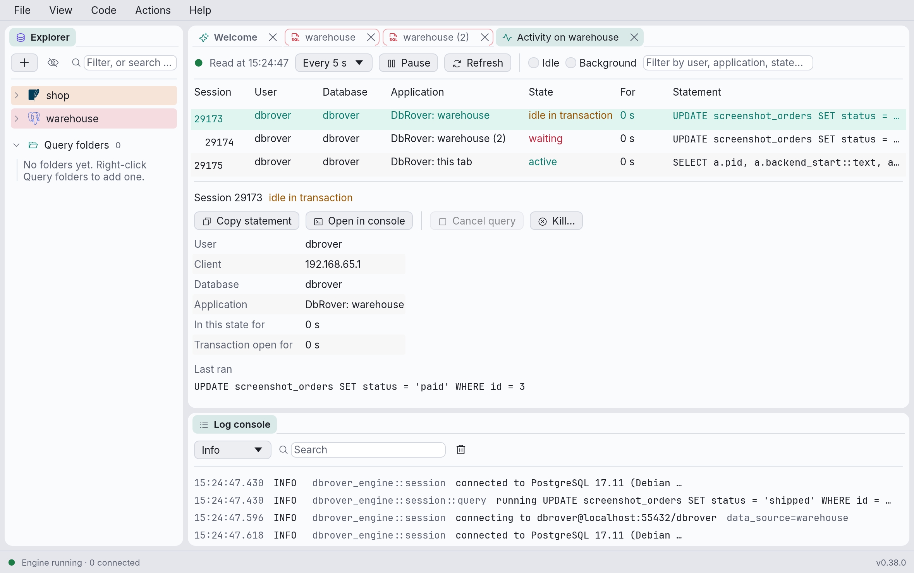
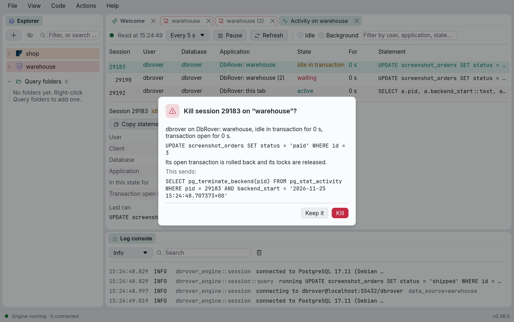

# Server activity

A report that used to take a minute has run for twenty. A migration hangs, and everything after
it queues behind its lock. A console left open in a transaction still holds its rows. **Server
activity** shows what a database server is doing: its sessions and what each one runs, who is
waiting on whose locks, and **Cancel query** and **Kill** to stop them.

It works on PostgreSQL, MySQL, MariaDB, SQL Server and ClickHouse. It isn't offered on SQLite
and DuckDB, which run inside DbRover with no one else's sessions, nor yet on Redshift, the
cloud warehouses or the NoSQL engines.

## Opening it

Right-click a data source in the explorer and choose **Server activity**. A tab opens beside
the consoles, *Activity on* the data source, with a connection of its own: a refresh never
waits behind the explorer or a console's long query, which is often the very thing you came to
stop. Each data source has one such tab; choosing it again brings it to the front. It isn't
reopened when DbRover starts, since that would connect to every server whose tab was open.

## The list

Each row is a session: its id (PostgreSQL's pid, MySQL's thread id, SQL Server's session id,
ClickHouse's query id), user, database, application, state, how long it has been in that
state, and its statement on one line.

| State | Means |
| --- | --- |
| **active** | Running a statement. |
| **waiting** | Running a statement that waits on another session's lock. |
| **idle in transaction** | Running nothing, with a transaction open: the usual reason others wait. |
| **idle** | Running nothing. |
| **background** | The server's own work: autovacuum, replication, the event scheduler. |
| **hidden** | Another user's session this login may not look into. |

**Who blocks whom.** A session waiting on a lock is drawn under the session holding it,
indented, and those chains come first, the oldest transaction first. The session at the left
of a chain is the one to look at. Sessions waiting on each other in a circle (a deadlock the
server hasn't broken yet) are drawn in red.

**DbRover's own sessions** are named in the Application column: *DbRover: this tab* (the
connection that reads the list), *DbRover: explorer*, and *DbRover: Orders.sql* for a console,
by its title.

**Idle** and **Background**, above the list, are off at first, so the list starts with what is
doing something. A session in a blocking chain is always shown, idle or not. The filter keeps
the sessions whose user, application, database or statement contains what you type.

Click a session for its details below the list: its client, how long its transaction has been
open, what it waits on and who holds it, what only this engine says (ClickHouse's rows read and
memory, SQL Server's percent complete), and its statement in full. **Copy statement**, **Open
in console** (a new console, not run) and **Go to blocker** are there too. A session that ends
while selected stays, marked *Ended*.

## Refreshing

The tab reads every 5 seconds while it is shown; a tab behind another isn't read until you come
back to it. The dot by **Read at** turns amber while a read is out, and the next read waits for
it, so a slow server is never sent more. A read that fails says why above the list and keeps the
last one. **Pause** stops the timer, **Refresh** reads once, and the menu beside them sets the
tab's interval, from 1 to 30 seconds. **Settings › Server activity** sets what a new tab starts
with, paused included.

Reads aren't kept in the [query history](history.md): the stops are.

## Cancel query and Kill

- **Cancel query** stops the running statement and keeps the session. PostgreSQL leaves its
  transaction open and failed until the client rolls it back; MySQL rolls back the statement
  and keeps the transaction.
- **Kill** ends the session: the server rolls back its open transaction and releases its locks.
  On SQL Server, rolling back a large change can take as long as making it did.

| | PostgreSQL | MySQL, MariaDB | SQL Server | ClickHouse |
| --- | --- | --- | --- | --- |
| **Cancel query** | `pg_cancel_backend` | `KILL QUERY` (MariaDB: `KILL QUERY ID`) | — | `KILL QUERY … ASYNC` |
| **Kill** | `pg_terminate_backend` | `KILL CONNECTION` | `KILL` | — |

SQL Server has no Cancel for another session: only a session's own client can stop its
statement and keep it. A DbRover console's statement is still stopped by that console's own
**Cancel**. ClickHouse's queries have no session around them, so there is nothing to kill.

**Kill always asks first**, since it rolls back someone's work. **Cancel query** asks first on
a [careful](objects.md#safety-levels-and-colours) data source, and runs at once otherwise. The
question names the session and the data source, whose session it is, what it runs, and the
statement that will be sent:

On a **read-only** data source both buttons are disabled, and DbRover refuses them however
they are asked for. The tab's own session can't be stopped either. Where a button is disabled,
hovering over it says why.

**Only the session that was listed is stopped.** PostgreSQL and SQL Server give a new session
the number of one that ended, sometimes within seconds. So the statement checks the session's
start time too, and a session that has ended since is reported as *had already ended*, with
nothing stopped. On PostgreSQL, Cancel also checks when the statement started, so it never
stops one the session began after you looked. On MariaDB, Cancel names the statement itself.

Each stop is kept in the [query history](history.md), tagged **Activity**, with what was
stopped: *Ended session 4211 (app, orders-api, shop), idle in transaction for 41 min, last ran
UPDATE orders SET …*. The other user's statement is kept with passwords taken out, as the
history's own statements are.

## What a login may see and stop

Every server shows less to a login without the right privilege, each in its own way. The tab
says what is left out and what would show it, above the list.

| Engine | Without the privilege | Shows everything | Stops other users' sessions |
| --- | --- | --- | --- |
| PostgreSQL | Every session, but other roles' statements, states and times are hidden | Superuser, or `pg_read_all_stats` (or `pg_monitor`) | Superuser, or `pg_signal_backend` (not a superuser's); a role may always stop its own |
| MySQL, MariaDB | Only this login's own threads, and no lock waits | `PROCESS` | `CONNECTION_ADMIN` (MariaDB: `CONNECTION ADMIN`) or `SUPER`; a login may always stop its own |
| SQL Server | Only this login's own session, without its statement | `VIEW SERVER STATE` | `ALTER ANY CONNECTION`, for any session, its own included |
| ClickHouse | Nothing: the server refuses, naming the grant | `SELECT` on `system.processes` | `KILL QUERY`; a user may always stop its own queries |

A privilege that comes only through a role isn't seen on MySQL and MariaDB, so the tab may say
less is shown than really is. ClickHouse can't be asked whether the login may stop another
user's query, so **Cancel query** is offered and the server refuses where it must. In every
case the server has the last word, and its refusal is shown as it is.

**Through a pooler** such as PgBouncer, the sessions are the server's connections, not the
pool's clients, and in transaction pooling one connection serves many clients: Kill ends
whichever is using it. DbRover can't tell it is behind a pooler, and *DbRover: this tab* may
then name another pooled session.

**Managed services** grant less than a superuser: on Amazon RDS for MySQL the master user ends
others' threads with `CALL mysql.rds_kill(id)`, which you can run in a console; on Azure SQL
Database the view is one database's.

## Where each engine reads it

- **PostgreSQL:** `pg_stat_activity`, with `pg_blocking_pids` and `pg_locks` for the sessions
  waiting on a lock. The server keeps only the start of a long statement
  (`track_activity_query_size`, 1 KB by default); such a statement is marked *cut short*.
- **MySQL and MariaDB:** `performance_schema.processlist` (MySQL 8.0.22 and later) or
  `information_schema.PROCESSLIST`, transactions from `INNODB_TRX`, row-lock waits from
  `sys.innodb_lock_waits` (MariaDB: `INNODB_LOCK_WAITS`), and on MySQL the waits for a table's
  metadata lock from `sys.schema_table_lock_waits`.
- **SQL Server:** `sys.dm_exec_sessions` with the requests they run, `blocking_session_id`, and
  each request's statement from its batch. It lists a statement as the server parameterised it
  (`SET [n] = [n]+@1`).
- **ClickHouse:** `system.processes`, on the node DbRover is connected to.

## For AI assistants

An assistant can read the same list, and stop sessions, through
[`dbrover mcp`](mcp.md#permissions): `server_activity` needs the project's
**Server activity** permission, off by default, since other people's statements can hold
anything they typed; `stop_session` needs **Admin** as well, and is refused on a read-only
data source.
