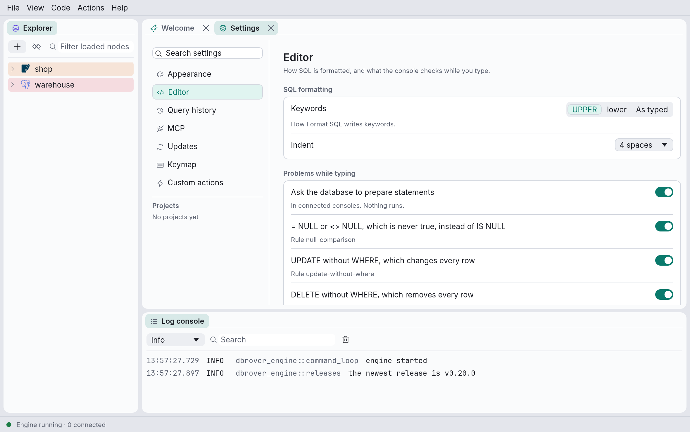

# Settings

**View → Settings…** (**DbRover → Settings…**, ⌘, on a Mac) opens the settings in a tab beside
your consoles. Asking again brings the same tab to the front; close it like any other tab.
Everything DbRover lets you set is in this one tab.

The sidebar lists its pages:

- **Appearance**: the theme, matching the system or always light or dark, as **View → Theme**
  chooses it.
- **Editor**: how [Format SQL](consoles.md) writes keywords and indents, and which
  [problems](consoles.md) the console points out while you type.
- **Query history**: how long [the history](history.md) keeps statements.
- **MCP**: what [AI assistants](mcp.md) may do in a project that doesn't say otherwise.
- **Updates**: whether DbRover checks for a new release when it starts.
- **Files**: the folder DbRover keeps your settings in, and **Choose…** to keep them elsewhere
  (see [Choosing the settings folder](files.md#choosing-the-settings-folder)).
- **Keymap**: every action's keys, from `keymap.toml` (see [Keyboard shortcuts](shortcuts.md)).
- **Custom actions**: the actions in `actions.toml` (see
  [Actions, snippets and themes](customising.md)).

Under **Projects**, each of your [projects](explorer.md) has a page of its own, with whether, and
how, [AI assistants](mcp.md) may use it. Right-click a project in the explorer and choose
**Project settings…** to open its page.

Type in **Search settings** to find anything on these pages by a word it shows, or one it is
known by: *dark*, *indent*, *timeout*, *format*. A search lists settings, shortcuts, custom
actions and projects together, and the sidebar counts what each page has that matches. A
custom action or a project found by a search has **Open**, which shows its page; click a page
in the sidebar to leave the search.

## Where each page saves

- **Appearance, Editor, Query history and Updates** save every change at once in
  `settings.toml` (see [Where DbRover keeps its files](files.md)), except the theme, which is kept
  with the window's layout. After editing `settings.toml` by hand, click **Reload** at the
  bottom of the page.
- **MCP** and **a project's page** wait for their own button, **Save MCP defaults** or **Save
  project settings**, and write `projects.toml`; **Discard** drops the changes. A project's
  changes are kept while you look at other pages, and its name in the sidebar has a dot until
  they are saved or discarded.
- **Files** changes nothing until you confirm a new folder with **Restart DbRover**; DbRover
  writes the choice as it quits, in the data folder.
- **Keymap** and **Custom actions** show what their files hold; you change them by editing
  `keymap.toml` and `actions.toml`. At the top of each page are the file's name (hover over it
  for its full path), **Reload**, to read it again after editing it, and **Create keymap.toml**
  or **Create actions.toml**, which writes a commented starting file (an existing one is kept).
  What a file got wrong is listed under them.

**View → Keymap…** and **View → Custom actions…** open those two pages directly, and so does
the status bar's link when `keymap.toml` or `actions.toml` has problems.
