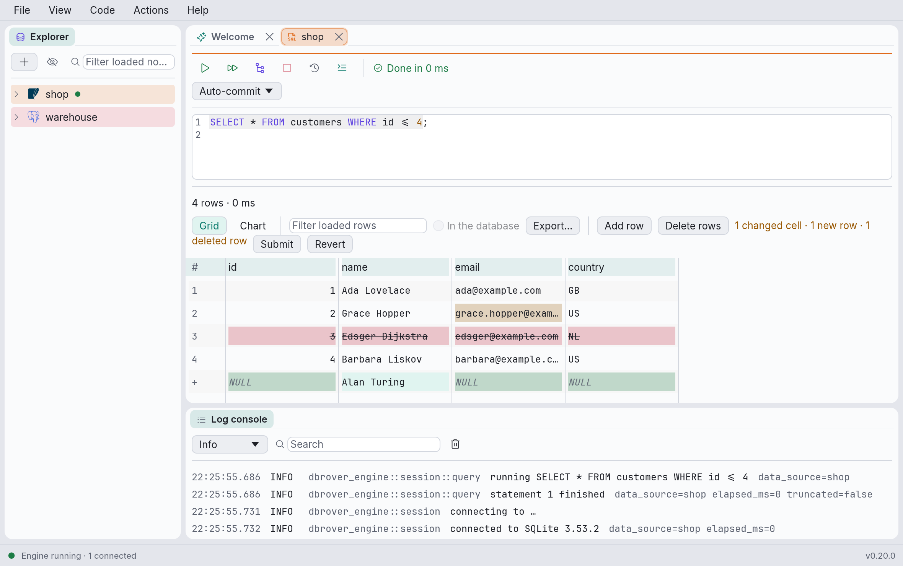
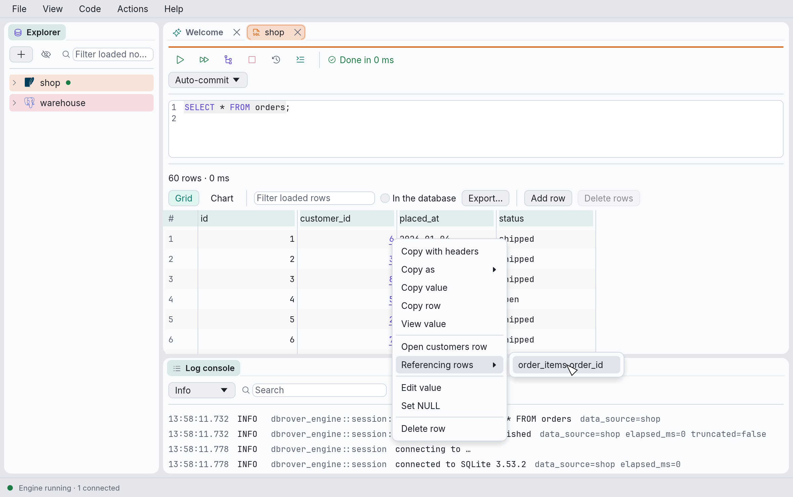
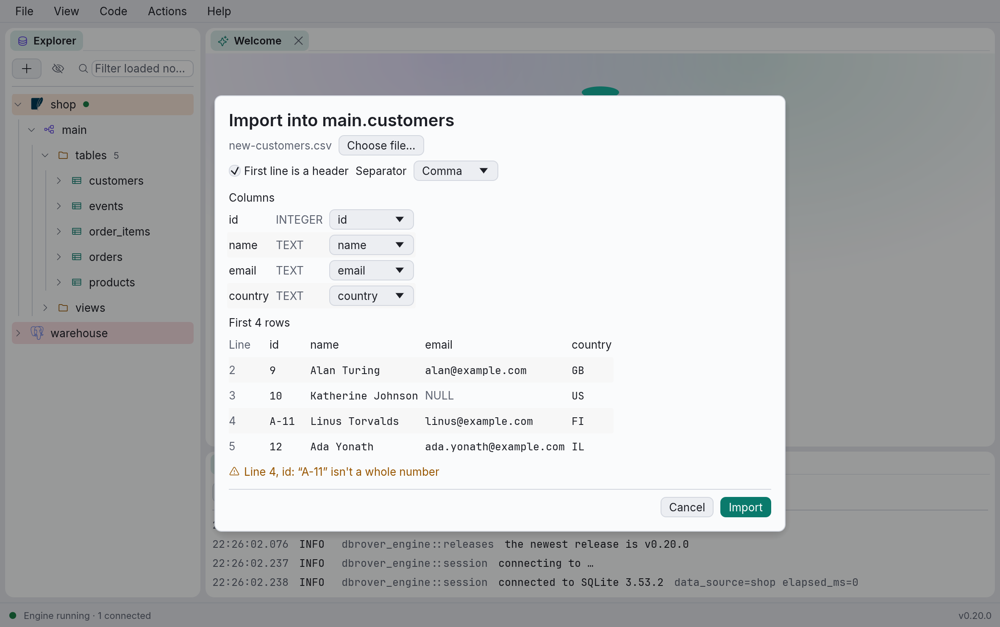

# Working with table data

The results grid is more than a view of a query. When the rows come from one table, you can
add, change and delete them, follow foreign keys from one table's rows to another's, sort and
filter every row in the database rather than only those loaded, export every row, and import a
CSV file into the table.

Editing needs a result whose rows stand for a table's rows: a `SELECT` from a single table (no
joins, `GROUP BY` or `DISTINCT`) that includes the table's primary key. **Open data** on a table
in the explorer gives you one. [Editing data](consoles.md#editing-data) explains when a result
is **Read-only**, and why.

## Adding, changing and deleting rows



- **Change a value** by double-clicking its cell (or selecting it and pressing F2 or Enter).
  Changed cells are tinted.
- **Add a row** with **Add row** in the grid's toolbar. The new row appears under the loaded
  ones, marked `+`. Each of its cells says what the database will put there if you leave it
  alone: `DEFAULT` (hover to see the default) or `NULL`. Type into the cells you want to set.
- **Delete rows** by right-clicking a row's cell and choosing **Delete row**, or by selecting
  cells in several rows and clicking **Delete rows**. Rows marked for deletion are struck
  through; **Restore row** in the same menu takes the mark away. A row you added and no longer
  want goes with **Remove row**.

The toolbar counts what is waiting, for example *1 changed cell · 1 new row · 1 deleted row*.
Nothing reaches the database until you click **Submit**; **Revert** forgets it all.

**Submit** writes everything at once, all or none: the deletions first, then the changes, then
the new rows, so a new row can take the key of one you deleted. If anything fails (a value
doesn't fit its column, a row changed since it was loaded, a key is already taken), nothing is
written, your changes stay as they were, and the message names the row: *Row 12* for a loaded
row, *New row 2* for one you added.

After a submit, deleted rows leave the grid and changed cells keep their values. If you added
rows, the query runs again, so they show what the database filled in for them, such as a
generated id.

On a **careful** data source, Submit first asks, naming the data source and what will happen:
*this inserts 1 row, updates 2 edited rows and deletes 1 row*. A **read-only** data source's
rows can't be changed. Every statement Submit sends is in the console's **History**, with the
values it replaced (see [The query history](history.md#what-a-statement-did)).

## Following foreign keys

A value in a foreign key column is underlined: it refers to a row of another table.



- **Open the row it refers to** with ⌘-click (Ctrl-click on Windows and Linux), or with **Open
  customers row** in the cell's menu. A new console opens with a query for that row, and runs
  it.
- **Find the rows that refer to this one** with **Referencing rows** in a row's menu. It lists
  the tables whose foreign keys point at this table, as *table.column*; pick one to open its
  rows that point at this row, again in a new console.

Each opens in a new tab, so the tab you came from is the way back. Following keys only reads,
so it works on read-only data sources and on tables without a primary key too. A key whose
value is `NULL` refers to nothing, so it isn't underlined; and a key is only followed when the
result includes all of its columns. An entry under **Referencing rows** is disabled, saying
which columns to add to the query, when the result lacks the ones the other table refers to.

## Sorting and filtering in the database

Clicking a column header, or typing in the filter, normally sorts and filters only the rows
already loaded, and the grid says so. To sort and filter every row, tick **In the database**
next to the filter. Then:

- clicking a column header sorts by it (ascending, descending, off), and
- pressing Enter in **Filter every row** keeps the rows where any value contains the text,
  ignoring case;

each by running the query again, wrapped in one that sorts and filters it:

```sql
SELECT * FROM (
SELECT * FROM orders
) AS dbrover_rows
WHERE … any value contains the text …
ORDER BY 3 DESC
```

The grid shows *Sorted and filtered by the database*, rows page in 500 at a time as usual, and
the rows can still be edited. Untick **In the database** to run the query as you wrote it again.

Only queries that start with `SELECT`, `WITH` or `VALUES` can be wrapped, and only when no two
columns have the same name (SQL Server can't wrap a `WITH` either). Otherwise the switch is
disabled; hover over it to see why. It is also disabled while changes are waiting to be
submitted, since running the query again would lose them. The database sorts by its own rules,
which may differ from the grid's: where `NULL`s go, for example.

## Exporting rows

**Export…** in the grid's toolbar writes the rows to a file: CSV, Excel, TSV, Markdown, SQL
statements, JSON, JSON Lines, Parquet or HTML, the loaded rows or every row the query returns.
**Copy as ›** in a cell's menu copies them in those formats. See
[Exporting and copying rows](exporting.md).

## Importing a CSV file

Right-click a table in the explorer and choose **Import CSV…**, then pick the file.



1. **The file.** Say whether its **First line is a header** (on by default) and which
   **Separator** it uses: comma, semicolon or tab. **Choose file…** picks another.
2. **Columns.** Each of the table's columns takes its values from a column of the file, or
   *(default)* to leave it to the database. DbRover matches them by name when the file has a
   header (ignoring case), or by position when it doesn't; change any of them in its menu.
3. **The first rows** of the file show as they would go into the table, with `NULL` for empty
   values and `DEFAULT` for columns left to their default.
4. **Warnings** point at values in those first rows that probably won't fit: text in a number
   column, a date that isn't `YYYY-MM-DD`, an empty value for a column that can't be `NULL`.
   They are only warnings: the database decides.

**Import** then reads the whole file and inserts it in batches of 500 rows, all in one
transaction. The dialog counts the rows as they go in. If the database refuses a row, the whole
import is rolled back, nothing is imported, and the dialog names the line of the file:
*Line 703: duplicate key value violates unique constraint*. On DuckDB it names the lines of the
batch that failed instead. Empty values are imported as `NULL`; everything else is sent as text
for the database to convert to the column's type, as when you type into a cell.

A **careful** data source asks before importing. A **read-only** one can't be imported into,
and nor can a ClickHouse table, since ClickHouse has no transaction to undo a failed import
with; the dialog says so.

## Redis keys

On a Redis, Valkey or Dragonfly data source, right-click a key in the explorer and choose **Open
data**. A console opens with the command that reads the key's value whole, and runs it:

| Type | Command | Shown as |
| --- | --- | --- |
| String | `GET` | One cell: text, a tree in **View value** when it is JSON, `redis-cli`'s quoting when it isn't text |
| Hash | `HSCAN … COUNT 1000` | `field` and `value` |
| List | `LRANGE key 0 -1` | `index` and `value` |
| Set | `SSCAN … COUNT 1000` | `member` |
| Sorted set | `ZRANGE key 0 -1 WITHSCORES` | `member` and `score`, lowest first |
| Stream | `XREVRANGE key + -` | each entry as a document, newest first: `_id` and then its fields as columns |
| JSON (the JSON module) | `JSON.GET` | One cell, a tree in **View value** |
| Anything else | `TYPE` | Its type's name |

A large value is read a page at a time as you scroll, a short command each, so a list or hash of
a million items neither stalls the server nor fills memory. A key in another database than the
data source's opens with a `SELECT` before it.

Above the result, a bar names the key and its type, with:

- **Set TTL…**: makes the key expire in the number of seconds you type (`EXPIRE`);
- **Persist**: keeps it from expiring (`PERSIST`);
- **Rename…**: gives it a new name, unless a key of that name exists (`RENAMENX`); the console then
  reads the key under its new name;
- **Delete…**: asks first, then deletes it (`DEL`).

Each runs as a command you typed would, then reads the key again: it is checked against the
data source's safety level, written to the log and recorded in the history. A read-only data
source's key bar only names the key.

The grid edits a value as a table's rows, with **Add row**, **Delete rows**, **Submit** and
**Revert**, and each change becomes one command:

| Type | Change a value | Add a row | Delete a row |
| --- | --- | --- | --- |
| String | `SET … KEEPTTL` (the key keeps its time to live) | — | — |
| Hash | `HSET` | `HSET`, with the field you type | `HDEL` |
| List | `LSET`, by the item's index | `RPUSH`, at the end | `LREM`, the first item with that value |
| Set | — | `SADD` | `SREM` |
| Sorted set | its score, `ZADD … XX` | `ZADD` | `ZREM` |
| JSON | the whole document, `JSON.SET key $` | — | — |

Redis has no transaction to undo a change, so **Submit** sends the commands one at a time. If one
fails, those before it stay made: the grid says how many, and reads the key again so it shows
what the server has. A hash field, a set member or a sorted set's member and score can't be typed
over, since they name their row: delete the row and add another. A stream's entries aren't
edited in the grid; add and delete them with `XADD` and `XDEL` in the console.

## MongoDB documents

On a MongoDB data source, **Open data** on a collection runs `find({})` on it, and the documents
it returns can be edited in the grid, as can those of any `find` on one collection typed in a
console. An `aggregate`'s documents, which may not be any collection's, can't.

- **Changing a field** sends `updateOne({_id: …}, {$set: {"address.city": …}})`: the document is
  found by its `_id`, which can't itself be typed over, and the field set by its path, an
  expanded column's included. The value keeps the type the field had: `8` typed over
  `NumberLong(7)` is stored as `NumberLong(8)`, over a string as the string `"8"`, and over a
  date as that date. Text that can't be the field's type, such as `seven` over a number, is
  refused before anything is sent. Text in the shell's syntax, `ObjectId("…")` or `{a: 1}`, is
  stored as written, and a field a document didn't have takes the type its text reads as.
- **Add row** adds a document of the fields typed into it, sent as `insertOne`; MongoDB gives it
  an `_id` unless one is typed in. A field of an expanded object is typed into the object's own
  column, as `{city: "Madrid"}`.
- **Delete rows** sends `deleteOne({_id: …})` for each.

**Submit** sends the commands one at a time, as for Redis: MongoDB has no transaction to undo a
change outside a replica set's sessions, so if one fails, those before it stay made. The
documents are then read again, so the grid and the tree show what the server stored. Each
command is checked against the data source's safety level, written to the log and recorded in
the history with the command that would undo it.

## Elasticsearch and OpenSearch hits

On an Elasticsearch or OpenSearch data source, **Open data** on an index, alias or data stream
runs a `match_all` search of it, and the hits it returns can be edited in the grid, as can those
of any search typed in a console whose hits show as documents. A search for its aggregations,
or any other answer, can't.

Each hit is found by its own `_index` and `_id`, which, with `_score`, can't be typed over, so
the hits of an alias or a pattern such as `logs-*` are edited in the index each came from. A
document indexed with its own routing is changed with that routing.

- **Changing a field** sends `POST /<index>/_update/<id>?refresh=true` with a partial document
  holding the field, an expanded column's by its path (`{"doc": {"address": {"city": …}}}`).
  The value keeps the JSON type the field had: `8` typed over a number is the number `8`, over a
  string the string `"8"`, and over `true` or `false` it must be one of them. Text that can't be
  the field's type, such as `seven` over a number, is refused before anything is sent. Over an
  object, an array or `null`, and in a field the document didn't have, JSON is taken as
  written and other text is a string. An array's items aren't columns of the grid: set the whole
  array, or send `_update` in a console.
- **Add row** indexes a document of the fields typed into it, in the search's index, or in the
  one typed into `_index` (which a search of several indices needs). A typed `_id` names it;
  otherwise the server gives it one.
- **Delete rows** sends `DELETE /<index>/_doc/<id>?refresh=true` for each.

Each request asks the index to refresh, so the hits read again show the change. **Submit**
sends them one at a time: neither server has transactions, so if one fails, those before it
stay made. Each is checked against the data source's safety level, written to the log and
recorded in the history with the request that would undo it. A partial update has the server
write the document's source again, so a number typed as `2.50` reads back as `2.5`.
