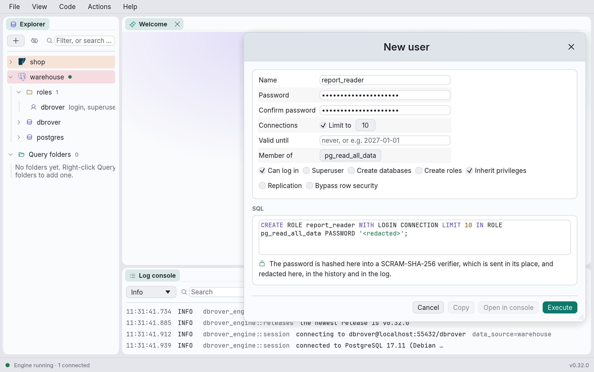
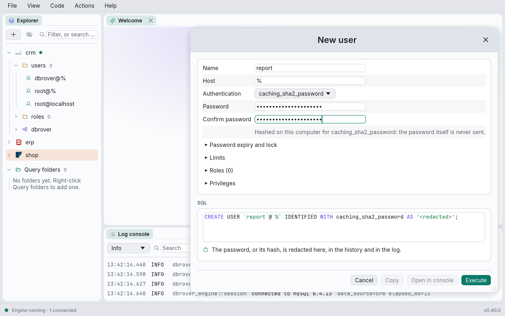
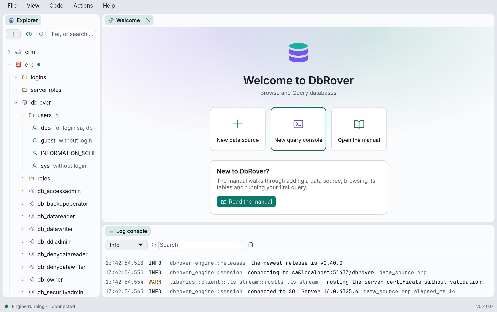
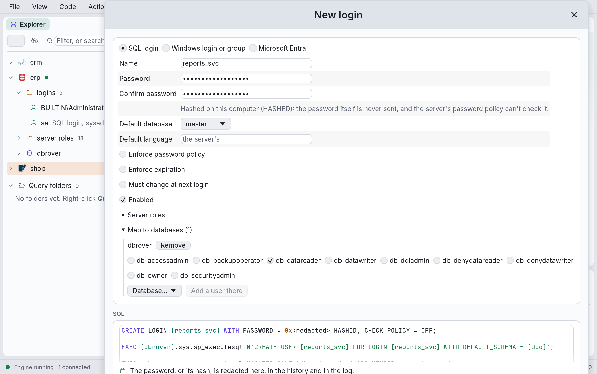

# Users and roles

The explorer lists a server's users and roles, and creates, changes and drops them, on
PostgreSQL, MySQL, MariaDB and SQL Server. Each engine has its own kind of user, and DbRover
keeps them apart:

| Engine | What logs in | Groups | Where they live |
| --- | --- | --- | --- |
| PostgreSQL | a **role** that may log in | a role that may not | the server: a **roles** folder |
| MySQL, MariaDB | an **account**, `name@host` | a **role** | the server: **users** and **roles** folders |
| SQL Server | a **login** | **server roles**; each database's **roles** | logins and server roles on the server; each database's **users** and **roles** in it |

The dialogs work like the [table helpers](objects.md): each one writes the SQL, shows it, and
runs it only when you click **Execute**, with the same
[safety levels and confirmations](objects.md#safety-levels-and-colours). A change that gives
administration of the server (`SUPER` or `CREATE USER` on MySQL, `sysadmin` or `db_owner` on
SQL Server, a grant option) says so above **Execute**, which turns red.

Amazon Redshift, which DbRover reaches as PostgreSQL, has no **roles** folder and no role
dialogs; nor have Azure Synapse and Microsoft Fabric, whose users are Microsoft Entra's.

- [PostgreSQL](#the-roles-folder)
- [MySQL and MariaDB](#mysql-and-mariadb)
- [SQL Server](#sql-server)

## PostgreSQL

### The roles folder

A PostgreSQL data source starts with a **roles** folder, before its databases, because roles
belong to the whole server rather than to one database. Each role says whether it can log in
and whether it is a superuser, and which roles it is a member of:

```text
roles
  app_readers
  report_reader    login, member of app_readers
  postgres         login, superuser
```

The roles PostgreSQL predefines (`pg_read_all_data`, `pg_monitor` and the rest) are
[system objects](explorer.md#system-objects), hidden until you click the eye button in the
explorer's toolbar.

| Right-click on | Menu items |
| --- | --- |
| A PostgreSQL data source, or its **roles** folder | **New › User…**, **New › Role…** |
| A role | **Copy name**, **Copy DDL**, **Edit…**, **Rename…**, **Drop…** |

**Copy DDL** copies the role's `CREATE ROLE` statement, rebuilt from what the catalog says
about it: its attributes, limit, expiry and memberships. Its password isn't in it.

### New user and New role

**New › User…** and **New › Role…** open the same dialog; New user starts with **Can log in**
ticked.



- **Name**.
- **Password** and **Confirm password**. Leave both empty for a role nobody logs in as.
- **Connections**: tick **Limit to** to cap how many connections the role may have open at
  once (`CONNECTION LIMIT`).
- **Valid until**: when the password stops working, as PostgreSQL reads a date or timestamp,
  e.g. `2027-01-01` (`VALID UNTIL`). Empty means never.
- **Member of**: the roles whose privileges it gets (`IN ROLE`). PostgreSQL's own roles are
  offered too: `pg_read_all_data` lets a role read every table, for example.
- The attributes, each with its keyword in its tooltip: **Can log in** (`LOGIN`),
  **Superuser**, **Create databases** (`CREATEDB`), **Create roles** (`CREATEROLE`),
  **Inherit privileges** (`INHERIT`, on unless you untick it), **Replication** and **Bypass
  row security** (`BYPASSRLS`).

The statement lists only what differs from PostgreSQL's defaults, e.g.
`CREATE ROLE report_reader WITH LOGIN CONNECTION LIMIT 10 IN ROLE pg_read_all_data PASSWORD
'<redacted>'`. The password comes last, so the expiry before it stays readable in the panel
and the history.

### How the password is sent

The password never leaves your computer as you typed it.

- **DbRover hashes it** into a SCRAM-SHA-256 verifier as soon as both fields match, the same way
  `psql`'s `\password` does, and sends the verifier in its place. PostgreSQL stores a verifier
  as it is, and checks the password against it when the user logs in.
- **The review panel shows `PASSWORD '<redacted>'`**, never the verifier: a verifier is not
  the password, but whoever holds it can try to guess the password offline.
- **Copy and Open in console are off** while the SQL holds a password. The redacted text would
  set a password nobody knows, and the real statement would put the verifier on the
  clipboard.
- **The query history and the log** keep the statement as the panel shows it, with
  `'<redacted>'` in place of the password, as they do for any statement holding one (see
  [Passwords stay out](history.md#passwords-stay-out)).

This needs PostgreSQL 10 or later, which accepts a verifier whatever its
`password_encryption` setting says.

### Edit a role

**Edit…** loads the role and fills the same fields, then writes what changed:

- one `ALTER ROLE` for the attributes, connection limit and expiry you changed;
- `REVOKE` for the roles it leaves, and `GRANT` for the ones it joins.

The password stays as it is unless you type a new one (hashed the same way) or tick **Remove
password** (`PASSWORD NULL`), after which password logins fail until a new one is set. With
nothing changed, there is nothing to execute.

### Rename a role

**Rename…** writes `ALTER ROLE … RENAME TO …`. A password stored as MD5 is cleared, because
PostgreSQL salts those with the role's name; the SCRAM passwords DbRover sets are kept.

### Drop a role

PostgreSQL refuses to drop a role that still owns something or holds privileges. **Drop…**
counts what the role owns and holds privileges on in the data source's database, names the
databases it owns and the roles that lose its privileges, and asks what to do with what it
owns:

- **Keep it**: just `DROP ROLE`, which fails if the role owns anything.
- **Give it to** another role: `REASSIGN OWNED BY … TO …`, then `DROP OWNED BY …` for the
  privileges left, then `DROP ROLE`. This also hands over the databases it owns.
- **Drop it**: `DROP OWNED BY …`, which drops the tables, views and other objects it owns, with
  their data, then `DROP ROLE`.

A role that owns something starts on **Give it to**, and **Execute** waits until you pick the
new owner. Everything runs in one transaction, so a refusal leaves the role and its objects as
they were. `REASSIGN OWNED` and `DROP OWNED` act only in the database the data source connects
to: what the role owns in another database still stops the drop, and the database's error says
so.

On a data source coloured red, you type the role's name before **Execute** can be clicked.

## MySQL and MariaDB

A MySQL or MariaDB data source starts with **users** and **roles** folders, before its
databases, because accounts belong to the whole server. An account is listed under its whole
name, `name@host`: `app@%` and `app@localhost` are two accounts, each with its own password and
privileges. Each says whether it is locked, whether its password has expired, and its roles; a
role says how many accounts it is granted to.

MySQL has no mark of its own for a role: a role is an account made locked and without a
password, which is how `CREATE ROLE` makes one, and DbRover lists such an account under
**roles**. MariaDB marks its roles, which have no host. The server's own accounts
(`mysql.sys`, `mariadb.sys`, and providers' accounts such as RDS's `rdsadmin`) are
[system objects](explorer.md#system-objects).

| Right-click on | Menu items |
| --- | --- |
| The data source, or its **users** or **roles** folder | **New › User…**, **New › Role…** |
| An account | **Edit…**, **Rename…**, **Lock or unlock…**, **Expire password…**, **Drop…**, **Copy DDL** |
| A role | **Edit…**, **Rename…** (MySQL only: MariaDB can't rename a role), **Drop…**, **Copy DDL** |

### New user and Edit



- **Name** and **Host**: `%` for any host, or a host name, an IP address or a mask such as
  `10.0.%`. To change either later, use **Rename…**.
- **Authentication**: the password plugins the server has active and DbRover writes passwords
  for: `caching_sha2_password` (MySQL's default), `mysql_native_password` where the server still
  has it, and MariaDB's `ed25519`. An account that logs in another way (a socket, PAM, LDAP,
  Kerberos) keeps its plugin unless you type a new password for one of these.
- **Password** and **Confirm password**. On Edit, leave them empty to keep the password.
- **Password expiry and lock**: **Locked**; when the password expires (the server's default,
  never, or every so many days); **Expire it now**, so the next login must change it; and on
  MySQL, **Lock after** so many failed logins, for some days or until unlocked.
- **Limits**: connections at once, and connections, queries and updates per hour, `0` for no
  limit.
- **Roles**: the roles granted, each with **Admin option** (it may grant the role on) and
  **Default** (active when it logs in; MariaDB allows one).
- **Privileges**: on every database (`*.*`), as data, structure and administration, with any
  other by name (MySQL's dynamic privileges, such as `BACKUP_ADMIN`); and on each database you
  add, with **With grant option** for each. Privileges on tables, columns and routines are
  listed too; untick one to revoke it. New ones are granted from a console.

A new role takes a name (and on MySQL a host), roles and privileges. MariaDB grants a new role
to the account that creates it, with admin option, as the dialog says.

### How the password is sent

- **Hashed on this computer** when it can be, in the plugin's own form, as on PostgreSQL:
  `IDENTIFIED WITH caching_sha2_password AS '…'`, or MariaDB's `IDENTIFIED BY PASSWORD '*…'`.
  The server stores the hash as it is, and the password itself never leaves your computer.
- **Sent as typed** when the server checks passwords (`validate_password` on MySQL, a password
  check plugin on MariaDB), which it can't do with a hash, and for `ed25519`, whose hash DbRover
  doesn't make. Then only over an encrypted connection: on one that isn't, **Execute** stays
  off and says why.
- The dialog says under the password which of the two it does. Either way the SQL shows
  `'<redacted>'`, **Copy** and **Open in console** are off, and the history and the log keep the
  statement redacted (see [Passwords stay out](history.md#passwords-stay-out)).

MySQL commits each account statement as it runs, so an Edit that fails half-way leaves the
statements before it done; the error says which one failed. The account's own change runs
first, then the privileges taken away, then those given.

### Lock, expire and drop

- **Lock or unlock…** shows whether the account is locked and writes the one statement that
  changes it: `ALTER USER … ACCOUNT LOCK` or `ACCOUNT UNLOCK`.
- **Expire password…** writes `ALTER USER … PASSWORD EXPIRE`: its next login must set a new
  password.
- **Drop…** names the views, routines, triggers and events that run as the account, which fail
  once it is gone (MySQL drops it with a warning for a login that may set any definer, and
  refuses otherwise), and a role's members. On a red data source you type
  the account's name first.

**Copy DDL** copies `CREATE USER` (or `CREATE ROLE`) and its grants, rebuilt from what the
server says about the account, without its password.

## SQL Server

A SQL Server data source starts with **logins** and **server roles** folders, before its
databases, and each database has **users** and **roles** folders before its schemas. A login
says its kind (SQL, Windows, Windows group, Microsoft Entra), its server roles, and whether it
is disabled or locked. A user says the login it is for, its roles, or that it is **orphaned**
(its login was dropped), **without login** or **contained** (it has a password of its own).
`dbo`, `guest`, `sys`, `public` and the server's `##…##` logins are system objects.



| Right-click on | Menu items |
| --- | --- |
| The data source, or its **logins** folder | **New › Login…** |
| The **server roles** folder | **New › Server role…** |
| A database's **users** folder | **New › User…** |
| A database's **roles** folder | **New › Role…** |
| A login | **Edit…**, **Rename…**, **Disable or enable…**, **Drop…** |
| A user, a server role or a database role | **Edit…**, **Rename…**, **Drop…** |

### New login and Edit



- The kind: **SQL login**, **Windows login or group** (`DOMAIN\name`), or **Microsoft Entra**
  (a user or group, where the server takes them). Only a SQL login has a password.
- **Enforce password policy** (`CHECK_POLICY`), **Enforce expiration** (`CHECK_EXPIRATION`) and
  **Must change at next login**, which needs both.
- **Default database** and **Default language**; **Enabled**.
- **Server roles**, and **Map to databases**: a user for the login in each database you add,
  with its roles.

**Edit…** sets the same, shows what the server says of the login (locked, expired, bad
passwords, days until the password expires), changes the password if one is typed, and
**Unlock**s it, which SQL Server does only with a new password. Its permissions are listed;
untick one to revoke it (a server permission is revoked in `master`, the only place SQL Server
changes them).

A SQL login's password is **hashed** on this computer (`PASSWORD = 0x… HASHED`) unless
**Enforce password policy** or **Must change** is ticked: the policy can't check a hash, and
SQL Server refuses **Must change** with one. Then it is sent as typed, over an encrypted
connection only; when the server won't tell a login whether its session is encrypted, the data
source's TLS or SSH setting decides.

### Database users and roles

- **New › User…** makes a user **for a login**, **without login**, **with a password** (in a
  contained database only; that password has no hashed form, so it is sent as typed over an
  encrypted connection), or for **Microsoft Entra**, with its default schema and roles.
- **Edit…** changes its default schema and roles, maps an orphaned user to a login, changes a
  contained user's password, and revokes its permissions.
- A role's **Edit…** changes its members, SQL Server's own roles included; **New** takes a name,
  an owner and members.

A statement for a database other than the server is written `EXEC [db].sys.sp_executesql
N'…'`, which runs it in that database without moving the explorer's connection there.

### Drop

- **A login:** its users are dropped first, unless you untick that, which leaves them orphaned.
  SQL Server won't drop a login that owns a database, or one that is connected.
- **A user:** the schemas and roles it owns are given to `dbo` first, or to the owner you type;
  SQL Server won't drop a user that owns any.
- **A role:** its members are taken out first. SQL Server's own roles can't be dropped.

SQL Server's statements run in one transaction, so a refusal leaves everything as it was.

## What a login without the privileges sees

DbRover often connects as an application's own login, which may not see others.

- On **MySQL and MariaDB**, without `CREATE USER` or `SELECT` on the `mysql` database, the
  **users** folder lists your own account, saying so, and the dialogs say that changing accounts
  needs `CREATE USER`.
- On **SQL Server**, without `VIEW ANY DEFINITION` or `ALTER ANY LOGIN`, the **logins** folder
  lists your own login, `sa` and the server roles; the dialogs say that changing logins needs
  `ALTER ANY LOGIN`, and a database's users `ALTER ANY USER`.

On a managed service (Amazon RDS and Aurora, Cloud SQL, Azure), the first account isn't the
server's administrator: it can create users and grant what it holds, and the server refuses the
rest with its own message, which the dialog shows. On Azure SQL Database, logins exist only in
`master`.
