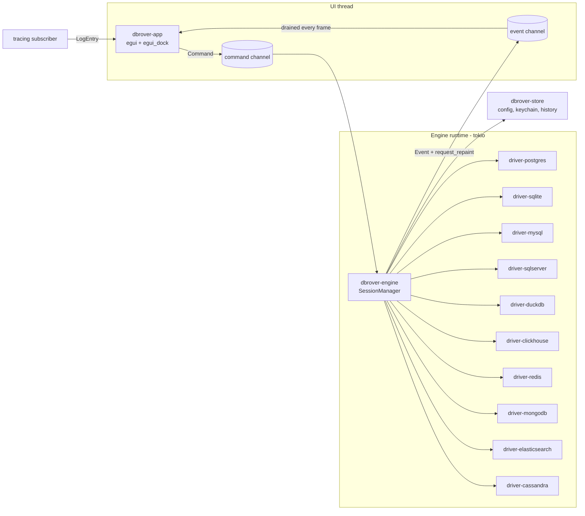

# Architecture

## Overview

DbRover is a Cargo workspace with a thin UI crate on top of an engine that owns all I/O.
The UI and the engine talk only through two message types, `Command` (UI → engine) and
`Event` (engine → UI). Nothing in the UI crate awaits a future or touches a socket.



## Crates

| Crate | Responsibility | Depends on |
| --- | --- | --- |
| `dbrover-core` | Domain types (`DataSource`, `ConnectionConfig`, `Password`, …) and the `Connection` trait. No I/O. | — |
| `dbrover-sql` | A forgiving SQL lexer: statement splitting, statement at the cursor, highlighting tokens, the UPDATE/DELETE-without-WHERE check, the formatter, and the syntax checker (`sqlparser`) and lint rules. What differs between dialects lives in its `dialect` module. CQL is one of its dialects, classified by a reader of its own (`classify::cql`), since `sqlparser` has none for it. | core, sqlparser |
| `dbrover-language` | `QueryLanguage`, what a driver speaks: `Sql(Dialect)` for the SQL engines, `Redis` for Redis, Valkey and Dragonfly, `Mongo` for MongoDB, and `Search` for Elasticsearch and OpenSearch, with more languages beside SQL as NoSQL engines arrive ([nosql.md](nosql.md)). Redis's commands are read as `redis-cli` reads them and classified from a table of the servers' command flags; MongoDB's are a subset of the shell's syntax, read into DbRover's own tree and classified from a table of its methods; Elasticsearch's and OpenSearch's are Kibana's Dev Tools requests, a method and path then a JSON body, classified by method and path from a table of endpoints. Each language splits a script into commands, yields tokens to highlight, lists completion words and classifies a command; SQL-only features ask it for its `Dialect`. A `Test` language, behind the `test-language` feature, exists only for tests. | core, sql |
| `dbrover-document` | JSON and documents with no engine in them ([ADR 0006](adr/0006-documents-as-extended-json-text.md)): a reader that keeps fields in order and numbers as written, MongoDB's Extended JSON types shown as the shell writes them, and paths (`items[2].sku`). What the app's JSON tree draws, for documents, SQL engines' JSON columns and Redis's JSON. | — |
| `dbrover-diagram` | ER diagrams with no window or database in them (ER1, [diagrams.md](diagrams.md)): a graph of tables as boxes of a given size and the keys between them, laid out in layers by Sugiyama's method, so the app's diagram tab only measures and draws. | — |
| `dbrover-picture` | Pictures the app exports, such as ER diagrams: `png` draws a picture's SVG as a PNG at a scale with resvg, using the fonts it is given (the app's bundled ones), never the system's, and refuses one past 64 megapixels. | — |
| `dbrover-plan` | Query plans with no engine in them (W10, [well-rounded.md](well-rounded.md#w10--a-visual-explain-plan)): one `Plan`, a tree of steps with their estimates and, once analysed, what they did, read from each engine's plan format (PostgreSQL's JSON first). It weighs each step's own share of the plan and writes the text plan, so the app's plan view only draws. | — |
| `dbrover-chart` | Charts of a result's columns with no UI in them (W12, [well-rounded.md](well-rounded.md#w12--charts-from-results)): each column's role (numbers, times or text) from its declared kind or its values, the chart a result starts with, the points read from rows as text with what was left out, ticks for numbers and times, and the layout into marks in points, which the app paints and an export writes. | core |
| `dbrover-driver-postgres` | `tokio-postgres` implementation of `Connection`. | core, tls |
| `dbrover-driver-sqlite` | `rusqlite` implementation, run on `spawn_blocking`. | core |
| `dbrover-driver-mysql` | `mysql_async` implementation for MySQL and MariaDB; a statement's task owns the connection while its result is open, and cancel is `KILL QUERY` from a second connection. | core |
| `dbrover-driver-sqlserver` | `tiberius` implementation for SQL Server and Azure SQL; statements run as plain batches on a task that owns the connection while its result is open, and cancel is TDS's attention message, sent by that task. Uses `dbrover-sql` only to place syntax errors, which SQL Server reports by line and token. | core, sql |
| `dbrover-driver-duckdb` | `duckdb` implementation, with DuckDB 1.5 inside (compiled, or DuckDB's prebuilt library in CI and releases; see [duckdb-prebuilt.md](duckdb-prebuilt.md)), run on `spawn_blocking` like SQLite; results are read as DuckDB streams them, in Arrow chunks, and formatted by Arrow. Uses `dbrover-sql` only to tell a change's row count from a result. | core, sql |
| `dbrover-driver-clickhouse` | The official `clickhouse` client over HTTP(S); a connection is a server session (`session_id`), so `USE`, `SET` and temporary tables last between statements. Results are read a line at a time in `JSONCompactEachRowWithNamesAndTypes`, values kept as ClickHouse writes them; cancel is `KILL QUERY` by `query_id` from a client outside the session. | core, tls |
| `dbrover-driver-redis` | The community `redis` client for Redis, Valkey and Dragonfly, in RESP3 on a stream the driver opens itself (TCP, a tunnel, TLS from `dbrover-tls`). A reply reaches the grid by its shape; `SCAN` and its kin are followed to their end a page at a time. Cancel is `CLIENT UNBLOCK` or `SCRIPT KILL` from a second session, or else a new session, since Redis can't stop most commands. | core, language, tls |
| `dbrover-driver-mongodb` | The official `mongodb` driver, with `bson` 3. Each shell command, read by `dbrover-language`, is sent as the server command its method sends (`find`, `aggregate`, `insert`, `update`, `findAndModify`, …), tagged with a comment unique to the run; documents reach the grid as canonical Extended JSON. A cursor is read in a task of its own, since the driver warns against dropping its futures part-way. Cancel finds the run's operations with `$currentOp` and ends them with `killOp`. TLS is the driver's own rustls on ring. | core, language |
| `dbrover-driver-elasticsearch` | Elasticsearch and OpenSearch over their REST APIs, with hyper and `dbrover-tls` as ClickHouse's client has them. Requests are sent as typed, tagged with an `X-Opaque-Id` unique to the run; a search's hits reach the grid as documents, paged through a point in time and `search_after`, the SQL endpoints' answers as rows, and any other answer as one document. Cancel cancels the run's tasks through the tasks API and drops the request. | core, document, language, tls |
| `dbrover-driver-cassandra` | Apache Cassandra and ScyllaDB over CQL's native protocol, with ScyllaDB's `scylla` client and `dbrover-tls`'s configuration. Statements run unprepared, as typed, their rows paged with the protocol's own paging, each value written as CQL reads it and collections as JSON. A node that can't be reached at the address the cluster gives it is reached through the one the data source names. The protocol has no cancel: cancel stops waiting, and on ScyllaDB a `SELECT` carries `USING TIMEOUT` from the data source's statement timeout. Validate prepares the statement. | core, sql, tls |
| `dbrover-tls` | The rustls client configuration for each TLS mode, shared by the PostgreSQL, ClickHouse, Redis, Elasticsearch and Cassandra drivers. | core |
| `dbrover-ssh` | SSH tunnels on `russh` (ring, no OpenSSL): signs in with the agent, a key file or a password, checks the host key against `known_hosts`, and forwards a local port to the database server. | core |
| `dbrover-engine` | Session lifecycle, command handling, cancellation, transactions, event emission. | core, sql, language, store, export, drivers |
| `dbrover-export` | The export formats (`ExportSpec`: a format and its options), the `TextFormat` trait that writes a header, rows and a footer to any writer, and `ExportWriter`, which writes a file a page at a time beside its final name. See [exports.md](exports.md). | core, sql |
| `dbrover-store` | Data source file (TOML), secrets (`SecretStore`, OS keychain via `keyring`), console files, query history (`rusqlite`) and its export. All blocking; the engine calls it from the blocking pool. | core, export |
| `dbrover-app` | `eframe` binary: panels, widgets, app state, keymap. | core, document, engine, sql, language, store, export |

`dbrover-app` depends on the engine only through its public `EngineHandle` (a command sender
and an event receiver), so the UI can be driven by a fake engine in tests.

## Threading model

- **UI thread**: `eframe` runs the egui loop on the main thread. Each frame it drains the event
  receiver with `try_recv`, applies events to `AppState`, then draws. It never blocks.
- **Engine runtime**: a multi-threaded `tokio` runtime owned by `EngineHandle`, created at launch.
  Its worker threads are the background threads; the UI thread never enters it except to block
  briefly in `EngineHandle::shutdown` on exit. The `SessionManager` task receives `Command`s and
  spawns one task per session.
- **Blocking drivers**: SQLite calls run inside `spawn_blocking` so they never stall the runtime.
- **Waking the UI**: after sending an `Event`, the engine calls `egui::Context::request_repaint()`
  so the UI redraws even when the user is idle. The engine receives a clone of the context at
  start-up, wrapped in a small `Repaint` trait so `dbrover-engine` does not depend on egui.

Rationale and alternatives: [ADR-0003](adr/0003-ui-engine-message-passing.md).

## Messages

Implemented so far (M1–M4). See `dbrover-engine/src/protocol.rs` for the authoritative version:

```rust
pub enum Command {
    SaveDataSource { data_source: DataSource, password: PasswordUpdate },
    DeleteDataSource(DataSourceId),
    TestConnection { data_source: DataSource, password: PasswordUpdate },
    Connect(DataSourceId),
    Disconnect(DataSourceId),
    LoadChildren { id: DataSourceId, path: CatalogPath },    // M2
    LoadDefinition { id: DataSourceId, path: CatalogPath },  // M2
    Execute { console: ConsoleId, data_source: DataSourceId, run: RunId,
              statements: Vec<String>, transactions: TransactionMode },          // M3, M4
    FetchMore { console: ConsoleId, run: RunId },            // M3
    Cancel { console: ConsoleId, run: RunId },               // M3
    CloseConsole(ConsoleId),                                 // M3
    EndTransaction { console: ConsoleId, end: TransactionEnd },                 // M4
    SaveConsole { key: ConsoleKey, text: String },           // M4
    DeleteConsoleFile(ConsoleKey),                           // M4
    SearchHistory { data_source: DataSourceId, text: String },                  // M4
    ExportRows { console: ConsoleId, export: Export },       // M4
    ReloadKeymap,                                            // M5
    DescribeTable { data_source: DataSourceId, table: RelationName },          // M5
    ApplyEdits { console: ConsoleId, statements: Vec<String> },                // M5
    CreateKeymap { text: String },                           // M5
    ReloadSettings,                                          // SQL tools
    SaveSettings(Settings),                                  // SQL tools
    ValidateStatements { console: ConsoleId, statements: Vec<String> },        // SQL tools
}

pub enum Event {
    Started,
    DataSourcesLoaded(Vec<DataSource>),
    DataSourcesUnavailable { error: String },
    DataSourceSaved(DataSource),
    DataSourceSaveFailed { id: DataSourceId, error: String },
    DataSourceDeleted(DataSourceId),
    SessionChanged { id: DataSourceId, state: SessionState },
    ConnectionTested { id: DataSourceId, result: Result<ServerInfo, String> },
    ChildrenLoaded { id: DataSourceId, path: CatalogPath, result: Result<Vec<CatalogNode>, String> },
    DefinitionLoaded { id: DataSourceId, path: CatalogPath, result: Result<String, String> },
    ConsoleSessionChanged { console: ConsoleId, state: SessionState },                  // M3
    StatementStarted { run: RunId, statement: usize, columns: Vec<ColumnInfo> },
    RowsFetched { run: RunId, statement: usize, rows: Vec<Row>, more: bool },
    StatementFinished { run: RunId, statement: usize, result: Result<StatementSummary, StatementFailure> },
    RunFinished { run: RunId, outcome: RunOutcome, elapsed: Duration },
    ConsolesLoaded(Vec<SavedConsole>),                                          // M4
    ConsoleSaveFailed { key: ConsoleKey, error: String },                       // M4
    TransactionChanged { console: ConsoleId, status: TransactionStatus },       // M4
    TransactionEnded { console: ConsoleId, result: Result<TransactionEnd, String> }, // M4
    HistoryFound { data_source: DataSourceId, text: String, result: Result<Vec<HistoryEntry>, String> }, // M4
    ExportFinished { console: ConsoleId, path: PathBuf, result: Result<usize, String> }, // M4
    KeymapLoaded { path: PathBuf, result: Result<KeymapBindings, String> },     // M5
    TableDescribed { data_source: DataSourceId, table: RelationName,
                     result: Result<Option<TableDescription>, String> },        // M5
    EditsApplied { console: ConsoleId, result: Result<(), EditFailure> },       // M5
    SettingsLoaded { path: PathBuf, result: Result<Settings, String> },         // SQL tools
    StatementsValidated { console: ConsoleId,
                          results: Vec<(String, StatementCheck)> },              // SQL tools
}
```

The engine owns the data source list: it loads `data_sources.toml` at start-up and applies
saves and deletes in order, so the UI never touches the file or the keychain. Each connected
data source has one session task that owns its `Box<dyn Connection>` and answers catalog
requests one at a time, in order. A disconnect abandons the request in progress. Sessions are
keyed by `DataSourceId`. Each query console has its own session too (M3), keyed by `ConsoleId`,
which also keeps the last statement's result cursor open between `FetchMore`s. Cancelling
goes through a `watch` channel rather than the request queue, so it reaches the session while
it is busy with the very statement being cancelled. A console session also tracks its
connection's transaction status and reports changes (M4). Disconnecting a data source closes
its explorer session and its consoles' sessions.

Files the engine owns besides the data sources (M4): console files are written in command
order by the command loop itself; the query history has one thread from the blocking pool,
fed through a channel by console sessions (records) and the command loop (searches); exports
run in a task of their own, since a large one may take a while.

Planned for later milestones:

```rust
pub enum Command {
    Connect { data_source: DataSourceId },
    Disconnect { session: SessionId },
    TestConnection { config: ConnectionConfig },
    Introspect { session: SessionId, node: CatalogPath },
    Execute { session: SessionId, run: RunId, sql: String },
    FetchMore { session: SessionId, run: RunId },
    Cancel { session: SessionId, run: RunId },
}

pub enum Event {
    SessionStateChanged { session: SessionId, state: SessionState },
    CatalogLoaded { session: SessionId, node: CatalogPath, children: Vec<CatalogNode> },
    ResultStarted { run: RunId, statement: StatementIndex, columns: Vec<ColumnMeta> },
    RowsReceived { run: RunId, statement: StatementIndex, batch: RowBatch },
    StatementFinished { run: RunId, statement: StatementIndex, outcome: StatementOutcome },
    RunFinished { run: RunId, elapsed: Duration },
    ServerNotice { session: SessionId, notice: Notice },
    Error { context: ErrorContext, error: EngineError },
}
```

`RunId` ties all events of one execution together, so stale events from a cancelled run are
easy to drop in the UI.

## Driver abstraction

Each driver crate exposes `connect(config, password) -> Result<ItsConnection, DriverError>`.
The engine maps a `ConnectionConfig` variant to a driver in one `match` and boxes the result.

```rust
// Implemented (M1–M4):
#[async_trait]
pub trait Connection: Send {
    fn server_info(&self) -> &ServerInfo;
    async fn ping(&mut self) -> Result<(), DriverError>;
    async fn children(&mut self, path: &CatalogPath) -> Result<Vec<CatalogNode>, DriverError>;
    async fn definition(&mut self, path: &CatalogPath) -> Result<String, DriverError>;
    async fn execute(&mut self, sql: &str) -> Result<Box<dyn ResultCursor>, DriverError>;
    async fn transaction_status(&mut self) -> Result<TransactionStatus, DriverError>; // M4
    async fn validate(&mut self, sql: &str)
        -> Result<Option<Rejection>, DriverError>;                            // SQL tools
    async fn describe_table(&mut self, table: &RelationName)
        -> Result<Option<TableDescription>, DriverError>;                    // M5
    fn cancel_handle(&self) -> Arc<dyn CancelHandle>;
    async fn close(self: Box<Self>) -> Result<(), DriverError>;
}

#[async_trait]
pub trait ResultCursor: Send {
    fn columns(&self) -> &[ColumnInfo];
    fn shape(&self) -> ResultShape { ResultShape::Rows } // or Documents (ADR 0006)
    async fn next_page(&mut self, max_rows: usize) -> Result<Vec<Row>, DriverError>;
    fn is_exhausted(&self) -> bool;
    async fn finish(self: Box<Self>) -> Result<Option<u64>, DriverError>;
}
```

Connections are trait objects so sessions don't care which engine they hold. Connection
*settings* are a closed enum. See [ADR-0002](adr/0002-native-drivers-behind-a-trait.md) and its M1
amendment.

## Core data types

- `Cell`: `Option<String>`, a value as the database formats it for display, `None` for `NULL`.
  Text rather than typed values; see [ADR-0004](adr/0004-results-as-text.md). `Row` is
  `Vec<Cell>`.
- `ColumnInfo`: name, plus the declared type when the driver knows it cheaply (SQLite does;
  PostgreSQL's simple protocol doesn't).
- `ResultShape`: whether a cursor's rows are rows or documents. A document is a row of one
  cell, holding it as canonical Extended JSON text; the console flattens documents into columns
  with `dbrover-document`'s `Flattened`. See
  [ADR-0006](adr/0006-documents-as-extended-json-text.md).
- Rows travel in pages of 500 as `RowsFetched` events, within the range other tools default
  to (DBeaver fetches 200 rows, DataGrip 500, pgAdmin 1,000).
- `CatalogNode`: `{ path, label, detail, has_children, has_definition, system }`. Its kind is the
  last segment of its `CatalogPath` (`Database`, `Schema`, `Folder(..)`, `Table`, `View`,
  `MaterializedView`, `Function`, `Sequence`, `Column`, `Index`, `Constraint`, `Trigger`), so
  the UI can pick actions per kind.
- IDs (`DataSourceId`, `ConsoleId`, `RunId`) are newtypes, never raw `Uuid`/`u64`.

## Errors

- Each driver crate has its own `thiserror` enum, converted into `DriverError` in core, which
  keeps the engine-specific detail that matters to users: SQLSTATE, message, detail, hint, and
  error position in the statement (so the editor can underline it).
- The app uses `anyhow` only at the binary edge (start-up failures). Everything shown in the UI
  is a typed error.
- No `unwrap`/`expect` outside tests; clippy configured to deny `unwrap_used` and `expect_used`.
