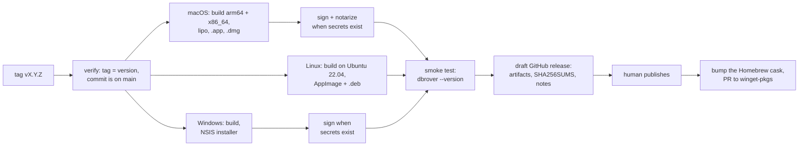

# Release binaries

Status: **R1 released** as v0.1.0 on 2026-10-23, followed by v0.2.0 (MySQL and MariaDB, TLS,
the update notice), v0.3.0 (SQL Server), v0.4.0 (projects, and links that open), v0.5.0
(installing updates, the read-only MCP server), v0.6.0 (DuckDB and ClickHouse), v0.7.0
(portable configuration, safety levels, MCP permissions), v0.8.0 (SSH tunnels, creating and
changing tables, indexes, views and schemas), v0.9.0 (adding and deleting rows, foreign
keys, sorting and filtering in the database, exporting every row, importing CSV), v0.10.0
(PostgreSQL users and roles, the history as an audit trail, .sql files, statement parameters,
find and replace), v0.11.0 (a native look on macOS: the menu bar, an integrated title bar,
the system font and accent colour), v0.12.0 (modifying tables, custom actions, snippets and
themes in files, the Windows installer), v0.13.0 (the rename to DbRover, command actions,
updates on Windows), v0.14.0 (Help › Report a problem… and Ask a question…), v0.15.0
(exports in every common format, Copy as, Run to file), v0.16.0 (passwords from a command,
SQL Server and ClickHouse over MCP through an MCP login, an explorer that pages through large
schemas), v0.17.0 (Redis, Valkey and Dragonfly, JSON documents as a tree and flattened into
columns), v0.18.0 (MongoDB, with the shell's syntax in the console), v0.19.0 (Settings as a
searchable tab, a restyled export dialog, the Visual C++ runtime in the Windows installer),
v0.19.1 (a Direct3D fallback on Windows without OpenGL 2, and an error message when DbRover
can't start), v0.20.0 (Elasticsearch and OpenSearch, and query plans drawn as a tree with
Explain analyse) and v0.21.0 (Cassandra, ScyllaDB and DynamoDB, ER diagrams, charts from
results, read-only on every engine, Settings pages for the keymap, actions and projects,
settings in `~/.config/dbrover` or a folder of your choice, and roomier buttons, menus and
dialogs). R3's update notice is built, ahead of R2 (see [R3](#r3--updates)).
Decisions settled on 2026-10-23 (see [Decisions](#decisions)).

Today the only way to run DbRover is to install Rust and build it from source (see the manual's
[Install](../book/src/install.md) chapter). That is fine for its author and a wall for anyone
else. This plan replaces it with downloads that install like any other desktop app.

## What users get

| Platform | Download | Installs with |
| --- | --- | --- |
| macOS 11+, Apple silicon and Intel | `dbrover-<version>.dmg`, one universal app | Drag to Applications, or `brew install --cask navasvarela/tap/dbrover` |
| Linux x86_64 | `dbrover-<version>-x86_64.AppImage` | Download, `chmod +x`, run; works on most distributions |
| Linux x86_64, Debian/Ubuntu | `dbrover_<version>_amd64.deb` | `sudo apt install ./dbrover_<version>_amd64.deb` |
| Windows 10+ x86_64 | `dbrover-<version>-windows-x64-setup.exe` | Run the installer; it installs for the current user, without administrator rights. Or `winget install DbRover.DbRover` |

Every release also has `SHA256SUMS`, and release notes generated from the Conventional Commits
since the previous release. ARM Linux and ARM Windows wait until someone asks.

## Pipeline

Pushing a tag `vX.Y.Z` on `main` runs `.github/workflows/release.yml`:



1. **Verify.** The tag must match the workspace version in `Cargo.toml`, and its commit must be
   on main. CI isn't run again: main only takes pull requests whose required checks passed, with
   every database server, so the commit has already been through it.
2. **Build.**
   - **macOS** on an Apple-silicon runner: `aarch64-apple-darwin` and `x86_64-apple-darwin`
     binaries, joined into a universal binary with `lipo`. One download, no "which Mac do I
     have?" question.
   - **Linux** on `ubuntu-22.04`, the oldest supported runner: binaries link against the glibc
     they're built with, so building old keeps the AppImage running on older distributions.
   - **Windows** on `windows-2022`.

   Each job links DuckDB's prebuilt library rather than compiling it: the static library for
   each macOS architecture and for Linux, and the DLL on Windows, which the installer puts
   beside `dbrover.exe`. `packaging/duckdb/fetch.sh` downloads it from DuckDB's GitHub release
   and checks it against `packaging/duckdb/SHA256SUMS`. See
   [DuckDB's prebuilt libraries](duckdb-prebuilt.md).
3. **Package** with `cargo-packager`, configured under `[package.metadata.packager]` in
   `crates/dbrover-app/Cargo.toml`: the `.app` bundle, the AppImage and `.deb`, and an NSIS
   installer. The bundle uses the existing `assets/brand/dbrover.icns` and icon PNGs, and carries
   the licences of DbRover, its fonts and DuckDB (with DuckDB's third-party notices) in
   `Resources/licenses/`. The `.dmg` comes from
   `packaging/macos-dmg.sh` instead of `cargo-packager`'s `dmg` format: that one runs
   `create-dmg`, whose `hdiutil convert` step failed on macOS 26 even outside any sandbox, and
   which is a known source of flaky runs on GitHub's macOS runners. A plain `hdiutil create`
   of a folder with the app and an Applications shortcut works; only the custom Finder window
   layout is lost.
4. **Sign** when the signing secrets are configured, and skip with a note in the release
   otherwise. macOS: Developer ID signing, then notarization with `notarytool` and stapling.
   Windows: Authenticode, planned for after the app's rename (see
   [Signing the Windows installer](#signing-the-windows-installer)). Separately, every update
   package, the Windows installer included, is signed with the update key (see
   [R3](#r3--updates)).
5. **Smoke test** every packaged artifact on its own runner by starting the binary inside it
   with `--version`, a new flag that prints the version and exits before opening a window. It
   catches broken bundles, missing libraries and a binary that won't start, cheaply. The Windows
   job also installs silently and starts the installed copy with no DuckDB on `PATH`, so a
   missing `duckdb.dll` fails it.
6. **Draft a GitHub release** with the artifacts, `SHA256SUMS` and the notes. A person looks at
   the draft and publishes it, so a release never goes out unseen.
7. **After publishing,** `.github/workflows/packages.yml` updates the Homebrew cask and opens a
   pull request for the new version on winget-pkgs (see [Package managers](#package-managers)).

## Tooling

| Need | Choice | Why |
| --- | --- | --- |
| Bundles and installers | [`cargo-packager`](https://github.com/crabnebula-dev/cargo-packager) | Built for desktop apps: `.app`, `.dmg`, AppImage, `.deb`, NSIS and WiX from one config, plus an updater for later. |
| Release notes, `CHANGELOG.md` | [`git-cliff`](https://git-cliff.org) | Groups Conventional Commits (`feat`, `fix`, breaking `!`) into readable notes, which `CONTRIBUTING.md` already requires. |
| Third-party licences | [`cargo-about`](https://github.com/EmbarkStudios/cargo-about) | Generates the licence notices of every dependency to ship with the app; the bundled fonts' OFL and Inter licences are added alongside. |
| Dependency inventory | [`cargo-auditable`](https://github.com/rust-secure-code/cargo-auditable) | Embeds the dependency list in the binary, so `cargo audit bin` can check a released build for vulnerable crates later. |

**Why not `dist` (cargo-dist):** it is excellent for command-line tools (shell and PowerShell
installers, Homebrew formulas, MSI), but it doesn't build `.app` bundles or DMGs, which a Mac
GUI app needs. **Why not hand-written scripts:** `.app` layout, `Info.plist`, DMG building,
AppImage and NSIS are each a small project; `cargo-packager` already does all of them.

## Release build

```toml
[profile.release]
lto = "thin"
codegen-units = 1
strip = "symbols"
```

Measured before and after in the PR that adds it: binary size and start-up time. Symbols are
stripped from what ships; crash reports can come later with separately uploaded debug info if
they are ever needed.

## DuckDB

Releases and CI link DuckDB's own prebuilt library instead of compiling its C++ engine, which
took 10–14 minutes per build on the runners. `packaging/duckdb/fetch.sh <rust-target> <dir>`
downloads it from DuckDB's GitHub release, refuses it unless its SHA-256 matches
`packaging/duckdb/SHA256SUMS`, and prints the variables that make `libduckdb-sys` link it; the
build also passes `--cfg dbrover_prebuilt_duckdb` in `RUSTFLAGS`. macOS and Linux link the
static library into `dbrover`. Windows links the DLL, which the installer puts beside
`dbrover.exe`. A plain `cargo build` still compiles DuckDB; `CONTRIBUTING.md` shows how to use
the prebuilt library locally. The packages carry DuckDB's licence and its third-party notices
as `licenses/DuckDB-LICENSE` and `licenses/DuckDB-THIRD-PARTY.txt`. Why, and what was
measured: [DuckDB's prebuilt libraries](duckdb-prebuilt.md).

To upgrade DuckDB:

1. Bump `duckdb` in the workspace `Cargo.toml`. The crate's version encodes DuckDB's:
   1.10506.x is DuckDB 1.5.6.
2. Add the new release's archives to `packaging/duckdb/SHA256SUMS`, one line per archive. Take
   each checksum from the downloaded file, and compare it with the digest GitHub records
   (`gh release view vX.Y.Z -R duckdb/duckdb --json assets`).
3. Run `packaging/duckdb/update-licenses.sh X.Y.Z` and commit what changes.
4. Update the version `links_duckdb_1_5_6_with_parquet_and_json` expects, and its name.

## Platform details

**macOS**
- **Bundle settings:** id `io.github.navasvarela.dbrover`, minimum macOS 11. The bundle sets
  `NSHighResolutionCapable`, and the menu bar shows "DbRover", not the binary name.
- **Gatekeeper:** it blocks unsigned apps downloaded from the internet. Without signing, users
  have to approve DbRover in System Settings › Privacy & Security after the first failed launch.
- **Keychain:** passwords live in the Keychain, and macOS ties "Always Allow" to the app's code
  signature. An unsigned (ad-hoc signed) build gets a new signature on every release, so after
  each update the user is asked again for every saved password. A Developer ID signature stays
  the same across releases, and the prompts happen once.

**Linux**
- **Passwords:** stored through the Secret Service (GNOME Keyring, KWallet). Desktop
  distributions run one; minimal window managers may not, and the manual's troubleshooting
  chapter will say how to start one.
- **System libraries:** the app needs `libxkbcommon`, Wayland or X11, and OpenGL from the
  system, all present on desktop distributions. No OpenSSL: TLS, when it comes, should use
  `rustls` so there is nothing to link.
- **Desktop integration:** the `.deb` and the AppImage include a `.desktop` file and icons, so
  DbRover appears in the application menu.

**Windows**
- **Tested in CI** on `windows-2022`, where the Postgres tests skip, as on macOS. The release
  job installs the installer silently and starts the installed copy. v0.12.0's installer was
  also tried on a real Windows machine on 2026-10-28: it installs and DbRover works.
- **The installer** is cargo-packager's NSIS template in per-user mode: `%LOCALAPPDATA%\DbRover`,
  registered under `HKCU`, with an `uninstall.exe` beside `dbrover.exe`, a Start menu shortcut,
  and no administrator rights. Installing again finds the previous location in the
  registry and installs over it, which is what updates rely on (see
  [R4](#r4--windows-parity)).
- **Passwords:** go to the Windows Credential Manager through the same `keyring` crate.
- **No graphics driver:** where Windows offers only OpenGL 1.1 (virtual machines, Windows
  Sandbox, some remote desktop sessions), DbRover draws with wgpu on Direct3D 12's software
  renderer instead of OpenGL, and a failed start is shown in a message box. See
  [Renderers](renderers.md).
- **SmartScreen:** it blocks the unsigned installer's first run ("Windows protected your PC"),
  as it did on that machine, and does so again for every new release while they are unsigned;
  the manual's Install chapter shows how to get past it (**More info › Run anyway**). Updates
  aren't stopped: the installer DbRover downloads for an update carries no mark of the web.
  Signing is an open decision, see [Signing the Windows installer](#signing-the-windows-installer).

## Prerequisites in the app

- **`--version`:** a flag that prints `dbrover <version> (<commit>)` and exits, for the smoke
  test and for bug reports. The same text goes in a Help › About dialog.
- **Licence files, first.** The repository is public but has none yet, and without one nobody
  may legally use, copy or redistribute the code or the binaries: MIT OR Apache-2.0 (see
  [Decisions](#decisions)).
- **A Windows CI job** (above).
- **The manual's Install chapter,** rewritten around the downloads, with "build from source"
  kept as a section for contributors.

## Versioning

- SemVer from the workspace `version`, starting at **0.1.0**: M0–M5 and the D1–D3 design work.
- While in 0.x, a breaking change to a saved file (the `!` commits in `CONTRIBUTING.md`) bumps
  the minor version and is called out first in the release notes; anything else bumps the patch.
- Releasing is done by a person: bump the version in a `build: release 0.x.y` PR, which also
  updates `CHANGELOG.md` from `git-cliff`, merge it, then tag the merge commit.

## Cutting a release

1. Merge a `build: release 0.x.y` pull request that bumps `version` in the workspace
   `Cargo.toml` (and, from R2, updates `CHANGELOG.md`).
2. Tag the merge commit and push the tag:

   ```bash
   git tag -a v0.x.y -m "dbrover 0.x.y" && git push origin v0.x.y
   ```

3. Watch **Actions › Release**. It refuses a tag that doesn't match the version, and builds
   nothing if the tagged commit isn't on main.
4. Open the draft on the releases page, check the assets and notes, and publish it.

To try the packaging without releasing, run **Actions › Release › Run workflow** on any
branch. It builds and smoke-tests everything and keeps the packages as workflow artifacts.
Pull requests that change packaging do the same automatically.

The Windows installer is attached while the repository variable `WINDOWS_RELEASES` is `true`
(**Settings › Secrets and variables › Actions › Variables**). It has been since v0.12.0, whose
installer was then tried on a real Windows machine; setting it to anything else leaves the
installer and its `latest.json` entry out of a release.

## Package managers

Each points at the files of a GitHub release; none builds DbRover again. The in-app updater
keeps working where it did: the cask installs the same `.app`, so it says `auto_updates true`
and Homebrew leaves updating to the app, and winget runs the same per-user installer, which
the updater replaces as before.

| Channel | Where | After each release | Secret |
| --- | --- | --- | --- |
| Homebrew | Cask `dbrover` in [navasvarela/homebrew-tap](https://github.com/navasvarela/homebrew-tap): `brew install --cask navasvarela/tap/dbrover` | `packages.yml` sets the version and the `.dmg`'s checksum and pushes | `HOMEBREW_TAP_TOKEN`: fine-grained, Contents read and write on the tap only |
| winget | `DbRover.DbRover` in [microsoft/winget-pkgs](https://github.com/microsoft/winget-pkgs) | `packages.yml` runs [komac](https://github.com/russellbanks/Komac) `update`, which opens a pull request; winget's validation pipeline checks it and a moderator merges it | `WINGET_TOKEN`: classic, `public_repo` |

Without its secret, a job says so and does nothing, so a release never fails over a package
manager. **Actions › Packages › Run workflow** with a tag redoes a release's bumps. The first
version in each went in by hand on 2026-10-28: the tap repository with its cask, and the first
winget manifest
([microsoft/winget-pkgs#464341](https://github.com/microsoft/winget-pkgs/pull/464341)).

**Not yet:**

- **The AUR,** a `dbrover-bin` package repackaging the `.deb`, after the soft launch. It is
  ready (a `PKGBUILD` that installs the `.deb`'s files) and needs the maintainer's AUR account,
  with an SSH key, to publish and then update by hand each release. Arch users can run the
  AppImage meanwhile.
- **Scoop:** its main bucket takes no GUI apps, and Extras expects an app people already know;
  winget covers Windows meanwhile.
- **Flathub:** builds from source in its own sandbox, with every crate vendored and the in-app
  updater switched off. Worth it once Linux users ask for it.

## Signing the Windows installer

An unsigned installer installs and runs, but Microsoft Defender SmartScreen blocks its first
run with "Windows protected your PC" until the user clicks **More info › Run anyway**. That is
what happened when v0.12.0's installer was first tried on a real Windows machine. Where Windows
11's Smart App Control is on, it blocks unsigned programs that have no reputation outright, and
in managed companies a policy can take **Run anyway** away.

**What signing changes,** according to Microsoft's
[SmartScreen reputation](https://learn.microsoft.com/windows/apps/package-and-deploy/smartscreen-reputation)
page (read on 2026-10-28):

- SmartScreen looks at two things: the publisher's certificate and the file's hash. A file is
  warned about until one of them has enough positive reputation, whether it is signed or not.
- **Unsigned,** every release starts from no reputation, so each new version warns again.
- **Signed,** the warning names the verified publisher, and reputation builds on the
  certificate, so later releases signed by the same identity can stop being warned about.
  Microsoft gives no threshold; for a new app it speaks of several weeks and hundreds of clean
  installs from a wide audience. Changing the certificate or the identity starts it again.
- **EV certificates no longer skip the warning.** Microsoft says paying for EV to avoid
  SmartScreen is no longer justified, so it isn't among the options.
- **Only the Microsoft Store removes the warning** from the first download, for MSIX packages,
  which Microsoft signs itself. An EXE or MSI installer submitted to the Store is not
  re-signed and must already be signed.

So none of the signing options below removes the warning for the first releases. Each one puts
a name on it, lets it fade over weeks of downloads, and lets Smart App Control allow DbRover
once that reputation exists. Since 2023 a public code-signing key must live in a hardware
module, so the options are signing services, certificates kept in a vendor's cloud, or a
smart card, which a GitHub-hosted runner can't use.

**Planned after the rename.** Signing waits until the app has its new name, so the first
certificate, and the reputation it builds, carry that name. Until then releases go out
unsigned. Whichever option is chosen, its steps go in the windows job of the release workflow:
`dbrover.exe` signed before it is packaged, the installer after, both signatures checked, and
only then the update signature over the final bytes (see [R4](#r4--windows-parity)). A draft
with Azure Artifact Signing's steps was written and dropped in
[#199](https://github.com/navasvarela/dbrover/pull/199), should Azure ever be the choice.

| Option | Cost | Open to an individual in Spain? | SmartScreen | Fit |
| --- | --- | --- | --- | --- |
| [Azure Artifact Signing](https://learn.microsoft.com/azure/artifact-signing/) (formerly Trusted Signing) | $9.99 a month (Basic: 5,000 signatures; see the [pricing page](https://azure.microsoft.com/pricing/details/artifact-signing/)), on a paid Azure subscription | **No.** Individuals must be in the US or Canada. Organizations may be in the EU (Spain included), the UK, the US, Canada and a few more, with a business identifier; validation takes 1–20 business days. | Names the validated organization; reputation builds with downloads. | Microsoft's own action signs in CI with an app registration's secret, and the key never leaves Microsoft's hardware. |
| [SignPath Foundation](https://signpath.org) | Free for open source | Yes: its terms set no country or individual limits. It accepts OSI-licensed projects it chooses, asks executables to have "a certain verifiable reputation", wants a "Code signing policy" page on dbdesk.org and multi-factor authentication for the team, and someone approves each release's signing by hand. | Names **SignPath Foundation**, not DbRover. Its certificate is shared with the other projects it signs; Microsoft doesn't say how that affects a new file, so don't count on it. | Signing requests go through SignPath's GitHub Action, from artifacts the workflow uploads. |
| An OV certificate in a vendor's cloud (for example Certum's or SSL.com's cloud signing) | Roughly €50–€150 a year, plus a per-signature or cloud fee with some vendors | Yes, after identity validation. Certum's cheaper Open Source certificate (from €69) comes on a smart card, which CI can't use. | Names the maintainer; reputation builds with downloads and carries over while the same identity signs. | Each vendor has its own signing tool, and unattended CI signing often needs a one-time-password secret or a paid tier. |
| [Microsoft Store](https://learn.microsoft.com/windows/apps/package-and-deploy/code-signing-options) with an MSIX package | Free for individual developers since 2025 | Yes. | **No warning** for copies installed from the Store. | A project of its own: a new MSIX package, Store certification for every release, and Store updates instead of DbRover's for those copies. The installer on GitHub would stay unsigned. |

**Recommendation**, for a maintainer who is an individual in Spain: apply to **SignPath
Foundation**. It is free, takes no key or account to look after, and its terms don't exclude
anyone by country. The cost is its name on the signature instead of DbRover's, an approval for
each release, and the risk that it turns down a new program with little reputation yet. If it
does, or to have DbRover's own name on the installer, buy an **OV certificate kept in a
vendor's cloud**, the paid option open to an individual in Spain. **Azure Artifact Signing**,
the cheapest paid option, becomes the choice only if the app is ever published by a registered
organization. Whatever is chosen, expect SmartScreen
to keep warning for the first weeks; the manual tells users how to get past it, and only the
Store would remove it. Decided by the maintainer; nothing has been bought or signed up for
(see [Decisions](#decisions)).

## Milestones

### R1 — First downloadable build

Built: `--version` and Help › About, the release profile (19.5 MB → 14.6 MB on macOS), the
licence files, Windows in CI, `cargo-packager` settings, `release.yml`, and the Install chapter.
The `.app` and `.dmg` were built and smoke-tested locally on macOS; the Linux and Windows
packages are first built by CI. Not done yet: the first tagged release, and trying it on a
clean machine, which is the exit check below.

- `--version`, the About dialog, the release profile, `LICENSE`, third-party notices.
- A Windows CI job.
- `release.yml` producing **unsigned** macOS and Linux artifacts as a draft release, with
  smoke tests and `SHA256SUMS`. It builds the Windows installer too, but attaches it only once
  it has been tried on a real Windows machine.
- The Install chapter rewritten.

**Exit:** someone with a clean Mac and a clean Linux machine, who doesn't have Rust installed,
installs DbRover from the release page and opens a SQLite file.

### R2 — Trusted installs

- macOS Developer ID signing and notarization, Windows signing, and the Homebrew cask in a tap.
- Release notes and `CHANGELOG.md` from `git-cliff`.

**Exit:** installing shows no Gatekeeper warning, the Windows installer names its publisher
and SmartScreen's warning fades as its reputation builds (no date can be promised; see
[Signing the Windows installer](#signing-the-windows-installer)), and an update doesn't
re-prompt for Keychain access.

### R3 — Updates

- An in-app "a new version is available" notice, then the `cargo-packager` updater, which
  checks a signed `latest.json` on the releases page.

**Exit:** a user on an older version is offered the new one and updates without visiting
GitHub.

**Status:** the notice is built. At start-up (unless switched off in **View → Settings…**)
and from **Help › Check for updates…**, the engine asks GitHub's API for the newest published
release (`releases/latest`, which skips drafts and prereleases) and the app compares its tag
with the running version. A newer one shows as a link in the status bar that leads to the
release page. The notice needed no signing, so it came before R2.

The updater is built too. **Install and restart** in the update dialog downloads and installs
the new release with `cargo-packager-updater`, then **Restart now** quits through the usual
checks for open transactions and starts the new copy:
- **The manifest.** The release job writes `latest.json` with one signed package per platform
  and attaches it to the release. The app reads it from `releases/latest/download/latest.json`,
  which only ever resolves to a published release.
- **The packages.** On macOS, the universal `.app.tar.gz` replaces the app bundle, asking for an
  administrator password if the bundle isn't writable. On Linux, the AppImage replaces itself.
  On Windows, the installer is kept and runs once DbRover has quit (see
  [R4](#r4--windows-parity)). The `.deb`, portable Windows copies and builds from source are not
  updated in place; the dialog says why and links to the release page.
- **Signing.** Update packages are signed with a minisign key of their own, separate from Apple
  or Windows code signing, so this works before R2:
  - The private key and its password are the repository secrets
    `CARGO_PACKAGER_SIGN_PRIVATE_KEY` and `CARGO_PACKAGER_SIGN_PRIVATE_KEY_PASSWORD`, and a
    backup is kept outside GitHub.
  - The public key is `UPDATE_PUBLIC_KEY` in `crates/dbrover-app/src/updates.rs`. A package with
    another signature is refused before anything is replaced.
  - **Rotating the key** means shipping the new public key in a release signed with the old
    one. If the old key is lost, every installed copy must be updated by hand once.
- **Checked before merging** with a scratch copy of `DbRover.app` on macOS. The updater found a
  local `latest.json`, verified the package's signature, and replaced the bundle. A package
  signed with another key was refused, and the old bundle was left as it was.

### R4 — Windows parity

Since v0.12.0 every release has the Windows installer. It was tried on a real Windows machine
on 2026-10-28: it installs and DbRover works, but Microsoft Defender SmartScreen blocked the
unsigned installer at first, until **More info › Run anyway**. A Windows copy is still second
class: it can't update itself (the dialog sends it to the release page), its installer isn't
signed, and the website and manual still say Windows builds aren't offered. In layers, one PR
each:

- **R4a — Plan:** this section.
- **R4b — Updates on Windows:** **Install and restart** downloads the new installer and checks
  its signature, then **Restart now** quits the usual way and runs the installer, which replaces
  DbRover and starts the new version. A copy the installer didn't put there (a portable copy, a
  build from source) keeps the release page.
- **R4c — The signed installer in the manifest:** the release workflow signs the installer with
  the update key, as it does the macOS and Linux packages, and `latest.json` gains a
  `windows-x86_64` entry.
- **R4d — Authenticode signing, after the rename:** not in this stack. Signing is set up once
  the app has its new name, so the certificate carries it from the start, most likely through
  SignPath Foundation or an OV certificate kept in a vendor's cloud. Until then releases stay
  unsigned. The options, their costs and a recommendation are an [open decision](#decisions)
  for the maintainer.
- **R4e — Site and manual:** the Windows download card, the hero's download button for Windows
  visitors, the manual's Install chapter with what SmartScreen shows for an unsigned installer,
  this document's Windows notes, and the demo note.

Decisions:

- **The installer runs after DbRover has quit.** `cargo-packager-updater` installs an NSIS
  update by starting the installer and calling `std::process::exit` straight away, from the
  engine's thread. That would skip the questions about open transactions and unsaved consoles,
  and the saving of the layout. So on Windows DbRover does the download and signature check with
  the updater, keeps the installer, and starts it from `main` once the app has stopped, the
  same place it already restarts the new copy on macOS and Linux.
- **Passive mode, then restart:** the installer runs with `/P /R`, the arguments
  `cargo-packager-updater` itself uses by default. `/P` shows only a progress bar and asks
  nothing; `/R` starts DbRover when it's done.
- **Per-user installs.** The installer already installs for the current user, into
  `%LOCALAPPDATA%\DbRover`, without administrator rights (cargo-packager's default). This is now
  written in `Cargo.toml`, because updates depend on it: an update needs no elevation, and the
  installer finds the previous location in the registry and installs over it.
- **Installed or portable** is decided by the uninstaller the installer writes beside
  `dbrover.exe`. Without one, the copy says it can't replace itself and offers the release page.
- **Order of signatures.** The update signature comes last, over the bytes users download.
  When Authenticode arrives (R4d), it goes first, since it changes the file it signs: the
  binary before it is packaged, the installer after.
- **Windows visitors to dbdesk.org get the installer** from the hero's download button, as Mac
  and Linux visitors get theirs.

Risks:

- **The install itself can't run in CI.** CI can't click through a restart on a desktop, so the
  updater's logic is tested with fixed feeds and fake installers, the staging and the check for
  an installed copy with unit tests, and the release job keeps installing silently and starting
  the installed copy. The full update is tried by hand on a Windows machine before it is relied
  on (the exit below).
- **Copies from v0.12.0 and earlier can't update themselves.** They predate this, so each
  needs one new installer from the release page; the manual says so.
- **The passive installer closes every running `dbrover.exe`,** other windows of DbRover
  included, without asking them about open transactions. DbRover has one window per process
  and quits its own first, so this only matters with two copies open at once.
- **SmartScreen keeps blocking the first run of a downloaded installer,** as it did on the first
  real Windows machine. Unsigned, every release starts again from no reputation; signing only
  lets the warning fade over weeks, as the certificate builds reputation (see R4d). Updates
  aren't affected: the installer DbRover downloads itself carries no "downloaded from the
  internet" mark, so Windows doesn't stop it.
- **The kept installer stays in the temporary folder** after the update. Each update overwrites
  the last one, so there is only ever one.

**Status:** built, waiting for the next release and a Windows machine to try the update on
(the exit below). Authenticode is planned for after the rename (R4d). What the release
workflow now does on Windows, and what was checked:
- **The installer is the update package.** The windows job signs
  `dbrover-<version>-windows-x64-setup.exe` with the update key after renaming it, uploads the
  `.sig` with it, and the release job adds `windows-x86_64` (format `nsis`) to `latest.json`
  whenever the installer is attached, failing the release if its signature is missing.
- **Checked before merging** on a Mac: a throwaway key signed a stand-in installer with the
  workflow's command, the release job's manifest script listed it, and
  `cargo-packager-updater`, asked for `windows-x86_64` from a local server, found the update,
  read its format as NSIS, downloaded it and verified the signature. With another key it
  refused it. The manifest script also failed, as it should, without the Windows signature.
- **Not checked:** the installer running over an installed copy and starting the new version,
  which needs a Windows desktop.

**Exit:** on a Windows machine, a copy installed from a release's installer is offered the next
release, **Install and restart** downloads it, **Restart now** asks about open transactions
first, then the installer's progress bar shows and the new version starts. A portable copy
says why it can't update and links to the release page. dbdesk.org offers Windows visitors the
installer, and the manual says what SmartScreen shows and how to get past it.

## Decisions

Settled on 2026-10-23, except the row marked open:

| Question | Decision | Consequence |
| --- | --- | --- |
| Where the downloads live | **A public repository.** It was made public on 2026-10-23. | Releases, the Homebrew tap and the D4 website all work on GitHub's free plan. It went public before the licence files existed, so adding them is R1's first and most urgent step: until then the code is visible but nobody may use it. |
| Licence | **MIT OR Apache-2.0**, the Rust ecosystem's usual pair. | `LICENSE-MIT` and `LICENSE-APACHE` at the root, `license = "MIT OR Apache-2.0"` in the workspace manifest, and the README says so. Bundled fonts keep their own licences (OFL for JetBrains Mono, Inter's licence). |
| macOS signing | **Unsigned in R1, signed and notarized in R2.** | R1's release notes and Install chapter explain how to open an unsigned app, and warn that updates re-ask for saved passwords. Enrol in the Apple Developer Program ($99 a year) before R2. |
| Windows | **CI job now, installer once tried on a real machine.** | R1 adds Windows to CI and the release workflow builds the installer, but it is attached to releases only after someone has run it on Windows. Attached since v0.12.0. Tried on a real Windows machine on 2026-10-28: it installs and works, and SmartScreen blocked the unsigned installer at first. |
| Windows signing | **Open**, for the maintainer. Recommended for an individual in Spain: SignPath Foundation, then an OV certificate in a vendor's cloud if it declines; Azure Artifact Signing only for an organization (see [Signing the Windows installer](#signing-the-windows-installer)). | Planned for after the app's rename. Until then releases are unsigned and SmartScreen blocks the installer's first run; the manual says how to get past it. The chosen option's steps then go in the release workflow's windows job. |
| Homebrew | **A tap, `navasvarela/homebrew-tap`**, decided on 2026-10-28. | homebrew/cask has disabled casks that fail Gatekeeper since September 2026, so an unsigned app can't go there; the tap's caveats say how to open it. Move to homebrew/cask once builds are notarized. |
| Package managers | **Homebrew tap and winget**, decided on 2026-10-28; the AUR after the soft launch. Not Scoop or Flathub yet. | See [Package managers](#package-managers). |

## Renaming to DbRover

Another desktop database client called DBDesk (zexahq/dbdesk, created 2025-11-19, which also
owns `dbdesk` on npm) came first. On 2026-10-28 the maintainer chose a new name, **DbRover**:
no trademark in TMview, nothing on the web, and `dbrover` is free on crates.io and npm. The
`dbrover` GitHub account belongs to an inactive user, which doesn't matter for a repository
under `navasvarela`. dbrover.com is parked for sale and isn't used.

The name is in about 350 files, but most of that is mechanical. The work that needs care is
making sure nobody loses data or their updates on the way: copies of dbdesk 0.12.0 and earlier
must be offered DbRover and install it, and the first DbRover must find everything dbdesk
saved.

### Names

| What | Today | After |
| --- | --- | --- |
| Product name in the window title, About, Welcome, menus, the macOS menu bar, the manual and the site | dbdesk | **DbRover** |
| Binary and command | `dbdesk`, `dbdesk mcp` | `dbrover`, `dbrover mcp` |
| Crates | `dbdesk-core`, `dbdesk-app`, … | `dbrover-core`, `dbrover-app`, … (folders under `crates/` too) |
| macOS bundle and identifier | `dbdesk.app`, `io.github.navasvarela.dbdesk` | `DbRover.app`, `io.github.navasvarela.dbrover` |
| macOS download and update package | `dbdesk-<version>-macos-universal.dmg`, `….app.tar.gz` | `dbrover-<version>-macos-universal.dmg`, `….app.tar.gz` |
| Linux | `dbdesk-<version>-x86_64.AppImage`, `dbdesk_<version>_amd64.deb`, `/usr/bin/dbdesk` | `dbrover-<version>-x86_64.AppImage`, `dbrover_<version>_amd64.deb`, `/usr/bin/dbrover` |
| Windows installer and install folder | `dbdesk-<version>-windows-x64-setup.exe`, `%LOCALAPPDATA%\dbdesk` | `dbrover-<version>-windows-x64-setup.exe`, `%LOCALAPPDATA%\DbRover` |
| Settings and data folders | `dbdesk` (see [Migrating existing installs](#migrating-existing-installs)) | `dbrover` |
| Keychain / credential store service | `dbdesk` | `dbrover` |
| MCP server name, and the entries **Copy MCP configuration** writes | `dbdesk`, `dbdesk-<slug>` | `dbrover`, `dbrover-<slug>` |
| `application_name` sent to PostgreSQL and MySQL | `dbdesk` | `dbrover` |
| Log files | `dbdesk.<date>.log`, `dbdesk-mcp.<date>.log` | `dbrover.<date>.log`, `dbrover-mcp.<date>.log` |
| Environment variables and the DuckDB build flag | `DBDESK_*`, `--cfg dbdesk_prebuilt_duckdb` | `DBROVER_*`, `--cfg dbrover_prebuilt_duckdb` |
| Repository and site | `navasvarela/dbdesk`, dbdesk.org | `navasvarela/dbrover`, dbrover.org |

**Which spelling where.** "DbRover", as the maintainer writes it, is the name people read:
window title, menus, the macOS menu bar (the bundle's `productName`), dialogs, the manual, the
site and the release notes. `dbrover`, in lower case, is every name a program reads or a person
types: the command, crates, packages, folders, the Keychain service, the MCP server, log files.
dbdesk used the lower-case form for both; the product name now has its own form because it is
a name, and the identifiers stay lower case because Linux paths, `.deb` package names, crate
names and Wayland's app id are case-sensitive, and people type them in terminals and MCP client
configuration.

**The data folders stay lower case** (`~/Library/Application Support/dbrover` on macOS,
`%APPDATA%\dbrover` on Windows, and since H4 `~/.config/dbrover` everywhere), even though macOS
and Windows would allow `DbRover`. The same
constant, `APP_NAME`, is eframe's app id, which on Wayland must match the `.desktop` file's
name, and keeping one lower-case name for both is how dbdesk already did it.

**A `dbdesk` command alias, on macOS only, for three minor releases (through 0.15).** An MCP
client starts dbdesk from the absolute path in its configuration, which the manual and **Copy
MCP configuration** give as `/Applications/dbdesk.app/Contents/MacOS/dbdesk`. An update replaces
the bundle's contents but keeps its folder (see [Updates across the
rename](#updates-across-the-rename)), so without an alias that file disappears and every
configured client stops working, silently. So the macOS bundle carries `Contents/MacOS/dbdesk`,
a symbolic link to `dbrover`, and `dbrover mcp` started through it writes one line to standard
error (which MCP clients log) asking to copy the configuration again. Nowhere else needs one:
the AppImage is replaced in place, so its path still works, and the `.deb` and the Windows
installer install DbRover beside dbdesk instead of over it, so the old path keeps running the
old copy until it is removed. The release notes of 0.15 announce the alias's removal in 0.16.

### Migrating existing installs

Today `dbdesk-store`'s `AppPaths` finds everything through `ProjectDirs::from("", "", "dbdesk")`,
and eframe keeps `app.ron` in its own folder for the same app id:

| Platform | Settings folder | Window state and logs |
| --- | --- | --- |
| macOS | `~/Library/Application Support/dbdesk/` | the same folder |
| Linux | `$XDG_CONFIG_HOME/dbdesk/`, or `~/.config/dbdesk/` | `$XDG_DATA_HOME/dbdesk/`, or `~/.local/share/dbdesk/` |
| Windows | `%APPDATA%\dbdesk\config\` | `%APPDATA%\dbdesk\data\` |

The settings folder holds `data_sources.toml`, `projects.toml`, `settings.toml`, `keymap.toml`,
`actions.toml`, `snippets.toml`, `theme.toml`, `consoles/<data source id>/*.sql` and
`history.sqlite`; the other holds `app.ron`, `trusted_commands.toml` (H2's trusted command
actions) and `logs/`. Passwords are in the OS credential store under the service `dbdesk`,
accounts `<id>`, `<id>/mcp` and `<id>/ssh`. Nothing inside the files depends on the name: the
history's `source` column says `app`, not `dbdesk`, and the `# dbdesk …` headers are comments.
H2's command actions get `DBDESK_*` environment variables; they haven't been released, so they
become `DBROVER_*` with no need to keep the old names.

**On start-up, before anything else,** both `dbrover` and `dbrover mcp` look for the previous
install, so whichever an MCP client or the user starts first does it:

1. If the new settings folder exists, stop: the migration has run, or this is a new install.
2. If the old settings folder doesn't exist, stop: nothing to bring over. Otherwise take a
   lock beside the new folder (`dbrover.migrating.lock`), so the app and an MCP client's
   server starting at the same moment copy one after the other, and check step 1 again once
   it is held.
3. Copy the old settings folder into a staging folder beside the new one
   (`dbrover.migrating`), removing a staging folder a crash left behind first.
   `history.sqlite` is copied with SQLite's `VACUUM INTO`, not as a file, so a copy taken while
   an old `dbdesk mcp` has it open is consistent and includes what is still in its write-ahead
   log. Everything else is copied file by file.
4. Rename the staging folder to the new settings folder. The rename is the commit point: a
   crash before it leaves no new folder, and the next start begins again.
5. Do the same for the window-state folder where it is a separate one (Linux, Windows), copying
   `app.ron` and skipping `logs/`: old logs would never be pruned under the new prefix.
6. Write `copied-to-dbrover.txt` in the old folder: where it was copied to, that DbRover
   doesn't read it any more, and that it can be deleted once DbRover has everything.
7. A window says once that the data was copied, and from where. (The Welcome tab was the first
   idea, but a restored layout may not have it open.)

This runs before telemetry starts, because on macOS the settings folder is also the log
folder, and creating `logs/` first would make step 1 skip the migration. What it did is logged
once telemetry is up. A migration that fails (disk full, permissions) leaves the old folder
untouched, and that session uses the old folders, as dbdesk did, and says why in the window
and the log. Starting empty instead would create the new settings folder, and step 1 would
never try again; this way the next start does.

**Copied, not moved.** Nothing of dbdesk's is changed or deleted, so a failed or interrupted
migration can't lose data, and dbdesk keeps working where it is still installed (the `.deb`
and Windows install DbRover beside it, and an MCP client may still start it). The price is
disk space and two copies that drift apart if both are used; the text file in the old folder
and the release notes say which one is read.

**Passwords move on first use, not at start-up.** The credential store gets a wrapper
`SecretStore`: reading a secret tries the `dbrover` service, then `dbdesk`; a secret found only
under `dbdesk` is written under `dbrover` and the old entry is deleted only after that write
succeeded. Deleting a data source deletes both. Copying every entry at the first start would
show a Keychain prompt for each saved password at once on unsigned macOS builds, before the
user has asked for anything; on first use, each prompt comes when connecting, as after any
unsigned update. The fallback stays for as long as the `dbdesk` alias does.

**Tests**, against temporary folders and the in-memory secret store, never the real ones:
every file and the consoles tree are copied; rows still in the history's write-ahead log are
in the copy; `logs/` isn't copied; an existing new folder means nothing is done; a leftover
staging folder is replaced; the old folder is left byte for byte as it was, apart from the text
file; a copy that fails half-way leaves no new folder. The wrapper's tests cover a secret found
under the new name, under the old one (moved, then found under the new one), under neither,
a failed write (returned, and the old entry kept), and deletion. The paths come from the two
names, so the migration code exists and is tested before the rename, and does nothing while
both names are `dbdesk`.

**Generalised in H4.** When `~/.config/dbrover` became the settings folder on every platform
(see [Settings folders](settings-folders.md)), the same code learnt to take a list of previous
installs, newest first: DbRover's platform folders, then dbdesk's. The first whose settings
folder exists is copied. A previous install that kept everything in one folder (macOS) is
split while it is copied: `app.ron` and `trusted_commands.toml` go to the new data folder,
everything else to the new settings folder, so trust never lands in a folder the user may sync.
A switch to another settings folder in Settings › Files is copied by the same code at the next
start.

### Updates across the rename

**The old address keeps working.** dbdesk 0.12.0 and earlier read
`https://github.com/navasvarela/dbdesk/releases/latest/download/latest.json`, and the update
notice asks `https://api.github.com/repos/navasvarela/dbdesk/releases/latest`. After the
repository is renamed, GitHub answers both with a permanent redirect to the new name, as it does
for every web, Git and API address. `cargo-packager-updater` 0.2.3 fetches the manifest and the
package with `reqwest::blocking::Client::new()`, which follows up to ten redirects, and today's
download already goes through one (`latest/download` → the release's file). The notice uses
ureq 3, which follows redirects for `GET` by default. So old copies find and download DbRover.
The redirect lasts until someone creates a new repository called `navasvarela/dbdesk`, which
must never happen.

**Tested without the network,** as the update tests already are, but one level lower: a
server on `127.0.0.1` answers the old manifest path with a 301 to the new one, that with a 302
to the file, and the package the same way, from the old repository's address. `GithubReleases`
finds the release through the API's 301, and `cargo-packager-updater`, configured as
`PackagerInstaller` configures it and given a throwaway key whose public half and signature
are test fixtures, finds the update, downloads it and accepts its signature, and refuses a
package with another one. Old copies run this same code, since neither crate changes.

**On macOS the bundle keeps its folder name.** The updater unpacks the archive without its top
folder into the running bundle's path (`install_inner` in `cargo-packager-updater`), so
`/Applications/dbdesk.app` gets DbRover's `Info.plist` (new identifier, `CFBundleExecutable`
`dbrover`, `CFBundleName` DbRover) and binaries, and `touch`es the bundle so LaunchServices sees
the change. **Restart now** runs `open -n /Applications/dbdesk.app`, which starts DbRover. The
menu bar, Dock tooltip, window and About say DbRover; Finder and Spotlight show the folder's
name, dbdesk, until the user renames it. Renaming the bundle from inside the app was ruled out
for now: it would break the same MCP paths the alias keeps working, and fail where
`/Applications` isn't writable. The manual says how to rename it by hand, and to copy the MCP
configuration again afterwards. New installs from the disk image are `DbRover.app`.

**A new identifier and signature** make macOS ask once more for each saved password, as every
unsigned update already does. The update key stays the same: a package signed with another key
would be refused by every installed copy.

**Elsewhere:**
- **The AppImage** replaces itself in place, keeping its file name.
- **The `.deb`** isn't updated in place; `dbrover` is a new package that installs beside
  `dbdesk` (cargo-packager can't declare `Replaces` or `Conflicts`). The release notes say to
  run `sudo apt remove dbdesk` afterwards.
- **Windows:** copies of 0.12.0 and earlier can't update themselves (see
  [R4](#r4--windows-parity)), so they install DbRover by hand. Shipping the rename in the same
  release as R4 means no dbdesk copy ever runs DbRover's installer as an update, which would
  install it beside dbdesk, in `%LOCALAPPDATA%\DbRover`, and start it. DbRover appears as a
  new app under **Settings › Apps**, and the release notes say to uninstall dbdesk afterwards.
  dbdesk's uninstaller doesn't touch `%APPDATA%\dbdesk`: cargo-packager's template only offers
  to delete the folders listed in `appdataPaths`, and there are none.

### The site and the domain

The site moves to **dbrover.org** on GitHub Pages, and dbdesk.org redirects to it, path for
path. That matters beyond old bookmarks: dbdesk 0.12.0 and earlier open
`https://dbdesk.org/manual/` from **Help** and the Welcome tab, and the release notes link into
the manual. The site keeps its paths (`/`, `/manual/…`), so the redirect only changes the host.
Fragments (`#…`) aren't sent to the server, and browsers keep them across a redirect.

Set up the new domain before any layer links to it, so its DNS check and GitHub's
certificate are done by the time the site moves.

**Done on 2026-10-28,** ahead of the merge order below: dbrover.org's DNS, the Pages custom
domain with HTTPS enforced, and the dbdesk.org redirect. Checked that day:
`https://dbdesk.org/manual/install.html` and `http://www.dbdesk.org/manual/` answer `301` to
the same path on `https://dbrover.org`, a query string is kept, and
`https://dbrover.org/manual/` answers `200`. The steps stay here as a record.

**dbrover.org** (the maintainer has it):
1. In dbrover.org's DNS (on Cloudflare, beside dbdesk.org), **DNS only** (grey cloud), so GitHub
   can issue the certificate: `A` records for `@` to `185.199.108.153`, `185.199.109.153`,
   `185.199.110.153` and `185.199.111.153`; `AAAA` records for `@` to `2606:50c0:8000::153`,
   `2606:50c0:8001::153`, `2606:50c0:8002::153` and `2606:50c0:8003::153`; and `CNAME www` to
   `navasvarela.github.io`.
2. On GitHub, **Settings (account) › Pages › Add a domain**: verify dbrover.org with the `TXT`
   record it shows, so no other account can claim it.
3. When the site layer merges: **repository Settings › Pages › Custom domain** `dbrover.org`,
   save, wait for the DNS check and the certificate, then tick **Enforce HTTPS**. There is no
   `CNAME` file to change: Pages is deployed from Actions, so the custom domain is only this
   setting.

**dbdesk.org, right after step 3** (from then on, GitHub no longer serves it). The redirect
rule can be created beforehand: it only acts on proxied traffic, so it does nothing until the
records change.
1. **Rules › Redirect Rules › Create rule**, named "dbdesk.org to dbrover.org":
   - **If incoming requests match** a custom filter expression:
     `(http.host eq "dbdesk.org") or (http.host eq "www.dbdesk.org")`.
   - **Then:** URL redirect, type **Dynamic**, expression
     `concat("https://dbrover.org", http.request.uri.path)`, status code **301**, **Preserve
     query string** on.
   - Deploy.
2. **DNS › Records:** delete the records that point at GitHub Pages (the apex `A` and `AAAA`
   records and `www`), and add placeholders, **Proxied** (orange cloud): `A @ 192.0.2.1`,
   `AAAA @ 100::` and `A www 192.0.2.1`. These addresses are reserved and never answer;
   Cloudflare redirects at its edge before contacting them, and its Universal SSL certificate
   covers `dbdesk.org` and `www.dbdesk.org`.
3. Check: `curl -sI https://dbdesk.org/manual/install.html` and
   `curl -sI http://www.dbdesk.org/manual/` answer `301` with
   `location: https://dbrover.org/manual/install.html` and `…/manual/`.
4. Keep dbdesk.org registered and renewed for at least two years: copies of 0.12.0 and earlier
   link to it for as long as they're used.

### Logo

The Strata mark is a database cylinder with no lettering, so it fits DbRover as it is and needs
no new wordmark. Only `assets/brand/social-preview.svg` sets the name in text (in Inter), and
the SVGs' `<title>`s name it. The rename layer changes those, re-exports
`social-preview.png`, and renames `dbdesk.icns` to `dbrover.icns`; the maintainer uploads the
new social preview (a repository setting).

### Release notes

The first DbRover release is **0.13.0**, with H2 and R4. Its notes start with the rename,
before the usual sections:

> **dbdesk is now DbRover.** Another database client called DBDesk was there first, so this
> one has a name of its own. Nothing else changes: on its first start, DbRover copies your data
> sources, projects, consoles, history, settings, keymap, actions, snippets and theme from
> dbdesk's folder, and saved passwords carry over the first time each is used (on macOS,
> choose **Always Allow** when asked). dbdesk's folder is left as it was.
>
> - **macOS and the AppImage:** update from the app as usual. On macOS the app keeps its
>   `dbdesk.app` name in Finder; rename it to `DbRover.app` if you like.
> - **The `.deb` and Windows:** install DbRover, then remove dbdesk
>   (`sudo apt remove dbdesk`, or **Settings › Apps** on Windows).
> - **MCP clients:** copy the configuration again from each project (**Copy MCP
>   configuration**). On macOS the old path keeps working until 0.16.
> - The site is now [dbrover.org](https://dbrover.org), and the repository
>   [navasvarela/dbrover](https://github.com/navasvarela/dbrover); the old addresses redirect.

### Steps only the maintainer can do

In merge and release order. None of these is done by the sessions building the rename.

| When | Step |
| --- | --- |
| Before anything links to it | **Done 2026-10-28:** dbrover.org's DNS records (step 1 above). Its GitHub domain verification (step 2) is still worth doing, if it isn't done yet. |
| Just before the rename layer merges | **Rename the repository**: **Settings › General › Repository name** `dbrover`. Open pull requests, issues, releases, secrets, variables and the Pages setting move with it. Then point every checkout and worktree at the new address: `git remote set-url origin https://github.com/navasvarela/dbrover.git`. Never create a new repository named `dbdesk`. |
| When the site layer merges | **Done 2026-10-28:** the Pages custom domain (step 3 above) with HTTPS enforced, and the dbdesk.org redirect on Cloudflare. |
| After the rename layer merges | Upload the new `assets/brand/social-preview.png` (**Settings › General › Social preview**), and update the repository's description and website field. |
| Release | Cut 0.13.0 as usual and check the exit below with it. |
| For two years at least | Renew dbdesk.org. |

### Layers

One stack, one pull request each, each building and passing on its own. The rename layer starts
from `main` once H2 and R4 have merged, since both touch many of the same files.

- **Plan:** this section, and the track in the roadmap.
- **Migration:** the copy of the previous install's folders, the passwords' fallback, the
  one-time window, and the tests above, plus the redirect tests of the updater. Written
  with both names as constants, so it does nothing until the next layer changes `APP_NAME`.
- **Rename:** crates and their folders, the binary, `APP_NAME`, the Keychain service, UI text,
  packaging (`productName`, identifier, icon, file names in `release.yml`, the macOS alias and
  its smoke test), environment variables, the MCP server name, the brand files, and every
  document's mention, except the site's address.
- **Site:** dbrover.org in `site/`, `book/book.toml`, the app's manual link and `homepage`,
  with the site's and the book's link checks.
- **Manual, README and demo note:** the Install chapter's "Coming from dbdesk" section (the
  migration, the macOS bundle name, the `.deb` and Windows steps, MCP clients), the README, and
  the roadmap's demo note.

The macOS alias: after `cargo packager --formats app`, the release job adds the link
(`ln -s dbrover Contents/MacOS/dbdesk`), then makes the `.app.tar.gz` from the bundle and signs
it with `cargo packager signer sign`, as R4's Windows step signs the installer, and the smoke
test runs `Contents/MacOS/dbdesk --version` too. Signing the bundle with a Developer ID, when
it comes, covers the link as part of the bundle.

### Decisions

| Question | Recommendation | Why |
| --- | --- | --- |
| How the name is written | **DbRover** for people, `dbrover` for programs (settled by the maintainer, 2026-10-28) | See [Names](#names). |
| Data folders | Lower case `dbrover` everywhere | One name with eframe's app id, which Wayland matches against the `.desktop` file. |
| Copy or move the old folders | **Copy**, once | Nothing of dbdesk's can be lost, and old installs that are still used keep working. |
| Passwords | **Moved on first use**, old entry deleted after the new one is written | No burst of Keychain prompts at the first start. |
| A `dbdesk` alias | **macOS only, a link in the bundle, through 0.15** | Keeps MCP clients working after an in-place update; nothing else needs it. |
| The macOS bundle's folder after an update | **Leave `dbdesk.app`**; the manual says how to rename it | Renaming it from the app would break MCP paths and fail without write access. Open: the maintainer may prefer the app to rename itself once. |
| Which release | **0.13.0, with R4** | No dbdesk copy runs DbRover's Windows installer as an update. |
| macOS identifier | `io.github.navasvarela.dbrover` | Same scheme as today; doesn't depend on owning a domain. |
| Logo | **Keep the Strata mark**, no wordmark | It has no lettering; only the social preview changes. |
| dbdesk.org | **Redirect, and renew for two years at least** | Old copies open its manual. |

### Risks

- **Two copies drifting apart.** Where dbdesk stays installed (`.deb`, Windows, an MCP client
  still pointing at it), it keeps writing to its own folder, which DbRover no longer reads.
  Statements an old `dbdesk mcp` records after the copy aren't in DbRover's history. The
  release notes and the file left in the old folder say so.
- **The redirect is GitHub's to keep.** It holds while no repository takes the old name. If it
  ever broke, copies of 0.12.0 and earlier would stop seeing updates and need one manual
  install.
- **In-place macOS updates keep the dbdesk folder name** until the user renames it.
- **dbdesk.org down between the Pages switch and the Cloudflare change.** Prepare the rule
  first and change the records straight after, so the gap is a minute or two.
- **The certificate takes a while.** GitHub issues it only after its DNS check passes, which
  can take up to a day, so dbrover.org is set up first, before any layer links to it.
- **Search results and old links** point at dbdesk.org and the old repository for a while;
  both redirect.

**Status:** built, in five layers (plan, migration, rename, site, manual), waiting for the
repository rename and 0.13.0. The domain steps are done. In the
code: `APP_NAME` is `dbrover` and `PREVIOUS_APP_NAME` `dbdesk` in `dbrover-store`. What the
manual tells users is in its Install chapter, under "Coming from dbdesk".

### Exit

A Mac running dbdesk 0.12.0 with saved data sources, a saved password, a console, history,
a custom `theme.toml` and an MCP client set up is offered DbRover 0.13.0, installs it from the
app and restarts into DbRover with all of it there. Its first connection asks for Keychain
access once and connects, and the MCP client still starts through the old path. An AppImage
does the same. On Windows and with the `.deb`, a fresh DbRover install finds dbdesk's data the
same way. `https://dbdesk.org/manual/install.html` lands on
`https://dbrover.org/manual/install.html`.
