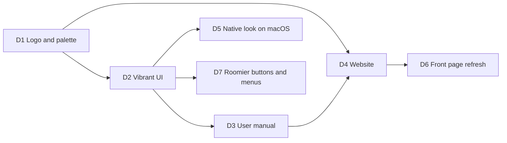

# Roadmap

Each milestone ends with something usable and a short demo note in this file. Milestones are
sized for evenings-and-weekends pace; the order matters more than the dates.

## M0 — Foundations

- Cargo workspace with the crates from [Architecture](architecture.md), mostly empty.
- CI (fmt, clippy `-D warnings`, test).
- `eframe` window with an `egui_dock` layout: explorer (left), console tabs (centre),
  log console (bottom). Layout persisted.
- `tracing` → log console pipeline working with app events.
- Engine runtime started, `Command`/`Event` channels wired, repaint on event.

**Exit:** the app opens, shows three panels, logs "engine started" in the log console.

**Demo note:** done. `cargo run -p dbrover-app` opens the docked layout, and the status bar shows
"Engine running". The log console shows "engine started" with level/search filters, and the
same entries go to `logs/dbrover.<date>.log`. The layout survives restarts; **View → Reset layout**
restores the default. An egui_kittest test drives the whole app headlessly.

## M1 — Data sources and sessions

- New / edit / delete data source dialog for Postgres and SQLite.
- `data_sources.toml` read/write, passwords in keychain.
- Connect, disconnect, test connection; status dot in the tree.
- Connection lifecycle in the log console.
- Driver conformance suite started (connect, simple query).

**Exit:** I can add my local Postgres and a SQLite file, connect to both, and see it logged.

**Demo note:** done. In the explorer, **+** opens the data source dialog for PostgreSQL or
SQLite, with **Test connection**. Data sources are saved to `data_sources.toml` and passwords to
the OS keychain. Double-click (or the context menu) connects and disconnects. The status dot
shows disconnected / connecting / connected / failed, and the tooltip shows the server version
or the error. Connection lifecycle and timings appear in the log console. Covered by driver
conformance tests against a real Postgres 17 and SQLite, headless engine tests, and a UI test
that adds a SQLite data source through the dialog.

Follow-ups left out of M1:

- ~~TLS for Postgres (`sslmode`).~~ Done in DB0: `disable`, `prefer`, `require` and
  `verify-full` with an optional CA file, on rustls.
- ~~A file picker for SQLite paths.~~ Done: **Browse…** and **New…** (create an empty database).
- ~~Prompting for a password when none is saved or the keychain is unavailable.~~ Done in W1.
- Noticing when an established connection drops (the session still shows "connected").
- Duplicate data source; ~~colour and safety level per data source~~ (colour in M4, safety
  levels in W2).
- Preserving comments in `data_sources.toml` (`toml_edit`).

## M2 — Connection explorer

- Lazy catalog tree down to columns, indexes, constraints for both drivers.
- Refresh subtree, filter loaded nodes, hide system schemas.
- Show definition for views and functions.

**Exit:** I can browse a real work schema without waiting on the UI.

**Demo note:** done. Expanding a data source connects it and loads the tree one level at a time,
with a spinner per loading node. PostgreSQL shows databases (others open their own connection
on demand), schemas, tables, views, materialized views, functions and sequences, then columns,
indexes, constraints and triggers per table. SQLite shows schemas, tables and views, then
columns, indexes, foreign keys and triggers. The filter box matches loaded nodes, the
**System** checkbox shows system schemas and tables, Refresh reloads a subtree, and Show
definition opens the source in a read-only window. Covered by a catalog walk over a fixture with
every object kind on both drivers, an engine test that connects on first expand, and a UI test
that clicks down to a table's columns.

Follow-ups left out of M2:

- `CREATE TABLE` DDL for Postgres tables (no `pg_get_tabledef`; see the explorer doc's open
  questions).
- Counts on folders, and row estimates on tables.
- Keyboard navigation and selection in the tree.
- A per-data-source "show system objects" setting (it is global now).
- Detecting dropped connections (still from M1; built in W3).

## M3 — SQL runner

- Query console tabs with highlighting and statement-under-cursor.
- Run statement / selection / script, with `dbrover-sql` splitting.
- Streaming result grid with paging and `FetchMore`.
- Cancellation for both drivers.
- Errors with position underline; Postgres notices in the log console.
- Safety confirmations for `UPDATE`/`DELETE` without `WHERE`.

**Exit:** I use DbRover instead of `psql` for a day of ordinary queries.

**Demo note:** built; the exit criterion (a day of real use) is still to be tried. Right-click a
data source → **New query console**, or a table → **Open data**. Each console has its own
connection:
- **Editing:** SQL is highlighted by `dbrover-sql`'s lexer.
- **Running:** ⌘↵ runs the selection or the statement at the cursor; ⇧⌘↵ runs everything,
  stopping at the first failure. ⌘. cancels on both drivers.
- **Results:** the grid shows 500 rows; **Load more rows** or scrolling to the bottom loads the
  next 500.
- **Errors:** the error's position is underlined in the editor.
- **Safety:** `UPDATE`/`DELETE` without `WHERE` asks "Run anyway?".
- **Notices:** PostgreSQL notices appear in the log console.

Covered by:
- Driver checks for execution (paging, NULL, abandoning a result, error positions) and
  cancellation on PostgreSQL 17 and SQLite.
- Headless console engine tests (scripts, paging, failures, cancel, a new run discarding unread
  rows).
- Console state tests, and a UI test that opens a table's data and loads the next page.

Writing that UI test found a real bug: "Load more rows" was drawn below a grid that takes all
the space, so it couldn't be clicked; it now sits in the summary line. A stress run found a
cancel race that left endless SQLite queries running; see "Hard-learned" in the SQL runner doc.

Follow-ups left out of M3 (most belong to M4 anyway):

- Explain (⌥⌘E), manual transactions, persisted consoles, query history, export.
- Cell selection and copying ranges, a cell viewer, client-side sort and filter.
- Line numbers, current-statement highlight, completion.
- Per-data-source safety levels (confirm any change on production).
- Positions for SQLite's "no such table/column" errors (SQLite doesn't report them).

## M4 — Daily-driver polish

- Console files persisted; reopen where I left off.
- Query history with search.
- Manual transaction mode.
- Copy as TSV, export CSV/JSON.
- `EXPLAIN` action.

**Exit:** I use DbRover instead of my usual database tool for a week, and keep a list of what I
missed.

**Demo note:** built; the exit criterion (a week of real use) is still to be tried.
- **Consoles are files:** each console is `consoles/<data-source-id>/console.sql` (then
  `console_2.sql`, …), saved a second after typing stops and on quit. Quit with consoles open
  and they come back with their text. Closed consoles you typed in are under the data source's
  **Open saved console** menu.
- **History:** **History** in a console searches every statement run on its data source, with
  time, outcome, duration and rows; **Insert** puts one back at the cursor.
- **Transactions:** switch a console to **Manual commit**, run an `INSERT`, and the toolbar
  shows "● Transaction open" until **Commit** or **Rollback**. Closing the console,
  disconnecting or quitting first asks whether to roll it back.
- **Explain:** ⌥⌘E (or **Explain**) shows the plan of the statement at the cursor.
- **Grid:** click, shift-click or drag to select cells, ⌘C copies them as TSV; click a header to
  sort and type to filter the loaded rows (labelled as such); double-click or Space opens a
  cell in a viewer that pretty-prints JSON; **Export → CSV…/JSON…** saves the rows as shown.
- **Editor:** line numbers, and the statement ⌘↵ would run is shaded.

Covered by:
- Store tests for console files, the history (ordering, `LIKE` escaping) and CSV/JSON export.
- A driver check for transaction status on PostgreSQL 17 and SQLite.
- Headless engine tests: console files across a restart, history records and search, manual
  mode with rollback, a user's own `BEGIN` and disconnecting, committing a failed PostgreSQL
  transaction, and exports.
- Console and grid state tests (sorting, filtering, selection, TSV, statement insertion,
  Explain error positions), and UI tests that restore a console from its file and save an
  edit, insert from the history, roll back in manual mode and confirm closing, explain, and
  sort, view and export rows.

Writing those UI tests found two older layout bugs: the default layout gave the explorer 80% of
the width (egui_dock's split fraction is the first node's share), and in a short console the
resizable results panel drew its contents under the editor, which took their clicks. Editor
and results are now split by hand.

Follow-ups left out of M4:

- Renaming consoles, and deleting saved ones from the UI.
- Pruning old history entries; searching all data sources at once.
- "Commit and close" in the rollback warning.
- Sorting and filtering in the database (re-running the query with `ORDER BY`/`WHERE`).
- Copying a selection with its column headers; exporting all rows, not only loaded ones.
- A visual check of the editor gutter and grid under the new theme (UI tests can't see paint).

## M5 — Personalisation

Picked after M4, in this order, one PR each: `keymap.toml`, autocompletion from the cached
catalog, editing data in the grid.

**Keymap demo note:** built. **View → Keymap…** lists every action with its id and shortcut;
**Create keymap.toml** writes a file with every default commented out, and **Reload** applies
edits. A typo in the file is listed as a problem (and counted in the status bar) instead of
discarding the rest. Covered by store and engine tests for reading, creating and reloading the
file, parser and conflict tests, and a UI test that runs a statement with a rebound key.

**Completion demo note:** built. Typing in a console suggests columns of the tables the
statement names, tables, schemas and keywords from the explorer's cached catalog, loading
what's missing in the background; ⌃Space asks anywhere, `alias.` lists that table's columns.
Covered by tests for finding the prefix, qualifier and table references, ranking candidates,
reading and requesting catalog levels, accepting a candidate, and a UI test that completes a
column on a fresh connection.

**Grid editing demo note:** built. Open a table's data, double-click a cell (or F2), type, and
**Submit** writes one `UPDATE` per changed row, all or none; in manual commit mode they join
the open transaction. Results that aren't one table's rows, or lack its primary key, say
"Read-only" and why. Covered by a `describe_table` conformance check on both drivers, engine
tests for all-or-none edits in a transaction or a savepoint (SQLite and PostgreSQL), tests for
deciding what's editable and generating `UPDATE`s, and a UI test that edits and submits a
cell.

The original candidates:

- `keymap.toml`, themes, fonts.
- Custom catalog actions (`actions.toml`) and snippets.
- Autocompletion from the cached catalog.
- SSH tunnels (`russh`; built in W3).
- Editing data in the grid.
- MySQL driver; a driver for the `db-data-structures` engine.

## SQL tools

Three additions to the query console, one PR each: a formatter, a syntax checker and linter,
and context-aware completion.

**Formatter demo note:** built. Type `select id,name from users where active=true` and press
⌥⌘L (or **Format**, or **Code → Format**): the statement is laid out clause by clause with
upper-case keywords and the cursor stays on its token; ⌘Z takes it back in one step. ⇧⌥⌘L
formats the whole console. **View → Settings…** switches keywords to lower case or as typed,
and the indent width, saved in `settings.toml`. The formatter is our own, over the lexer,
because `sqlformat` changed string literals and dollar-quoted bodies (see the SQL runner doc).
Covered by a corpus of PostgreSQL and SQLite statements formatted in every setting, whose
tokens must come out identical (ignoring whitespace and keyword case) and stable when formatted
twice; layout, cursor-mapping and safety-check tests; settings file and engine tests; and a UI
test that formats with ⌥⌘L, undoes it, and formats again from the Code menu after switching to
lower case.

**Linter demo note:** built. Type `select * from orders where id = null;` and, once typing
pauses, `= null` gets an amber wave; hover for "= NULL is never true; use IS NULL". An
unfinished `select id from orders where` gets a red one, and the toolbar says
**1 error, 1 warning**; F8 jumps between them. Run something so the console connects, and its
statements are also prepared (never run) on its own connection: a misspelt column then shows
the database's own message. Rules are switched off in View → Settings…. Syntax errors come
from `sqlparser`, only for data queries and changes, with a list of constructs it wrongly
rejects found by a corpus of valid statements. Covered by that corpus and lint tests in
`dbrover-sql`, a `validate` conformance check on both drivers, engine tests that validation
never connects, never disturbs unread rows and skips open PostgreSQL transactions, problem
and catalog-lint tests, and a UI test that hovers a warning and an error.

**Completion demo note:** built, extending M5's completion. `SELECT * FROM cus` offers the
`customers` table, not columns; `JOIN customers c ON c.` lists its columns with their types;
`INSERT INTO orders (cu` offers only `orders`' columns; `WITH big AS (SELECT id AS big_id
FROM orders) SELECT * FROM big WHERE big_` offers `big_id`, read from the CTE by the parser
(the lexer when it doesn't parse); `coal` gives `coalesce()` with the cursor inside. `cid`
fuzzy-matches `customer_id`, and what you accepted lately rises to the top in every console.
The list has the explorer's icons and each candidate's type. Covered by context, derived
table, ranking, function and projection tests, and a UI test that completes a table after
`FROM` (where the column of the same prefix isn't offered) and an alias's column after its
dot. Fixed on the way: the list never grew past the height of its first frame.

## Release track

Downloads that install like any other desktop app, instead of building from source. The full
plan, including the decisions it needs first, is in [Releasing](releasing.md).

- **R1 — First downloadable build:** unsigned macOS (universal `.dmg`) and Linux (AppImage,
  `.deb`) builds attached to a draft GitHub release by a tag-triggered workflow; Windows in CI,
  its installer attached once tried on a real machine. Also `--version`, the MIT OR Apache-2.0
  licence files, and the Install chapter rewritten.
- **R2 — Trusted installs:** macOS signing and notarization, Windows signing, a Homebrew cask,
  generated release notes.
- **R3 — Updates:** an in-app update notice, then installing updates from the app (macOS and
  the AppImage), with signed packages and a `latest.json` on each release.
- **R4 — Windows parity:** Windows copies update themselves like the others, the installer is
  signed with the update key and listed in `latest.json`, and the website and manual offer the
  installer. Authenticode signing follows the app's rename. Layers, decisions,
  risks and exit: [R4](releasing.md#r4--windows-parity).

**R4 demo note:** built; the update itself is still to be tried on a Windows machine with the
next release. On Windows, a copy installed with the installer (one with `uninstall.exe` beside
`dbrover.exe`) that is older than the newest release says "DbRover 0.13.0 is available" in the
status bar. **Install and restart** shows the download's progress, then "DbRover 0.13.0 is
downloaded" and **Restart now**. With a transaction open in a manual-commit console, **Restart
now** asks first; once DbRover has quit, the installer's progress bar appears and the new version
starts. A portable copy instead says it wasn't installed with DbRover's installer and offers
**Open release page**. Releases sign the installer with the update key and list it as
`windows-x86_64` in `latest.json`. Authenticode signing comes after the app's rename; the choice
of service is an open decision in
[Signing the Windows installer](releasing.md#signing-the-windows-installer). dbrover.org's
download button says **Download for Windows** to Windows visitors and links the installer, the
download section has an **Installer** button, and the manual's Install chapter walks through
the first-run SmartScreen block (**More info › Run anyway**), as seen when v0.12.0's installer
was tried on a real Windows machine, and the Windows update. Covered by unit tests of
keeping the installer (one file, replaced by the next), of its passive `/P /R` command line, and
of telling an installed copy from a portable one; the update state and dialog tests with a kept
installer; the engine and UI tests of the install flow with a fake installer; and, by hand on a
Mac, the workflow's signature, manifest and `cargo-packager-updater`'s check of a Windows
entry (see [R4's status](releasing.md#r4--windows-parity)).

**Update notice demo note:** built, ahead of R2. Start a build older than the newest release,
and the status bar says "DbRover 0.2.0 is available"; click it for the version you have and
**Open release page**. **Help › Check for updates…** asks on demand and says "You're up to
date" otherwise. The check at start-up can be switched off in **View → Settings…**
(`[updates] check_on_start` in `settings.toml`); a failed automatic check is only logged. The
engine asks GitHub's `releases/latest` through a `ReleaseFeed` trait, so tests use a fixed feed
and never the network. Covered by version comparison and state tests, an engine test of both
answers, a dialog test, and a UI test that finds a newer release at start-up and an up-to-date
one on request.

**Renaming to DbRover:** another database client called DBDesk came first, so dbdesk becomes
**DbRover** (`dbrover` for the command, crates and packages) in 0.13.0, with the site at
dbrover.org and dbdesk.org redirecting to it. In layers: the plan; the migration, which copies
the previous install's settings, consoles, history and custom files once on the first start and
moves saved passwords to the new credential-store name on first use; the mechanical rename;
the site; and the manual and README. On macOS and the AppImage, copies of 0.12.0 and earlier
update to DbRover from the app, through GitHub's redirect from the old repository. Names,
migration, updates, the domain steps and the maintainer's steps:
[Renaming to DbRover](releasing.md#renaming-to-dbrover).

**Rename demo note:** built, waiting for the repository rename and 0.13.0. Start DbRover on a
machine where dbdesk ran: a window says your data was copied from dbdesk's folder, and the
explorer shows the same data sources, projects and consoles, the history has every statement,
and `actions.toml`, `snippets.toml`, `theme.toml` and the keymap apply. dbdesk's folder is left
as it was, with `copied-to-dbrover.txt` in it. Connecting to a data source with a saved
password finds it under the old keychain name and moves it to `dbrover`. If the copy fails,
the window says why and the session runs on dbdesk's folder; the next start tries again. An MCP
client still configured with `/Applications/dbdesk.app/Contents/MacOS/dbdesk` starts the
server, which says in the client's log that the name goes away in 0.16. The window title, menus,
About and Welcome say DbRover; the command, crates, packages, folders, keychain service and MCP
server are `dbrover`; the macOS bundle is `DbRover.app` (`io.github.navasvarela.dbrover`),
with a `dbdesk` link beside the binary. dbrover.org serves the site and the manual, dbdesk.org
redirects to it path for path, and the download buttons keep linking 0.12.0's `dbdesk-*`
files until 0.13.0 is out. Covered by the migration's tests against temporary folders (every
file and the consoles tree, history rows still in the write-ahead log, the logs left behind,
nothing done twice, a crash's staging folder replaced, a failed copy leaving no new folder, two
processes taking turns), the password fallback's tests, the notice's UI test, the alias check,
and tests against a local stand-in for GitHub that the release notice and the updater follow a
renamed repository's redirects and still check the package's signature. Not checked yet: the
update from a real 0.12.0 install, on macOS and with the AppImage, which needs the 0.13.0
release (the plan's exit).

## Database track

More engines, in order of how many people use them. The full plan, with the rankings, what
each engine needs and the open decisions, is in [More databases](databases.md).

- **DB0 — Groundwork:**
  - dialect facts gathered in one module;
  - TLS for network connections, PostgreSQL first;
  - one data source form shared by every server engine;
  - one CI container per engine.
- **DB1 — MySQL and MariaDB:** one driver on `mysql_async`, with cancel by `KILL QUERY` and
  `SHOW CREATE` definitions.
- **DB2 — SQL Server:** `tiberius`, SQL Server logins first, `GO` batches, XML plans.
- **DB3 — DuckDB:** files and in-memory data sources for querying CSV and Parquet, if the
  bundled engine keeps the downloads small enough.
- **DB4 — ClickHouse:** the official `clickhouse` crate over HTTP and HTTPS, results streamed
  in a self-describing format, cancel by `query_id`, no transactions and a read-only grid.
- **DB5 — Oracle:** after R2, because its client needs Oracle's own library installed
  separately.

**DB0 demo note:** built in #26, #27 and #28. Run `docker compose up -d --wait`: besides the
usual PostgreSQL, a second one on port 55443 refuses unencrypted connections. Add it as a data
source with **TLS** `disable` and **Test connection** fails with *pg_hba.conf rejects connection
… no encryption*; pick `require` and it connects. Pick `verify-full` and it fails with
*UnknownIssuer*, until **CA file** points at `docker/postgres-tls/ca.crt`. Browsing, running
and ⌘. cancel all work over TLS. Old `data_sources.toml` files load with `prefer`, and the TLS
choice is a `[data_source.tls]` table. Underneath, every per-dialect fact (lexer rules,
`sqlparser` dialect, known parser gaps, functions, `EXPLAIN` prefix, system names) is a method
in `dbrover-sql`'s `dialect` module: non-test matches on `Dialect`, `DriverKind` or
`ConnectionConfig` went from 31 in 16 files to 19 in 5. Host, port, database, user, password
and TLS are one `ServerConfig` in core and one `ServerFields` section in the dialog, which a
new server engine reuses. CI starts every compose service and exports the URLs listed in
`test-servers.env`, so a new engine's container touches those two files only. Covered by the
TLS driver tests against both servers (encrypted per `pg_stat_ssl`, cancel and browsing over
TLS, each refusal), serde tests for old and new files, form tests for every TLS mode, and a UI
test that picks `verify-full` with a CA file and saves it.

**DB1 demo note:** built in #32, #35, #36 and #37. `docker compose up -d --wait` now also
starts MySQL 8.4 (port 55306) and MariaDB 11.4 (port 55307). **+** → **MySQL / MariaDB** opens
the shared server form (`localhost:3306`, database `mysql`, user `root`); **Test connection**
says "Connected to MySQL 8.4.…" or "MariaDB 11.4.…", over TLS by default. The explorer lists
each database as a schema, with tables, views, functions, procedures and events, and columns,
indexes, constraints and triggers under tables; **Show definition** gives `SHOW CREATE …`,
tables included. Run `SELECT 1 FROM DUAL WHERE SLEEP(60) = 0` and ⌘. stops it through
`KILL QUERY` on a second connection. **Open data** on a table and edit a cell: the `UPDATE`
uses backticks and doubles backslashes. Scripts split on `DELIMITER //`, `"text"` is a string,
`#` starts a comment, and ⌥⌘E explains as a tree on MySQL 8. In manual commit mode, `CREATE
TABLE` asks first, since MySQL commits it and the open transaction at once. Underneath:
`Quoting` and the default schema became per-dialect and per-config facts, the conformance suite
uses SQL all three engines accept, and its describe check follows the server's
`lower_case_table_names`. Covered by the whole conformance suite on both servers in CI, driver
tests for the catalog, definitions and TLS, an engine test of grid edits in MySQL's form, lexer,
splitter, syntax-check and formatter corpora for the dialect, a UI test that adds a MySQL data
source, and unit tests for the implicit-commit warning and the tree explain.

**DB2 demo note:** built in #39, #42 and #44, the first milestone delivered as a
native stack of pull requests. `docker compose up -d --wait` now also starts SQL Server 2022 (port 51433; on an
Apple-silicon Mac it runs emulated, slowly). **+** → **SQL Server** opens the shared server form
(`localhost:1433`, database `master`, user `sa`); **Test connection** says "Connected to SQL
Server 16.0.…", encrypted by default. The explorer lists every database the login may open, then
schemas, then tables, views, functions, procedures, sequences and synonyms, with columns,
indexes, constraints and triggers under tables; **Show definition** gives the stored source of
views, routines and triggers. Run `WAITFOR DELAY '00:01:00'` and ⌘. stops it with TDS's own
cancel, which needs no permission; the console stays usable. Scripts split on `GO` lines, a
procedure's body runs to the next `GO`, `[names]` and `N'…'` are single tokens, and `SELECT TOP
(10)` formats on one line. ⌥⌘E switches `SHOWPLAN_XML` on around the statement and off after it,
and **View value** shows the plan indented. **Open data** on a table and edit a cell: the `UPDATE`
uses brackets and an `N'…'` literal, so `Zoë 李` survives. Underneath: `tiberius` is pinned to
tiberius-rs/tiberius#460's commit, which fixes its cancel (0.13.0 left the client a reply behind
after one); validation asks `sp_describe_first_result_set`, since `SET NOEXEC ON` lets a
misspelt table through; and the conformance suite takes a `Spelling` for `#temporary` tables and
`BEGIN TRANSACTION`. Covered by the whole conformance suite against SQL Server in CI, driver
tests for the catalog, definitions, TLS modes, value formatting and cancelling a result still
arriving, engine tests of grid edits and explain, lexer, splitter, syntax-check and formatter
corpora for the dialect, and a UI test that adds a SQL Server data source. Not tried: connecting
to Azure SQL, for want of an account.

**DB3 demo note:** built in #49, #52 and #55, as a native stack. **+** → **DuckDB**
opens a form with **File** (with **Browse…**, **New…** and **Read-only**, as for SQLite) or **In
memory**; **Test connection** says "Connected to DuckDB 1.5.6", and nothing is installed:
DuckDB is compiled into DbRover. In an in-memory data source, `SELECT * FROM
'/path/orders.parquet'` or `read_csv(…)` queries files directly. The explorer lists the database
(and attached ones), schemas, tables, views, macros and sequences, and **Show definition** gives
DuckDB's own `CREATE` statement, tables included. A trillion-row cross join stops at ⌘., `EXPLAIN`
shows DuckDB's text plan, and editing a cell writes a standard `UPDATE`, refused inside an open
transaction since DuckDB has no savepoints. The downloads grow by about 13 MB (the stripped
binary from 27.0 MB to 68.0 MB), inside the 30 MB budget. Underneath: rows arrive as Arrow
chunks and are formatted by Arrow, statements without rows answer with a status the driver reads
to the end, and `Command::CreateDatabaseFile` creates SQLite and DuckDB files alike. Covered by
the whole conformance suite on DuckDB in every CI job, driver tests for the catalog, definitions,
value formatting, status results and reading a Parquet file from memory, an engine test of grid
edits, lexer, syntax-check and formatter corpora for the dialect, and a UI test that adds an
in-memory DuckDB data source.

**DB4 demo note:** built in #56, #60 and #61, as a native stack. `docker
compose up -d --wait` now also starts ClickHouse 25.8, over HTTP on port 58123 and HTTPS on
58443. **+** → **ClickHouse** opens the shared server form (`localhost:8123`, database and user
`default`) with TLS `disable`, `require` or `verify-full`; choosing `require` moves the port to
8443. **Test connection** says "Connected to ClickHouse 25.8.33.6", over HTTPS with
`docker/postgres-tls/ca.crt` as the CA file. The explorer lists databases, then tables, views,
materialized views and dictionaries, with columns and data-skipping indexes, and **Show
definition** gives ClickHouse's `CREATE` statement. `SELECT number FROM numbers(10000000)`
pages 500 rows at a time, and running anything else stops the rest at once; `SELECT
sum(number) FROM numbers(1000000000000)` stops at ⌘.. `USE`, `SET` and temporary tables last
from run to run, `EXPLAIN` shows the plan a step per row, results are read-only (hover over
**Read-only** for why), and there is no transaction mode. **Format** keeps `toDate` and
`countIf` as typed. The downloads grow by about half a megabyte. Underneath: one HTTP session
per console, `KILL QUERY … SYNC` by `query_id` for ⌘. and for abandoned results, `EXPLAIN AST`
then `EXPLAIN PLAN` for the linter, and the rustls configuration shared with PostgreSQL in
`dbrover-tls`. Covered by the conformance suite without transactions or table descriptions on
ClickHouse in CI, driver tests for TLS, value formats, the session, paging and abandoning ten
million rows, and the catalog with definitions, an engine test of a session across runs,
lexer, syntax-check and formatter corpora for the dialect, and UI tests of the form's TLS port
and read-only results.

## Cloud and big data track

Managed databases signed into with a cloud account, data in object storage, and the cloud
warehouses. Planned, not scheduled. The providers come in this order: AWS, then Google Cloud,
then Azure, both across the milestones and within each one. The full plan, with the order, the
shared groundwork and the open decisions, is in [Cloud and big data](cloud-data.md).

- **C0 — Groundwork:**
  - signing in with AWS, Google Cloud and Microsoft Entra ID accounts, reusing the sign-in
    already on the machine and never storing a cloud secret; AWS's comes first, with DynamoDB
    (the NoSQL track's N5);
  - cost guards per data source, so that nothing scans a whole table unasked; DynamoDB's
    comes first, with N5;
  - queries run as jobs (submit, poll, page, cancel by id);
  - lazy, searchable catalogs for very large ones.
- **C1 — Managed databases:** RDS, Aurora and Redshift; Cloud SQL; Azure SQL, Azure Database,
  and Synapse's and Fabric's SQL endpoints; and Neon, Supabase and ClickHouse Cloud, through the
  drivers DbRover has, with presets in the data source dialog.
- **C2 — Object storage:** Parquet, CSV and JSON in S3, Google Cloud Storage and Azure Blob
  Storage, Iceberg and Delta tables, and MotherDuck, all through DuckDB.
- **C3 — Athena and Trino**, over AWS's Athena API and then Trino's HTTP protocol.
- **C4 — BigQuery**, over its jobs API, with a dry run showing the bytes a query will scan.
- **C5 — Snowflake**, over its SQL API.
- **C6 — Databricks SQL**, over the Statement Execution API and Unity Catalog.

## NoSQL track

Redis, MongoDB and the other most used non-SQL stores, in the same explorer, console and grid,
each in its own query language. Planned on 2026-10-29; N0a was built on 2026-10-30, after W7
landed, N0b and N1 the same day, N2 and N3 on 2026-10-31, and N4 on 2026-11-01.
The full plan, with the order, the groundwork, each milestone's layers and the decisions, is in
[NoSQL databases](nosql.md).

- **N0a — Groundwork: languages, safety and the explorer** (built, in four layers):
  - query languages beside SQL, each splitting, highlighting, completing and classifying its
    own commands;
  - safety levels, warnings and MCP permissions for every language, with a read-only login as
    the database's guard where there is no read-only session;
  - an explorer that pages through large levels, with the filter applied by the server.
- **N0b — Groundwork: documents** (built, in four layers):
  - [ADR 0006](adr/0006-documents-as-extended-json-text.md), documents as Extended JSON text;
  - a tree for any JSON value in the cell viewer, SQL engines' JSON columns first;
  - documents flattened into the grid's columns, with the whole document as a tree or JSON;
  - copying and exporting results of a language without SQL, documents included.
- **N1 — Redis, Valkey and Dragonfly** (built, in six layers): keys by pattern with
  `SCAN`, grouped by `:`; a viewer per type with TTL; a command console classified by the
  server's own command flags.
- **N2 — MongoDB** (built, in seven layers): databases and collections, `find` and `aggregate` in a subset of the shell's
  syntax, documents in the grid and tree, edits that keep each value's type.
- **N3 — Elasticsearch and OpenSearch** (built, in seven layers): indices and mappings, Dev Tools-style requests, hits as
  documents, the SQL endpoints as rows.
- **N4 — Cassandra and ScyllaDB** (built, in six layers): CQL as a dialect of
  `dbrover-sql`, keyspaces and tables, paged rows, collections in the tree, edits by primary
  key; ScyllaDB in every pull request's CI, Cassandra nightly.
- **N5 — DynamoDB** (built, in eight layers, 2026-11-01, ahead of C0): signing in through
  AWS's own credential chain with a profile and a region, PartiQL in the console, items as
  documents, tables and their indexes in the explorer, and a guard that asks before a statement
  reads a whole table. It brings C0's AWS sign-in and its first cost guard with it.

  **N5 demo note:** run `docker compose up -d --wait dynamodb`, then add a **DynamoDB** data
  source, **Sign in with** **Local emulator**, **Endpoint** `http://localhost:58000`. Create a
  table with the AWS CLI (`aws dynamodb create-table … --endpoint-url http://localhost:58000`),
  and it shows in the explorer with its keys and indexes; **Open data** reads it a page at a
  time. `SELECT * FROM "orders" WHERE status = 'open'` asks **Read all of orders?** before
  scanning; with `WHERE customer = 'c-1'` it runs at once. Change an attribute in the grid and
  it becomes an `UPDATE` by the item's key, keeping its type.
- **Later:** Neo4j after ER1.

## Object helpers track

Dialogs that write, show and run the SQL to create and change tables, indexes, views, schemas
and users, from a **New** submenu and object actions in the explorer. The full plan is in
[Creating and changing database objects](entity-helpers.md).

- **E0 — Groundwork:**
  - object specs and a DDL builder per dialect in `dbrover-sql`;
  - each dialect's capabilities;
  - a review-and-run panel that shows the SQL before anything runs;
  - `ApplyDdl` in one transaction where the engine allows it;
  - confirmations for destructive actions.

  **E0 demo note:** built, with E1, as one stack. Right-click a table → **Drop…** and the dialog
  names the table and what goes with it, then shows `DROP TABLE main.orders;`, highlighted,
  with **Execute**, **Open in console** and **Copy**. Nothing runs until **Execute**; a
  refusal shows the database's error under the SQL and keeps the dialog open, and success
  reloads the folder. On a data source coloured red, **Execute** waits until the table's name
  is typed; a careful one asks "Run on “shop”?" first; a read-only one greys **Execute** out
  and says why, leaving the console and **Copy**. Underneath: `dbrover_sql` describes objects
  as `TableSpec` and `IndexSpec`, turned into each dialect's DDL by pure functions with golden
  tests, quoting a name only when it has capitals, spaces or a word some dialect reserves; each
  dialect's `Capabilities` (transactional DDL, `CASCADE`, keys, index methods, in-place table
  changes, common types) sit next to its other facts and decide the menus; and
  `Command::ApplyDdl` runs on the explorer's connection, in one transaction on PostgreSQL,
  SQLite, SQL Server and DuckDB, one statement at a time on MySQL and ClickHouse, where
  `Event::DdlApplied` says how many stayed applied. Every statement goes into the history.
  `describe_table` now reports each column's type, nullability and default, on every engine.
  Covered by the builder's golden tests, engine tests of all-or-none, partial failure,
  read-only refusal and the history, and kittest tests of the panel in every safety level.
- **E1 — Tables and indexes:** New table (columns, keys, checks), Rename, Truncate, Drop, and
  Copy DDL, which also gives PostgreSQL tables their missing `CREATE TABLE`; New index and
  Drop index.

  **E1 demo note:** built. Right-click `main` → **New › Table…**, name it `shipments`, add
  `order_id integer`, untick its **Nullable**, and on **Foreign keys** point it at
  `main.orders (id)`: the SQL below grows as you type, and **Execute** creates the table and
  shows it in the reloaded tree. On the table, **New index…** picks columns in order, **Unique**
  and, on PostgreSQL and MySQL, a method; **Rename…**, **Truncate…** (`DELETE FROM` on SQLite)
  and **Drop…** (with `CASCADE` on PostgreSQL) do what they say; **Copy DDL** copies SQLite's,
  MySQL's, DuckDB's and ClickHouse's own `CREATE TABLE`, and on PostgreSQL one rebuilt from
  `describe_table` and the catalog's constraints, which recreates the table when run. ClickHouse
  tables get `ENGINE = MergeTree ORDER BY` their key and no index helpers; SQL Server has no
  Copy DDL yet. Covered by a round trip that builds two tables from one spec on every engine
  with a test server and compares `describe_table` with it, an engine test that runs
  PostgreSQL's copied DDL, and kittest tests that create a table with a foreign key, index,
  rename and drop through the dialogs and wait for the tree to show it.
- **E2 — Views and schemas:** New view and materialized view with the console's editor, Edit,
  Refresh, Rename, Drop; New schema and Drop schema.

  **E2 demo note:** built. Right-click `main` → **New › View…**, name it `shipped_orders` and
  type its query in an editor highlighted like a console's: the review panel shows
  `CREATE VIEW main.shipped_orders AS …`, and **Execute** puts it in the reloaded **views**
  folder. On the view, **Edit…** loads its definition and starts from the query in it, saved
  with `CREATE OR REPLACE VIEW`, `ALTER VIEW` on SQL Server, or, on SQLite and for
  materialized views, a drop and create in one transaction that the confirmation spells out;
  **Rename…** (not on SQLite, which can't), **Drop…** (with `CASCADE` on PostgreSQL) and
  **Copy DDL** do what they say. On PostgreSQL, **New › Materialized view…** can start `WITH
  NO DATA`, and **Refresh…** offers `CONCURRENTLY` once the view has a unique index. **New ›
  Schema…** sits on a PostgreSQL, SQL Server or DuckDB database (with an owner on the first
  two), and on a MySQL or ClickHouse data source, where it writes `CREATE DATABASE`; **Drop
  schema…** counts what the schema holds and drops it with `CASCADE` where the engine has it.
  SQL Server tables now have **Copy DDL**, rebuilt from `describe_table` and the constraints,
  whose definitions the driver writes from its catalog views. Covered by the builder's golden
  tests and `view_query` against each engine's definitions, engine round trips that create,
  edit (from the definition), rename and drop a view and create and drop a schema holding a
  table on every engine with a test server (MySQL's test user can't create databases), a
  PostgreSQL materialized view test, the copied DDL run again on PostgreSQL and SQL Server,
  and kittest tests that create, edit and drop a view on SQLite and a schema on DuckDB.
- **E3 — Users and roles (PostgreSQL):**
  - a Roles folder in the tree;
  - New user and New role, with passwords hashed into a SCRAM verifier on the client and
    redacted in the review panel, the history and the log;
  - Edit, Rename, Drop (with what the role owns, reassigned or dropped);
  - menus from `Capabilities::users`, so other engines can add theirs.

  **E3 demo note:** built. A PostgreSQL data source starts with a **roles** folder: each role
  says `login`, `superuser` and what it is a member of, PostgreSQL's `pg_` roles among the
  system objects, and **Copy DDL** copies its `CREATE ROLE` without the password. Right-click
  the data source or the folder → **New › User…**, name it `report_reader`, type its password
  twice, tick **Limit to** and pick `pg_read_all_data` under **Member of**: the review panel
  shows `CREATE ROLE report_reader WITH LOGIN CONNECTION LIMIT 10 IN ROLE pg_read_all_data
  PASSWORD '<redacted>'`, says the password was hashed here into a SCRAM-SHA-256 verifier, and
  greys out **Copy** and **Open in console**; **Execute** sends the verifier, never the
  password. **Edit…** loads the role and writes one `ALTER ROLE` for what changed plus `GRANT`
  and `REVOKE` for memberships, keeping the password unless a new one is typed or **Remove
  password** is ticked; **Rename…** writes `ALTER ROLE … RENAME TO`; **Drop…** counts what the
  role owns and holds privileges on, names the databases it owns and the members that lose
  it, and gives what it owns to another role (`REASSIGN OWNED`, then `DROP OWNED`) or drops
  it, in one transaction before `DROP ROLE`. The panel redacts the password with W4's
  `redact_secrets`, as the history and the log do. Menus come from `Capabilities::users`,
  so only PostgreSQL shows them. Covered by the builder's golden tests, a verifier checked
  against a reference SCRAM computation that reproduces RFC 7677's exchange, an engine round
  trip on the PostgreSQL test server that creates a group and a user, copies its DDL, logs
  in as it (and is refused with a wrong password), alters, renames and drops it with the
  table it owns given away, then searches the history for the password and the verifier;
  panel tests of the redaction; and an app test on the PostgreSQL server that creates, edits,
  renames and drops a user through the dialogs and finds no password or verifier anywhere in
  the history store.
- **E4 — Modify table:**
  - **Modify table…** opens the New table dialog filled from the live table, and writes the
    `ALTER TABLE` statements that turn it into the changed one, shown before they run;
  - renames tracked by the dialog's rows, never read as a drop and an add;
  - each dialect's own statements, and what it can't do refused in the dialog with the reason;
  - identity and auto-increment columns, kept by Modify table and written by Copy DDL;
  - SQLite's table rebuild last, in its own layer.

  **E4 demo note:** built. Right-click `orders` → **Modify table…**: the dialog loads the
  table, its keys and checks under their own names. Rename `status` to `state` and add
  `shipped_at text`, and the panel shows `ALTER TABLE main.orders RENAME COLUMN status TO
  state;` and `… ADD COLUMN shipped_at text;`; **Execute** keeps every row. Remove a row and
  the dialog says which column's values go. On PostgreSQL every change happens in place, with
  a **USING** field for a retyped column; MySQL restates a retyped column with `MODIFY
  COLUMN`; SQL Server drops and re-adds a column's named default around a change; DuckDB and
  ClickHouse refuse in the dialog what they can't do ("DuckDB can't add keys or checks to an
  existing table."). On SQLite, a new type rebuilds the table: a new table, the rows copied,
  the old one dropped and the new one renamed, its indexes and triggers created again, then
  columns renamed and dropped in place so SQLite rewrites the views and keys that name them,
  all in one transaction with foreign keys off and checked before committing. Copy DDL on
  PostgreSQL and SQL Server now keeps identity columns. Covered by golden tests per dialect,
  an engine round trip on every engine with a test server that alters a table with rows and
  loads it back, a SQLite rebuild test that keeps rows, an index, a trigger, a view and a
  cascading key, and kittest tests of the dialog on SQLite.

## MCP track

An MCP server, so AI assistants can browse and query DbRover's data sources, grouped into
projects with permissions per project. The full plan is in [MCP server](mcp-server.md).

- **P0 — Projects:**
  - data sources grouped into projects in `projects.toml`, shown as groups in the explorer;
  - useful without MCP.

  **P0 demo note:** built. In the explorer, right-click a data source → **Move to project ›** →
  **New project…**, type `Analytics`, and the data source sits under a foldable **Analytics**
  header, with the rest under **No project**. **Rename…** and **Delete…** are on the header's
  menu; deleting moves its data sources to No project and deletes none. Typing a project's
  name in the filter shows all its data sources. Restart the app and the grouping is still
  there: projects live in `projects.toml` (with the MCP defaults written out, and every project
  off for MCP), membership in an optional `project` id on each data source. A
  `data_sources.toml` from 0.2.0 loads unchanged. A project keeps the slug made from its first
  name through renames, so MCP client configurations won't break. Covered by store tests (the
  file format, slugs, broken files refused), engine tests (create, rename, move, delete,
  restart, a broken `projects.toml` never overwritten), a serde test of a 0.2.0 file, and a
  kittest UI test of the whole flow.
- **MCP1 — Read-only server:**
  - `dbrover mcp --project <slug>` over stdio, with catalog, describe, query and explain tools;
  - read-only transactions, row and time limits, and every call logged and recorded in the
    history.

  **MCP1 demo note:** built. In `projects.toml`, set `mcp_enabled = true` on a project, then add
  `dbrover mcp --project <slug>` to an MCP client (the manual's "Connecting an AI assistant"
  has the JSON). The assistant gets six read-only tools: `list_data_sources`, `list_objects`,
  `describe_table`, `get_definition`, `query` and `explain`. Ask it to describe a table and
  query it: rows come back as text cells, at most 500, with `truncated` when there were more.
  Ask it to run `WITH gone AS (DELETE FROM t RETURNING *) SELECT * FROM gone` and DbRover
  refuses it before sending; `SELECT f()` on a function that inserts is refused by the
  database's read-only transaction (SQLSTATE 25006). Both refusals are in
  `dbrover-mcp.YYYY-MM-DD.log`, and every statement sent is in the query history with `source =
  'mcp'`. Covered by the classifier's corpus per dialect, the history's two-process WAL test,
  `dbrover-mcp`'s stdio test (a real server process against SQLite, PostgreSQL, MySQL and
  MariaDB), and tests of the `mcp` subcommand on the real binary.

- **MCP2 — Permissions:**
  - an `execute` tool, gated by the project's `write`, `schema` and `admin` permissions, which
    fall back to global defaults that only read;
  - statements classified by the parser;
  - an optional separate MCP login per data source.

  **MCP2 demo note:** built. In `projects.toml`, give a project `[project.mcp] write = true` and
  restart its server. The assistant now also has `execute`, marked destructive. An `INSERT`
  goes through and is committed. A `CREATE TABLE` is refused, and `dbrover-mcp.YYYY-MM-DD.log`
  says `missing_permission="schema"`. Add `schema = true`, restart, and it goes through. Give
  the data source `mcp_login = { user = "…" }` for a role that may only `SELECT`, with its
  password in the keychain entry `<id>/mcp`. The same `INSERT` is then refused by the database
  (SQLSTATE 42501), though the project allows it. `schemas = ["public"]` hides and refuses
  other schemas. A batch whose second statement fails rolls back the first. Covered by the
  classifier's corpus per dialect (now with `CALL`, `COPY`, grants, settings and session
  killing), unit tests of the allow-list and of `execute`'s planning, and `dbrover-mcp`'s
  `permissions` test: a real server process against SQLite, PostgreSQL, MySQL and MariaDB,
  checking the exit criterion end to end.
- **MCP3 — In the app:** project settings, Copy MCP configuration, MCP statements marked in the
  history, and a manual chapter.

  **MCP3 demo note:** built. From a fresh install, add a data source, then right-click it →
  **Move to project › New project…**. Right-click the project → **Project settings…**, tick
  **Allow MCP clients to use this project**, and save. Turning on **Write** without an MCP
  login on a server data source shows the warning that only a dedicated login's grants are
  airtight. Set the login in the data source's dialog (**MCP login**, **MCP password**).
  **Copy MCP configuration** on the project copies the `mcpServers` entry with this machine's
  path to DbRover; paste it into the client, as the manual's "Connecting an AI assistant"
  chapter shows. **View › Settings… › MCP** edits the defaults every project starts from. The
  assistant's statements appear in the console's **History**, marked **MCP**, and the menu
  beside the search shows only them. Covered by kittest UI tests (project settings with the
  warning and Reset, the MCP defaults, the copied configuration, the history's marks and
  filter), engine tests of the new commands, and store tests of the history's source filter.

## Hackability track

Customisation without rebuilding DbRover, from files to commands to plugins. The full plan is in
[Hackability](hackability.md), and the decision in
[ADR 0005](adr/0005-customisation-files-commands-then-wasm.md).

- **H1 — Files:** `actions.toml` (SQL actions on tree nodes and grid selections, bindable in the
  keymap), `snippets.toml` and `theme.toml`, in layers:
  - **H1a — Reading the files:** `actions.toml`, `snippets.toml` and `theme.toml` sit next to
    `keymap.toml` and are read the way it is: at start-up, after `settings.toml`, and again on
    **Reload**, by the engine on its blocking pool. A missing file adds nothing; a file that
    isn't TOML is one problem. Each entry is checked on its own, so a broken one is skipped and
    listed and the rest still apply. The checks are pure functions in `dbrover-store` (the
    formats) and `dbrover-core` (SQL templates), with a unit test for every problem message.
    The status bar counts each file's problems next to `keymap.toml`'s, with the same link,
    and one window per file lists them with **Reload**. The five files share one reader and
    one engine loader, so `keymap.toml` and `settings.toml` lose their copies of it.
  - **H1b — Actions:** an action appears in the right-click menu of the explorer nodes and
    grid cells it applies to, for the drivers it lists. Choosing one fills in its SQL and
    opens it in a new console on the same data source, run at once unless `run = false`.
    - The run goes through the console's usual path: `:name` parameters are asked for, a
      `DELETE` without `WHERE` and a careful data source ask first, and a read-only one
      refuses changes. The history records the statements with a new source, **Action**,
      and the action's id.
    - `grid.selection` runs once for the selected cells; `grid.row` runs once per selected
      row, as one run.
    - Each action is a keymap id, `custom.<id>`, and a command in a new **Actions** menu,
      in egui's menu bar and in the macOS one, through `run_command`. From a key or the
      menu it acts on the focused console's selected cells, or on the explorer's selected
      node: clicking a node now selects it. A `custom.` id that `actions.toml` doesn't
      define is a keymap problem.
  - **H1c — View → Actions…:** every action with its id, what it applies to, its drivers,
    its shortcut and its SQL, the file's problems, **Reload** and **Create actions.toml**
    (a commented example, never over an existing file).
  - **H1d — Snippets:** completion lists the snippets whose trigger starts with the word
    being typed, for the console's driver, marked as snippets and ranked after exact name
    matches. Accepting one inserts its body with the first field selected; Tab and ⇧Tab move
    between fields in order and end at `$0`, and Esc or a click elsewhere leaves them.
  - **H1e — Theme overrides:** `theme.toml`'s `[light]` and `[dark]` tables override palette
    tokens for that theme, on top of the D2 palette, and the window's colours change on
    **Reload**. A token whose text falls below WCAG AA where it is drawn still applies and is
    listed, by the check the palette's own test runs. On macOS the accent colour still tints
    selection and focus, unless the file sets that theme's `primary` or `selection`.
  - **H1f — Manual:** a chapter on the three files, and this demo note.

  Changes to [Hackability](hackability.md) made while planning: `theme.toml` overrides each of
  the light and dark themes instead of picking a base and adding a fourth theme;
  `{data_source}` is a string literal, since it names nothing in the database; key-bound and
  menu actions act on the explorer's selected node, which the explorer didn't have.

  Tested with unit tests of the formats and templates (hostile names in every dialect's
  quoting among them), and kittest tests of each feature on SQLite with temporary config
  folders. No engine test server is needed.

  **H1 demo note:** built. Write `actions.toml` with **Row count** (`applies_to = ["table",
  "view"]`, `SELECT count(*) FROM {qualified_name}`) and **Last 100 rows** (`ORDER BY
  {column:created_at} DESC LIMIT 100`, `run = false`), and bind `"custom.row-count" =
  "cmd+shift+c"` in `keymap.toml`. Right-click a table called `it's; DROP TABLE orders; --`:
  **Row count** opens a console running `SELECT count(*) FROM "main"."it's; DROP TABLE orders;
  --"` and the history marks it **Action**. Click a table and press ⇧⌘C, or pick it from the new
  **Actions** menu (in the macOS menu bar too); **Last 100 rows** opens its SQL to edit. A
  `grid.row` action deletes the selected rows one statement each, and a `DELETE` without
  `WHERE` still asks **Run anyway?**. A typo (`applies_to = ["tabel"]`) shows **actions.toml: 1
  problem**; **View → Actions…** lists it, and every action with its keys and SQL; **Create
  actions.toml** writes the commented examples once. In `snippets.toml`, `trigger = "sel"`
  shows in completion after `SELECT`; Enter inserts it with `*` selected, Tab moves to the
  table, then the condition, then the end. `theme.toml` with `[light] primary = "#5b3fe0"`
  recolours selection and buttons on **Reload**; `[dark] text_weak = "#444444"` applies and
  lists each text it makes unreadable. Covered by the tests in
  [Testing](testing.md#actions-snippets-and-themes-h1).
- **H2 — Commands:** built (2026-10-28). An action in `actions.toml` runs a program instead of
  SQL, with no shell and never a secret, getting the grid's selection on stdin and sending its
  output to a viewer, a new console, the log or nowhere. In layers, one PR each:
  - **H2a — Plan:** this section, and the design points it settles in
    [Hackability](hackability.md#h2--commands).
  - **H2b — Reading command actions:** an action has either `sql` or `command`, never both.
    `command` is a list of arguments whose placeholders are checked like `sql`'s, plus the data
    source's own fields: `{host}`, `{port}`, `{user}` and `{file}`. `stdin` (`json`, `csv`,
    `tsv`, `none`), `output` (`viewer`, `console`, `log`, `none`) and `timeout` (`"30s"`) are
    read only with `command`, and `run` only with `sql`. A command can't be on `grid.row`, take
    `{values}`, or read stdin on anything but the grid, and SQL can't take the data source's
    fields: each is a problem with the file, with a unit test for every message. The checks are
    pure functions in `dbrover-core` (the template) and `dbrover-store` (the format and the rows
    a command reads, in each format). **View → Actions…** shows each command in full; until
    H2d they aren't offered in menus.
  - **H2c — Running programs:** a new engine command runs one: it fills the placeholders, with
    the data source's fields resolved as a connection resolves them, writes the selection to
    stdin, and reports its output in one event. It runs on tokio's process support, with a
    timeout, a stop, and output capped. Which commands the user has trusted is a new file the
    engine reads at start-up and adds to, and the engine refuses to run any other. Tested with
    a small program built from the engine crate itself, on every CI OS.
  - **H2d — Command actions in the app:** command actions are offered where SQL actions are,
    in the right-click menus, the Actions menu and the keymap. The first run of each asks
    first, showing the command in full. While one runs, the status bar says so with **Stop**,
    and ⌘. stops it. Its output goes where `output` says, and a failure opens a window with
    the exit code and stderr. **View → Actions…** says which commands are trusted. Tested with
    kittest UI tests of each output, against a scripted program runner instead of real
    processes.
  - **H2e — Manual:** the book's actions chapter, a troubleshooting entry for a program that
    isn't found, [Testing](testing.md), and the demo note.

  Decisions:

  - **Programs run on tokio's process support, not the blocking pool.** `tokio::process`
    waits on a program without holding a thread, and reads stdout and stderr while it writes
    stdin, so a program that writes before it has read everything can't deadlock against DbRover.
    It needs only tokio's `process` feature, no new crate.
  - **Stopping a program is dropping it.** The engine races each run against its timeout and a
    stop; whichever loses is dropped, and the child is spawned with `kill_on_drop`, so a timeout,
    **Stop**, ⌘. and quitting DbRover all kill it the same way. A command can't run past the
    engine.
  - **Only the program itself is killed.** Killing a whole process tree needs process groups on
    Unix and job objects on Windows, both through `unsafe` calls the workspace forbids. So a
    program that starts children of its own (`sh -c "sleep 100 &"`) may leave them running.
    DbRover stops reading the moment its own child is gone, so it never waits on them.
  - **Timeout:** 60 seconds unless the action sets `timeout`, written with a unit (`"500ms"`,
    `"30s"`, `"5m"`, `"1h"`). A program that opens a window or a terminal (`open -a Terminal`)
    returns at once, so the timeout only ever stops programs DbRover is waiting on.
  - **Output limits:** stdout is kept up to 4 MB, chosen rather than measured: far more than
    anyone reads in a viewer or a console, and little enough to hold in memory. Past it the
    program is stopped and what it wrote so far is shown with a note saying so. stderr is kept up to 64 KB and the rest discarded, since only an error
    message is wanted from it. Output is read as UTF-8, with invalid bytes replaced.
  - **A non-zero exit is a failure, whatever `output` says:** stdout is discarded and a window
    shows the exit code (or, on Unix, the signal) and stderr. A program that can't start, a
    placeholder nothing fills, a timeout and a stop are failures too, each said in words. With
    `output = "log"`, stderr goes to the log console on success as well.
  - **What a command gets:**
    - Its arguments, each placeholder filling exactly one, as raw text: no shell and no quoting,
      since none is needed. `{qualified_name}` is the name as the dialect's SQL writes it.
      `{database}` is the node's database, or the one the data source connects to.
    - DbRover's own environment, as any program started from it, plus `DBROVER_DATA_SOURCE`,
      `DBROVER_DRIVER`, `DBROVER_DATABASE`, `DBROVER_SCHEMA`, `DBROVER_TABLE` (each only when there is
      one) and `DBROVER_FORMAT`.
    - On stdin, the selected cells: the selected columns of the selected rows, as a JSON array
      of objects (the format of Export), CSV with a header line, or TSV as Copy writes it.
      Otherwise stdin is empty, so a program that reads it ends rather than waits.
    - It runs in the home folder: a Mac app started from the Finder has `/` as its folder,
      which no command expects.
  - **Never a secret.** No placeholder or variable holds a password, a token or an SSH secret.
    The data source's fields come from its saved settings with `${NAME}` variables resolved,
    which hold none; the engine's passwords are never consulted to build a command. An engine
    test runs a program that writes back everything it got, and searches it for a saved
    password.
  - **Trust.** The first run of each command shows it in full (the action, every argument as
    written, what goes on stdin, where output goes) and asks **Run** or **Cancel**. **Run**
    records the action's id, command and stdin in `trusted_commands.toml`. It lives in the data
    folder, not the config folder beside `actions.toml`, so a config folder synced from
    elsewhere or copied from a colleague brings no trust with it. A command whose definition
    changes, even by one argument, asks again. The engine checks the same list before it runs
    anything, so a UI bug can't skip the question. Shared and imported configuration (the data
    source export) carries no actions, and a test proves an export holding some imports none.
  - **Windows, macOS and Linux:**
    - Arguments are passed as a list everywhere. On Windows the standard library quotes each one
      for the program's own parser, and refuses arguments it can't pass safely to a `.bat` or
      `.cmd` file rather than letting `cmd.exe` read them.
    - On Windows a program is started without a console window (`CREATE_NO_WINDOW`), so a
      command doesn't flash one open.
    - A Mac app started from the Finder gets a short `PATH` (`/usr/bin:/bin:/usr/sbin:/sbin`)
      that lacks Homebrew's folders, so `jq` may not be found though the terminal finds it. A
      program that isn't found says so, names the `PATH` it was looked for in, and suggests its
      full path. DbRover doesn't add folders to `PATH` behind the user's back.
  - **Commands don't run on `grid.row`.** A command already gets every selected row on stdin,
    so running it once per row would only start more programs and leave nowhere to put several
    outputs. `{row.<column>}` is the first selected row's value, as in SQL.

  Changes to [Hackability](hackability.md) made while planning: programs run on tokio's
  process support rather than the blocking pool; the data source's fields as placeholders
  (`{host}`, `{port}`, `{user}`, `{file}`); trust is recorded by definition outside the config
  folder and asked on first run; `grid.row`, `{values}`, and stdin off the grid aren't for
  commands; the program runs in the home folder.

  Risks:

  - **A command running something unintended.** No shell, one argument per placeholder,
    commands only from the user's own file, each shown in full and trusted by its exact
    definition before it first runs, and checked again by the engine.
  - **A secret reaching a program.** No placeholder or variable holds one, and the engine test
    searches everything a program gets for a saved password.
  - **Runaway programs.** Each has a timeout, a stop and capped output; what can't be killed
    (a program's own children) is never waited on.
  - **Programs differ by OS.** The tests run a program built from the workspace, the same on
    all three CI systems, never `sh` or `cmd`; the manual's examples say which OS they are for.
  - **Slow or flaky tests.** Engine tests use timeouts of a second or less and a program that
    sleeps until killed, never one that sleeps for a fixed time. UI tests use a scripted runner,
    so they start no processes at all.

  **Exit:** I send selected rows to `jq` and see the result in the viewer; I open a data source
  in `pgcli`; a program that writes SQL opens its output in a console; a runaway command is
  stopped by its timeout and by ⌘.; a table named with a quote, a space and a semicolon reaches
  the command as one argument; no saved password reaches any command.

  **H2 demo note:** built. Add **Send rows to jq** to `actions.toml` (`applies_to =
  ["grid.selection"]`, `command = ["/opt/homebrew/bin/jq", "-r", ".[] | .email"]`, `stdin =
  "json"`). Open a table's data, select some emails, right-click and choose it: **Run a
  program?** shows the command as written, "the selected cells, as JSON", "shown in a window"
  and "1m". **Run** opens **Output of Send rows to jq** with one email a line; the next time it
  runs without asking, and **View → Actions…** says **Trusted: runs without asking**. Change
  `-r` to `-c` and **Reload**: it asks again. Written as plain `jq`, a Mac app opened from the
  Finder says "jq was not found in DbRover's PATH (/usr/bin:/bin:/usr/sbin:/sbin)". **Dump to
  SQL** (`pg_dump --table={qualified_name} …`, `output = "console"`) on a table opens the dump in
  a new console, unrun. A command on a table called `it's; DROP TABLE orders; --` gets it as one
  argument. A `["sleep", "600"]` action shows **Running Sleep…** with **Stop** in the status bar;
  Stop or ⌘. ends it with **Sleep stopped**, and `timeout = "2s"` opens **Sleep failed**:
  "stopped after 2s without finishing". `["false"]` opens a window with "false failed (exit
  status: 1)". The `pgcli` example opens in a terminal that takes a command (`gnome-terminal --`
  on Linux, `alacritty -e` or `kitty` on a Mac); Terminal.app can't be given one. Covered by the
  tests in [Testing](testing.md#command-actions-h2): the engine's run real processes, the app's a
  scripted runner. The programs this note names (`jq`, `pg_dump`, `sleep`, `false`, the
  terminals) were not run by hand in the app for it.
- **H3 — WebAssembly plugins (later):** sandboxed and capability-based, over the same extension
  points, started once at least three real needs outgrow H1 and H2.
- **H4 — Settings folders (M):** built; designed on 2026-11-01 in
  [Settings folders](settings-folders.md).
  `~/.config/dbrover` is the settings folder on every platform, and the settings folder can be
  one the user chooses.
  - **Defaults:** settings in `~/.config/dbrover` and the machine's own files (`app.ron`,
    logs, trust) in `~/.local/share/dbrover`, on macOS, Linux (where nothing moves, and the XDG
    variables still count) and Windows (under `%USERPROFILE%`).
  - **Moving installs:** the rename's copy, generalised to a list of previous installs:
    DbRover's platform folders, then dbdesk's. A one-folder install (macOS) is split while it is
    copied, so `trusted_commands.toml` never lands in the settings folder.
  - **Choosing:** `--config-dir`, then `DBROVER_CONFIG_DIR`, then **Settings › Files**, whose
    choice is kept in the data folder, per machine. A folder with DbRover's files is used as it
    is; an empty one gets a copy or nothing; any other is refused. The copy runs at the next
    start through the migration's code, and a missing chosen folder falls back to the default
    for that session.
  - **MCP:** `dbrover mcp` resolves the folder the same way, so a choice in Settings needs no
    change to clients; Copy MCP configuration adds `--config-dir` only for a folder from the
    flag or the variable.
  - **H4a — The plan:** the design and this entry.
  - **H4b — `~/.config/dbrover` everywhere:** the defaults and the migration, with tests.
  - **H4c — Where the folder comes from:** `settings_folder.toml`, the order, the pending copy
    and the folder checks, in the store.
  - **H4d — The flag and the variable:** in the app and `dbrover mcp`, the missing-folder
    window, and Copy MCP configuration.
  - **H4e — Settings › Files:** the row, **Choose…**, **Use the default folder** and the
    restart.
  - **H4f — Manual and docs,** and the demo note. The release-notes paragraph comes with the
    release PR that ships H4.

  **Exit:** on macOS, an install from 0.20 starts with everything it had, read from
  `~/.config/dbrover`; choosing an empty synced folder and restarting copies the settings
  there, and an MCP client configured before the switch serves the project from it.

  **H4 demo note:** built. A macOS install that kept its files in
  `~/Library/Application Support/dbrover` starts with them in `~/.config/dbrover`, and its
  window layout and trusted commands in `~/.local/share/dbrover`; the window says where they
  came from, and the old folder has a note in it. **View › Settings… › Files** shows the folder
  and where it came from. **Choose…** an empty folder, keep **Copy my settings there**, click
  **Restart DbRover**: DbRover quits, starts again, and reads everything from the new folder,
  which `settings_folder.toml` in the data folder names. A folder with another install's files
  is used as it is, and `~/Documents` is refused. Unmount the folder's drive and DbRover starts on
  the default folder and says why; `dbrover mcp` stops with the folder's name instead.
  `dbrover --config-dir ~/work/dbrover` and `DBROVER_CONFIG_DIR` set the folder for one start,
  lock the Files page, and add `--config-dir` to Copy MCP configuration. Covered by migration
  tests of every previous layout against temporary folders, store tests of the order, the
  choice file, the pending copy and the folder checks, app tests of the start-up decisions and
  the Files page, and the `mcp_subcommand` test running the real binary with the flag, the
  variable, a saved choice and a missing folder. The relaunch and the copy at the next start
  were not run by hand in the app for this note.

## Well-rounded track

The gaps that keep DbRover from being an everyday tool. The full plan is in
[A well-rounded app](well-rounded.md).

- **W1 — Portable configuration:**
  - export and import data sources and projects, with no secrets, and a preview that matches
    entries by id;
  - paths that travel, and `${VARIABLE}` placeholders;
  - a password prompt on first connect.

  **W1 demo note:** built. **File › Export data sources…**, tick a project (its data sources
  follow), **Export…**: the TOML file has `format_version = 1`, the projects with their MCP
  settings, and `[[data_source]]` tables in `data_sources.toml`'s format, with no password,
  token or command. A SQLite file next to the export is written relative to it, one in the home
  folder as `~/…`. On another machine, **File › Import data sources…** shows each project and
  data source as new, unchanged, or what differs (`Host: localhost → db.internal`), flags files
  that machine doesn't have, and offers Import/Update, Skip, or Import as a copy per entry;
  projects match by id, then by slug. Import, then expand a data source: it asks for its
  password once, with **Save to keychain** ticked (a locked keychain asks too, and the password
  is kept for the session). Import the same file again and everything is unchanged and nothing
  is written. A data source with host `${PGHOST}` connects wherever that is set; the dialog
  shows what each placeholder resolves to, and an unset one stops the connection naming the
  setting. Covered by core tests of placeholders, store tests of the format, paths and preview,
  engine tests of a round trip between two engines, a re-import that changes no file, a search
  of an export of every kind of data source for every saved password, the password prompt (a
  real PostgreSQL connection included), and kittest tests of the prompt, the export and the
  import preview.
- **W2 — Safety per data source:** Normal, Careful (confirm every change) and Read-only
  (enforced as for MCP).

  **W2 demo note:** built. In the data source dialog, pick **Red** and it suggests **Careful**
  (**Make it careful**); the level is saved as `safety = "careful"` and travels in exports. Open
  a console on it: the toolbar shows **Careful**, the console starts in **Manual commit**, and
  an `UPDATE` asks *Run on "production"?* first; editing a cell and pressing **Submit** asks
  *Apply edits to "production"?*. Make it **Read-only**: an `INSERT` or `CREATE TABLE` is
  refused before it is sent (*Refused: this statement changes data, and "production" is
  read-only.*), `SELECT f()` on a PostgreSQL function that inserts fails with the database's
  read-only transaction error, rows still page in 500s, and the grid isn't editable. The
  statement check and the read-only modes moved from `dbrover-mcp` to `dbrover_engine::read_only`,
  which the MCP server and consoles now share. SQL Server, DuckDB and ClickHouse have no
  read-only mode DbRover uses yet, so only the check applies there, and the dialog says so. Covered by engine tests (SQLite refusals and
  edits; PostgreSQL `INSERT`, `CREATE TABLE`, a write inside a function, and paging inside the
  read-only transaction), the read-only module's tests, hazard dialog tests, and kittest tests
  of a careful grid edit, a read-only refusal and red suggesting Careful.
- **W3 — Connections you can rely on:** SSH tunnels with `russh`, and noticing and reconnecting
  dropped connections.

  **W3 demo note:** built. Edit a PostgreSQL data source, tick **Connect through an SSH
  server**, and give the bastion's host, user and **Key file** (or the agent, or a password):
  the first connection shows the server's SHA-256 fingerprint and asks; **Trust and connect**
  adds it to `~/.ssh/known_hosts` and the explorer lists the databases behind the bastion. An
  encrypted key asks for its passphrase once, **Save to keychain** ticked, under `<id>/ssh`. Put
  another key on that host's line of `known_hosts` and connecting is refused, naming the line to
  remove. MySQL and MariaDB, SQL Server and ClickHouse connect the same way, and TLS through
  the tunnel still checks the server's own name. A data source's explorer and consoles share
  one tunnel, closed with the last of them; `dbrover mcp` uses its own. Then run
  `SELECT pg_terminate_backend(pid)` on a console's session from elsewhere, and run again in
  that console: the statement fails, the toolbar says **Disconnected: its transaction,
  temporary tables and session settings are gone** with **Reconnect**, and nothing runs until
  you click it. A connection idle for a minute is pinged first, so a lost explorer reconnects
  as you expand the next node. The SSH client is `russh` 0.64 on `ring` (no OpenSSL or
  aws-lc), in a new `dbrover-ssh` crate with its own `known_hosts` reader (patterns, hashed
  names, `@revoked`). Covered by `dbrover-ssh` tests against an OpenSSH container in
  `docker-compose.yml` (key, encrypted key, password, unknown, changed and revoked host keys, a
  refused forward), engine tests through it (sharing, the prompts, the host-key trust), driver
  tests of each engine through a forwarded port and of a session the server ended, engine
  tests of lost explorers and consoles in a scratch database, and kittest tests of the SSH
  fields, the host-key prompt and Reconnect.
- **W4 — History as an audit trail:** designed in [History as an audit trail](history-audit.md),
  in layers:
  - **W4a:** where each statement came from (console, grid edit, object helper, import,
    export, or MCP with the client's name), migrated forward from existing rows, and a filter
    by it;
  - **W4b:** passwords and connection strings redacted before they reach the file, with a test
    that reads the file's bytes;
  - **W4c:** grid edits with the values they replaced, keyed by the row's primary key, and the
    statement that would put them back;
  - **W4d:** a search across data sources, by text, kind and time, on indexes;
  - **W4e:** retention by age and per data source, pruned in short batches beside other
    processes;
  - **W4f:** export of a search as CSV or JSON.

  **W4 demo note:** built. Edit a customer's country in the grid and **Submit**, then open
  **History**: the `UPDATE` is tagged **Grid**; click it and the details say *Submitted from
  the grid, on main.customers*, *Changed the row where id = 3*, country **Before** `ES`
  **After** `PT`, and **To put it back** `UPDATE "main"."customers" SET "country" = 'ES' WHERE
  "id" = '3'`, which **Insert into console** puts in the console to review and run. Each entry
  is tagged **Console**, **Grid**, **Object** (the explorer's helpers), **Import** (one entry
  per CSV file, with the file on hover), **Export** or **MCP** (the client's name, from its
  `initialize`, on hover); rows from before W4 read as **DbRover**. Pick **Every data source**
  and **MCP clients**: an assistant's statements on any data source show, each named, a removed
  data source as *Removed data source*; **Last hour** narrows them. `CREATE ROLE app PASSWORD
  's3cret'` (or `IDENTIFIED BY`, `CREATE SECRET`, `password=` in a connection string) is stored
  and logged as `'<redacted>'`. **Export history › As JSON…** writes every match, without the
  500-row limit. In **View › Settings…**, **Keep statements for: a year** saves
  `[history] max_age_days = 365` and deletes older statements at once, in 2,000-row
  transactions, and again at every start. The file is migrated to schema version 2 (`origin`,
  `detail`, `changes` and two indexes; old rows untouched, `source` still `app`/`mcp` for an
  older DbRover sharing the file). Full-text search was measured and left out: on a million
  statements FTS5 doubled the file and took 10 s to build under the write lock. Covered by store
  tests (migrations from 0.2.0 and pre-W4 files, two processes writing and migrating, pruning
  while another process writes, every search filter and its query plan, the secrets guard
  reading the file's bytes, export), engine tests on SQLite (each recorder's provenance, a grid
  edit's change, secrets, retention at start-up and on save, export), the MCP stdio test (the
  client's name), and kittest tests of the tags and filter, a grid edit's details and revert,
  every data source and a period, the retention setting, and the export.
- **W5 — Power in the grid:** designed in [Power in the grid](grid-power.md), in layers:
  - **W5a:** insert and delete rows, submitted with cell edits all or none, and recorded in the
    history;
  - **W5b:** follow a foreign key from a cell to its row, and from a row to the rows that point
    at it;
  - **W5c:** sort and filter in the database, by wrapping the statement;
  - **W5d:** export every row, streamed to the file;
  - **W5e:** import a CSV into a table, with a column mapping and a preview.

  **W5 demo note:** built. Open data on `customers` and **Add row**: a `+` row shows `DEFAULT`
  or `NULL` per column; type a name, change a cell in another row, right-click a third and
  **Delete row** (struck through, **Restore row** undoes it). The toolbar says *1 changed cell ·
  1 new row · 1 deleted row*; **Submit** sends the `DELETE`, the `UPDATE` and the `INSERT`, in
  that order, all or none, and runs the query again to show the new row's generated id. A
  duplicate key rolls everything back and says *New row 1: …*; a careful data source first asks
  *this inserts 1 row, updates 1 edited row and deletes 1 row*; every statement is in the
  history. In `orders`, `customer_id` values are underlined: ⌘-click one, or **Open customers
  row**, and a new console selects that customer; there, **Referencing rows ›
  orders.customer_id** opens their orders. Tick **In the database** and click a header: the
  query runs again as `SELECT * FROM (…) AS dbrover_rows ORDER BY 2 DESC`, covering rows that
  weren't loaded, and Enter in **Filter every row** adds a `WHERE` with the same meaning as the
  grid's filter; the rows stay editable. **Export › All rows as CSV…** on a 100,000-row result
  writes every row a page at a time (*Exporting… 52000 rows*, **Cancel export** leaves no
  file). **Import CSV…** on a table maps a file's columns by header name, previews 20 rows,
  warns *Line 4, id: “A-11” isn't a whole number*, and imports in 500-row `INSERT`s in one
  transaction; a duplicate key on line 703 rolls it all back and says so. The statements are
  built by `dbrover_sql` (`RowSql`, `arrange`), table descriptions carry foreign keys both ways
  on every driver (none on ClickHouse), the store has a streaming `ExportWriter` and an RFC 4180
  `CsvReader`, and the DuckDB driver now shares one database per file between connections, so
  the explorer's changes show in open consoles. Covered by `dbrover_sql` golden tests per
  dialect, store tests of the writer and reader, engine tests on SQLite, DuckDB, PostgreSQL,
  MySQL, MariaDB and SQL Server (ClickHouse too for the wrapper and the export) in
  `tests/grid`, a DuckDB driver test of two connections to one file, and kittest tests of each
  feature on SQLite.
- **W6 — Files and parameters:** open and save `.sql` files, `:name` parameters, find and
  replace, in layers:
  - **W6a — `.sql` files:**
    - **File › Open…** (⌘O), **Open recent ›** (the last ten, with **Clear**), **Save** (⌘S)
      and **Save as…** (⇧⌘S), and a `.sql` file dropped on the window. A file opens in a
      console on the data source it was last opened on; the first time, a small dialog asks
      which, starting from the focused console's.
    - A console bound to a file is titled with the file's name, with `•` while it has unsaved
      changes, and the path on hover. It is saved only when asked: closing it with unsaved
      changes asks **Save**, **Don't save** or **Cancel**, and so does quitting.
    - Consoles in the config folder keep saving themselves. **Save** on one asks where (as
      **Save as…**), binds the console to that file, and removes its copy in the config
      folder.
    - The file is looked at every two seconds and when the window regains focus. Changed on
      disk with no unsaved edits, it reloads; with unsaved edits, the console says so and
      offers **Reload** or **Keep mine**. A deleted file says so too, and **Save** writes it
      again.
    - Open file tabs are restored at the next launch: the dock layout already keeps the tab,
      and the app's saved state (`app.ron`) keeps which file it shows and the recent files.
    - `dbrover report.sql` opens the file; the app ignores other arguments as it does now.
      Finder's **Open With** needs a document type in the macOS bundle and Apple Events, and
      is left as a follow-up.
    - Reading and writing go through the engine (`Command::OpenSqlFile`, `SaveSqlFile`,
      `CheckSqlFiles`), as every other file does, so the UI never waits on the disk. Files are
      UTF-8; another encoding is refused with a message rather than mangled. Saves are atomic.
  - **W6b — Finding `:name` parameters:** `dbrover_sql::parameters` finds `:name` (a letter
    or `_`, then letters, digits and `_`) outside strings, comments and quoted identifiers,
    with the lexer that highlights. It skips PostgreSQL and DuckDB casts (`::int`), `:=`
    assignments, array slices (`a[1:n]`), DuckDB's and ClickHouse's `{…}` (struct and map
    literals, ClickHouse's own `{name:Type}` parameters), labels (`name:`), and a colon
    written right after a name, number, string or closing bracket. Golden tests: one corpus
    file per dialect, each statement preceded by the parameters it must find.
  - **W6c — Binding parameters:** `Command::Execute` and the export of every row carry the
    run's values (text or `NULL`).
    - SQLite (`?1`), DuckDB (`$1`), MySQL and MariaDB (`?`), and SQL Server (`@P1`, through
      `sp_executesql`) get real bound parameters, through a new `Connection::execute_bound`.
      Values are bound as text, which each database converts as it would a string.
    - PostgreSQL and ClickHouse get the value as a string literal, quoted as the grid's edits
      are. PostgreSQL runs consoles over the simple query protocol, which returns every value
      as `psql` prints it but has no parameters; binding would need the extended protocol and
      decoding every type from binary. PostgreSQL types an untyped `'…'` literal from its
      context exactly as it types an untyped parameter. ClickHouse's parameters need a type in
      the placeholder, and a `String` one doesn't compare with numbers, where a literal
      converts.
    - **Explain** always uses literals, since SQL Server's plan settings and `sp_executesql`
      don't mix.
    - The read-only check and the transaction rules look at the statement with literals, so
      they see what runs. Error positions are mapped back to the text as typed.
    - The history records the statement as typed, followed by a comment with its values
      (`-- :since = '2026-01-01'`), so W4's history schema is left alone.
    - Engine tests bind a text value, a number compared with a number column, a repeated
      parameter and `NULL` on every engine with a test server.
  - **W6d — The parameters dialog:** a run whose statements have parameters asks for their
    values first, in their order, each with a **NULL** switch, filled in with what that
    console used last. **Run** goes on to the usual confirmations. Running a statement again
    without typing (rows reloaded after an insert, sorting in the database, exporting every
    row) reuses those values without asking.
  - **W6e — Find and replace:** a bar above the editor, ⌘F to find and ⌥⌘F to replace, ⌘G
    and ⇧⌘G (or Enter and ⇧Enter in the field) for the next and previous match, Esc to
    close; **Match case**, **Whole word** and **Regex**, with `$1` in the replacement;
    **Replace** and **Replace all** (one undo step); every match highlighted, the current one
    more strongly, and *3 of 12*. An invalid regular expression says why. The `regex` crate
    is already in the dependency tree through MySQL's and DuckDB's crates. Every shortcut is
    in `keymap.toml` like the console's others.
  - **W6f — Manual:** a chapter on files, parameters and find and replace, and this demo
    note.

  Tested with `dbrover_sql` golden tests per dialect, store and engine tests of the files
  (temporary folders), engine tests binding parameters on every engine with a test server,
  unit tests of the find logic, and kittest tests of each feature on SQLite with temporary
  files. New engine tests reuse W5's `test_sources`, so they add a few seconds per server.

  **W6 demo note:** built. **File › Open…** a `report.sql` from a project: with one data source
  it opens at once, otherwise a dialog asks which (and remembers it under **Open recent**). Type,
  and the tab reads `report.sql •`; ⌘S writes it and the dot goes. Edit the file in another
  editor and the console follows it within two seconds; edit both and the console says *changed
  on disk* with **Reload** and **Keep mine**. Close the tab, or quit, with unsaved changes and
  DbRover asks **Save**, **Don't save** or **Cancel**; a failed save keeps the tab. **Save as…**
  on an ordinary console moves it to a file and removes its copy in `consoles/`. Restart, and
  the file's tab is back; `dbrover other.sql` opens another. Run `SELECT * FROM orders WHERE
  placed_at >= :since AND status = :status`: **Parameter values** asks for both, with **NULL**
  switches, and next time starts from what you typed. SQLite, DuckDB, MySQL, MariaDB and SQL
  Server bind the values (`Connection::execute_bound`); PostgreSQL and ClickHouse get quoted
  literals; casts, `:=`, labels, slices and ClickHouse's `{id:UInt64}` are left alone. The
  history keeps `… :since` with `-- :since = '2026-01-01'` under it. ⌘F finds as you type
  (*1 of 2*), with **Aa**, **W** and **.\***; ⌥⌘F adds the replace field, and **Replace all**
  replaces every match in one undo step. Covered by the tests above; the engine tests ran on
  every server of the compose file.
- **W7 — Exports:** built (2026-10-30). Rows out in the formats people use, from everywhere
  rows are, designed in [Exports and your own formats](exports.md). In layers, one PR each:
  - **W7a — Plan:** this entry and the design.
  - **W7b — Text formats** (built): a `dbrover-export` crate with one `TextFormat` trait (a header, each
    row, a footer, to any writer) for files, the clipboard and MCP alike; CSV with options
    (separator, quoting, header, `NULL` text, line ending, a BOM) and a **CSV for Excel** preset,
    TSV, Markdown, JSON, JSON Lines and HTML; each column's kind from its declared type.
  - **W7c — SQL statements** (built): `INSERT` (to the result's table or one named, up to 1,000 rows a
    statement) and `UPDATE` (for rows the grid could edit), built by `RowSql`.
  - **W7d — Excel** (built): `.xlsx` with `rust_xlsxwriter` in constant memory, cells typed from declared
    types or, without one, from the text (leading zeros, long ids and offsets stay text), a frozen
    header with an autofilter, a new sheet past a million rows.
  - **W7e — Parquet** (built): written by an in-memory DuckDB that spills to disk, each column given the
    narrowest type all its values fit.
  - **W7f — The export dialog** (built): loaded or all rows, the format, its options and a preview, the
    last choices remembered in `app.ron`.
  - **W7g — Copy as** (built): every text format from the cell menu and the Edit menu, **Copy with
    headers** (⇧⌘C), and **Copy row** quoting as **Copy selection** does.
  - **W7h — The explorer and Run to file** (built): **Export data…** on tables and views, streamed on the
    explorer's connection; **Run to file…** (⌥⌘↵) writes a statement's rows without loading the
    grid.
  - **W7i — MCP** (built): the `query` tool's `format` (`json`, `csv`, `markdown`, `jsonl`), as text
    within the row limit; MCP clients write no files.
  - **W7j — Manual** (built): a chapter on exporting and copying, and this demo note.

  Decisions, risks and tests are in [the design](exports.md#decisions). In short: values are
  never reformatted, only typed where the format has types; the BOM is off for CSV and on in the
  Excel preset; Parquet comes from DuckDB rather than new crates; rich HTML on the clipboard is
  left for later.

  **Exit:** a PostgreSQL query's every row opens in Excel with numbers that sum, dates that sort
  and a zip code's leading zero kept; **CSV for Excel** keeps its accents; a selection pastes into
  a pull request as Markdown and into a SQLite console as `INSERT`s that run; **Export data…**
  writes a ten-million-row table to Parquet without DbRover's memory growing; **Run to file…**
  never loads the grid; an assistant gets rows as CSV over MCP.

  **W7 demo note:** built. Run a query, click **Export…**: the dialog offers loaded or all rows,
  every format with CSV for Excel among them, each format's options and a preview of the file's
  first lines (for Excel and Parquet, what each column becomes), and opens next time on what you
  chose. Excel writes a typed workbook with a frozen, filtered header, `007` and
  `9007199254740993` kept as text, `9.50` a number and `2024-01-31` a date, and goes on in
  *Rows 2* past a sheet's rows; Parquet types each column by what its values keep (`BIGINT`,
  `DECIMAL(23,3)`, `DATE`, a zip code as `VARCHAR`). **SQL INSERT** and **UPDATE** write to the
  table the grid edits; for a join, INSERT asks for a table. Select cells, right-click, **Copy as
  › Markdown**, and paste a table; ⇧⌘C copies with headers. **Export data…** on a table writes
  every row from the explorer, counting them in the dialog; **Run to file…** (⌥⌘↵) runs `SELECT
  … WHERE id >= :min` into a JSON Lines file after asking for `:min`, without loading the grid.
  Over MCP, `query` with `"format": "csv"` answers with CSV text. Covered by golden tests of every
  format, `calamine` and DuckDB reading files back, engine tests on every server of the compose
  file and kittest tests on SQLite. Still to try by eye: opening the files in Excel itself, and
  watching DbRover's memory while it writes a ten-million-row table to Parquet.
- **W8 — Your own export formats:** planned, after W7. `exports.toml`, beside `actions.toml` and
  read like it, defines named presets of the built-in formats, templates (a header, a row and a
  footer in MiniJinja, streamed, with no file access and a fuel limit) and programs that get the
  rows as JSON Lines on stdin and write the file on stdout, trusted as H2's commands are. They
  appear in the export dialog and **Copy as ›**. No grouping, totals or charts: those are SQL's
  job, or a program's. Layers: **W8a** plan, **W8b** reading the file and presets, **W8c**
  templates, **W8d** programs, **W8e** manual. Designed in
  [Exports and your own formats](exports.md#w8--your-own-formats).

Also planned, from the gaps in [the comparison](comparison.md#gaps-worth-closing-soon), in
this order. Not scheduled yet; each is sized there (**S** a pull request or two, **M** a stack of
three to five, **L** a track of its own).

- **W9 — A password command (S):** a data source can get its password by running a command
  instead of from the keychain, so short-lived tokens work today: `aws rds
  generate-db-auth-token`, `gcloud sql generate-login-token`, `az account get-access-token`,
  `op read`, `vault kv get`.
  - The data source dialog gets **Password from a command**, with the command and its
    arguments as a list (no shell), and `{host}`, `{port}`, `{user}` and `{database}` filled in
    from the data source.
  - It runs on H2's command machinery: the first run shows the command in full and asks, trust
    is recorded by its exact definition in `trusted_commands.toml`, it has a timeout and its
    output is capped. Its standard output, trimmed, is the password; it is never written to
    disk, the log or the history.
  - It runs again on every connection, so a token that expires after fifteen minutes is fresh
    each time; reconnecting (W3) gets a new one.
  - C0's built-in cloud sign-in stays the long-term answer; this covers the time until then and
    every secret store DbRover will never know.

  **Exit:** a data source whose password command is `["printf", "dbrover"]` connects to the
  PostgreSQL test server after one trust prompt and without it the second time; a command that
  fails shows its exit code and standard error instead of connecting.

  **W9 demo note:** built in #252 and #253. New PostgreSQL data source, tick **Password from a
  command**, and write `printf` and `dbrover` on two lines of **Password command**. Connecting
  asks **Run this command for a password?** with the command in full; **Run and connect**
  connects, and the next connection doesn't ask. `trusted_commands.toml` then has an entry with
  the data source's id beside the command actions'; edit one argument and it asks again. A
  command that fails stops with *could not get the password: … failed (exit status: 3): …*
  and its stderr. Departures from the plan: the dialog's **Test connection** runs the command
  it shows without asking (and records nothing), and `dbrover mcp` runs a password command only
  once it is trusted in the app, since it can't ask; an MCP login keeps its own saved password.
  The timeout is 60 s, as a command action's default, so `op` or a browser sign-in can wait for
  the user. Covered by engine tests (the exit on the PostgreSQL test server, a fresh
  password on every connection, through an SSH tunnel, a failing command, the dialog's test),
  store tests of the trust file and the export, and a kittest test of the dialog and the
  prompt.
- **W10 — A visual explain plan (M):** built; designed on 2026-10-31 in
  [A well-rounded app](well-rounded.md#w10--a-visual-explain-plan). The plan of the statement at
  the cursor as a tree of steps, each with its estimated cost and rows and, after **Explain
  analyse**, the actual rows and time, the costliest steps highlighted.
  - PostgreSQL first, from `EXPLAIN (FORMAT JSON)`; then MySQL's `EXPLAIN FORMAT=JSON` and SQL
    Server's XML showplan. Each format is parsed into one plan type, which the view draws.
  - **Explain analyse** runs the statement, so on a careful data source it asks first, and on a
    read-only one it runs inside the read-only transaction.
  - The text plan stays one click away, and both can be copied.
  - **W10a — The plan type and PostgreSQL:** a new crate, `dbrover-plan`, holds one plan type,
    weighs its steps and writes the text plan; PostgreSQL's JSON is parsed into it, tested with
    plans recorded from the test server.
  - **W10b — The plan view:** ⌥⌘E draws the plan as a tree with the costliest step
    highlighted, **Tree** and **Text** switch views, **Copy text** and **Copy JSON** copy them.
  - **W10c — Explain analyse** (⌥⇧⌘E): actual rows, loops and time beside each estimate, and
    estimates ten times off flagged; it runs as **Run** would, asking first on a careful data
    source and inside the read-only transaction on a read-only one.
  - **W10d — MySQL and MariaDB:** MySQL 8.3 and later through `explain_json_format_version =
    2`, switched on around the statement; the older `query_block` format for MySQL 8.0 and
    MariaDB, with MariaDB's `ANALYZE FORMAT=JSON`.
  - **W10e — SQL Server:** the XML showplan, estimated (`SHOWPLAN_XML`) and actual
    (`STATISTICS XML`).
  - **W10f — Manual:** a chapter on reading plans, and this demo note.

  **W10 demo note:** built in #291, #294, #296, #302 and #303, with the manual chapter
  [Reading query plans](../book/src/explain-plans.md). On the PostgreSQL test server, type a
  join of `orders` and `customers` and press ⌥⌘E: the results panel shows the plan as a tree,
  each step with its share of the plan as a bar, its estimated cost and rows, and the costliest
  step tinted and marked **Costliest** (`Seq Scan on orders o` when there are twenty orders a
  customer), selected so its facts show under the tree. **Explain analyse** (⇧⌥⌘E, or the button
  above the plan) runs the join and adds **Actual rows**, **Loops** and **Time**, the shares
  going by time, and a ⚠ on rows ten times off their estimate. **Text** shows the plan in
  PostgreSQL's layout; **Copy text** and **Copy JSON** copy either. The same works on MySQL 8.4
  (iterator plans, with `explain_json_format_version` switched to 2 around the explain and put
  back), MariaDB (`ANALYZE FORMAT=JSON`), MySQL 8.0 (estimates only) and SQL Server
  (`SHOWPLAN_XML`, and `STATISTICS XML` for the actual plan, which the driver reads in place of
  the statement's rows). On a careful data source Explain analyse asks first; on a read-only
  one an analysed `DELETE` is refused and a write hidden in a function fails in the read-only
  transaction. Departures from the design: none of substance; the costliest step's facts show
  under the tree rather than only on hover, and MariaDB's query blocks have a time but no row
  count, so plans carry actual rows as optional. Covered by parser tests on plans recorded from
  every server, engine tests explaining to both depths on PostgreSQL, MySQL, MariaDB and SQL
  Server, the read-only engine test, and kittest tests of the view and of the exit on the
  PostgreSQL test server. Still to try by eye: a plan of a few hundred steps, for scrolling and
  folding.

  **Exit:** on the PostgreSQL test server, ⌥⌘E on a join of `orders` and `customers` shows a
  tree whose costliest step is highlighted, and **Explain analyse** adds the actual rows.
- **W11 — Read-only on every engine (S–M):** built; designed on 2026-10-31 in
  [A well-rounded app](well-rounded.md#w11--read-only-on-every-engine), with each engine's
  guard. The read-only level (W2) and the MCP server use each engine's own read-only mode, so
  the database refuses a write wherever the engine has one, not only on PostgreSQL, MySQL,
  MariaDB and SQLite.
  - ClickHouse: a read-only connection sends `readonly = 2` with every request (2 rather than 1,
    so a `SELECT`'s own `SETTINGS` still run). An MCP login becomes optional there.
  - DuckDB: a file is opened with `access_mode = 'READ_ONLY'`. DuckDB's rule between programs,
    one writer or any number of readers, applies within DbRover too: a file is never open both
    ways in one process, which DuckDB would allow but where the reader would see stale and
    reused blocks. The MCP server, a process of its own, holds a file only during a call. An
    in-memory database can't be opened read-only and keeps the check alone.
  - SQL Server has no read-only transaction. Its data sources are served to MCP clients only
    through an MCP login, whose grants are what keeps them read-only, and the dialog says so.
    *Done in N0a* (2026-10-30).
  - Redis, Valkey, Dragonfly, MongoDB, Elasticsearch and OpenSearch have no read-only session
    (`READONLY`, read preferences and index blocks don't refuse one connection's writes), so
    their login stays the guard, as N1 to N3 built it.
  - **W11a — The plan:** the design and this entry.
  - **W11b — ClickHouse:** the setting on read-only connections, for read-only data sources and
    MCP.
  - **W11c — DuckDB:** read-only files, one configuration of a file at a time, and the MCP
    server holding a file only during a call.
  - **W11d — Manual:** each engine's guard, the ClickHouse login's `readonly = 2`, and this
    demo note.

  **W11 demo note:** built in #310, #311, #313 and #314. Make a ClickHouse data source on the
  test server read-only: its dialog no longer warns, and a console refuses an `INSERT` with
  DbRover's check, while `SELECT number FROM numbers(1) SETTINGS readonly = 0`, which the check
  reads as a `SELECT`, fails with ClickHouse's own "Cannot modify 'readonly' setting in
  readonly mode"; a query's own `SETTINGS max_threads = 1` still runs. Make a DuckDB file
  data source read-only: `SELECT nextval('orders_id')` fails with DuckDB's "attached in
  read-only mode", and a second data source on the same file can't connect for writing until
  the first disconnects, with an error that says so. An AI assistant's project now lists both
  without an MCP login, even one that allows changes, and `execute` is refused on them; a
  DuckDB file is free for the app to write between the assistant's calls. A DuckDB database in
  memory stays unserved, and its read-only level is the check alone, as the dialog says. SQL
  Server, Redis, MongoDB, Elasticsearch and OpenSearch are unchanged: their login is the
  guard. Departures from the design: none of substance; testing a read-only data source's
  connection now connects as its sessions will (read-only), and Project settings' note about
  data sources without logins names only those the server runs changes on. Covered by driver
  tests on ClickHouse and on DuckDB files, the engine's read-only tests on both, and two new
  MCP test binaries, `clickhouse` on the compose server and `duckdb` on files on every OS.
  Still to try by eye: a ClickHouse Cloud service, and an MCP login with `readonly = 2` there.

  **Exit:** a read-only ClickHouse and a read-only DuckDB data source refuse a write the
  statement check can't see, with the database's own error (on DuckDB a `SELECT` of a function
  that writes; ClickHouse's functions don't write, so a `SELECT` that lifts `readonly`, and an
  `INSERT` sent past the check); an MCP client can query a SQL Server data source that has an
  MCP login.
- **W12 — Charts from results (M):** built; designed on 2026-11-01 in
  [A well-rounded app](well-rounded.md#w12--charts-from-results). A bar, line or scatter chart
  of a result's columns, in a tab beside the grid, from the rows already fetched, exported as
  PNG or SVG like ER1's diagrams.
  - **Columns:** each column is a number, a time or text, from its declared type or, when the
    driver declares none, from its values. X starts as the first time or text column and Y as
    every other column of numbers; the kind starts as lines over time, scatter over numbers,
    bars otherwise. Any of them can be changed.
  - **Rows:** the grid's loaded rows, in its order and through its filter. A null or unreadable
    value is a gap, never a zero, and the line under the chart counts what was left out. Bars
    chart the first 250 rows, lines and scatter the first 50,000.
  - **Drawn with egui's shapes,** not `egui_plot`, from one pure layout into marks, in a new
    crate, `dbrover-chart`; the export draws the same marks, so the SVG is the chart on screen.
  - **Export** goes through ER1e's code (`Command::ExportPicture`, PNG through
    `dbrover-picture` with the bundled fonts, `crate::picture`'s formats and SVG helpers),
    shared rather than copied; the chart writes only its own marks as SVG.
  - **W12a — The plan:** the design and this entry.
  - **W12b — The chart:** `dbrover-chart`: column roles, the starting choice, series, ticks and
    the layout into marks, unit-tested.
  - **W12c — The chart tab:** **Grid** and **Chart**, the kind, X and Y, hover and the legend.
  - **W12d — Manual:** a section on charts, and this demo note.
  - **W12e — Export:** SVG and PNG through ER1e's export.

  **W12 demo note:** built in #319, #324, #325, #329 and the export layer, with a section on charts
  in [Query consoles](../book/src/consoles.md#charts). Run
  `SELECT to_char(day, 'YYYY-MM') AS month, sum(total) AS total FROM orders GROUP BY 1 ORDER
  BY 1` on PostgreSQL and click **Chart** beside **Grid**: the months open as bars from zero,
  `X: month` and `Y: total` above them, "Charting 3 rows" under them, and hovering a bar
  shows its month and total. **Lines** joins them; **Grid** goes back to the rows, and nothing
  runs again. With `date_trunc('month', day)` in place of `to_char`, the next run keeps the
  chart open and starts as a line over time, its ticks dated. A null total is a gap, counted
  under the chart; a result with no numbers says so. **Export › SVG…** saves the chart as
  drawn, named `total by month.svg`, in light colours on white, and a browser shows it;
  **PNG at 1×, 2× or 3×** draws the same picture with the bundled fonts. Departures from the
  design: none of substance; the line under the chart reads "Charting 12 rows" rather than
  "12 rows", which the summary above the grid already says, and the menu is ER1's **Export ›**
  rather than a shared widget, which one menu didn't need. Covered by `dbrover-chart`'s unit
  tests, kittest tests of the tab, tests of the chart's SVG (drawn as a PNG too), and a
  whole-app test of the exit on the PostgreSQL test server: bars, an SVG and a PNG exported,
  then lines. Still to try by eye: a 50,000-point scatter's frame time, against the limit.

  **Exit:** a `GROUP BY` result of months and totals charts as bars and lines, and exports as an
  SVG a browser shows.
- **W13 — Schema compare (L, later):** two schemas, on one data source or two of the same
  engine, side by side with what differs (tables, columns, keys, indexes, views), and the script
  that turns one into the other, opened in a console to read and run by hand. It starts with
  PostgreSQL and reuses the object helpers' DDL (E-track). It was a non-goal in
  [Vision](vision.md) until 2026-10-29, and comes after the others here and after ER1.

  **Exit:** comparing two PostgreSQL schemas that differ by a column and an index lists both
  differences, and running the script on one makes the comparison come back empty.
- **W14 — Settings in one place (M):** built; designed on 2026-11-01 in
  [A well-rounded app](well-rounded.md#w14--settings-in-one-place). The keymap, the custom
  actions and each project's settings become pages of the Settings tab, in place of the keymap
  and actions windows and the Project settings modal, and its search finds them all.
  - **Sidebar:** the five categories, then **Keymap** and **Custom actions**, then a
    **Projects** caption with one entry per project. Right-click a project → **Project
    settings…** opens its page.
  - **Keymap and Custom actions** list what `keymap.toml` and `actions.toml` hold in cards,
    with each file's problems at the top and **Create** and **Reload** at the bottom; editing
    stays in the files.
  - **A project's page** has the MCP toggle and rows Project settings has today, saved with
    **Save project settings**; unsaved changes are kept across pages and marked in the sidebar.
  - **Search** finds shortcuts, custom actions and projects as well as settings.
  - **View → Keymap…** and **View → Custom actions…** (renamed from Actions…) stay and open
    their pages, keeping the ids `view.keymap` and `view.actions`.
  - **W14a — The plan:** the design and this entry.
  - **W14b — Pages, and the keymap's:** `Page`, search items, the Keymap page.
  - **W14c — Custom actions:** the page; the actions window goes.
  - **W14d — Projects:** the project pages; the modal goes.
  - **W14e — Manual:** settings, shortcuts, customising, MCP and explorer chapters, the
    pictures, and the demo note.

  **W14 demo note:** built in #346, #348, #350, #355 and the manual's layer, described in
  [Settings](../book/src/settings.md). Open **View → Settings…**: below Updates are **Keymap**
  and **Custom actions**, then **Projects** with each project. **Keymap** lists every action in
  cards (Console, Grid, Editor, File, App, then your custom actions), with its id and keys;
  write `"console.walk" = "f6"` in `keymap.toml` and click **Reload** at the top of the page,
  and the problem is listed there, while the status bar's **keymap.toml: 1 problem** opens the
  same page. **Custom actions** shows each action of `actions.toml` in a card, a command with
  its stdin, output, timeout and whether it is trusted. Type *format* in **Search settings**:
  the Format and Format all shortcuts show under **Keymap › Console** beside the Editor's
  formatting settings, and the sidebar counts them. Right-click a project → **Project
  settings…**: the tab opens on its page; switch on MCP and tick **Write**, go to another page
  and back, and the change is still there, with a dot by the project's name; **Save project
  settings** writes `projects.toml` and the dot goes. **View → Keymap…** and **View → Custom
  actions…** (renamed from Actions…) open their pages, and no keymap, actions or project
  settings window is left. Departures from the design: the Keymap and Custom actions pages have
  their file's path and links at the top rather than the bottom, since they are long; a
  search's heading counts matches ("3 matches"), as not everything found is a setting. Covered
  by kittest tests of each page, of the menus and status bar links that open them, of search
  across settings, shortcuts, actions and projects, and of a project's draft kept across pages,
  saved and discarded, with unit tests of the keymap's sections and search. Still to try by
  eye: a sidebar with many projects, on a small window.

  **Exit:** **View → Settings…** lists Keymap, Custom actions and each project in its sidebar;
  right-click a project → **Project settings…** opens its page, where allowing writes and
  saving writes `projects.toml`; searching *format* finds the Format shortcuts beside the
  Format SQL settings; no keymap, actions or project settings window is left.

## Diagrams track

Pictures of a schema. Every other tool in [the comparison](comparison.md) has ER diagrams, and
they show what a database holds better than any list. ER1 was built on 2026-11-01; ER diagrams
were a non-goal in [Vision](vision.md) until 2026-10-29.

- **ER1 — Read-only ER diagrams (M):** designed on 2026-11-01 in
  [ER diagrams](diagrams.md), and built. A diagram of the tables you pick, or of a whole schema, with their
  columns and the foreign keys between them. It shows the schema and changes nothing in it:
  editing from the diagram is out of scope.
  - **Opening one:** right-click a schema → **Diagram…** picks its tables, all of them by
    default, with **Add the tables these reference** to grow the choice by one step of foreign
    keys. On a table, **Diagram with related tables** starts from it and the tables its keys
    join. The explorer selects one node at a time, so choosing tables happens in this dialog,
    not by multi-selecting in the tree. ClickHouse has no foreign keys, so the menus aren't
    offered there, nor on the engines without SQL.
  - **What loads:** each table's description, through the drivers' `describe_table`, which
    already returns columns, the primary key and foreign keys both ways (W5's
    `foreign_keys` and `referenced_by`). `Command::DescribeTables` describes a list of tables
    on the explorer's connection; the tab asks for eight at a time, so a schema of a hundred
    tables neither opens a hundred connections nor holds the explorer up.
  - **Layout:** automatic and layered (Sugiyama's method), in a new crate, `dbrover-diagram`:
    referenced tables in the first column, the tables pointing at them in the next, cycles
    broken at a self-reference or the last key found, crossings reduced by sweeping the layers
    in barycentre order, and tables no key joins in columns of their own. It is a pure
    function from boxes and keys to positions, tested without a window.
  - **The view:** a dock tab with egui 0.36's `Scene` for pan and zoom. Tables are boxes with
    their columns, the primary key and foreign-key columns marked, coloured like the
    explorer's icons; each key is a line from its columns to the table it references. Drag a
    table to move it; **Arrange** lays everything out again, **Fit** shows it all.
  - **Saved per project:** the data source, the tables in a diagram and where each one sits go
    in `diagrams/<project>/<name>.toml` in the settings folder, or `diagrams/_none/` for a data
    source in no project, so a diagram reopens as it was left and can be kept in Git. Columns
    and keys are described again on opening. A table dropped from the database is shown as
    missing rather than removed from the file. The data source's menu lists its diagrams.
  - **Export:** SVG, written from the same boxes and lines, and PNG at 1×, 2× or 3×, drawn from
    that SVG with `resvg`, which `egui_extras` already brings into the build. That copy draws
    no text, so its `text` feature is turned on, with the app's bundled fonts.
  - **Decided:** a data source outside any project keeps its diagrams in `diagrams/_none/`,
    since most are in none; the dialog asks to narrow a choice of more than 150 tables, to be
    confirmed by measuring it (layout about 1 ms, a frame about 1.2 ms, loading 0.28 s locally
    and about 12 s at 20 ms a round trip). Reasons are in [the design](diagrams.md#decisions).
  - **ER1a — The plan:** the design and this entry.
  - **ER1b — Describing many tables, and the layout:** `Command::DescribeTables`, and the
    `dbrover-diagram` crate's layered layout.
  - **ER1c — The diagram tab:** the menus, the dialog, loading a few at a time, and the
    `Scene` view with dragging, **Arrange** and **Fit**.
  - **ER1d — Saving and reopening:** the `diagrams/` folder, the **Diagrams** menu, tabs
    restored at start-up, missing tables, adding and removing tables.
  - **ER1e — Export:** SVG, and PNG through resvg.
  - **ER1f — Manual:** a chapter on diagrams and this demo note. The site's clip comes later.

  **ER1 demo note:** built in #315, #317, #320, #321, #327 and #328. On the shop, right-click
  `main` (or `public` on PostgreSQL) → **Diagram…**, keep every table and **Open**: customers
  and products sit in the first column, orders next, order items after, and a table no key
  joins in a column of its own; each key is a curve from its column to the one it refers to.
  Drag a table, close the tab and quit; start again and the data source's **Diagrams** menu
  reopens it as it was left, from `diagrams/_none/main.toml`. Drop a table from the database
  and it comes back dashed and **missing**. **Export › SVG…** writes a picture a browser shows,
  and **PNG at 2×…** the same drawn with DbRover's own fonts. Right-click a table in the tree
  for **Diagram with related tables**, and one in the diagram for **Add related tables** and
  **Remove from diagram**. Departures from the design: places are saved in whole points, so
  the file reads better and its events compare; the file names the schema the diagram was
  opened on; boxes are dragged anywhere on them, not by the header; and a line that would pass
  behind a box between its tables bends around it, added when the first export showed one
  looking as if it ended at the wrong table. Covered by the layout's unit tests, engine tests
  on SQLite and PostgreSQL (150 tables in batches), whole-app tests on SQLite (the dialog,
  related tables, moving, saving, reopening, a missing table, export) and the exit on the
  PostgreSQL test server. Still to do: the site's clip, and routing lines along the layout's
  dummy vertices so they cross each other less.

  **Exit:** on the PostgreSQL test server, right-click `public` → **Diagram…**, pick `orders`
  and tick **Add the tables these reference**: `orders`, `customers` and `products` appear,
  laid out with their keys drawn. Move `products`, quit, start again and reopen the diagram:
  `products` is where it was left. **Export › SVG…** writes a file a browser shows with the
  same boxes and lines.

## Design and documentation track

Runs alongside the feature milestones rather than after them: each item is usable on its own.
They build on each other in this order, because each one reuses what the one before it made:

### D1 — Logo and brand palette

- A logo mark that works from 16 px (tab icon, favicon) up to a hero image: a simple, bold
  shape, readable in one colour, drawn as SVG.
- A small palette derived from it: one primary accent, one secondary accent, and the success,
  warning and error colours, each with light- and dark-theme variants. D2 builds the UI theme
  from these values, so the logo and the app clearly belong together.
- Exports: `assets/brand/logo.svg` (full colour), `logo-mono.svg` (one colour), a PNG set for
  the window icon (eframe's `ViewportBuilder::with_icon`) and the macOS `.icns`.
- Process: three or four concepts side by side, pick one, refine it.

**Exit:** the DbRover window, the README and the repository's social preview show the logo.

**Demo note:** built in #7. The mark is "Strata", a database cylinder cut into a lid and two
slabs, picked from four concepts; [brand.md](brand.md) has its construction, the files and the
palette with its contrast ratios. `assets/brand/export.sh` regenerates every PNG and the
`.icns` reproducibly. The window and the README show the logo. The social preview is a
repository setting rather than a file: `assets/brand/social-preview.png` is uploaded under
**Settings → General → Social preview**, and has to be uploaded again whenever it changes.

### D2 — A more colourful, vibrant UI

egui's default look is deliberately neutral grey. This replaces it with a theme of DbRover's own:

- **Theme module.** `Visuals` built from the D1 palette for light and dark mode: accent-tinted
  selection, hover and active states, panel and tab-bar colours, and an `egui_dock` style to
  match. The theme follows the system setting, with an override in the View menu.
- **Colour that carries meaning:**
  - A colour per data source, shown on its explorer row, its console tabs and a band along the
    top of the console (the colour planned in M1's follow-ups; it lands here).
  - Coloured icons per catalog node kind.
  - Status dots and run status in the palette's success, warning and error colours.
- **Icons.** An icon font (Phosphor, via `egui-phosphor`) for toolbar buttons, tree nodes and
  menus, instead of text-only buttons.
- **Typography.** Inter for the UI and JetBrains Mono for SQL and results, bundled (both
  under the SIL Open Font License).
- **Syntax and grid colours** retuned to the palette; a zebra-striped grid with a tinted
  header.
- **Contrast:** text stays at WCAG AA contrast against its background in both themes, checked
  by a unit test over the palette.

**Exit:** before/after screenshots of each panel in both themes are in the PR, and the app
still reads well in both.

**Demo note:** built in #10, with before/after screenshots of each panel in both themes.
Decisions, including why icons have a font family of their own, are in
[look-and-feel.md](features/look-and-feel.md).

### D3 — User manual

- **mdBook** in `book/`, written for someone who has never seen DbRover. Chapters:
  1. Install and first launch
  2. Data sources: adding, testing, passwords and the keychain
  3. Explorer: browsing, filtering, definitions
  4. Query consoles: running, results, cancelling, errors
  5. Keyboard shortcuts
  6. Where DbRover keeps its files
  7. Troubleshooting (TLS, keychain prompts, logs)
- **Screenshots generated, not hand-taken.** egui_kittest's snapshot feature renders the
  app headlessly (wgpu), against a fixture database. Running one test regenerates every image,
  so they never go stale.
- **Kept in step with the code.** Each milestone's PR updates the chapters it affects, and CI
  builds the book (`mdbook build`, plus a link check) so a broken page fails the PR.

**Exit:** the manual covers everything up to the current milestone, and builds in CI.

**Demo note:** built in #11, covering everything up to M5: data sources and the keychain,
the explorer, consoles (saved consoles, transactions, history, completion, sorting, filtering,
export and grid editing), the keymap, files and troubleshooting. All eleven images are rendered
by one ignored test (`screenshots::regenerate_screenshots`), and CI builds the book with
`mdbook-linkcheck2`.

### D4 — Website on GitHub Pages

- A landing page with the logo, a one-paragraph pitch, screenshots from D3, and links to the
  manual, the source and (later) downloads. Plain HTML/CSS in `site/`, styled with the D1
  palette. No framework needed for one page.
- The manual (D3) is published under `/manual/` on the same site.
- **Deployment:** a GitHub Actions workflow builds the landing page and the book on every push
  to `main` and publishes them with `actions/deploy-pages`. PRs only build, so a broken site
  fails the PR without going live.
- **Hosting:** GitHub Pages from this repository, which is public, so the free plan covers it.
  (While it was private, Pages would have needed a paid plan or a separate public repository.)

**Exit:** the site is live, linked from the README, and redeploys on every merge to `main`.

**Demo note:** built. <https://dbrover.org> (first published at `navasvarela.github.io/dbdesk`,
then dbdesk.org) is one hand-written page in `site/` (HTML and CSS, the app's palette and bundled fonts, dark first
with a light theme), with the manual under `/manual/`. `site/build.sh` assembles both, copying the logo, fonts and database
logos from `assets/` rather than keeping second copies. `.github/workflows/pages.yml` builds it
on pull requests that touch it (checking the landing page's links with lychee, offline, and the
manual's with mdbook-linkcheck2) and publishes it on every push to `main`. The Welcome tab's
**Open the manual** now opens the published manual. The Download button goes to the releases
page, which is empty until the first release is published.

### D5 — A native look on macOS

DbRover keeps egui for everything inside the window, but on macOS its chrome becomes the
system's. The design, decisions and risks are in [A native look on macOS](macos-look.md). In
layers, one PR each:

- **D5a — One list of commands:** the egui menu bar is built from a list of app commands (id,
  label, keymap shortcut, enabled and checked state), and every menu click and file shortcut
  runs through one function. No visible change.
- **D5b — The macOS menu bar:** a native menu bar built from the same list with `muda`: the app
  menu (About, Check for updates…, Settings… ⌘,, Services, Hide, Quit), File, Edit (routed to
  the focused egui widget), View, Code, Window and Help, kept in sync with enabled and checked
  state and the keymap. The egui menu bar stays on Windows and Linux.
- **D5c — An integrated title bar:** the content runs under a transparent title bar, with room
  for the window buttons; the top strip drags the window and double-click zooms.
- **D5d — The system font and accent colour:** SF Pro and SF Mono read from the system at
  runtime (never bundled), falling back to Inter and JetBrains Mono, and the system accent
  colour for selection and focus, following changes.
- **D5e — The manual:** the menu bar and the macOS look in the book.

**Exit:** on a Mac, DbRover's menus are in the menu bar, ⌘, opens Settings, ⌘Q still asks before
rolling back an open transaction, the window has no separate title bar, and text is in the
system font with the user's accent colour; Windows and Linux look and behave as before.

**Demo note:** built; the native parts are still to be tried by eye on a Mac (see
[As built](macos-look.md#as-built)). What to try: on a Mac, the menu bar at the top of the screen has **DbRover** (About,
Check for updates…, Settings… ⌘,, Services, Hide, Quit ⌘Q), File, Edit, View, Code, Window and
Help (**DbRover manual**); there is no egui menu in the window. Open a console, type, and
**Edit → Undo** should undo in the editor; select cells and **Edit → Copy** copies them as TSV. In
manual commit mode, run an `INSERT` and press ⌘Q: DbRover should ask before rolling back. **File → Save**
is greyed out until a console's tab is selected, and rebinding `file.save` in `keymap.toml`
changes the menu's key after **Reload**. The window has no title bar of its own: the traffic
lights sit on DbRover's top strip, which moves the window when dragged and zooms it when
double-clicked. Text is SF Pro and SF Mono, and selections are tinted with the system accent
colour; switch the accent in System Settings and DbRover follows when you return. On Linux and
Windows nothing changes but **Settings…** showing its new key, Ctrl+Comma. Covered by tests of the command list
and both menu layouts, kittest tests of the egui menu (every item, shortcut, enabled state and
tooltip, and that items run their commands) and of the title strip (title, room for the window
buttons, none in full screen), tests of Edit commands' input events and of shortcut-to-key-
equivalent conversion, font loading and its fallback, and accent selections against WCAG AA for
each of macOS's accents.

### D6 — A front page that shows what DbRover does

D4's page was written before the first release and last changed with ClickHouse (#61). It tells
visitors to build from source although releases are out and update themselves, misses most of
what shipped since 0.6 (SSH and TLS, safety levels, the schema helpers and Modify table, the
grid's database-side sort and filter, export of every row and CSV import, the history, `.sql`
files and parameters, find and replace, MCP, projects, the macOS look, and H1's files), and
shows one static screenshot under six equal cards. In layers, one PR each:

- **D6a — Plan:** this section.
- **D6b — Content:** every stale statement corrected and the copy rewritten on the current
  layout; the page states facts only, each one backed by the manual.
- **D6c — Pictures and clips:** the screenshot machinery records frames while a scene
  scripts typing and clicks, and renders the tour's pictures in both themes; `site/clips.sh`
  encodes them with ffmpeg into WebM (VP9) and MP4 (H.264) with a poster, and the stills into
  WebP. The hero clip opens a data source, expands the tree, types a query with completion,
  runs it and filters the results in the database. This lands before the layout, so the
  layout's first commit already has its pictures and no placeholder images enter the history.
- **D6d — Layout:** a hero with a short, specific headline and a download button that names
  the visitor's platform and the version; a strip of three differentiators; a feature tour in
  alternating rows, each with its own picture (writing SQL, the results grid, changing the
  schema, staying safe, AI assistants through MCP, connecting anywhere, making it yours); and a
  download section for every platform, with the checksums and the updater. Works at phone
  width, in both themes, in the D1 palette and fonts.
- **D6e — Docs:** regenerating the clips in [testing.md](testing.md), the README, and the demo
  note.

Decisions:

- **The version is written in at build time.** `site/build.sh` writes the version, and the
  release file names, into the page. No GitHub API call at runtime: the page stays static and
  works with scripts off, and can't be rate-limited. The Pages workflow passes the latest
  published release; a local build uses the workspace version from `Cargo.toml`.
- **Platform detection is a progressive enhancement.** Without scripts, the hero links to the
  download section; with them, a few lines pick macOS or Linux from the user agent. Windows
  visitors get the download section, which says Windows builds aren't published yet.
- **Pictures for the page are rendered, never taken by hand,** like the manual's: a sibling of
  the screenshot test renders the tour's scenes in both themes at a smaller window, so the UI
  reads at the size the page shows it, and records the clips. They are encoded once, by hand,
  into `site/media/` (WebP stills, WebM and MP4 clips, PNG posters) and committed, replaced in
  place, never versioned by name. Nothing new runs in CI.
- **Light and dark pictures are chosen with `<picture>` and `prefers-color-scheme`;** clips
  pick a source the same way with `<source media>`. Under `prefers-reduced-motion` the poster
  is shown instead of the clip.
- **Unreleased features are labelled.** The tour describes what is on `main`, and marks what
  the current release doesn't have yet (Modify table and H1's files when this lands), so a
  visitor who downloads it isn't promised more than they get. The label comes off with the next
  release.
- **The "making it yours" row shows the files themselves** as text, which says more about
  `actions.toml`, `snippets.toml` and `theme.toml` than a picture of a menu.

Risks:

- **Weight in git.** Every clip lives in the repository forever, and every regeneration adds
  its bytes again. Budget: the hero clip at most about 2 MB per format, stills under 200 KB
  each; regenerate only when the UI visibly changes.
- **Clips go stale** like any picture; regenerating is one test and one script, documented in
  testing.md.
- **Claims drift from the app.** The copy links each section into the manual, which is kept in
  step with the code, so a stale claim has one obvious place to be checked against.
- **Numbers on the page** (download size) are measured from the release's files and say so;
  they are updated by hand when a release changes them noticeably.
- **A version bump went live before its release.** Merging the bump to `main` redeployed the
  page with the new version's download links, which 404ed until the tag's release was
  published. Now the Pages workflow takes the latest published release instead, and publishing
  a release redeploys the page.

**Exit:** dbrover.org says how to download the current release for each platform, shows every
major feature with a picture or clip in both themes, and reads well on a phone.

**Demo note:** built. <https://dbrover.org> opens on "Seven databases, one native app" and a
13-second clip of DbRover opening a SQLite data source, completing `SELECT * FROM orders`,
running it and having the database filter and sort the rows, in the visitor's theme. The
download button names the platform and version (**Download for macOS · v0.11.0**), with the
AppImage and `.deb` beside it; three differentiators follow, then seven rows: writing SQL, the
grid, changing the schema, staying safe, MCP, connecting, and the files that make it yours, each
with a picture cropped to what it shows (the last shows the files themselves), in light or dark
to match the page. The download section covers macOS, Linux and Windows, the checksums and the
updater. Modify table and H1's files carried a **Next release** label until v0.12.0 shipped
them. The pictures and clip are rendered by `screenshots::site::record_site_media` and encoded
by `site/clips.sh` (see [testing.md](testing.md#website-pictures-and-clips)): 2.6 MB in all,
the clip about 0.3 MB as MP4 and 0.4 MB as WebM per theme, each still under 60 KB. Download
sizes on the page were read from the v0.11.0 release's assets (`gh release view v0.11.0 --json
assets`): the AppImage is 38,885,880 bytes, the `.dmg` 78,262,644. No startup time or memory
figure is claimed, because none was measured.

### D7 — Roomier buttons and menus

D2 gave the controls DbRover's colours but kept egui's proportions, and the result reads as
"too crowded and unloved" (2026-11-01): menu entries with two points of padding, buttons with
no outline on a panel of nearly their colour, dialogs with a menu's margin, and one kind of
button for every action. The design is in [Buttons and menus](buttons-and-menus.md). In layers,
one PR each:

- **D7a — Plan:** this section and the design page, with before and after pictures of a few
  screens in both themes.
- **D7b — Spacing and sizing tokens:** control height, button padding, item spacing and the
  window margin as named values in `theme.rs`.
- **D7c — Buttons:** secondary buttons and fields outlined at rest, a primary and a danger
  button that answer the pointer, square icon buttons, and each dialog's main and destructive
  actions using them.
- **D7d — Menus:** DbRover's menu style for every menu, context menu and the menu bar, through
  `widgets` helpers rather than egui's own.
- **D7e — Dialogs:** dialogs framed with the window margin, and the manual's and website's
  pictures rendered again.

**Exit:** menus, buttons and dialogs have room around their text in both themes, a destructive
action can't be mistaken for Cancel, the explorer and grid stay dense, and the macOS menu bar is
untouched.
